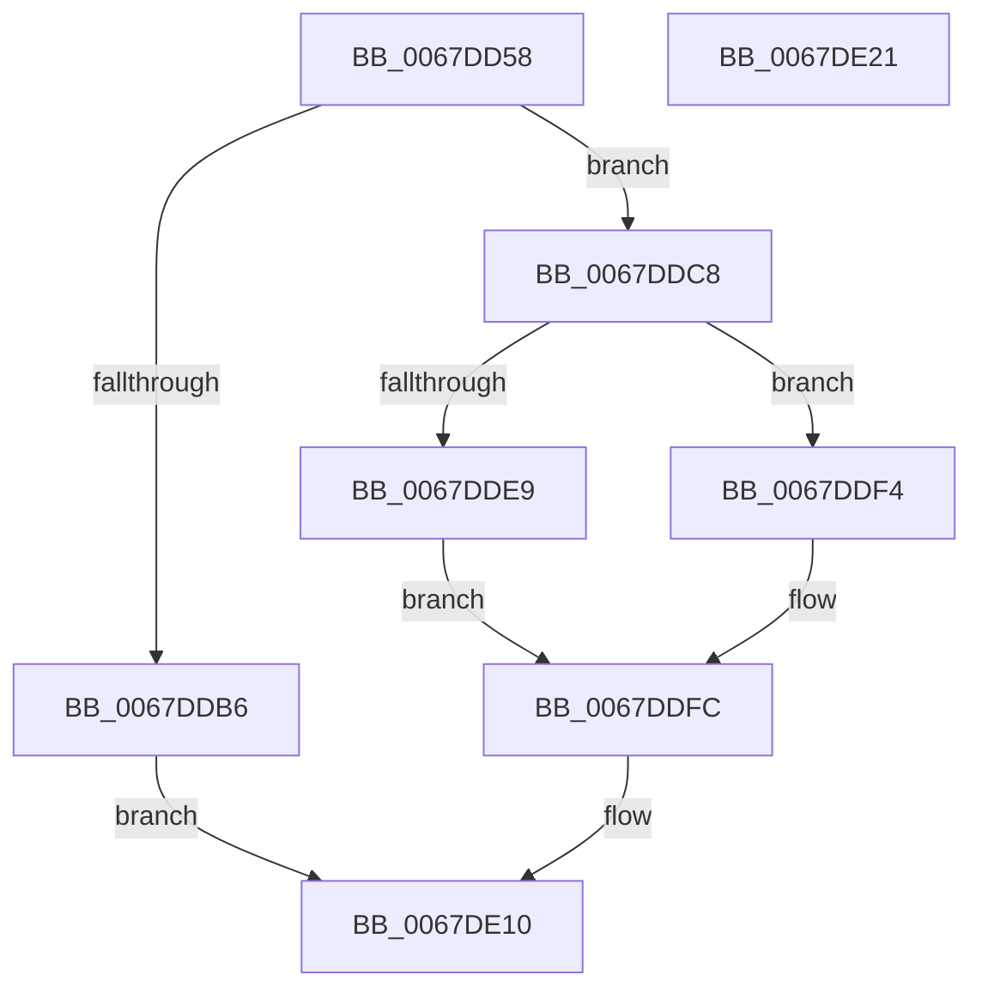

# MmRemoveSystemCacheFromDump

- RVA: `0x0067DD58`–`0x0067DE22` (길이 `202` bytes)
- VA: `0x000000014067DD58`
- 실행 섹션: `.text`
- PDB 이름 있음: `예`; PDB Function 태그: `아니요`
- unwind 정보 RVA: `0x000D7F3C`
- 디코드: `49`개 명령, `202/202` bytes 표시
- 미해석 바이트: `0` (있으면 어셈블리에 `.byte`로 보존)

> 이 문서는 커널 이미지의 기계어와 PDB 기호를 분석해 생성했습니다. 4번과 5번은 함수 원형과 자료형을 바이너리 사용 방식에서 추정한 C 해석이며 원본 소스 복구 결과는 아닙니다.

## 1. Dependencies

- 직접 호출 지점: **8**; 고유 호출 대상: **7**
- 직접 호출자로 확인된 함수: **2**
- RIP 상대 이미지 참조: **1**

### Outgoing calls
- `0x0067DD79` → [memset](../6C/memset_function_006C6C40.md) (function, `0x006C6C40`)
- `0x0067DDAD` → [MiSystemInSingleProcessorMode](MiSystemInSingleProcessorMode_function_00673D40.md) (function, `0x00673D40`)
- `0x0067DDC1` → [MiWalkPageTables](../2C/MiWalkPageTables_function_002C2710.md) (function, `0x002C2710`)
- `0x0067DDCA` → [MiGetAnyMultiplexedVm](../44/MiGetAnyMultiplexedVm_function_00448BD0.md) (function, `0x00448BD0`)
- `0x0067DDED` → [MiLockWorkingSetSharedAtDpc](../23/MiLockWorkingSetSharedAtDpc_function_00239574.md) (function, `0x00239574`)
- `0x0067DDF4` → [MiLockWorkingSetShared](../27/MiLockWorkingSetShared_function_0027CBF0.md) (function, `0x0027CBF0`)
- `0x0067DE00` → [MiWalkPageTables](../2C/MiWalkPageTables_function_002C2710.md) (function, `0x002C2710`)
- `0x0067DE0B` → [MiUnlockWorkingSetShared](../27/MiUnlockWorkingSetShared_function_0027D690.md) (function, `0x0027D690`)

### Direct callers
- [IopLiveDumpRemoveSystemCacheFromDump](../59/IopLiveDumpRemoveSystemCacheFromDump_function_0059E1B0.md) at `0x0059E214`
- [MmGetDumpRange](MmGetDumpRange_function_0067DA68.md) at `0x0067DB49`

### Static image references
- `0x0067DD83` → RVA `0x0067D430` (`MiCrashdumpRemovePte`; read)

## 2. Other-region calls and transfers

- 다른 실행 섹션으로 향하는 call: **0**
- 별도 외부 분기/꼬리 이동을 확인하지 못했습니다.

## 3. Assembly (complete function range)

```asm
0067DD58  48 89 5C 24 08                  mov qword ptr [rsp + 8], rbx
0067DD5D  55                              push rbp
0067DD5E  48 8D 6C 24 A9                  lea rbp, [rsp - 0x57]
0067DD63  48 81 EC F0 00 00 00            sub rsp, 0xf0
0067DD6A  48 8B D9                        mov rbx, rcx
0067DD6D  33 D2                           xor edx, edx
0067DD6F  48 8D 4D 97                     lea rcx, [rbp - 0x69]
0067DD73  41 B8 C0 00 00 00               mov r8d, 0xc0
0067DD79  E8 C2 8E 04 00                  call 0x1406c6c40
0067DD7E  48 83 65 8F 00                  and qword ptr [rbp - 0x71], 0
0067DD83  48 8D 05 A6 F6 FF FF            lea rax, [rip - 0x95a]
0067DD8A  48 83 4D C7 FF                  or qword ptr [rbp - 0x39], 0xffffffffffffffff
0067DD8F  48 89 45 3F                     mov qword ptr [rbp + 0x3f], rax
0067DD93  48 B8 00 00 00 00 00 80 FF FF   movabs rax, 0xffff800000000000
0067DD9D  48 89 45 BF                     mov qword ptr [rbp - 0x41], rax
0067DDA1  48 8D 45 87                     lea rax, [rbp - 0x79]
0067DDA5  48 89 45 4F                     mov qword ptr [rbp + 0x4f], rax
0067DDA9  48 89 5D 87                     mov qword ptr [rbp - 0x79], rbx
0067DDAD  E8 8E 5F FF FF                  call 0x140673d40
0067DDB2  85 C0                           test eax, eax
0067DDB4  74 12                           je 0x14067ddc8
0067DDB6  48 8D 4D 97                     lea rcx, [rbp - 0x69]
0067DDBA  C7 45 97 00 26 02 00            mov dword ptr [rbp - 0x69], 0x22600
0067DDC1  E8 4A 49 C4 FF                  call 0x1402c2710
0067DDC6  EB 48                           jmp 0x14067de10
0067DDC8  33 C9                           xor ecx, ecx
0067DDCA  E8 01 AE DC FF                  call 0x140448bd0
0067DDCF  48 8B D8                        mov rbx, rax
0067DDD2  48 89 45 B7                     mov qword ptr [rbp - 0x49], rax
0067DDD6  C7 45 97 06 00 00 00            mov dword ptr [rbp - 0x69], 6
0067DDDD  44 0F 20 C1                     mov rcx, cr8
0067DDE1  80 F9 02                        cmp cl, 2
0067DDE4  48 8B C8                        mov rcx, rax
0067DDE7  75 0B                           jne 0x14067ddf4
0067DDE9  C6 45 A0 11                     mov byte ptr [rbp - 0x60], 0x11
0067DDED  E8 82 B7 BB FF                  call 0x140239574
0067DDF2  EB 08                           jmp 0x14067ddfc
0067DDF4  E8 F7 ED BF FF                  call 0x14027cbf0
0067DDF9  88 45 A0                        mov byte ptr [rbp - 0x60], al
0067DDFC  48 8D 4D 97                     lea rcx, [rbp - 0x69]
0067DE00  E8 0B 49 C4 FF                  call 0x1402c2710
0067DE05  8A 55 A0                        mov dl, byte ptr [rbp - 0x60]
0067DE08  48 8B CB                        mov rcx, rbx
0067DE0B  E8 80 F8 BF FF                  call 0x14027d690
0067DE10  48 8B 9C 24 00 01 00 00         mov rbx, qword ptr [rsp + 0x100]
0067DE18  48 81 C4 F0 00 00 00            add rsp, 0xf0
0067DE1F  5D                              pop rbp
0067DE20  C3                              ret
0067DE21  CC                              int3
```

## 4. C-style interpretation (structured pseudocode)

```c
__int64 __fastcall MmRemoveSystemCacheFromDump(__int64 a1, int a2)
{
    __int64 result;
    __int64 v_rsp;
    unsigned __int64 v_stack_m10;
    unsigned __int64 v_stack_m20;
    unsigned __int64 v_stack_m5F;
    unsigned __int64 v_stack_m98;
    unsigned __int64 v_stack_mA0;
    unsigned __int64 v_stack_mA8;
    unsigned __int8 v_stack_mBF;
    unsigned __int64 v_stack_mC8;
    unsigned __int64 v_stack_mD0;
    unsigned __int64 v_stack_mD8;
    unsigned __int64 v_stack_p8;

    v_stack_p8 = v_rbx;
    v_rsp = (v_rsp) - (240);
    a2 = 0;
    result = memset(v_stack_mC8, a2, 192, a4);
    v_stack_m20 = v_rip - 2394;
    v_stack_mA0 = v_rip - 2394;
    v_stack_m10 = v_stack_mD8;
    v_stack_mD8 = a1;
    result = MiSystemInSingleProcessorMode(v_stack_mC8, a2, 192, a4);
    if ((unsigned int)(result) == 0) goto loc_0067DDC8;
    v_stack_mC8 = 0x22600ULL;
    result = MiWalkPageTables(v_stack_mC8, a2, 192, a4);
    goto loc_0067DE10;
loc_0067DDC8:
    a1 = 0;
    result = MiGetAnyMultiplexedVm(a1, a2, 192, a4);
    v_stack_mA8 = result;
    v_stack_mC8 = 6;
    if (((unsigned __int8)(v_cr8)) != 2) goto loc_0067DDF4;
    v_stack_mBF = 17;
    result = MiLockWorkingSetSharedAtDpc(result, a2, 192, a4);
    goto loc_0067DDFC;
loc_0067DDF4:
    result = MiLockWorkingSetShared(result, a2, 192, a4);
    v_stack_mBF = (unsigned __int8)(result);
loc_0067DDFC:
    result = MiWalkPageTables(v_stack_mC8, a2, 192, a4);
    result = MiUnlockWorkingSetShared(result, v_stack_mBF, 192, a4);
loc_0067DE10:
    v_rsp = (v_rsp) + (240);
    return result;
}
```

## 5. (Beta) C Style

```c
int64_t MmRemoveSystemCacheFromDump(int64_t Arg1, int32_t Arg2)
{
    int64_t result;
    int64_t local_rsp;
    uint64_t v_stack_m10;
    uint64_t v_stack_m20;
    uint64_t v_stack_m5F;
    uint64_t v_stack_m98;
    uint64_t v_stack_mA0;
    uint64_t v_stack_mA8;
    uint8_t v_stack_mBF;
    uint64_t v_stack_mC8;
    uint64_t v_stack_mD0;
    uint64_t v_stack_mD8;
    uint64_t v_stack_p8;

    v_stack_p8 = local_rbx;
    local_rsp = (local_rsp) - (240);
    Arg2 = 0;
    result = memset(v_stack_mC8, Arg2, 192, a4);
    v_stack_m20 = v_rip - 2394;
    v_stack_mA0 = v_rip - 2394;
    v_stack_m10 = v_stack_mD8;
    v_stack_mD8 = Arg1;
    result = MiSystemInSingleProcessorMode(v_stack_mC8, Arg2, 192, a4);
    if ((uint32_t)(result) == 0) goto loc_0067DDC8;
    v_stack_mC8 = 0x22600ULL;
    result = MiWalkPageTables(v_stack_mC8, Arg2, 192, a4);
    goto loc_0067DE10;
loc_0067DDC8:
    Arg1 = 0;
    result = MiGetAnyMultiplexedVm(Arg1, Arg2, 192, a4);
    v_stack_mA8 = result;
    v_stack_mC8 = 6;
    if (((uint8_t)(v_cr8)) != 2) goto loc_0067DDF4;
    v_stack_mBF = 17;
    result = MiLockWorkingSetSharedAtDpc(result, Arg2, 192, a4);
    goto loc_0067DDFC;
loc_0067DDF4:
    result = MiLockWorkingSetShared(result, Arg2, 192, a4);
    v_stack_mBF = (uint8_t)(result);
loc_0067DDFC:
    result = MiWalkPageTables(v_stack_mC8, Arg2, 192, a4);
    result = MiUnlockWorkingSetShared(result, v_stack_mBF, 192, a4);
loc_0067DE10:
    local_rsp = (local_rsp) + (240);
    return result;
}
```

## 6. Execution-region graph

[열기: 2D/3D 그래프와 함수 탐색 컨트롤 패널](../../../control-panel.html?section=text&rva=0x0067DD58&view=graph)

- 2D 그래프는 위에서 아래로 흐르고, 3D 그래프는 빈 공간을 드래그해 회전합니다. Shift+드래그는 이동, 휠은 확대·축소, 함수 노드 선택은 대상 보고서 이동입니다.

### Static fallback


