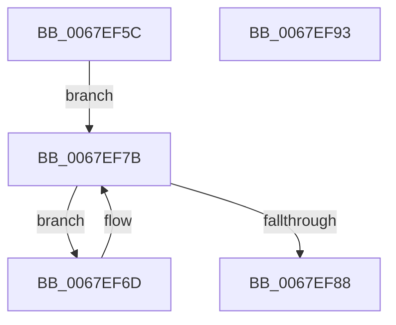

# MmSetTrimWhileAgingState

- RVA: `0x0067EF5C`–`0x0067EF94` (길이 `56` bytes)
- VA: `0x000000014067EF5C`
- 실행 섹션: `.text`
- PDB 이름 있음: `예`; PDB Function 태그: `아니요`
- unwind 정보 RVA: `0x0005CAAC`
- 디코드: `19`개 명령, `56/56` bytes 표시
- 미해석 바이트: `0` (있으면 어셈블리에 `.byte`로 보존)

> 이 문서는 커널 이미지의 기계어와 PDB 기호를 분석해 생성했습니다. 4번과 5번은 함수 원형과 자료형을 바이너리 사용 방식에서 추정한 C 해석이며 원본 소스 복구 결과는 아닙니다.

## 1. Dependencies

- 직접 호출 지점: **2**; 고유 호출 대상: **2**
- 직접 호출자로 확인된 함수: **1**
- RIP 상대 이미지 참조: **0**

### Outgoing calls
- `0x0067EF73` → [MiSetTrimWhileAgingState](MiSetTrimWhileAgingState_function_0067ED14.md) (function, `0x0067ED14`)
- `0x0067EF7B` → [PsGetNextPartition](../3B/PsGetNextPartition_function_003B9D5C.md) (function, `0x003B9D5C`)

### Direct callers
- [PfSetSuperfetchInformation](../../page/AD/PfSetSuperfetchInformation_function_00ADE6E8.md) at `0x00ADEEC3`

### Static image references
- 디코드된 RIP-relative 메모리 참조가 없습니다.

## 2. Other-region calls and transfers

- 다른 실행 섹션으로 향하는 call: **0**
- 별도 외부 분기/꼬리 이동을 확인하지 못했습니다.

## 3. Assembly (complete function range)

```asm
0067EF5C  48 89 5C 24 08                  mov qword ptr [rsp + 8], rbx
0067EF61  57                              push rdi
0067EF62  48 83 EC 20                     sub rsp, 0x20
0067EF66  48 8B F9                        mov rdi, rcx
0067EF69  33 C9                           xor ecx, ecx
0067EF6B  EB 0E                           jmp 0x14067ef7b
0067EF6D  48 8B 0B                        mov rcx, qword ptr [rbx]
0067EF70  48 8B D7                        mov rdx, rdi
0067EF73  E8 9C FD FF FF                  call 0x14067ed14
0067EF78  48 8B CB                        mov rcx, rbx
0067EF7B  E8 DC AD D3 FF                  call 0x1403b9d5c
0067EF80  48 8B D8                        mov rbx, rax
0067EF83  48 85 C0                        test rax, rax
0067EF86  75 E5                           jne 0x14067ef6d
0067EF88  48 8B 5C 24 30                  mov rbx, qword ptr [rsp + 0x30]
0067EF8D  48 83 C4 20                     add rsp, 0x20
0067EF91  5F                              pop rdi
0067EF92  C3                              ret
0067EF93  CC                              int3
```

## 4. C-style interpretation (structured pseudocode)

```c
__int64 __fastcall MmSetTrimWhileAgingState(__int64 a1)
{
    __int64 result;
    __int64 v_rsp;
    unsigned __int64 v_stack_p8;

    v_stack_p8 = v_rbx;
    v_rsp = (v_rsp) - (32);
    a1 = 0;
    goto loc_0067EF7B;
loc_0067EF6D:
    result = MiSetTrimWhileAgingState(*(unsigned __int64 *)(v_rbx), 0, a3, a4);
loc_0067EF7B:
    result = PsGetNextPartition(v_rbx, 0, a3, a4);
    if (result != 0) goto loc_0067EF6D;
    v_rsp = (v_rsp) + (32);
    return result;
}
```

## 5. (Beta) C Style

```c
int64_t MmSetTrimWhileAgingState(int64_t Arg1)
{
    int64_t result;
    int64_t local_rsp;
    uint64_t v_stack_p8;

    v_stack_p8 = local_rbx;
    local_rsp = (local_rsp) - (32);
    Arg1 = 0;
    goto loc_0067EF7B;
loc_0067EF6D:
    result = MiSetTrimWhileAgingState(*(uint64_t *)(local_rbx), 0, a3, a4);
loc_0067EF7B:
    result = PsGetNextPartition(local_rbx, 0, a3, a4);
    if (result != 0) goto loc_0067EF6D;
    local_rsp = (local_rsp) + (32);
    return result;
}
```

## 6. Execution-region graph

[열기: 2D/3D 그래프와 함수 탐색 컨트롤 패널](../../../control-panel.html?section=text&rva=0x0067EF5C&view=graph)

- 2D 그래프는 위에서 아래로 흐르고, 3D 그래프는 빈 공간을 드래그해 회전합니다. Shift+드래그는 이동, 휠은 확대·축소, 함수 노드 선택은 대상 보고서 이동입니다.

### Static fallback


