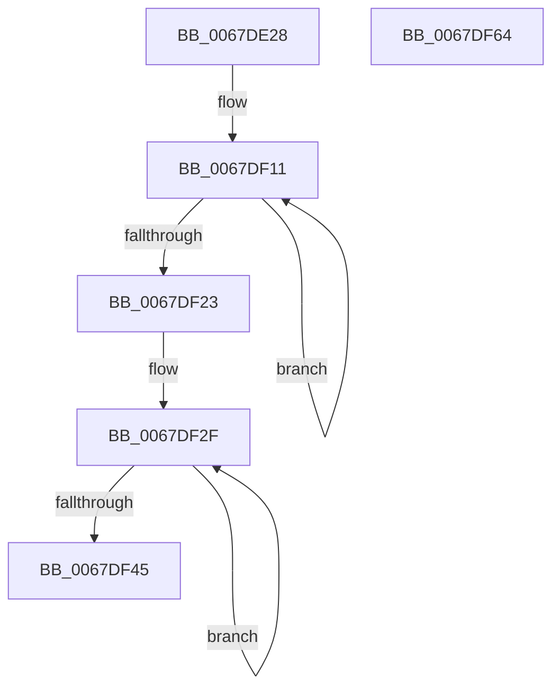

# MmSnapTriageDumpInformation

- RVA: `0x0067DE28`–`0x0067DF65` (길이 `317` bytes)
- VA: `0x000000014067DE28`
- 실행 섹션: `.text`
- PDB 이름 있음: `예`; PDB Function 태그: `아니요`
- unwind 정보 RVA: `0x00060BC4`
- 디코드: `63`개 명령, `317/317` bytes 표시
- 미해석 바이트: `0` (있으면 어셈블리에 `.byte`로 보존)

> 이 문서는 커널 이미지의 기계어와 PDB 기호를 분석해 생성했습니다. 4번과 5번은 함수 원형과 자료형을 바이너리 사용 방식에서 추정한 C 해석이며 원본 소스 복구 결과는 아닙니다.

## 1. Dependencies

- 직접 호출 지점: **6**; 고유 호출 대상: **3**
- 직접 호출자로 확인된 함수: **3**
- RIP 상대 이미지 참조: **26**

### Outgoing calls
- `0x0067DE49` → [IoAddTriageDumpDataBlock](../42/IoAddTriageDumpDataBlock_function_00428374.md) (function, `0x00428374`)
- `0x0067DE5A` → [IoAddTriageDumpDataBlock](../42/IoAddTriageDumpDataBlock_function_00428374.md) (function, `0x00428374`)
- `0x0067DF07` → [HvlQueryVsmConnection](../45/HvlQueryVsmConnection_function_0045D180.md) (function, `0x0045D180`)
- `0x0067DF14` → [MiAddTriageDumpPtes](MiAddTriageDumpPtes_function_0067D308.md) (function, `0x0067D308`)
- `0x0067DF36` → [MiAddTriageDumpPtes](MiAddTriageDumpPtes_function_0067D308.md) (function, `0x0067D308`)
- `0x0067DF4F` → [IoAddTriageDumpDataBlock](../42/IoAddTriageDumpDataBlock_function_00428374.md) (function, `0x00428374`)

### Direct callers
- [IoWriteCrashDump](../59/IoWriteCrashDump_function_005936D8.md) at `0x005937C5`
- [IopCollectTriageDumpData](../59/IopCollectTriageDumpData_function_00594754.md) at `0x005947D6`
- [IopWriteCapsuleTriageDumpToFirmware](../59/IopWriteCapsuleTriageDumpToFirmware_function_005967AC.md) at `0x00596847`

### Static image references
- `0x0067DE42` → RVA `0x00E2CB40` (`.data`; read)
- `0x0067DE53` → RVA `0x00E38D00` (`.data`; read)
- `0x0067DE61` → RVA `0x00EF5118` (`.data`; read)
- `0x0067DE68` → RVA `0x00EF5108` (`.data`; write)
- `0x0067DE6F` → RVA `0x00EF5110` (`.data`; write)
- `0x0067DE76` → RVA `0x00EF50FC` (`.data`; write)
- `0x0067DE7C` → RVA `0x00EF5118` (`.data`; write)
- `0x0067DE83` → RVA `0x00E3A880` (`.data`; read)
- `0x0067DE8A` → RVA `0x00EF50E0` (`.data`; write)
- `0x0067DE91` → RVA `0x00E30278` (`.data`; read)
- `0x0067DE97` → RVA `0x00EF50E8` (`.data`; write)
- `0x0067DE9D` → RVA `0x00E30274` (`.data`; read)
- `0x0067DEA3` → RVA `0x00E30260` (`.data`; read)
- `0x0067DEA9` → RVA `0x00E3025C` (`.data`; read)
- `0x0067DEAF` → RVA `0x00E30258` (`.data`; read)
- `0x0067DEB5` → RVA `0x00EF50EC` (`.data`; write)
- `0x0067DEBB` → RVA `0x00E302A0` (`.data`; read)
- `0x0067DEC1` → RVA `0x00EF50F0` (`.data`; write)
- `0x0067DEC7` → RVA `0x00E302A4` (`.data`; read)
- `0x0067DECD` → RVA `0x00EF50F4` (`.data`; write)
- `0x0067DED3` → RVA `0x00FC6B30` (`ALMOSTRO`; read)
- `0x0067DEDA` → RVA `0x00EF5100` (`.data`; write)
- `0x0067DEEB` → RVA `0x00EF50F8` (`.data`; write)
- `0x0067DEF9` → RVA `0x00FC6A88` (`ALMOSTRO`; read)
- `0x0067DF23` → RVA `0x000277A8` (`.rdata`; read)
- `0x0067DF48` → RVA `0x00EF50E0` (`.data`; read)

## 2. Other-region calls and transfers

- 다른 실행 섹션으로 향하는 call: **0**
- 별도 외부 분기/꼬리 이동을 확인하지 못했습니다.

## 3. Assembly (complete function range)

```asm
0067DE28  48 89 5C 24 08                  mov qword ptr [rsp + 8], rbx
0067DE2D  48 89 74 24 10                  mov qword ptr [rsp + 0x10], rsi
0067DE32  57                              push rdi
0067DE33  48 83 EC 20                     sub rsp, 0x20
0067DE37  48 8B DA                        mov rbx, rdx
0067DE3A  48 8B F1                        mov rsi, rcx
0067DE3D  BA C0 C1 00 00                  mov edx, 0xc1c0
0067DE42  48 8D 0D F7 EC 7A 00            lea rcx, [rip + 0x7aecf7]
0067DE49  E8 26 A5 DA FF                  call 0x140428374
0067DE4E  BA 40 5D 00 00                  mov edx, 0x5d40
0067DE53  48 8D 0D A6 AE 7B 00            lea rcx, [rip + 0x7baea6]
0067DE5A  E8 15 A5 DA FF                  call 0x140428374
0067DE5F  33 C0                           xor eax, eax
0067DE61  48 8D 0D B0 72 87 00            lea rcx, [rip + 0x8772b0]
0067DE68  48 89 05 99 72 87 00            mov qword ptr [rip + 0x877299], rax
0067DE6F  48 89 05 9A 72 87 00            mov qword ptr [rip + 0x87729a], rax
0067DE76  89 05 80 72 87 00               mov dword ptr [rip + 0x877280], eax
0067DE7C  48 89 05 95 72 87 00            mov qword ptr [rip + 0x877295], rax
0067DE83  48 8B 05 F6 C9 7B 00            mov rax, qword ptr [rip + 0x7bc9f6]
0067DE8A  48 89 05 4F 72 87 00            mov qword ptr [rip + 0x87724f], rax
0067DE91  8B 05 E1 23 7B 00               mov eax, dword ptr [rip + 0x7b23e1]
0067DE97  89 05 4B 72 87 00               mov dword ptr [rip + 0x87724b], eax
0067DE9D  8B 05 D1 23 7B 00               mov eax, dword ptr [rip + 0x7b23d1]
0067DEA3  8B 15 B7 23 7B 00               mov edx, dword ptr [rip + 0x7b23b7]
0067DEA9  03 15 AD 23 7B 00               add edx, dword ptr [rip + 0x7b23ad]
0067DEAF  03 15 A3 23 7B 00               add edx, dword ptr [rip + 0x7b23a3]
0067DEB5  89 05 31 72 87 00               mov dword ptr [rip + 0x877231], eax
0067DEBB  8B 05 DF 23 7B 00               mov eax, dword ptr [rip + 0x7b23df]
0067DEC1  89 05 29 72 87 00               mov dword ptr [rip + 0x877229], eax
0067DEC7  8B 05 D7 23 7B 00               mov eax, dword ptr [rip + 0x7b23d7]
0067DECD  89 05 21 72 87 00               mov dword ptr [rip + 0x877221], eax
0067DED3  48 8B 05 56 8C 94 00            mov rax, qword ptr [rip + 0x948c56]
0067DEDA  48 89 05 1F 72 87 00            mov qword ptr [rip + 0x87721f], rax
0067DEE1  48 B8 40 02 00 00 80 F7 FF FF   movabs rax, 0xfffff78000000240
0067DEEB  89 15 07 72 87 00               mov dword ptr [rip + 0x877207], edx
0067DEF1  8B 00                           mov eax, dword ptr [rax]
0067DEF3  89 05 0F 72 87 00               mov dword ptr [rip + 0x87720f], eax
0067DEF9  48 8B 05 88 8B 94 00            mov rax, qword ptr [rip + 0x948b88]
0067DF00  48 89 05 09 72 87 00            mov qword ptr [rip + 0x877209], rax
0067DF07  E8 74 F2 DD FF                  call 0x14045d180
0067DF0C  BF 04 00 00 00                  mov edi, 4
0067DF11  48 8B 0B                        mov rcx, qword ptr [rbx]
0067DF14  E8 EF F3 FF FF                  call 0x14067d308
0067DF19  48 8D 5B 08                     lea rbx, [rbx + 8]
0067DF1D  48 83 EF 01                     sub rdi, 1
0067DF21  75 EE                           jne 0x14067df11
0067DF23  48 8D 1D 7E 98 9A FF            lea rbx, [rip - 0x656782]
0067DF2A  BF 0F 00 00 00                  mov edi, 0xf
0067DF2F  0F B7 0B                        movzx ecx, word ptr [rbx]
0067DF32  48 8B 0C 31                     mov rcx, qword ptr [rcx + rsi]
0067DF36  E8 CD F3 FF FF                  call 0x14067d308
0067DF3B  48 8D 5B 02                     lea rbx, [rbx + 2]
0067DF3F  48 83 EF 01                     sub rdi, 1
0067DF43  75 EA                           jne 0x14067df2f
0067DF45  8D 57 40                        lea edx, [rdi + 0x40]
0067DF48  48 8D 0D 91 71 87 00            lea rcx, [rip + 0x877191]
0067DF4F  E8 20 A4 DA FF                  call 0x140428374
0067DF54  48 8B 5C 24 30                  mov rbx, qword ptr [rsp + 0x30]
0067DF59  48 8B 74 24 38                  mov rsi, qword ptr [rsp + 0x38]
0067DF5E  48 83 C4 20                     add rsp, 0x20
0067DF62  5F                              pop rdi
0067DF63  C3                              ret
0067DF64  CC                              int3
```

## 4. C-style interpretation (structured pseudocode)

```c
__int64 __fastcall MmSnapTriageDumpInformation(__int64 a1, __int64 a2)
{
    __int64 result;
    __int64 v_rdi;
    __int64 v_rsp;
    unsigned __int64 v_stack_p10;
    unsigned __int64 v_stack_p8;

    v_stack_p8 = v_rbx;
    v_stack_p10 = v_rsi;
    v_rsp = (v_rsp) - (32);
    result = IoAddTriageDumpDataBlock(v_rip + 8056055, (unsigned int)(0xC1C0ULL), a3, a4);
    result = IoAddTriageDumpDataBlock(v_rip + 8105638, (unsigned int)(0x5D40ULL), a3, a4);
    result = 0;
    *(unsigned __int64 *)(v_rip + 8876697) = 0;
    *(unsigned __int64 *)(v_rip + 8876698) = 0;
    *(unsigned int *)(v_rip + 8876672) = 0;
    *(unsigned __int64 *)(v_rip + 8876693) = 0;
    *(unsigned __int64 *)(v_rip + 8876623) = *(unsigned __int64 *)(v_rip + 8112630);
    *(unsigned int *)(v_rip + 8876619) = (unsigned int)((unsigned int)(*(unsigned int *)(v_rip + 8070113)));
    a2 = (unsigned int)(((unsigned int)(*(unsigned int *)(v_rip + 8070071))) + (*(unsigned int *)(v_rip + 8070061)));
    a2 = (unsigned int)((a2) + (*(unsigned int *)(v_rip + 8070051)));
    *(unsigned int *)(v_rip + 8876593) = (unsigned int)((unsigned int)(*(unsigned int *)(v_rip + 8070097)));
    *(unsigned int *)(v_rip + 8876585) = (unsigned int)((unsigned int)(*(unsigned int *)(v_rip + 8070111)));
    *(unsigned int *)(v_rip + 8876577) = (unsigned int)((unsigned int)(*(unsigned int *)(v_rip + 8070103)));
    *(unsigned __int64 *)(v_rip + 8876575) = *(unsigned __int64 *)(v_rip + 9735254);
    *(unsigned int *)(v_rip + 8876551) = (unsigned int)(a2);
    *(unsigned int *)(v_rip + 8876559) = (unsigned int)((unsigned int)(*(unsigned int *)(*(unsigned __int64 *)(v_rip + 9735254))));
    *(unsigned __int64 *)(v_rip + 8876553) = *(unsigned __int64 *)(v_rip + 9735048);
    result = HvlQueryVsmConnection(v_rip + 8876720, a2, a3, a4);
loc_0067DF11:
    result = MiAddTriageDumpPtes(*(unsigned __int64 *)(a2), a2, a3, a4);
    v_rdi = (4) - (1);
    if (condition_is_not_equal) goto loc_0067DF11;
loc_0067DF2F:
    result = MiAddTriageDumpPtes(*(unsigned __int64 *)(*(unsigned __int16 *)(v_rip - 6645634) + a1 * 1), a2, a3, a4);
    v_rdi = (15) - (1);
    if (condition_is_not_equal) goto loc_0067DF2F;
    result = IoAddTriageDumpDataBlock(v_rip + 8876433, v_rdi + 64, a3, a4);
    v_rsp = (v_rsp) + (32);
    return result;
}
```

## 5. (Beta) C Style

```c
int64_t MmSnapTriageDumpInformation(int64_t Arg1, void *Arg2)
{
    uint8_t *arg2 = (uint8_t *)Arg2;

    int64_t result;
    int64_t local_rdi;
    int64_t local_rsp;
    uint64_t v_stack_p10;
    uint64_t v_stack_p8;

    v_stack_p8 = local_rbx;
    v_stack_p10 = local_rsi;
    local_rsp = (local_rsp) - (32);
    result = IoAddTriageDumpDataBlock(v_rip + 8056055, (uint32_t)(0xC1C0ULL), a3, a4);
    result = IoAddTriageDumpDataBlock(v_rip + 8105638, (uint32_t)(0x5D40ULL), a3, a4);
    result = 0;
    *(uint64_t *)(v_rip + 0x877299) = 0;
    *(uint64_t *)(v_rip + 0x87729A) = 0;
    *(uint32_t *)(v_rip + 0x877280) = 0;
    *(uint64_t *)(v_rip + 0x877295) = 0;
    *(uint64_t *)(v_rip + 0x87724F) = *(uint64_t *)(v_rip + 0x7BC9F6);
    *(uint32_t *)(v_rip + 0x87724B) = (uint32_t)((uint32_t)(*(uint32_t *)(v_rip + 0x7B23E1)));
    Arg2 = (uint32_t)(((uint32_t)(*(uint32_t *)(v_rip + 0x7B23B7))) + (*(uint32_t *)(v_rip + 0x7B23AD)));
    Arg2 = (uint32_t)((Arg2) + (*(uint32_t *)(v_rip + 0x7B23A3)));
    *(uint32_t *)(v_rip + 0x877231) = (uint32_t)((uint32_t)(*(uint32_t *)(v_rip + 0x7B23D1)));
    *(uint32_t *)(v_rip + 0x877229) = (uint32_t)((uint32_t)(*(uint32_t *)(v_rip + 0x7B23DF)));
    *(uint32_t *)(v_rip + 0x877221) = (uint32_t)((uint32_t)(*(uint32_t *)(v_rip + 0x7B23D7)));
    *(uint64_t *)(v_rip + 0x87721F) = *(uint64_t *)(v_rip + 0x948C56);
    *(uint32_t *)(v_rip + 0x877207) = (uint32_t)(Arg2);
    *(uint32_t *)(v_rip + 0x87720F) = (uint32_t)((uint32_t)(*(uint32_t *)(*(uint64_t *)(v_rip + 0x948C56))));
    *(uint64_t *)(v_rip + 0x877209) = *(uint64_t *)(v_rip + 0x948B88);
    result = HvlQueryVsmConnection(v_rip + 8876720, Arg2, a3, a4);
loc_0067DF11:
    result = MiAddTriageDumpPtes(*(uint64_t *)(arg2), Arg2, a3, a4);
    local_rdi = (4) - (1);
    if (condition_is_not_equal) goto loc_0067DF11;
loc_0067DF2F:
    result = MiAddTriageDumpPtes(*(uint64_t *)(*(uint16_t *)(v_rip - 0x656782) + Arg1 * 1), Arg2, a3, a4);
    local_rdi = (15) - (1);
    if (condition_is_not_equal) goto loc_0067DF2F;
    result = IoAddTriageDumpDataBlock(v_rip + 8876433, local_rdi + 64, a3, a4);
    local_rsp = (local_rsp) + (32);
    return result;
}
```

### 관측된 메모리 오프셋

구조체 형식이 확인되지 않은 접근은 인자 기준의 오프셋으로만 기록했습니다.

| 기준 인자 | 오프셋 표현 | 폭 (bit) | 접근 |
|---|---:|---:|---|
| `Arg2` | `+ 0x0` | `64` | `R` |
| `Arg2` | `+ 0x8` | `64` | `R` |

## 6. Execution-region graph

[열기: 2D/3D 그래프와 함수 탐색 컨트롤 패널](../../../control-panel.html?section=text&rva=0x0067DE28&view=graph)

- 2D 그래프는 위에서 아래로 흐르고, 3D 그래프는 빈 공간을 드래그해 회전합니다. Shift+드래그는 이동, 휠은 확대·축소, 함수 노드 선택은 대상 보고서 이동입니다.

### Static fallback


