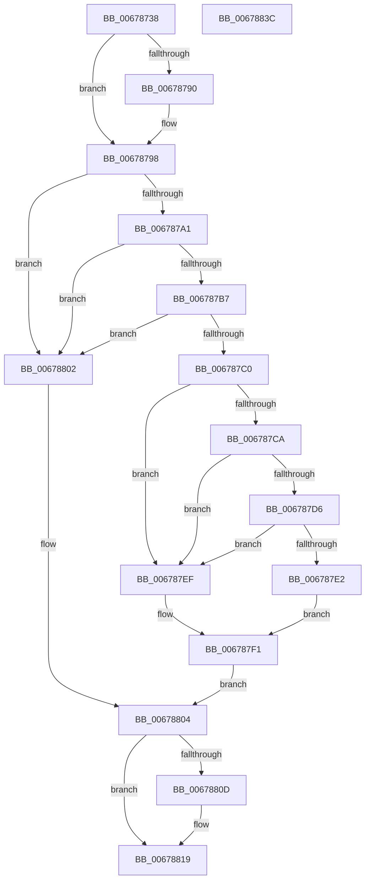

# MmTryIdentifyPage

- RVA: `0x00678738`–`0x0067883D` (길이 `261` bytes)
- VA: `0x0000000140678738`
- 실행 섹션: `.text`
- PDB 이름 있음: `예`; PDB Function 태그: `아니요`
- unwind 정보 RVA: `0x0006B074`
- 디코드: `72`개 명령, `261/261` bytes 표시
- 미해석 바이트: `0` (있으면 어셈블리에 `.byte`로 보존)

> 이 문서는 커널 이미지의 기계어와 PDB 기호를 분석해 생성했습니다. 4번과 5번은 함수 원형과 자료형을 바이너리 사용 방식에서 추정한 C 해석이며 원본 소스 복구 결과는 아닙니다.

## 1. Dependencies

- 직접 호출 지점: **5**; 고유 호출 대상: **5**
- 직접 호출자로 확인된 함수: **1**
- RIP 상대 이미지 참조: **2**

### Outgoing calls
- `0x00678793` → [KiRaiseIrqlProcessIrqlFlags](../4F/KiRaiseIrqlProcessIrqlFlags_function_004F56FC.md) (function, `0x004F56FC`)
- `0x006787CD` → [MiIsPageOnBadList](../2B/MiIsPageOnBadList_function_002B1018.md) (function, `0x002B1018`)
- `0x006787D9` → [MiIsPageSecured](../22/MiIsPageSecured_function_00228524.md) (function, `0x00228524`)
- `0x006787E8` → [MiIdentifyPfn](../31/MiIdentifyPfn_function_0031CAC0.md) (function, `0x0031CAC0`)
- `0x00678814` → [KiLowerIrqlProcessIrqlFlags](../4F/KiLowerIrqlProcessIrqlFlags_function_004F5698.md) (function, `0x004F5698`)

### Direct callers
- [IopLiveDumpMirrorPhysicalMemoryCallback](../59/IopLiveDumpMirrorPhysicalMemoryCallback_function_0059D260.md) at `0x0059D425`

### Static image references
- `0x00678787` → RVA `0x00FC6D20` (`ALMOSTRO`; read)
- `0x00678798` → RVA `0x00E2DCE0` (`.data`; read)

## 2. Other-region calls and transfers

- 다른 실행 섹션으로 향하는 call: **0**
- 별도 외부 분기/꼬리 이동을 확인하지 못했습니다.

## 3. Assembly (complete function range)

```asm
00678738  48 89 5C 24 10                  mov qword ptr [rsp + 0x10], rbx
0067873D  48 89 6C 24 18                  mov qword ptr [rsp + 0x18], rbp
00678742  48 89 74 24 20                  mov qword ptr [rsp + 0x20], rsi
00678747  57                              push rdi
00678748  41 56                           push r14
0067874A  41 57                           push r15
0067874C  48 83 EC 20                     sub rsp, 0x20
00678750  33 C0                           xor eax, eax
00678752  4C 8D 3C 49                     lea r15, [rcx + rcx*2]
00678756  0F 57 C0                        xorps xmm0, xmm0
00678759  48 8B EA                        mov rbp, rdx
0067875C  0F 11 02                        movups xmmword ptr [rdx], xmm0
0067875F  48 89 42 10                     mov qword ptr [rdx + 0x10], rax
00678763  4C 8B F1                        mov r14, rcx
00678766  BF 01 00 00 00                  mov edi, 1
0067876B  4D 03 FF                        add r15, r15
0067876E  48 B8 00 00 00 00 00 DE FF FF   movabs rax, 0xffffde0000000000
00678778  4A 8D 1C F8                     lea rbx, [rax + r15*8]
0067877C  44 0F 20 C6                     mov rsi, cr8
00678780  8D 57 01                        lea edx, [rdi + 1]
00678783  44 0F 22 C2                     mov cr8, rdx
00678787  83 3D 92 E5 94 00 00            cmp dword ptr [rip + 0x94e592], 0
0067878E  74 08                           je 0x140678798
00678790  40 8A CE                        mov cl, sil
00678793  E8 64 CF E7 FF                  call 0x1404f56fc
00678798  4C 3B 35 41 55 7B 00            cmp r14, qword ptr [rip + 0x7b5541]
0067879F  77 61                           ja 0x140678802
006787A1  48 B8 28 00 00 00 00 DE FF FF   movabs rax, 0xffffde0000000028
006787AB  4A 8B 04 F8                     mov rax, qword ptr [rax + r15*8]
006787AF  48 C1 E8 36                     shr rax, 0x36
006787B3  85 C7                           test edi, eax
006787B5  74 4B                           je 0x140678802
006787B7  F0 48 0F BA 6B 18 3F            lock bts qword ptr [rbx + 0x18], 0x3f
006787BE  72 42                           jb 0x140678802
006787C0  8B 43 20                        mov eax, dword ptr [rbx + 0x20]
006787C3  C1 E8 18                        shr eax, 0x18
006787C6  A8 40                           test al, 0x40
006787C8  75 25                           jne 0x1406787ef
006787CA  48 8B CB                        mov rcx, rbx
006787CD  E8 46 88 C3 FF                  call 0x1402b1018
006787D2  85 C0                           test eax, eax
006787D4  75 19                           jne 0x1406787ef
006787D6  48 8B CB                        mov rcx, rbx
006787D9  E8 46 FD BA FF                  call 0x140228524
006787DE  85 C0                           test eax, eax
006787E0  75 0D                           jne 0x1406787ef
006787E2  48 8B D5                        mov rdx, rbp
006787E5  49 8B CE                        mov rcx, r14
006787E8  E8 D3 42 CA FF                  call 0x14031cac0
006787ED  EB 02                           jmp 0x1406787f1
006787EF  33 FF                           xor edi, edi
006787F1  48 B8 FF FF FF FF FF FF FF 7F   movabs rax, 0x7fffffffffffffff
006787FB  F0 48 21 43 18                  lock and qword ptr [rbx + 0x18], rax
00678800  EB 02                           jmp 0x140678804
00678802  33 FF                           xor edi, edi
00678804  83 3D 15 E5 94 00 00            cmp dword ptr [rip + 0x94e515], 0
0067880B  74 0C                           je 0x140678819
0067880D  44 0F 20 C1                     mov rcx, cr8
00678811  40 8A D6                        mov dl, sil
00678814  E8 7F CE E7 FF                  call 0x1404f5698
00678819  40 0F B6 CE                     movzx ecx, sil
0067881D  44 0F 22 C1                     mov cr8, rcx
00678821  48 8B 5C 24 48                  mov rbx, qword ptr [rsp + 0x48]
00678826  8B C7                           mov eax, edi
00678828  48 8B 6C 24 50                  mov rbp, qword ptr [rsp + 0x50]
0067882D  48 8B 74 24 58                  mov rsi, qword ptr [rsp + 0x58]
00678832  48 83 C4 20                     add rsp, 0x20
00678836  41 5F                           pop r15
00678838  41 5E                           pop r14
0067883A  5F                              pop rdi
0067883B  C3                              ret
0067883C  CC                              int3
```

## 4. C-style interpretation (structured pseudocode)

```c
__int64 __fastcall MmTryIdentifyPage(__int64 a1, __int64 a2)
{
    __int64 result;
    __int64 v_r15;
    __int64 v_rdi;
    __int64 v_rsp;
    unsigned __int64 v_stack_p10;
    unsigned __int64 v_stack_p18;
    unsigned __int64 v_stack_p20;

    v_stack_p10 = v_rbx;
    v_stack_p18 = v_rbp;
    v_stack_p20 = v_rsi;
    v_rsp = (v_rsp) - (32);
    result = 0;
    *(unsigned __int64 *)(a2) = v_xmm0;
    *(unsigned __int64 *)(a2 + 16) = 0;
    v_r15 = (a1 + a1 * 2) + (a1 + a1 * 2);
    if ((*(unsigned int *)(v_rip + 9758098)) != 0) {
        a1 = (unsigned __int8)(v_cr8);
        result = KiRaiseIrqlProcessIrqlFlags(a1, 1 + 1, a3, a4);
    }
    if (a1 > (*(unsigned __int64 *)(v_rip + 8082753))) goto loc_00678802;
    result = (*(unsigned __int64 *)(result + v_r15 * 8)) >> (54);
    if (((1) & ((unsigned int)(result))) == 0) goto loc_00678802;
    if (condition_is_below) goto loc_00678802;
    result = (unsigned int)(((unsigned int)(*(unsigned int *)(result + v_r15 * 8 + 32))) >> (24));
    if ((((unsigned __int8)(result)) & (64)) != 0) goto loc_006787EF;
    result = MiIsPageOnBadList(result + v_r15 * 8, 1 + 1, a3, a4);
    if ((unsigned int)(result) != 0) goto loc_006787EF;
    result = MiIsPageSecured(result + v_r15 * 8, 1 + 1, a3, a4);
    if ((unsigned int)(result) != 0) goto loc_006787EF;
    result = MiIdentifyPfn(a1, a2, a3, a4);
    goto loc_006787F1;
loc_006787EF:
    v_rdi = 0;
loc_006787F1:
    goto loc_00678804;
loc_00678802:
    v_rdi = 0;
loc_00678804:
    if ((*(unsigned int *)(v_rip + 9757973)) != 0) {
        a1 = 1 + 1;
        a2 = (unsigned __int8)(v_cr8);
        result = KiLowerIrqlProcessIrqlFlags(a1, a2, a3, a4);
    }
    v_rsp = (v_rsp) + (32);
    return 0;
}
```

## 5. (Beta) C Style

```c
int64_t MmTryIdentifyPage(void *Arg1, void *Arg2)
{
    uint8_t *arg1 = (uint8_t *)Arg1;
    uint8_t *arg2 = (uint8_t *)Arg2;

    int64_t result;
    int64_t local_r15;
    int64_t local_rdi;
    int64_t local_rsp;
    uint64_t v_stack_p10;
    uint64_t v_stack_p18;
    uint64_t v_stack_p20;

    v_stack_p10 = local_rbx;
    v_stack_p18 = local_rbp;
    v_stack_p20 = local_rsi;
    local_rsp = (local_rsp) - (32);
    result = 0;
    *(uint64_t *)(arg2) = v_xmm0;
    *(uint64_t *)(arg2 + 0x10) = 0;
    local_r15 = (Arg1 + Arg1 * 2) + (Arg1 + Arg1 * 2);
    if ((*(uint32_t *)(v_rip + 0x94E592)) != 0) {
        Arg1 = (uint8_t)(v_cr8);
        result = KiRaiseIrqlProcessIrqlFlags(Arg1, 1 + 1, a3, a4);
    }
    if (Arg1 > (*(uint64_t *)(v_rip + 0x7B5541))) goto loc_00678802;
    result = (*(uint64_t *)(result + local_r15 * 8)) >> (54);
    if (((1) & ((uint32_t)(result))) == 0) goto loc_00678802;
    if (condition_is_below) goto loc_00678802;
    result = (uint32_t)(((uint32_t)(*(uint32_t *)(result + local_r15 * 8 + 0x20))) >> (24));
    if ((((uint8_t)(result)) & (64)) != 0) goto loc_006787EF;
    result = MiIsPageOnBadList(result + local_r15 * 8, 1 + 1, a3, a4);
    if ((uint32_t)(result) != 0) goto loc_006787EF;
    result = MiIsPageSecured(result + local_r15 * 8, 1 + 1, a3, a4);
    if ((uint32_t)(result) != 0) goto loc_006787EF;
    result = MiIdentifyPfn(Arg1, Arg2, a3, a4);
    goto loc_006787F1;
loc_006787EF:
    local_rdi = 0;
loc_006787F1:
    goto loc_00678804;
loc_00678802:
    local_rdi = 0;
loc_00678804:
    if ((*(uint32_t *)(v_rip + 0x94E515)) != 0) {
        Arg1 = 1 + 1;
        Arg2 = (uint8_t)(v_cr8);
        result = KiLowerIrqlProcessIrqlFlags(Arg1, Arg2, a3, a4);
    }
    local_rsp = (local_rsp) + (32);
    return 0;
}
```

### 관측된 메모리 오프셋

구조체 형식이 확인되지 않은 접근은 인자 기준의 오프셋으로만 기록했습니다.

| 기준 인자 | 오프셋 표현 | 폭 (bit) | 접근 |
|---|---:|---:|---|
| `Arg1` | `+ 0x0 + rcx*2` | `64` | `R` |
| `Arg2` | `+ 0x0` | `128` | `R` |
| `Arg2` | `+ 0x10` | `64` | `W` |

## 6. Execution-region graph

[열기: 2D/3D 그래프와 함수 탐색 컨트롤 패널](../../../control-panel.html?section=text&rva=0x00678738&view=graph)

- 2D 그래프는 위에서 아래로 흐르고, 3D 그래프는 빈 공간을 드래그해 회전합니다. Shift+드래그는 이동, 휠은 확대·축소, 함수 노드 선택은 대상 보고서 이동입니다.

### Static fallback


