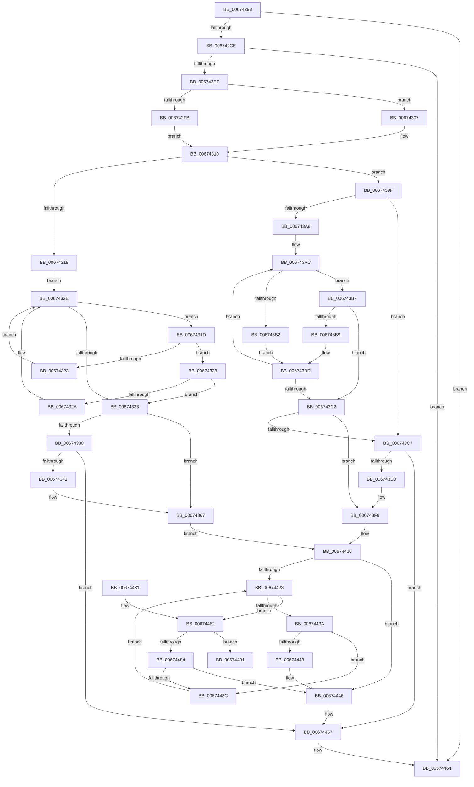

# MmUpdateMdlTrackerForMdlSwitch

- RVA: `0x00674298`–`0x006744B0` (길이 `536` bytes)
- VA: `0x0000000140674298`
- 실행 섹션: `.text`
- PDB 이름 있음: `예`; PDB Function 태그: `아니요`
- unwind 정보 RVA: `0x000D7BC4`
- 디코드: `151`개 명령, `536/536` bytes 표시
- 미해석 바이트: `0` (있으면 어셈블리에 `.byte`로 보존)

> 이 문서는 커널 이미지의 기계어와 PDB 기호를 분석해 생성했습니다. 4번과 5번은 함수 원형과 자료형을 바이너리 사용 방식에서 추정한 C 해석이며 원본 소스 복구 결과는 아닙니다.

## 1. Dependencies

- 직접 호출 지점: **14**; 고유 호출 대상: **9**
- 직접 호출자로 확인된 함수: **2**
- RIP 상대 이미지 참조: **4**

### Outgoing calls
- `0x00674300` → [ExAcquireSpinLockExclusiveAtDpcLevel](../24/ExAcquireSpinLockExclusiveAtDpcLevel_function_00248E80.md) (function, `0x00248E80`)
- `0x00674307` → [ExAcquireSpinLockExclusive](../24/ExAcquireSpinLockExclusive_function_00248690.md) (function, `0x00248690`)
- `0x00674344` → [MiReadProcessNumberOfLockedPages](../49/MiReadProcessNumberOfLockedPages_function_00494968.md) (function, `0x00494968`)
- `0x00674361` → [KeBugCheckEx](../4F/KeBugCheckEx_function_004FD660.md) (function, `0x004FD660`)
- `0x0067436D` → [MiValidateMdlTracker](../4B/MiValidateMdlTracker_function_004B894C.md) (function, `0x004B894C`)
- `0x00674386` → [RtlAvlRemoveNode](../29/RtlAvlRemoveNode_function_00296650.md) (function, `0x00296650`)
- `0x006743D3` → [MiReadProcessNumberOfLockedPages](../49/MiReadProcessNumberOfLockedPages_function_00494968.md) (function, `0x00494968`)
- `0x006743F2` → [KeBugCheckEx](../4F/KeBugCheckEx_function_004FD660.md) (function, `0x004FD660`)
- `0x00674402` → [MiValidateMdlTracker](../4B/MiValidateMdlTracker_function_004B894C.md) (function, `0x004B894C`)
- `0x0067440E` → [RtlAvlRemoveNode](../29/RtlAvlRemoveNode_function_00296650.md) (function, `0x00296650`)
- `0x00674431` → [guard_dispatch_icall](../6B/guard_dispatch_icall_function_006BAAD0.md) (function, `0x006BAAD0`)
- `0x00674452` → [RtlAvlInsertNodeEx](../26/RtlAvlInsertNodeEx_function_00265790.md) (function, `0x00265790`)
- `0x0067445F` → [MiReleaseSpinLockExclusive](../24/MiReleaseSpinLockExclusive_function_002482C0.md) (function, `0x002482C0`)
- `0x006744AA` → [KeBugCheckEx](../4F/KeBugCheckEx_function_004FD660.md) (function, `0x004FD660`)

### Direct callers
- [VmProbeAndLockPages](../64/VmProbeAndLockPages_function_0064C340.md) at `0x0064C3C5`
- [VmUnlockPages](../64/VmUnlockPages_function_0064C3F0.md) at `0x0064C430`

### Static image references
- `0x006742B4` → RVA `0x00FC6BBC` (`ALMOSTRO`; read)
- `0x006742D7` → RVA `0x00FC6AB0` (`ALMOSTRO`; read)
- `0x00674393` → RVA `0x00673E90` (`MiLockSwitchedMdlTrackerCompare`; read)
- `0x00674416` → RVA `0x0048E960` (`MiLockTrackerCompare`; read)

## 2. Other-region calls and transfers

- 다른 실행 섹션으로 향하는 call: **0**
- 별도 외부 분기/꼬리 이동을 확인하지 못했습니다.

## 3. Assembly (complete function range)

```asm
00674298  48 89 5C 24 08                  mov qword ptr [rsp + 8], rbx
0067429D  48 89 6C 24 10                  mov qword ptr [rsp + 0x10], rbp
006742A2  48 89 74 24 20                  mov qword ptr [rsp + 0x20], rsi
006742A7  57                              push rdi
006742A8  41 54                           push r12
006742AA  41 55                           push r13
006742AC  41 56                           push r14
006742AE  41 57                           push r15
006742B0  48 83 EC 30                     sub rsp, 0x30
006742B4  8B 05 02 29 95 00               mov eax, dword ptr [rip + 0x952902]
006742BA  41 BC 01 00 00 00               mov r12d, 1
006742C0  8B DA                           mov ebx, edx
006742C2  48 8B E9                        mov rbp, rcx
006742C5  41 84 C4                        test r12b, al
006742C8  0F 84 96 01 00 00               je 0x140674464
006742CE  4C 8B 71 10                     mov r14, qword ptr [rcx + 0x10]
006742D2  33 FF                           xor edi, edi
006742D4  4D 85 F6                        test r14, r14
006742D7  4C 0F 44 35 D1 27 95 00         cmove r14, qword ptr [rip + 0x9527d1]
006742DF  49 8B B6 98 03 00 00            mov rsi, qword ptr [r14 + 0x398]
006742E6  48 85 F6                        test rsi, rsi
006742E9  0F 84 75 01 00 00               je 0x140674464
006742EF  44 0F 20 C0                     mov rax, cr8
006742F3  48 8D 4E 18                     lea rcx, [rsi + 0x18]
006742F7  3C 02                           cmp al, 2
006742F9  75 0C                           jne 0x140674307
006742FB  C6 44 24 70 11                  mov byte ptr [rsp + 0x70], 0x11
00674300  E8 7B 4B BD FF                  call 0x140248e80
00674305  EB 09                           jmp 0x140674310
00674307  E8 84 43 BD FF                  call 0x140248690
0067430C  88 44 24 70                     mov byte ptr [rsp + 0x70], al
00674310  85 DB                           test ebx, ebx
00674312  0F 84 87 00 00 00               je 0x14067439f
00674318  48 8B 1E                        mov rbx, qword ptr [rsi]
0067431B  EB 11                           jmp 0x14067432e
0067431D  48 3B 6B 18                     cmp rbp, qword ptr [rbx + 0x18]
00674321  73 05                           jae 0x140674328
00674323  48 8B 1B                        mov rbx, qword ptr [rbx]
00674326  EB 06                           jmp 0x14067432e
00674328  76 09                           jbe 0x140674333
0067432A  48 8B 5B 08                     mov rbx, qword ptr [rbx + 8]
0067432E  48 85 DB                        test rbx, rbx
00674331  75 EA                           jne 0x14067431d
00674333  48 85 DB                        test rbx, rbx
00674336  75 2F                           jne 0x140674367
00674338  39 7E 1C                        cmp dword ptr [rsi + 0x1c], edi
0067433B  0F 84 16 01 00 00               je 0x140674457
00674341  49 8B CE                        mov rcx, r14
00674344  E8 1F 06 E2 FF                  call 0x140494968
00674349  4C 8B C8                        mov r9, rax
0067434C  8D 53 08                        lea edx, [rbx + 8]
0067434F  49 8B 86 98 03 00 00            mov rax, qword ptr [r14 + 0x398]
00674356  8D 4B 76                        lea ecx, [rbx + 0x76]
00674359  4C 8B C5                        mov r8, rbp
0067435C  48 89 44 24 20                  mov qword ptr [rsp + 0x20], rax
00674361  E8 FA 92 E8 FF                  call 0x1404fd660
00674366  CC                              int3
00674367  41 8B D4                        mov edx, r12d
0067436A  48 8B CB                        mov rcx, rbx
0067436D  E8 DA 45 E4 FF                  call 0x1404b894c
00674372  48 B8 FF FF FF FF FF FF FF 7F   movabs rax, 0x7fffffffffffffff
0067437C  48 8B D3                        mov rdx, rbx
0067437F  48 21 43 18                     and qword ptr [rbx + 0x18], rax
00674383  48 8B CE                        mov rcx, rsi
00674386  E8 C5 22 C2 FF                  call 0x140296650
0067438B  4C 8B 6D 30                     mov r13, qword ptr [rbp + 0x30]
0067438F  4C 8D 7E 08                     lea r15, [rsi + 8]
00674393  4C 8D 25 F6 FA FF FF            lea r12, [rip - 0x50a]
0067439A  E9 81 00 00 00                  jmp 0x140674420
0067439F  48 8B 5E 08                     mov rbx, qword ptr [rsi + 8]
006743A3  48 85 DB                        test rbx, rbx
006743A6  74 1F                           je 0x1406743c7
006743A8  48 8B 4D 30                     mov rcx, qword ptr [rbp + 0x30]
006743AC  48 3B 4B 40                     cmp rcx, qword ptr [rbx + 0x40]
006743B0  73 05                           jae 0x1406743b7
006743B2  48 8B 1B                        mov rbx, qword ptr [rbx]
006743B5  EB 06                           jmp 0x1406743bd
006743B7  76 09                           jbe 0x1406743c2
006743B9  48 8B 5B 08                     mov rbx, qword ptr [rbx + 8]
006743BD  48 85 DB                        test rbx, rbx
006743C0  75 EA                           jne 0x1406743ac
006743C2  48 85 DB                        test rbx, rbx
006743C5  75 31                           jne 0x1406743f8
006743C7  39 7E 1C                        cmp dword ptr [rsi + 0x1c], edi
006743CA  0F 84 87 00 00 00               je 0x140674457
006743D0  49 8B CE                        mov rcx, r14
006743D3  E8 90 05 E2 FF                  call 0x140494968
006743D8  BA 09 00 00 00                  mov edx, 9
006743DD  4C 8B C8                        mov r9, rax
006743E0  49 8B 86 98 03 00 00            mov rax, qword ptr [r14 + 0x398]
006743E7  4C 8B C5                        mov r8, rbp
006743EA  48 89 44 24 20                  mov qword ptr [rsp + 0x20], rax
006743EF  8D 4A 6D                        lea ecx, [rdx + 0x6d]
006743F2  E8 69 92 E8 FF                  call 0x1404fd660
006743F7  CC                              int3
006743F8  41 8B D4                        mov edx, r12d
006743FB  48 89 6B 18                     mov qword ptr [rbx + 0x18], rbp
006743FF  48 8B CB                        mov rcx, rbx
00674402  E8 45 45 E4 FF                  call 0x1404b894c
00674407  48 8B D3                        mov rdx, rbx
0067440A  48 8D 4E 08                     lea rcx, [rsi + 8]
0067440E  E8 3D 22 C2 FF                  call 0x140296650
00674413  4C 8B FE                        mov r15, rsi
00674416  4C 8D 25 43 A5 E1 FF            lea r12, [rip - 0x1e5abd]
0067441D  4C 8B ED                        mov r13, rbp
00674420  4D 8B 37                        mov r14, qword ptr [r15]
00674423  4D 85 F6                        test r14, r14
00674426  74 1E                           je 0x140674446
00674428  49 8B D6                        mov rdx, r14
0067442B  49 8B CD                        mov rcx, r13
0067442E  49 8B C4                        mov rax, r12
00674431  E8 9A 66 04 00                  call 0x1406baad0
00674436  85 C0                           test eax, eax
00674438  7E 48                           jle 0x140674482
0067443A  49 8B 46 08                     mov rax, qword ptr [r14 + 8]
0067443E  48 85 C0                        test rax, rax
00674441  75 49                           jne 0x14067448c
00674443  40 B7 01                        mov dil, 1
00674446  4C 8B CB                        mov r9, rbx
00674449  44 8A C7                        mov r8b, dil
0067444C  49 8B D6                        mov rdx, r14
0067444F  49 8B CF                        mov rcx, r15
00674452  E8 39 13 BF FF                  call 0x140265790
00674457  8A 54 24 70                     mov dl, byte ptr [rsp + 0x70]
0067445B  48 8D 4E 18                     lea rcx, [rsi + 0x18]
0067445F  E8 5C 3E BD FF                  call 0x1402482c0
00674464  48 8B 5C 24 60                  mov rbx, qword ptr [rsp + 0x60]
00674469  48 8B 6C 24 68                  mov rbp, qword ptr [rsp + 0x68]
0067446E  48 8B 74 24 78                  mov rsi, qword ptr [rsp + 0x78]
00674473  48 83 C4 30                     add rsp, 0x30
00674477  41 5F                           pop r15
00674479  41 5E                           pop r14
0067447B  41 5D                           pop r13
0067447D  41 5C                           pop r12
0067447F  5F                              pop rdi
00674480  C3                              ret
00674481  CC                              int3
00674482  79 0D                           jns 0x140674491
00674484  49 8B 06                        mov rax, qword ptr [r14]
00674487  48 85 C0                        test rax, rax
0067448A  74 BA                           je 0x140674446
0067448C  4C 8B F0                        mov r14, rax
0067448F  EB 97                           jmp 0x140674428
00674491  48 8B 46 10                     mov rax, qword ptr [rsi + 0x10]
00674495  4C 8B CD                        mov r9, rbp
00674498  4D 8B C6                        mov r8, r14
0067449B  48 89 44 24 20                  mov qword ptr [rsp + 0x20], rax
006744A0  BA 02 00 00 00                  mov edx, 2
006744A5  B9 D9 00 00 00                  mov ecx, 0xd9
006744AA  E8 B1 91 E8 FF                  call 0x1404fd660
006744AF  CC                              int3
```

## 4. C-style interpretation (structured pseudocode)

```c
__int64 __fastcall MmUpdateMdlTrackerForMdlSwitch(__int64 a1, int a2)
{
    __int64 result;
    __int64 v_r14;
    __int64 v_rdi;
    __int64 v_rsp;
    unsigned __int64 v_stack_m38;
    unsigned __int64 v_stack_p10;
    unsigned __int8 v_stack_p18;
    unsigned __int64 v_stack_p20;
    unsigned __int64 v_stack_p8;

    v_stack_p8 = v_rbx;
    v_stack_p10 = v_rbp;
    v_stack_p20 = v_rsi;
    v_rsp = (v_rsp) - (48);
    if (((1) & ((unsigned __int8)((unsigned int)(*(unsigned int *)(v_rip + 9775362))))) == 0) goto loc_00674464;
    v_rdi = 0;
    v_r14 = *(unsigned __int64 *)(a1 + 16);
    if (*(unsigned __int64 *)(a1 + 16) == 0) { v_r14 = *(unsigned __int64 *)(v_rip + 9775057); }
    if (*(unsigned __int64 *)(v_r14 + 920) == 0) goto loc_00674464;
    if (((unsigned __int8)(v_cr8)) != 2) goto loc_00674307;
    v_stack_p18 = 17;
    result = ExAcquireSpinLockExclusiveAtDpcLevel(*(unsigned __int64 *)(v_r14 + 920) + 24, a2, a3, a4);
    goto loc_00674310;
loc_00674307:
    result = ExAcquireSpinLockExclusive(*(unsigned __int64 *)(v_r14 + 920) + 24, a2, a3, a4);
    v_stack_p18 = (unsigned __int8)(result);
loc_00674310:
    if ((unsigned int)((unsigned int)(a2)) == 0) goto loc_0067439F;
    goto loc_0067432E;
loc_0067431D:
    if (a1 >= (*(unsigned __int64 *)(*(unsigned __int64 *)(*(unsigned __int64 *)(v_r14 + 920)) + 24))) goto loc_00674328;
    goto loc_0067432E;
loc_00674328:
    if (a1 <= (*(unsigned __int64 *)(*(unsigned __int64 *)(*(unsigned __int64 *)(v_r14 + 920)) + 24))) goto loc_00674333;
loc_0067432E:
    if (*(unsigned __int64 *)(*(unsigned __int64 *)(*(unsigned __int64 *)(*(unsigned __int64 *)(v_r14 + 920))) + 8) != 0) goto loc_0067431D;
loc_00674333:
    if (*(unsigned __int64 *)(*(unsigned __int64 *)(*(unsigned __int64 *)(*(unsigned __int64 *)(v_r14 + 920))) + 8) != 0) goto loc_00674367;
    if ((*(unsigned int *)(*(unsigned __int64 *)(v_r14 + 920) + 28)) == 0) goto loc_00674457;
    result = MiReadProcessNumberOfLockedPages(v_r14, a2, a3, a4);
    v_stack_m38 = *(unsigned __int64 *)(v_r14 + 920);
    result = KeBugCheckEx(*(unsigned __int64 *)(*(unsigned __int64 *)(*(unsigned __int64 *)(*(unsigned __int64 *)(v_r14 + 920))) + 8) + 118, *(unsigned __int64 *)(*(unsigned __int64 *)(*(unsigned __int64 *)(*(unsigned __int64 *)(v_r14 + 920))) + 8) + 8, a1, result);
loc_00674367:
    result = MiValidateMdlTracker(*(unsigned __int64 *)(*(unsigned __int64 *)(*(unsigned __int64 *)(*(unsigned __int64 *)(v_r14 + 920))) + 8), 1, a1, result);
    result = RtlAvlRemoveNode(*(unsigned __int64 *)(v_r14 + 920), *(unsigned __int64 *)(*(unsigned __int64 *)(*(unsigned __int64 *)(*(unsigned __int64 *)(v_r14 + 920))) + 8), a1, result);
    goto loc_00674420;
loc_0067439F:
    if (*(unsigned __int64 *)(*(unsigned __int64 *)(v_r14 + 920) + 8) == 0) goto loc_006743C7;
loc_006743AC:
    if ((*(unsigned __int64 *)(a1 + 48)) >= (*(unsigned __int64 *)(*(unsigned __int64 *)(*(unsigned __int64 *)(v_r14 + 920) + 8) + 64))) goto loc_006743B7;
    goto loc_006743BD;
loc_006743B7:
    if ((*(unsigned __int64 *)(a1 + 48)) <= (*(unsigned __int64 *)(*(unsigned __int64 *)(*(unsigned __int64 *)(v_r14 + 920) + 8) + 64))) goto loc_006743C2;
loc_006743BD:
    if (*(unsigned __int64 *)(*(unsigned __int64 *)(*(unsigned __int64 *)(*(unsigned __int64 *)(v_r14 + 920) + 8)) + 8) != 0) goto loc_006743AC;
loc_006743C2:
    if (*(unsigned __int64 *)(*(unsigned __int64 *)(*(unsigned __int64 *)(*(unsigned __int64 *)(v_r14 + 920) + 8)) + 8) != 0) goto loc_006743F8;
loc_006743C7:
    if ((*(unsigned int *)(*(unsigned __int64 *)(v_r14 + 920) + 28)) == 0) goto loc_00674457;
    result = MiReadProcessNumberOfLockedPages(v_r14, *(unsigned __int64 *)(*(unsigned __int64 *)(*(unsigned __int64 *)(*(unsigned __int64 *)(v_r14 + 920))) + 8), a1, result);
    v_stack_m38 = *(unsigned __int64 *)(v_r14 + 920);
    result = KeBugCheckEx(9 + 109, 9, a1, result);
loc_006743F8:
    *(unsigned __int64 *)(*(unsigned __int64 *)(*(unsigned __int64 *)(*(unsigned __int64 *)(*(unsigned __int64 *)(v_r14 + 920) + 8)) + 8) + 24) = a1;
    result = MiValidateMdlTracker(*(unsigned __int64 *)(*(unsigned __int64 *)(*(unsigned __int64 *)(*(unsigned __int64 *)(v_r14 + 920) + 8)) + 8), (unsigned int)((unsigned int)(v_rip - 1290)), a1, result);
    result = RtlAvlRemoveNode(*(unsigned __int64 *)(v_r14 + 920) + 8, *(unsigned __int64 *)(*(unsigned __int64 *)(*(unsigned __int64 *)(*(unsigned __int64 *)(v_r14 + 920) + 8)) + 8), a1, result);
loc_00674420:
    if (*(unsigned __int64 *)(*(unsigned __int64 *)(v_r14 + 920)) == 0) goto loc_00674446;
loc_00674428:
    result = guard_dispatch_icall(a1, *(unsigned __int64 *)(*(unsigned __int64 *)(v_r14 + 920)), a1, result);
    if (condition_is_less_or_equal) goto loc_00674482;
    if (*(unsigned __int64 *)(*(unsigned __int64 *)(*(unsigned __int64 *)(v_r14 + 920)) + 8) != 0) goto loc_0067448C;
loc_00674446:
    result = RtlAvlInsertNodeEx(*(unsigned __int64 *)(v_r14 + 920), *(unsigned __int64 *)(*(unsigned __int64 *)(v_r14 + 920)), 1, *(unsigned __int64 *)(*(unsigned __int64 *)(*(unsigned __int64 *)(*(unsigned __int64 *)(v_r14 + 920) + 8)) + 8));
loc_00674457:
    result = MiReleaseSpinLockExclusive(*(unsigned __int64 *)(v_r14 + 920) + 24, v_stack_p18, 1, *(unsigned __int64 *)(*(unsigned __int64 *)(*(unsigned __int64 *)(*(unsigned __int64 *)(v_r14 + 920) + 8)) + 8));
loc_00674464:
    v_rsp = (v_rsp) + (48);
    return result;
loc_00674482:
    if (!sign_flag) goto loc_00674491;
    if (*(unsigned __int64 *)(*(unsigned __int64 *)(*(unsigned __int64 *)(v_r14 + 920))) == 0) goto loc_00674446;
loc_0067448C:
    goto loc_00674428;
loc_00674491:
    v_stack_p20 = *(unsigned __int64 *)(v_stack_p20 + 16);
    result = KeBugCheckEx(217, 2, *(unsigned __int64 *)(*(unsigned __int64 *)(*(unsigned __int64 *)(v_r14 + 920))), v_stack_p10);
    return result;
}
```

## 5. (Beta) C Style

```c
int64_t MmUpdateMdlTrackerForMdlSwitch(void *Arg1, int32_t Arg2)
{
    uint8_t *arg1 = (uint8_t *)Arg1;

    int64_t result;
    int64_t local_r14;
    int64_t local_rdi;
    int64_t local_rsp;
    uint64_t v_stack_m38;
    uint64_t v_stack_p10;
    uint8_t v_stack_p18;
    uint64_t v_stack_p20;
    uint64_t v_stack_p8;

    v_stack_p8 = local_rbx;
    v_stack_p10 = local_rbp;
    v_stack_p20 = local_rsi;
    local_rsp = (local_rsp) - (48);
    if (((1) & ((uint8_t)((uint32_t)(*(uint32_t *)(v_rip + 0x952902))))) == 0) goto loc_00674464;
    local_rdi = 0;
    local_r14 = *(uint64_t *)(arg1 + 0x10);
    if (*(uint64_t *)(arg1 + 0x10) == 0) { local_r14 = *(uint64_t *)(v_rip + 0x9527D1); }
    if (*(uint64_t *)(local_r14 + 0x398) == 0) goto loc_00674464;
    if (((uint8_t)(v_cr8)) != 2) goto loc_00674307;
    v_stack_p18 = 17;
    result = ExAcquireSpinLockExclusiveAtDpcLevel(*(uint64_t *)(local_r14 + 0x398) + 24, Arg2, a3, a4);
    goto loc_00674310;
loc_00674307:
    result = ExAcquireSpinLockExclusive(*(uint64_t *)(local_r14 + 0x398) + 24, Arg2, a3, a4);
    v_stack_p18 = (uint8_t)(result);
loc_00674310:
    if ((uint32_t)((uint32_t)(Arg2)) == 0) goto loc_0067439F;
    goto loc_0067432E;
loc_0067431D:
    if (Arg1 >= (*(uint64_t *)(*(uint64_t *)(*(uint64_t *)(local_r14 + 0x398)) + 0x18))) goto loc_00674328;
    goto loc_0067432E;
loc_00674328:
    if (Arg1 <= (*(uint64_t *)(*(uint64_t *)(*(uint64_t *)(local_r14 + 0x398)) + 0x18))) goto loc_00674333;
loc_0067432E:
    if (*(uint64_t *)(*(uint64_t *)(*(uint64_t *)(*(uint64_t *)(local_r14 + 0x398))) + 0x8) != 0) goto loc_0067431D;
loc_00674333:
    if (*(uint64_t *)(*(uint64_t *)(*(uint64_t *)(*(uint64_t *)(local_r14 + 0x398))) + 0x8) != 0) goto loc_00674367;
    if ((*(uint32_t *)(*(uint64_t *)(local_r14 + 0x398) + 0x1C)) == 0) goto loc_00674457;
    result = MiReadProcessNumberOfLockedPages(local_r14, Arg2, a3, a4);
    v_stack_m38 = *(uint64_t *)(local_r14 + 0x398);
    result = KeBugCheckEx(*(uint64_t *)(*(uint64_t *)(*(uint64_t *)(*(uint64_t *)(local_r14 + 0x398))) + 0x8) + 118, *(uint64_t *)(*(uint64_t *)(*(uint64_t *)(*(uint64_t *)(local_r14 + 0x398))) + 0x8) + 8, Arg1, result);
loc_00674367:
    result = MiValidateMdlTracker(*(uint64_t *)(*(uint64_t *)(*(uint64_t *)(*(uint64_t *)(local_r14 + 0x398))) + 0x8), 1, Arg1, result);
    result = RtlAvlRemoveNode(*(uint64_t *)(local_r14 + 0x398), *(uint64_t *)(*(uint64_t *)(*(uint64_t *)(*(uint64_t *)(local_r14 + 0x398))) + 0x8), Arg1, result);
    goto loc_00674420;
loc_0067439F:
    if (*(uint64_t *)(*(uint64_t *)(local_r14 + 0x398) + 0x8) == 0) goto loc_006743C7;
loc_006743AC:
    if ((*(uint64_t *)(arg1 + 0x30)) >= (*(uint64_t *)(*(uint64_t *)(*(uint64_t *)(local_r14 + 0x398) + 0x8) + 0x40))) goto loc_006743B7;
    goto loc_006743BD;
loc_006743B7:
    if ((*(uint64_t *)(arg1 + 0x30)) <= (*(uint64_t *)(*(uint64_t *)(*(uint64_t *)(local_r14 + 0x398) + 0x8) + 0x40))) goto loc_006743C2;
loc_006743BD:
    if (*(uint64_t *)(*(uint64_t *)(*(uint64_t *)(*(uint64_t *)(local_r14 + 0x398) + 0x8)) + 0x8) != 0) goto loc_006743AC;
loc_006743C2:
    if (*(uint64_t *)(*(uint64_t *)(*(uint64_t *)(*(uint64_t *)(local_r14 + 0x398) + 0x8)) + 0x8) != 0) goto loc_006743F8;
loc_006743C7:
    if ((*(uint32_t *)(*(uint64_t *)(local_r14 + 0x398) + 0x1C)) == 0) goto loc_00674457;
    result = MiReadProcessNumberOfLockedPages(local_r14, *(uint64_t *)(*(uint64_t *)(*(uint64_t *)(*(uint64_t *)(local_r14 + 0x398))) + 0x8), Arg1, result);
    v_stack_m38 = *(uint64_t *)(local_r14 + 0x398);
    result = KeBugCheckEx(9 + 109, 9, Arg1, result);
loc_006743F8:
    *(void **)(*(uint64_t *)(*(uint64_t *)(*(uint64_t *)(*(uint64_t *)(local_r14 + 0x398) + 0x8)) + 0x8) + 0x18) = Arg1;
    result = MiValidateMdlTracker(*(uint64_t *)(*(uint64_t *)(*(uint64_t *)(*(uint64_t *)(local_r14 + 0x398) + 0x8)) + 0x8), (uint32_t)((uint32_t)(v_rip - 1290)), Arg1, result);
    result = RtlAvlRemoveNode(*(uint64_t *)(local_r14 + 0x398) + 8, *(uint64_t *)(*(uint64_t *)(*(uint64_t *)(*(uint64_t *)(local_r14 + 0x398) + 0x8)) + 0x8), Arg1, result);
loc_00674420:
    if (*(uint64_t *)(*(uint64_t *)(local_r14 + 0x398)) == 0) goto loc_00674446;
loc_00674428:
    result = guard_dispatch_icall(Arg1, *(uint64_t *)(*(uint64_t *)(local_r14 + 0x398)), Arg1, result);
    if (condition_is_less_or_equal) goto loc_00674482;
    if (*(uint64_t *)(*(uint64_t *)(*(uint64_t *)(local_r14 + 0x398)) + 0x8) != 0) goto loc_0067448C;
loc_00674446:
    result = RtlAvlInsertNodeEx(*(uint64_t *)(local_r14 + 0x398), *(uint64_t *)(*(uint64_t *)(local_r14 + 0x398)), 1, *(uint64_t *)(*(uint64_t *)(*(uint64_t *)(*(uint64_t *)(local_r14 + 0x398) + 0x8)) + 0x8));
loc_00674457:
    result = MiReleaseSpinLockExclusive(*(uint64_t *)(local_r14 + 0x398) + 24, v_stack_p18, 1, *(uint64_t *)(*(uint64_t *)(*(uint64_t *)(*(uint64_t *)(local_r14 + 0x398) + 0x8)) + 0x8));
loc_00674464:
    local_rsp = (local_rsp) + (48);
    return result;
loc_00674482:
    if (!sign_flag) goto loc_00674491;
    if (*(uint64_t *)(*(uint64_t *)(*(uint64_t *)(local_r14 + 0x398))) == 0) goto loc_00674446;
loc_0067448C:
    goto loc_00674428;
loc_00674491:
    v_stack_p20 = *(uint64_t *)(v_stack_p20 + 0x10);
    result = KeBugCheckEx(217, 2, *(uint64_t *)(*(uint64_t *)(*(uint64_t *)(local_r14 + 0x398))), v_stack_p10);
    return result;
}
```

### 관측된 메모리 오프셋

구조체 형식이 확인되지 않은 접근은 인자 기준의 오프셋으로만 기록했습니다.

| 기준 인자 | 오프셋 표현 | 폭 (bit) | 접근 |
|---|---:|---:|---|
| `Arg1` | `+ 0x10` | `64` | `R` |
| `Arg1` | `+ 0x30` | `64` | `R` |

## 6. Execution-region graph

[열기: 2D/3D 그래프와 함수 탐색 컨트롤 패널](../../../control-panel.html?section=text&rva=0x00674298&view=graph)

- 2D 그래프는 위에서 아래로 흐르고, 3D 그래프는 빈 공간을 드래그해 회전합니다. Shift+드래그는 이동, 휠은 확대·축소, 함수 노드 선택은 대상 보고서 이동입니다.

### Static fallback


