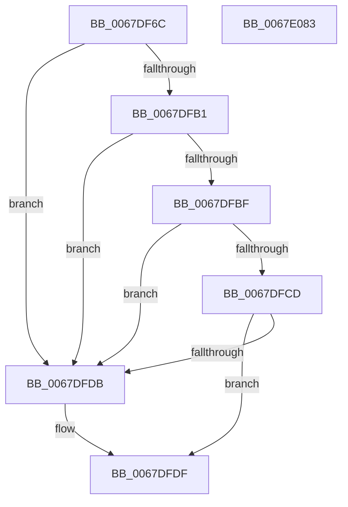

# MmWriteTriageInformation

- RVA: `0x0067DF6C`–`0x0067E084` (길이 `280` bytes)
- VA: `0x000000014067DF6C`
- 실행 섹션: `.text`
- PDB 이름 있음: `예`; PDB Function 태그: `아니요`
- unwind 정보 RVA: `0x000C62DC`
- 디코드: `68`개 명령, `280/280` bytes 표시
- 미해석 바이트: `0` (있으면 어셈블리에 `.byte`로 보존)

> 이 문서는 커널 이미지의 기계어와 PDB 기호를 분석해 생성했습니다. 4번과 5번은 함수 원형과 자료형을 바이너리 사용 방식에서 추정한 C 해석이며 원본 소스 복구 결과는 아닙니다.

## 1. Dependencies

- 직접 호출 지점: **4**; 고유 호출 대상: **2**
- 직접 호출자로 확인된 함수: **1**
- RIP 상대 이미지 참조: **11**

### Outgoing calls
- `0x0067DFA6` → [RtlGetNtProductType](../43/RtlGetNtProductType_function_00436270.md) (function, `0x00436270`)
- `0x0067DFB6` → [ExVerifySuite](../4F/ExVerifySuite_function_004F80E0.md) (function, `0x004F80E0`)
- `0x0067DFC4` → [ExVerifySuite](../4F/ExVerifySuite_function_004F80E0.md) (function, `0x004F80E0`)
- `0x0067DFD2` → [ExVerifySuite](../4F/ExVerifySuite_function_004F80E0.md) (function, `0x004F80E0`)

### Direct callers
- [IoFillTriageDumpBuffer](../59/IoFillTriageDumpBuffer_function_005921CC.md) at `0x00592635`

### Static image references
- `0x0067DF7E` → RVA `0x00FC6C28` (`ALMOSTRO`; read)
- `0x0067DF8F` → RVA `0x00F04AB8` (`.data`; read)
- `0x0067DFDF` → RVA `0x00F04A20` (`.data`; read)
- `0x0067DFED` → RVA `0x00FC6A88` (`ALMOSTRO`; read)
- `0x0067DFF7` → RVA `0x00E37658` (`.data`; read)
- `0x0067E002` → RVA `0x00E2CB48` (`.data`; read)
- `0x0067E00D` → RVA `0x00E37660` (`.data`; read)
- `0x0067E018` → RVA `0x00E37650` (`.data`; read)
- `0x0067E023` → RVA `0x00E3D840` (`.data`; read)
- `0x0067E02E` → RVA `0x00E3CEC0` (`.data`; read)
- `0x0067E039` → RVA `0x00E3CEC8` (`.data`; read)

## 2. Other-region calls and transfers

- 다른 실행 섹션으로 향하는 call: **0**
- 별도 외부 분기/꼬리 이동을 확인하지 못했습니다.

## 3. Assembly (complete function range)

```asm
0067DF6C  48 89 5C 24 10                  mov qword ptr [rsp + 0x10], rbx
0067DF71  48 89 7C 24 18                  mov qword ptr [rsp + 0x18], rdi
0067DF76  55                              push rbp
0067DF77  48 8B EC                        mov rbp, rsp
0067DF7A  48 83 EC 70                     sub rsp, 0x70
0067DF7E  8B 05 A4 8C 94 00               mov eax, dword ptr [rip + 0x948ca4]
0067DF84  48 8B F9                        mov rdi, rcx
0067DF87  83 65 10 00                     and dword ptr [rbp + 0x10], 0
0067DF8B  48 8D 4D 10                     lea rcx, [rbp + 0x10]
0067DF8F  8B 1D 23 6B 88 00               mov ebx, dword ptr [rip + 0x886b23]
0067DF95  C7 45 B0 01 00 00 00            mov dword ptr [rbp - 0x50], 1
0067DF9C  C7 45 B4 50 00 00 00            mov dword ptr [rbp - 0x4c], 0x50
0067DFA3  89 45 B8                        mov dword ptr [rbp - 0x48], eax
0067DFA6  E8 C5 82 DB FF                  call 0x140436270
0067DFAB  83 7D 10 01                     cmp dword ptr [rbp + 0x10], 1
0067DFAF  75 2A                           jne 0x14067dfdb
0067DFB1  B9 06 00 00 00                  mov ecx, 6
0067DFB6  E8 25 A1 E7 FF                  call 0x1404f80e0
0067DFBB  84 C0                           test al, al
0067DFBD  75 1C                           jne 0x14067dfdb
0067DFBF  B9 0B 00 00 00                  mov ecx, 0xb
0067DFC4  E8 17 A1 E7 FF                  call 0x1404f80e0
0067DFC9  84 C0                           test al, al
0067DFCB  75 0E                           jne 0x14067dfdb
0067DFCD  B9 0C 00 00 00                  mov ecx, 0xc
0067DFD2  E8 09 A1 E7 FF                  call 0x1404f80e0
0067DFD7  84 C0                           test al, al
0067DFD9  74 04                           je 0x14067dfdf
0067DFDB  0F BA EB 1F                     bts ebx, 0x1f
0067DFDF  8B 05 3B 6A 88 00               mov eax, dword ptr [rip + 0x886a3b]
0067DFE5  4C 8D 5C 24 70                  lea r11, [rsp + 0x70]
0067DFEA  89 45 C0                        mov dword ptr [rbp - 0x40], eax
0067DFED  48 8B 05 94 8A 94 00            mov rax, qword ptr [rip + 0x948a94]
0067DFF4  0F B6 C8                        movzx ecx, al
0067DFF7  48 8B 05 5A 96 7B 00            mov rax, qword ptr [rip + 0x7b965a]
0067DFFE  48 89 45 C8                     mov qword ptr [rbp - 0x38], rax
0067E002  48 8B 05 3F EB 7A 00            mov rax, qword ptr [rip + 0x7aeb3f]
0067E009  48 89 45 D0                     mov qword ptr [rbp - 0x30], rax
0067E00D  48 8B 05 4C 96 7B 00            mov rax, qword ptr [rip + 0x7b964c]
0067E014  48 89 45 D8                     mov qword ptr [rbp - 0x28], rax
0067E018  48 8B 05 31 96 7B 00            mov rax, qword ptr [rip + 0x7b9631]
0067E01F  48 89 45 E0                     mov qword ptr [rbp - 0x20], rax
0067E023  48 8B 05 16 F8 7B 00            mov rax, qword ptr [rip + 0x7bf816]
0067E02A  48 89 45 E8                     mov qword ptr [rbp - 0x18], rax
0067E02E  48 8B 05 8B EE 7B 00            mov rax, qword ptr [rip + 0x7bee8b]
0067E035  48 89 45 F0                     mov qword ptr [rbp - 0x10], rax
0067E039  48 8B 05 88 EE 7B 00            mov rax, qword ptr [rip + 0x7bee88]
0067E040  89 5D BC                        mov dword ptr [rbp - 0x44], ebx
0067E043  0F 28 45 B0                     movaps xmm0, xmmword ptr [rbp - 0x50]
0067E047  49 8B 5B 18                     mov rbx, qword ptr [r11 + 0x18]
0067E04B  0F 11 07                        movups xmmword ptr [rdi], xmm0
0067E04E  D1 E9                           shr ecx, 1
0067E050  0F 28 45 D0                     movaps xmm0, xmmword ptr [rbp - 0x30]
0067E054  83 E1 01                        and ecx, 1
0067E057  89 4D C4                        mov dword ptr [rbp - 0x3c], ecx
0067E05A  0F 28 4D C0                     movaps xmm1, xmmword ptr [rbp - 0x40]
0067E05E  0F 11 4F 10                     movups xmmword ptr [rdi + 0x10], xmm1
0067E062  48 89 45 F8                     mov qword ptr [rbp - 8], rax
0067E066  0F 28 4D E0                     movaps xmm1, xmmword ptr [rbp - 0x20]
0067E06A  0F 11 47 20                     movups xmmword ptr [rdi + 0x20], xmm0
0067E06E  0F 28 45 F0                     movaps xmm0, xmmword ptr [rbp - 0x10]
0067E072  0F 11 4F 30                     movups xmmword ptr [rdi + 0x30], xmm1
0067E076  0F 11 47 40                     movups xmmword ptr [rdi + 0x40], xmm0
0067E07A  49 8B 7B 20                     mov rdi, qword ptr [r11 + 0x20]
0067E07E  49 8B E3                        mov rsp, r11
0067E081  5D                              pop rbp
0067E082  C3                              ret
0067E083  CC                              int3
```

## 4. C-style interpretation (structured pseudocode)

```c
__int64 __fastcall MmWriteTriageInformation(__int64 a1)
{
    __int64 result;
    __int64 v_rsp;
    unsigned __int64 v_stack_m10;
    unsigned __int64 v_stack_m18;
    unsigned __int64 v_stack_m20;
    unsigned __int64 v_stack_m28;
    unsigned __int64 v_stack_m30;
    unsigned __int64 v_stack_m38;
    unsigned __int64 v_stack_m40;
    unsigned int v_stack_m44;
    unsigned int v_stack_m48;
    unsigned int v_stack_m4C;
    unsigned int v_stack_m50;
    unsigned int v_stack_m54;
    unsigned int v_stack_m58;
    unsigned __int64 v_stack_m8;
    unsigned __int64 v_stack_p10;
    unsigned __int64 v_stack_p18;
    unsigned int v_stack_p8;

    v_stack_p10 = v_rbx;
    v_stack_p18 = v_rdi;
    v_rsp = (v_rsp) - (112);
    v_stack_m58 = 1;
    v_stack_m54 = 80;
    v_stack_m50 = (unsigned int)((unsigned int)(*(unsigned int *)(v_rip + 9735332)));
    result = RtlGetNtProductType(v_stack_p8, a2, a3, a4);
    if (v_stack_p8 != 1) goto loc_0067DFDB;
    result = ExVerifySuite(6, a2, a3, a4);
    if ((unsigned __int8)(result) != 0) goto loc_0067DFDB;
    result = ExVerifySuite(11, a2, a3, a4);
    if ((unsigned __int8)(result) != 0) goto loc_0067DFDB;
    result = ExVerifySuite(12, a2, a3, a4);
    if ((unsigned __int8)(result) != 0) {
    }
    v_stack_m48 = (unsigned int)((unsigned int)(*(unsigned int *)(v_rip + 8940091)));
    v_stack_m40 = *(unsigned __int64 *)(v_rip + 8099418);
    v_stack_m38 = *(unsigned __int64 *)(v_rip + 8055615);
    v_stack_m30 = *(unsigned __int64 *)(v_rip + 8099404);
    v_stack_m28 = *(unsigned __int64 *)(v_rip + 8099377);
    v_stack_m20 = *(unsigned __int64 *)(v_rip + 8124438);
    v_stack_m18 = *(unsigned __int64 *)(v_rip + 8121995);
    v_stack_m4C = (unsigned int)((unsigned int)(*(unsigned int *)(v_rip + 8940323)));
    *(unsigned __int64 *)(a1) = v_xmm0;
    a1 = (unsigned int)(((unsigned __int8)(*(unsigned __int64 *)(v_rip + 9734804))) >> (1));
    a1 = (unsigned int)((a1) & (1));
    v_stack_m44 = (unsigned int)(a1);
    *(unsigned __int64 *)(a1 + 16) = v_xmm1;
    v_stack_m10 = *(unsigned __int64 *)(v_rip + 8121992);
    *(unsigned __int64 *)(a1 + 32) = v_xmm0;
    *(unsigned __int64 *)(a1 + 48) = v_xmm1;
    *(unsigned __int64 *)(a1 + 64) = v_xmm0;
    return *(unsigned __int64 *)(v_rip + 8121992);
}
```

## 5. (Beta) C Style

```c
int64_t MmWriteTriageInformation(void *Arg1)
{
    uint8_t *arg1 = (uint8_t *)Arg1;

    int64_t result;
    int64_t local_rsp;
    uint64_t v_stack_m10;
    uint64_t v_stack_m18;
    uint64_t v_stack_m20;
    uint64_t v_stack_m28;
    uint64_t v_stack_m30;
    uint64_t v_stack_m38;
    uint64_t v_stack_m40;
    uint32_t v_stack_m44;
    uint32_t v_stack_m48;
    uint32_t v_stack_m4C;
    uint32_t v_stack_m50;
    uint32_t v_stack_m54;
    uint32_t v_stack_m58;
    uint64_t v_stack_m8;
    uint64_t v_stack_p10;
    uint64_t v_stack_p18;
    uint32_t v_stack_p8;

    v_stack_p10 = local_rbx;
    v_stack_p18 = local_rdi;
    local_rsp = (local_rsp) - (112);
    v_stack_m58 = 1;
    v_stack_m54 = 80;
    v_stack_m50 = (uint32_t)((uint32_t)(*(uint32_t *)(v_rip + 0x948CA4)));
    result = RtlGetNtProductType(v_stack_p8, a2, a3, a4);
    if (v_stack_p8 != 1) goto loc_0067DFDB;
    result = ExVerifySuite(6, a2, a3, a4);
    if ((uint8_t)(result) != 0) goto loc_0067DFDB;
    result = ExVerifySuite(11, a2, a3, a4);
    if ((uint8_t)(result) != 0) goto loc_0067DFDB;
    result = ExVerifySuite(12, a2, a3, a4);
    if ((uint8_t)(result) != 0) {
    }
    v_stack_m48 = (uint32_t)((uint32_t)(*(uint32_t *)(v_rip + 0x886A3B)));
    v_stack_m40 = *(uint64_t *)(v_rip + 0x7B965A);
    v_stack_m38 = *(uint64_t *)(v_rip + 0x7AEB3F);
    v_stack_m30 = *(uint64_t *)(v_rip + 0x7B964C);
    v_stack_m28 = *(uint64_t *)(v_rip + 0x7B9631);
    v_stack_m20 = *(uint64_t *)(v_rip + 0x7BF816);
    v_stack_m18 = *(uint64_t *)(v_rip + 0x7BEE8B);
    v_stack_m4C = (uint32_t)((uint32_t)(*(uint32_t *)(v_rip + 0x886B23)));
    *(uint64_t *)(arg1) = v_xmm0;
    Arg1 = (uint32_t)(((uint8_t)(*(uint64_t *)(v_rip + 0x948A94))) >> (1));
    Arg1 = (uint32_t)((Arg1) & (1));
    v_stack_m44 = (uint32_t)(Arg1);
    *(uint64_t *)(arg1 + 0x10) = v_xmm1;
    v_stack_m10 = *(uint64_t *)(v_rip + 0x7BEE88);
    *(uint64_t *)(arg1 + 0x20) = v_xmm0;
    *(uint64_t *)(arg1 + 0x30) = v_xmm1;
    *(uint64_t *)(arg1 + 0x40) = v_xmm0;
    return *(uint64_t *)(v_rip + 0x7BEE88);
}
```

### 관측된 메모리 오프셋

구조체 형식이 확인되지 않은 접근은 인자 기준의 오프셋으로만 기록했습니다.

| 기준 인자 | 오프셋 표현 | 폭 (bit) | 접근 |
|---|---:|---:|---|
| `Arg1` | `+ 0x0` | `128` | `R` |
| `Arg1` | `+ 0x10` | `128` | `R` |
| `Arg1` | `+ 0x20` | `128` | `R` |
| `Arg1` | `+ 0x30` | `128` | `R` |
| `Arg1` | `+ 0x40` | `128` | `R` |

## 6. Execution-region graph

[열기: 2D/3D 그래프와 함수 탐색 컨트롤 패널](../../../control-panel.html?section=text&rva=0x0067DF6C&view=graph)

- 2D 그래프는 위에서 아래로 흐르고, 3D 그래프는 빈 공간을 드래그해 회전합니다. Shift+드래그는 이동, 휠은 확대·축소, 함수 노드 선택은 대상 보고서 이동입니다.

### Static fallback


