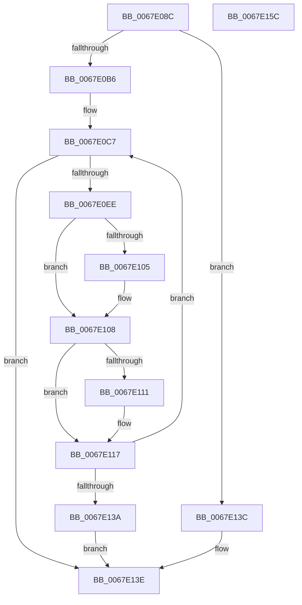

# MmWriteUnloadedDriverInformation

- RVA: `0x0067E08C`–`0x0067E15D` (길이 `209` bytes)
- VA: `0x000000014067E08C`
- 실행 섹션: `.text`
- PDB 이름 있음: `예`; PDB Function 태그: `아니요`
- unwind 정보 RVA: `0x0005E6B4`
- 디코드: `57`개 명령, `209/209` bytes 표시
- 미해석 바이트: `0` (있으면 어셈블리에 `.byte`로 보존)

> 이 문서는 커널 이미지의 기계어와 PDB 기호를 분석해 생성했습니다. 4번과 5번은 함수 원형과 자료형을 바이너리 사용 방식에서 추정한 C 해석이며 원본 소스 복구 결과는 아닙니다.

## 1. Dependencies

- 직접 호출 지점: **1**; 고유 호출 대상: **1**
- 직접 호출자로 확인된 함수: **1**
- RIP 상대 이미지 참조: **2**

### Outgoing calls
- `0x0067E128` → [memcpy](../6C/memcpy_function_006C6840.md) (function, `0x006C6840`)

### Direct callers
- [IoFillTriageDumpBuffer](../59/IoFillTriageDumpBuffer_function_005921CC.md) at `0x0059249D`

### Static image references
- `0x0067E0A5` → RVA `0x00EF54B0` (`.data`; read)
- `0x0067E0B6` → RVA `0x00EF54A8` (`.data`; read)

## 2. Other-region calls and transfers

- 다른 실행 섹션으로 향하는 call: **0**
- 별도 외부 분기/꼬리 이동을 확인하지 못했습니다.

## 3. Assembly (complete function range)

```asm
0067E08C  48 8B C4                        mov rax, rsp
0067E08F  48 89 58 08                     mov qword ptr [rax + 8], rbx
0067E093  48 89 68 10                     mov qword ptr [rax + 0x10], rbp
0067E097  48 89 70 18                     mov qword ptr [rax + 0x18], rsi
0067E09B  48 89 78 20                     mov qword ptr [rax + 0x20], rdi
0067E09F  41 56                           push r14
0067E0A1  48 83 EC 20                     sub rsp, 0x20
0067E0A5  48 83 3D 03 74 87 00 00         cmp qword ptr [rip + 0x877403], 0
0067E0AD  4C 8B F1                        mov r14, rcx
0067E0B0  0F 84 86 00 00 00               je 0x14067e13c
0067E0B6  8B 35 EC 73 87 00               mov esi, dword ptr [rip + 0x8773ec]
0067E0BC  48 8D 59 08                     lea rbx, [rcx + 8]
0067E0C0  FF CE                           dec esi
0067E0C2  33 FF                           xor edi, edi
0067E0C4  8D 6F 18                        lea ebp, [rdi + 0x18]
0067E0C7  4C 8B 0D E2 73 87 00            mov r9, qword ptr [rip + 0x8773e2]
0067E0CE  83 FE 32                        cmp esi, 0x32
0067E0D1  B8 31 00 00 00                  mov eax, 0x31
0067E0D6  0F 43 F0                        cmovae esi, eax
0067E0D9  48 8D 14 B6                     lea rdx, [rsi + rsi*4]
0067E0DD  41 0F 10 04 D1                  movups xmm0, xmmword ptr [r9 + rdx*8]
0067E0E2  F3 0F 7F 03                     movdqu xmmword ptr [rbx], xmm0
0067E0E6  49 83 7C D1 08 00               cmp qword ptr [r9 + rdx*8 + 8], 0
0067E0EC  74 50                           je 0x14067e13e
0067E0EE  49 8B 44 D1 10                  mov rax, qword ptr [r9 + rdx*8 + 0x10]
0067E0F3  48 89 43 28                     mov qword ptr [rbx + 0x28], rax
0067E0F7  49 8B 44 D1 18                  mov rax, qword ptr [r9 + rdx*8 + 0x18]
0067E0FC  48 89 43 30                     mov qword ptr [rbx + 0x30], rax
0067E100  66 39 2B                        cmp word ptr [rbx], bp
0067E103  76 03                           jbe 0x14067e108
0067E105  66 89 2B                        mov word ptr [rbx], bp
0067E108  0F B7 43 02                     movzx eax, word ptr [rbx + 2]
0067E10C  66 3B C5                        cmp ax, bp
0067E10F  76 06                           jbe 0x14067e117
0067E111  66 89 6B 02                     mov word ptr [rbx + 2], bp
0067E115  8B C5                           mov eax, ebp
0067E117  48 8D 4B 10                     lea rcx, [rbx + 0x10]
0067E11B  44 0F B7 C0                     movzx r8d, ax
0067E11F  48 89 4B 08                     mov qword ptr [rbx + 8], rcx
0067E123  49 8B 54 D1 08                  mov rdx, qword ptr [r9 + rdx*8 + 8]
0067E128  E8 13 87 04 00                  call 0x1406c6840
0067E12D  48 83 C3 38                     add rbx, 0x38
0067E131  FF CE                           dec esi
0067E133  FF C7                           inc edi
0067E135  83 FF 32                        cmp edi, 0x32
0067E138  72 8D                           jb 0x14067e0c7
0067E13A  EB 02                           jmp 0x14067e13e
0067E13C  33 FF                           xor edi, edi
0067E13E  41 89 3E                        mov dword ptr [r14], edi
0067E141  48 8B 5C 24 30                  mov rbx, qword ptr [rsp + 0x30]
0067E146  48 8B 6C 24 38                  mov rbp, qword ptr [rsp + 0x38]
0067E14B  48 8B 74 24 40                  mov rsi, qword ptr [rsp + 0x40]
0067E150  48 8B 7C 24 48                  mov rdi, qword ptr [rsp + 0x48]
0067E155  48 83 C4 20                     add rsp, 0x20
0067E159  41 5E                           pop r14
0067E15B  C3                              ret
0067E15C  CC                              int3
```

## 4. C-style interpretation (structured pseudocode)

```c
__int64 __fastcall MmWriteUnloadedDriverInformation(__int64 a1)
{
    __int64 result;
    __int64 v_rbx;
    __int64 v_rdi;
    __int64 v_rsi;
    __int64 v_rsp;
    unsigned __int64 v_stack_p10;
    unsigned __int64 v_stack_p18;
    unsigned __int64 v_stack_p20;
    unsigned __int64 v_stack_p8;

    *(unsigned __int64 *)(v_rsp + 8) = v_rbx;
    *(unsigned __int64 *)(v_rsp + 16) = v_rbp;
    *(unsigned __int64 *)(v_rsp + 24) = v_rsi;
    *(unsigned __int64 *)(v_rsp + 32) = v_rdi;
    v_rsp = (v_rsp) - (32);
    if ((*(unsigned __int64 *)(v_rip + 8877059)) == 0) goto loc_0067E13C;
    v_rsi = (unsigned int)(((unsigned int)(*(unsigned int *)(v_rip + 8877036))) - 1);
    v_rdi = 0;
loc_0067E0C7:
    if (((unsigned int)(v_rsi)) >= 50) { v_rsi = 49; }
    *(unsigned __int64 *)(a1 + 8) = v_xmm0;
    if ((*(unsigned __int64 *)(*(unsigned __int64 *)(v_rip + 8877026) + v_rsi + v_rsi * 4 * 8 + 8)) == 0) goto loc_0067E13E;
    *(unsigned __int64 *)(a1 + 8 + 40) = *(unsigned __int64 *)(*(unsigned __int64 *)(v_rip + 8877026) + v_rsi + v_rsi * 4 * 8 + 16);
    *(unsigned __int64 *)(a1 + 8 + 48) = *(unsigned __int64 *)(*(unsigned __int64 *)(v_rip + 8877026) + v_rsi + v_rsi * 4 * 8 + 24);
    if ((*(unsigned __int16 *)(a1 + 8)) >= = ((unsigned __int16)(v_rdi + 24))) {
        *(unsigned __int16 *)(a1 + 8) = (unsigned __int16)(v_rdi + 24);
    }
    result = *(unsigned __int16 *)(a1 + 8 + 2);
    if (((unsigned __int16)(*(unsigned __int16 *)(a1 + 8 + 2))) >= = ((unsigned __int16)(v_rdi + 24))) {
        *(unsigned __int16 *)(a1 + 8 + 2) = (unsigned __int16)(v_rdi + 24);
        result = (unsigned int)(v_rdi + 24);
    }
    *(unsigned __int64 *)(a1 + 8 + 8) = a1 + 8 + 16;
    result = memcpy(a1 + 8 + 16, *(unsigned __int64 *)(*(unsigned __int64 *)(v_rip + 8877026) + v_rsi + v_rsi * 4 * 8 + 8), (unsigned __int16)(result), *(unsigned __int64 *)(v_rip + 8877026));
    v_rbx = (a1 + 8) + (56);
    v_rsi = (unsigned int)((v_rsi) - 1);
    v_rdi = (unsigned int)((v_rdi) + 1);
    if (((unsigned int)(v_rdi)) < 50) goto loc_0067E0C7;
    goto loc_0067E13E;
loc_0067E13C:
    v_rdi = 0;
loc_0067E13E:
    *(unsigned int *)(a1) = 0;
    v_rsp = (v_rsp) + (32);
    return result;
}
```

## 5. (Beta) C Style

```c
int64_t MmWriteUnloadedDriverInformation(void *Arg1)
{
    uint8_t *arg1 = (uint8_t *)Arg1;

    int64_t result;
    int64_t local_rbx;
    int64_t local_rdi;
    int64_t local_rsi;
    int64_t local_rsp;
    uint64_t v_stack_p10;
    uint64_t v_stack_p18;
    uint64_t v_stack_p20;
    uint64_t v_stack_p8;

    *(uint64_t *)(local_rsp + 0x8) = local_rbx;
    *(uint64_t *)(local_rsp + 0x10) = local_rbp;
    *(uint64_t *)(local_rsp + 0x18) = local_rsi;
    *(uint64_t *)(local_rsp + 0x20) = local_rdi;
    local_rsp = (local_rsp) - (32);
    if ((*(uint64_t *)(v_rip + 0x877403)) == 0) goto loc_0067E13C;
    local_rsi = (uint32_t)(((uint32_t)(*(uint32_t *)(v_rip + 0x8773EC))) - 1);
    local_rdi = 0;
loc_0067E0C7:
    if (((uint32_t)(local_rsi)) >= 50) { local_rsi = 49; }
    *(uint64_t *)(arg1 + 0x8) = v_xmm0;
    if ((*(uint64_t *)(*(uint64_t *)(v_rip + 0x8773E2) + local_rsi + local_rsi * 4 * 8 + 0x8)) == 0) goto loc_0067E13E;
    *(uint64_t *)(arg1 + 0x8 + 0x28) = *(uint64_t *)(*(uint64_t *)(v_rip + 0x8773E2) + local_rsi + local_rsi * 4 * 8 + 0x10);
    *(uint64_t *)(arg1 + 0x8 + 0x30) = *(uint64_t *)(*(uint64_t *)(v_rip + 0x8773E2) + local_rsi + local_rsi * 4 * 8 + 0x18);
    if ((*(uint16_t *)(arg1 + 0x8)) >= = ((uint16_t)(local_rdi + 24))) {
        *(uint16_t *)(arg1 + 0x8) = (uint16_t)(local_rdi + 24);
    }
    result = *(uint16_t *)(arg1 + 0x8 + 0x2);
    if (((uint16_t)(*(uint16_t *)(arg1 + 0x8 + 0x2))) >= = ((uint16_t)(local_rdi + 24))) {
        *(uint16_t *)(arg1 + 0x8 + 0x2) = (uint16_t)(local_rdi + 24);
        result = (uint32_t)(local_rdi + 24);
    }
    *(void **)(arg1 + 0x8 + 0x8) = Arg1 + 8 + 16;
    result = memcpy(Arg1 + 8 + 16, *(uint64_t *)(*(uint64_t *)(v_rip + 0x8773E2) + local_rsi + local_rsi * 4 * 8 + 0x8), (uint16_t)(result), *(uint64_t *)(v_rip + 0x8773E2));
    local_rbx = (Arg1 + 8) + (56);
    local_rsi = (uint32_t)((local_rsi) - 1);
    local_rdi = (uint32_t)((local_rdi) + 1);
    if (((uint32_t)(local_rdi)) < 50) goto loc_0067E0C7;
    goto loc_0067E13E;
loc_0067E13C:
    local_rdi = 0;
loc_0067E13E:
    *(uint32_t *)(arg1) = 0;
    local_rsp = (local_rsp) + (32);
    return result;
}
```

### 관측된 메모리 오프셋

구조체 형식이 확인되지 않은 접근은 인자 기준의 오프셋으로만 기록했습니다.

| 기준 인자 | 오프셋 표현 | 폭 (bit) | 접근 |
|---|---:|---:|---|
| `Arg1` | `+ 0x0` | `16` | `R` |
| `Arg1` | `+ 0x0` | `16` | `W` |
| `Arg1` | `+ 0x0` | `32` | `W` |
| `Arg1` | `+ 0x0` | `128` | `W` |
| `Arg1` | `+ 0x2` | `16` | `R` |
| `Arg1` | `+ 0x2` | `16` | `W` |
| `Arg1` | `+ 0x8` | `64` | `R` |
| `Arg1` | `+ 0x8` | `64` | `W` |
| `Arg1` | `+ 0x10` | `64` | `R` |
| `Arg1` | `+ 0x28` | `64` | `W` |
| `Arg1` | `+ 0x30` | `64` | `W` |

## 6. Execution-region graph

[열기: 2D/3D 그래프와 함수 탐색 컨트롤 패널](../../../control-panel.html?section=text&rva=0x0067E08C&view=graph)

- 2D 그래프는 위에서 아래로 흐르고, 3D 그래프는 빈 공간을 드래그해 회전합니다. Shift+드래그는 이동, 휠은 확대·축소, 함수 노드 선택은 대상 보고서 이동입니다.

### Static fallback


