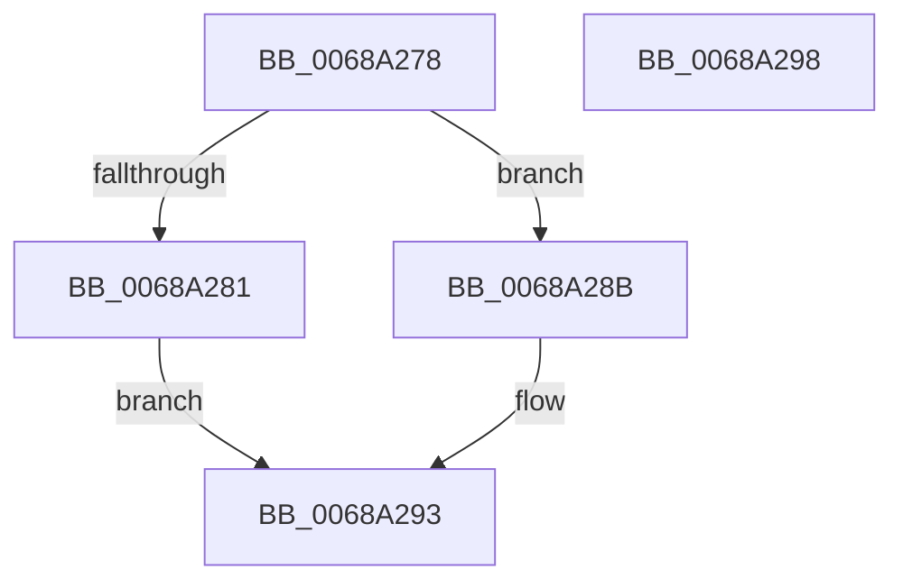

# MI_GET_DIRECTORY_FRAME_FROM_PROCESS_PDE

- RVA: `0x0068A278`–`0x0068A299` (길이 `33` bytes)
- VA: `0x000000014068A278`
- 실행 섹션: `.text`
- PDB 이름 있음: `예`; PDB Function 태그: `아니요`
- unwind 정보 RVA: `0x0005C788`
- 디코드: `11`개 명령, `33/33` bytes 표시
- 미해석 바이트: `0` (있으면 어셈블리에 `.byte`로 보존)

> 이 문서는 커널 이미지의 기계어와 PDB 기호를 분석해 생성했습니다. 4번과 5번은 함수 원형과 자료형을 바이너리 사용 방식에서 추정한 C 해석이며 원본 소스 복구 결과는 아닙니다.

## 1. Dependencies

- 직접 호출 지점: **1**; 고유 호출 대상: **1**
- 직접 호출자로 확인된 함수: **2**
- RIP 상대 이미지 참조: **0**

### Outgoing calls
- `0x0068A28E` → [MiGetContainingPageTable](../34/MiGetContainingPageTable_function_003467F0.md) (function, `0x003467F0`)

### Direct callers
- [MiInitializeSystemPageTable](../45/MiInitializeSystemPageTable_function_00451C88.md) at `0x00452012`
- [MiReplicatePteChangeToProcess](../69/MiReplicatePteChangeToProcess_function_00693D24.md) at `0x00693D43`

### Static image references
- 디코드된 RIP-relative 메모리 참조가 없습니다.

## 2. Other-region calls and transfers

- 다른 실행 섹션으로 향하는 call: **0**
- 별도 외부 분기/꼬리 이동을 확인하지 못했습니다.

## 3. Assembly (complete function range)

```asm
0068A278  48 83 EC 28                     sub rsp, 0x28
0068A27C  48 85 C9                        test rcx, rcx
0068A27F  74 0A                           je 0x14068a28b
0068A281  48 8B 41 28                     mov rax, qword ptr [rcx + 0x28]
0068A285  48 C1 E8 0C                     shr rax, 0xc
0068A289  EB 08                           jmp 0x14068a293
0068A28B  48 8B CA                        mov rcx, rdx
0068A28E  E8 5D C5 CB FF                  call 0x1403467f0
0068A293  48 83 C4 28                     add rsp, 0x28
0068A297  C3                              ret
0068A298  CC                              int3
```

## 4. C-style interpretation (structured pseudocode)

```c
__int64 __fastcall MI_GET_DIRECTORY_FRAME_FROM_PROCESS_PDE(__int64 a1, __int64 a2)
{
    __int64 result;
    __int64 v_rsp;

    v_rsp = (v_rsp) - (40);
    if (a1 == 0) goto loc_0068A28B;
    result = (*(unsigned __int64 *)(a1 + 40)) >> (12);
    goto loc_0068A293;
loc_0068A28B:
    result = MiGetContainingPageTable(a2, a2, a3, a4);
loc_0068A293:
    v_rsp = (v_rsp) + (40);
    return result;
}
```

## 5. (Beta) C Style

```c
int64_t MI_GET_DIRECTORY_FRAME_FROM_PROCESS_PDE(int64_t Arg1, int64_t Arg2)
{
    int64_t result;
    int64_t local_rsp;

    local_rsp = (local_rsp) - (40);
    if (Arg1 == 0) goto loc_0068A28B;
    result = (*(uint64_t *)(Arg1 + 0x28)) >> (12);
    goto loc_0068A293;
loc_0068A28B:
    result = MiGetContainingPageTable(Arg2, Arg2, a3, a4);
loc_0068A293:
    local_rsp = (local_rsp) + (40);
    return result;
}
```

## 6. Execution-region graph

[열기: 2D/3D 그래프와 함수 탐색 컨트롤 패널](../../../control-panel.html?section=text&rva=0x0068A278&view=graph)

- 2D 그래프는 위에서 아래로 흐르고, 3D 그래프는 빈 공간을 드래그해 회전합니다. Shift+드래그는 이동, 휠은 확대·축소, 함수 노드 선택은 대상 보고서 이동입니다.

### Static fallback


