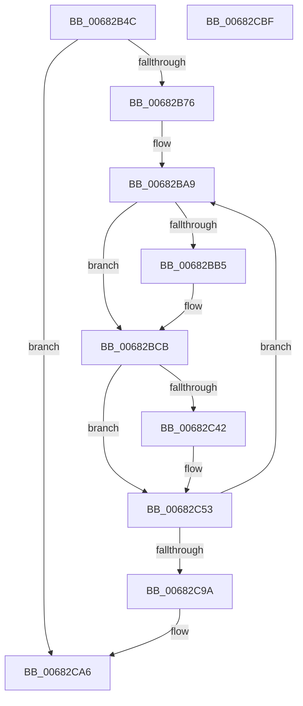

# MiAddExpansionNonPagedPool

- RVA: `0x00682B4C`–`0x00682CC0` (길이 `372` bytes)
- VA: `0x0000000140682B4C`
- 실행 섹션: `.text`
- PDB 이름 있음: `예`; PDB Function 태그: `아니요`
- unwind 정보 RVA: `0x000D83A0`
- 디코드: `101`개 명령, `372/372` bytes 표시
- 미해석 바이트: `0` (있으면 어셈블리에 `.byte`로 보존)

> 이 문서는 커널 이미지의 기계어와 PDB 기호를 분석해 생성했습니다. 4번과 5번은 함수 원형과 자료형을 바이너리 사용 방식에서 추정한 C 해석이며 원본 소스 복구 결과는 아닙니다.

## 1. Dependencies

- 직접 호출 지점: **12**; 고유 호출 대상: **10**
- 직접 호출자로 확인된 함수: **2**
- RIP 상대 이미지 참조: **0**

### Outgoing calls
- `0x00682B7A` → [MiMakeDemandZeroPte](../33/MiMakeDemandZeroPte_function_00337A00.md) (function, `0x00337A00`)
- `0x00682BAC` → [MI_NODE_FROM_PFN](../2B/MI_NODE_FROM_PFN_function_002B0F30.md) (function, `0x002B0F30`)
- `0x00682BBC` → [MiReturnPhysicalPoolPages](../32/MiReturnPhysicalPoolPages_function_00328568.md) (function, `0x00328568`)
- `0x00682BC4` → [MI_NODE_FROM_PFN](../2B/MI_NODE_FROM_PFN_function_002B0F30.md) (function, `0x002B0F30`)
- `0x00682BCE` → [MiLockPageInline](../31/MiLockPageInline_function_0031A340.md) (function, `0x0031A340`)
- `0x00682BD9` → [MiClearPfnReuseFields](../37/MiClearPfnReuseFields_function_003759F0.md) (function, `0x003759F0`)
- `0x00682C10` → [MiSetPfnIdentity](../2A/MiSetPfnIdentity_function_002A2350.md) (function, `0x002A2350`)
- `0x00682C31` → [MiSetPfnContainingFrame](../36/MiSetPfnContainingFrame_function_00363FC0.md) (function, `0x00363FC0`)
- `0x00682C4E` → [MiChangePageAttribute](../33/MiChangePageAttribute_function_00332ECC.md) (function, `0x00332ECC`)
- `0x00682C7A` → [MiUnlockPage](../31/MiUnlockPage_function_0031A3E0.md) (function, `0x0031A3E0`)
- `0x00682C87` → [MiInsertPageChainHead](../2A/MiInsertPageChainHead_function_002A24EC.md) (function, `0x002A24EC`)
- `0x00682CA1` → [MiReturnPhysicalPoolPages](../32/MiReturnPhysicalPoolPages_function_00328568.md) (function, `0x00328568`)

### Direct callers
- [MiFreeLargeInitializationCodePages](../67/MiFreeLargeInitializationCodePages_function_00670080.md) at `0x00670142`
- [MiInitializeNonPagedPool](../../init/C6/MiInitializeNonPagedPool_function_00C64A24.md) at `0x00C64C0F`

### Static image references
- 디코드된 RIP-relative 메모리 참조가 없습니다.

## 2. Other-region calls and transfers

- 다른 실행 섹션으로 향하는 call: **0**
- 별도 외부 분기/꼬리 이동을 확인하지 못했습니다.

## 3. Assembly (complete function range)

```asm
00682B4C  48 89 5C 24 08                  mov qword ptr [rsp + 8], rbx
00682B51  48 89 6C 24 18                  mov qword ptr [rsp + 0x18], rbp
00682B56  48 89 74 24 20                  mov qword ptr [rsp + 0x20], rsi
00682B5B  57                              push rdi
00682B5C  41 56                           push r14
00682B5E  41 57                           push r15
00682B60  48 83 EC 40                     sub rsp, 0x40
00682B64  48 8B EA                        mov rbp, rdx
00682B67  45 33 FF                        xor r15d, r15d
00682B6A  48 8B D1                        mov rdx, rcx
00682B6D  48 85 ED                        test rbp, rbp
00682B70  0F 84 30 01 00 00               je 0x140682ca6
00682B76  41 8D 4F 04                     lea ecx, [r15 + 4]
00682B7A  E8 81 4E CB FF                  call 0x140337a00
00682B7F  48 8D 34 52                     lea rsi, [rdx + rdx*2]
00682B83  48 8B F8                        mov rdi, rax
00682B86  48 C1 E6 04                     shl rsi, 4
00682B8A  48 B8 00 00 00 00 00 DE FF FF   movabs rax, 0xffffde0000000000
00682B94  48 03 F0                        add rsi, rax
00682B97  0F 57 C0                        xorps xmm0, xmm0
00682B9A  33 C0                           xor eax, eax
00682B9C  48 89 44 24 30                  mov qword ptr [rsp + 0x30], rax
00682BA1  83 CB FF                        or ebx, 0xffffffff
00682BA4  0F 11 44 24 20                  movups xmmword ptr [rsp + 0x20], xmm0
00682BA9  48 8B CE                        mov rcx, rsi
00682BAC  E8 7F E3 C2 FF                  call 0x1402b0f30
00682BB1  3B D8                           cmp ebx, eax
00682BB3  74 16                           je 0x140682bcb
00682BB5  33 D2                           xor edx, edx
00682BB7  48 8D 4C 24 20                  lea rcx, [rsp + 0x20]
00682BBC  E8 A7 59 CA FF                  call 0x140328568
00682BC1  48 8B CE                        mov rcx, rsi
00682BC4  E8 67 E3 C2 FF                  call 0x1402b0f30
00682BC9  8B D8                           mov ebx, eax
00682BCB  48 8B CE                        mov rcx, rsi
00682BCE  E8 6D 77 C9 FF                  call 0x14031a340
00682BD3  48 8B CE                        mov rcx, rsi
00682BD6  44 8A F0                        mov r14b, al
00682BD9  E8 12 2E CF FF                  call 0x1403759f0
00682BDE  8B 4E 20                        mov ecx, dword ptr [rsi + 0x20]
00682BE1  48 B8 00 00 00 00 00 00 00 C0   movabs rax, 0xc000000000000000
00682BEB  89 4C 24 68                     mov dword ptr [rsp + 0x68], ecx
00682BEF  33 D2                           xor edx, edx
00682BF1  66 44 89 7C 24 68               mov word ptr [rsp + 0x68], r15w
00682BF7  8B 4C 24 68                     mov ecx, dword ptr [rsp + 0x68]
00682BFB  89 4E 20                        mov dword ptr [rsi + 0x20], ecx
00682BFE  48 8B 4E 18                     mov rcx, qword ptr [rsi + 0x18]
00682C02  48 23 C8                        and rcx, rax
00682C05  48 89 4E 18                     mov qword ptr [rsi + 0x18], rcx
00682C09  48 8B CE                        mov rcx, rsi
00682C0C  48 89 7E 10                     mov qword ptr [rsi + 0x10], rdi
00682C10  E8 3B F7 C1 FF                  call 0x1402a2350
00682C15  8B 46 20                        mov eax, dword ptr [rsi + 0x20]
00682C18  33 D2                           xor edx, edx
00682C1A  89 44 24 68                     mov dword ptr [rsp + 0x68], eax
00682C1E  48 8B CE                        mov rcx, rsi
00682C21  C1 E8 18                        shr eax, 0x18
00682C24  0C 10                           or al, 0x10
00682C26  88 44 24 6B                     mov byte ptr [rsp + 0x6b], al
00682C2A  8B 44 24 68                     mov eax, dword ptr [rsp + 0x68]
00682C2E  89 46 20                        mov dword ptr [rsi + 0x20], eax
00682C31  E8 8A 13 CE FF                  call 0x140363fc0
00682C36  8B 46 20                        mov eax, dword ptr [rsi + 0x20]
00682C39  C1 E8 10                        shr eax, 0x10
00682C3C  24 C0                           and al, 0xc0
00682C3E  3C 40                           cmp al, 0x40
00682C40  74 11                           je 0x140682c53
00682C42  BA 01 00 00 00                  mov edx, 1
00682C47  48 8B CE                        mov rcx, rsi
00682C4A  44 8D 42 02                     lea r8d, [rdx + 2]
00682C4E  E8 79 02 CB FF                  call 0x140332ecc
00682C53  48 C7 46 08 F8 FF FF FF         mov qword ptr [rsi + 8], 0xfffffffffffffff8
00682C5B  41 8A D6                        mov dl, r14b
00682C5E  8B 46 20                        mov eax, dword ptr [rsi + 0x20]
00682C61  48 8B CE                        mov rcx, rsi
00682C64  89 44 24 68                     mov dword ptr [rsp + 0x68], eax
00682C68  C1 E8 10                        shr eax, 0x10
00682C6B  24 FD                           and al, 0xfd
00682C6D  0C 05                           or al, 5
00682C6F  88 44 24 6A                     mov byte ptr [rsp + 0x6a], al
00682C73  8B 44 24 68                     mov eax, dword ptr [rsp + 0x68]
00682C77  89 46 20                        mov dword ptr [rsi + 0x20], eax
00682C7A  E8 61 77 C9 FF                  call 0x14031a3e0
00682C7F  48 8B D6                        mov rdx, rsi
00682C82  48 8D 4C 24 20                  lea rcx, [rsp + 0x20]
00682C87  E8 60 F8 C1 FF                  call 0x1402a24ec
00682C8C  48 83 C6 30                     add rsi, 0x30
00682C90  48 83 ED 01                     sub rbp, 1
00682C94  0F 85 0F FF FF FF               jne 0x140682ba9
00682C9A  33 D2                           xor edx, edx
00682C9C  48 8D 4C 24 20                  lea rcx, [rsp + 0x20]
00682CA1  E8 C2 58 CA FF                  call 0x140328568
00682CA6  48 8B 5C 24 60                  mov rbx, qword ptr [rsp + 0x60]
00682CAB  48 8B 6C 24 70                  mov rbp, qword ptr [rsp + 0x70]
00682CB0  48 8B 74 24 78                  mov rsi, qword ptr [rsp + 0x78]
00682CB5  48 83 C4 40                     add rsp, 0x40
00682CB9  41 5F                           pop r15
00682CBB  41 5E                           pop r14
00682CBD  5F                              pop rdi
00682CBE  C3                              ret
00682CBF  CC                              int3
```

## 4. C-style interpretation (structured pseudocode)

```c
__int64 __fastcall MiAddExpansionNonPagedPool(__int64 a1, __int64 a2)
{
    __int64 result;
    __int64 v_r15;
    __int64 v_rbp;
    __int64 v_rbx;
    __int64 v_rsi;
    __int64 v_rsp;
    unsigned __int64 v_stack_m28;
    unsigned __int64 v_stack_m38;
    unsigned int v_stack_p10;
    unsigned __int8 v_stack_p12;
    unsigned __int8 v_stack_p13;
    unsigned __int64 v_stack_p18;
    unsigned __int64 v_stack_p20;
    unsigned __int64 v_stack_p8;

    v_stack_p8 = v_rbx;
    v_stack_p18 = v_rbp;
    v_stack_p20 = v_rsi;
    v_rsp = (v_rsp) - (64);
    v_r15 = 0;
    if (a2 == 0) goto loc_00682CA6;
    result = MiMakeDemandZeroPte(v_r15 + 4, a1, a3, a4);
    v_rsi = (a1 + a1 * 2) << (4);
    v_rsi = (v_rsi) + (result);
    result = 0;
    v_stack_m28 = 0;
    v_rbx = (unsigned int)((v_rbx) | (0xFFFFFFFFULL));
    v_stack_m38 = v_xmm0;
loc_00682BA9:
    result = MI_NODE_FROM_PFN(v_rsi, a1, a3, a4);
    if (((unsigned int)(v_rbx)) != ((unsigned int)(result))) {
        a2 = 0;
        a1 = v_stack_m38;
        result = MiReturnPhysicalPoolPages(a1, a2, a3, a4);
        a1 = v_rsi;
        result = MI_NODE_FROM_PFN(a1, a2, a3, a4);
        v_rbx = (unsigned int)(result);
    }
    result = MiLockPageInline(v_rsi, a2, a3, a4);
    result = MiClearPfnReuseFields(v_rsi, a2, a3, a4);
    v_stack_p10 = (unsigned int)((unsigned int)(*(unsigned int *)(v_rsi + 32)));
    a2 = 0;
    v_stack_p10 = 0;
    *(unsigned int *)(v_rsi + 32) = (unsigned int)((unsigned int)(v_stack_p10));
    a1 = (*(unsigned __int64 *)(v_rsi + 24)) & (result);
    *(unsigned __int64 *)(v_rsi + 24) = a1;
    *(unsigned __int64 *)(v_rsi + 16) = result;
    result = MiSetPfnIdentity(v_rsi, a2, a3, a4);
    a2 = 0;
    v_stack_p10 = (unsigned int)((unsigned int)(*(unsigned int *)(v_rsi + 32)));
    result = (unsigned int)(((unsigned int)(*(unsigned int *)(v_rsi + 32))) >> (24));
    result = (unsigned __int8)((result) | (16));
    v_stack_p13 = (unsigned __int8)(result);
    *(unsigned int *)(v_rsi + 32) = (unsigned int)((unsigned int)(v_stack_p10));
    result = MiSetPfnContainingFrame(v_rsi, a2, a3, a4);
    result = (unsigned int)(((unsigned int)(*(unsigned int *)(v_rsi + 32))) >> (16));
    result = (unsigned __int8)((result) & (192));
    if (((unsigned __int8)(result)) != 64) {
        a2 = 1;
        a1 = v_rsi;
        a3 = a2 + 2;
        result = MiChangePageAttribute(a1, a2, a3, a4);
    }
    *(unsigned __int64 *)(v_rsi + 8) = -8;
    v_stack_p10 = (unsigned int)((unsigned int)(*(unsigned int *)(v_rsi + 32)));
    result = (unsigned int)(((unsigned int)(*(unsigned int *)(v_rsi + 32))) >> (16));
    result = (unsigned __int8)((result) & (253));
    result = (unsigned __int8)((result) | (5));
    v_stack_p12 = (unsigned __int8)(result);
    *(unsigned int *)(v_rsi + 32) = (unsigned int)((unsigned int)(v_stack_p10));
    result = MiUnlockPage(v_rsi, (unsigned __int8)((unsigned __int8)(result)), a3, a4);
    result = MiInsertPageChainHead(v_stack_m38, v_rsi, a3, a4);
    v_rsi = (v_rsi) + (48);
    v_rbp = (a2) - (1);
    if (condition_is_not_equal) goto loc_00682BA9;
    a2 = 0;
    result = MiReturnPhysicalPoolPages(v_stack_m38, a2, a3, a4);
loc_00682CA6:
    v_rsp = (v_rsp) + (64);
    return result;
}
```

## 5. (Beta) C Style

```c
int64_t MiAddExpansionNonPagedPool(int64_t Arg1, int64_t Arg2)
{
    int64_t result;
    int64_t local_r15;
    int64_t local_rbp;
    int64_t local_rbx;
    int64_t local_rsi;
    int64_t local_rsp;
    uint64_t v_stack_m28;
    uint64_t v_stack_m38;
    uint32_t v_stack_p10;
    uint8_t v_stack_p12;
    uint8_t v_stack_p13;
    uint64_t v_stack_p18;
    uint64_t v_stack_p20;
    uint64_t v_stack_p8;

    v_stack_p8 = local_rbx;
    v_stack_p18 = local_rbp;
    v_stack_p20 = local_rsi;
    local_rsp = (local_rsp) - (64);
    local_r15 = 0;
    if (Arg2 == 0) goto loc_00682CA6;
    result = MiMakeDemandZeroPte(local_r15 + 4, Arg1, a3, a4);
    local_rsi = (Arg1 + Arg1 * 2) << (4);
    local_rsi = (local_rsi) + (result);
    result = 0;
    v_stack_m28 = 0;
    local_rbx = (uint32_t)((local_rbx) | (0xFFFFFFFFULL));
    v_stack_m38 = v_xmm0;
loc_00682BA9:
    result = MI_NODE_FROM_PFN(local_rsi, Arg1, a3, a4);
    if (((uint32_t)(local_rbx)) != ((uint32_t)(result))) {
        Arg2 = 0;
        Arg1 = v_stack_m38;
        result = MiReturnPhysicalPoolPages(Arg1, Arg2, a3, a4);
        Arg1 = local_rsi;
        result = MI_NODE_FROM_PFN(Arg1, Arg2, a3, a4);
        local_rbx = (uint32_t)(result);
    }
    result = MiLockPageInline(local_rsi, Arg2, a3, a4);
    result = MiClearPfnReuseFields(local_rsi, Arg2, a3, a4);
    v_stack_p10 = (uint32_t)((uint32_t)(*(uint32_t *)(local_rsi + 0x20)));
    Arg2 = 0;
    v_stack_p10 = 0;
    *(uint32_t *)(local_rsi + 0x20) = (uint32_t)((uint32_t)(v_stack_p10));
    Arg1 = (*(uint64_t *)(local_rsi + 0x18)) & (result);
    *(uint64_t *)(local_rsi + 0x18) = Arg1;
    *(uint64_t *)(local_rsi + 0x10) = result;
    result = MiSetPfnIdentity(local_rsi, Arg2, a3, a4);
    Arg2 = 0;
    v_stack_p10 = (uint32_t)((uint32_t)(*(uint32_t *)(local_rsi + 0x20)));
    result = (uint32_t)(((uint32_t)(*(uint32_t *)(local_rsi + 0x20))) >> (24));
    result = (uint8_t)((result) | (16));
    v_stack_p13 = (uint8_t)(result);
    *(uint32_t *)(local_rsi + 0x20) = (uint32_t)((uint32_t)(v_stack_p10));
    result = MiSetPfnContainingFrame(local_rsi, Arg2, a3, a4);
    result = (uint32_t)(((uint32_t)(*(uint32_t *)(local_rsi + 0x20))) >> (16));
    result = (uint8_t)((result) & (192));
    if (((uint8_t)(result)) != 64) {
        Arg2 = 1;
        Arg1 = local_rsi;
        a3 = Arg2 + 2;
        result = MiChangePageAttribute(Arg1, Arg2, a3, a4);
    }
    *(uint64_t *)(local_rsi + 0x8) = -8;
    v_stack_p10 = (uint32_t)((uint32_t)(*(uint32_t *)(local_rsi + 0x20)));
    result = (uint32_t)(((uint32_t)(*(uint32_t *)(local_rsi + 0x20))) >> (16));
    result = (uint8_t)((result) & (253));
    result = (uint8_t)((result) | (5));
    v_stack_p12 = (uint8_t)(result);
    *(uint32_t *)(local_rsi + 0x20) = (uint32_t)((uint32_t)(v_stack_p10));
    result = MiUnlockPage(local_rsi, (uint8_t)((uint8_t)(result)), a3, a4);
    result = MiInsertPageChainHead(v_stack_m38, local_rsi, a3, a4);
    local_rsi = (local_rsi) + (48);
    local_rbp = (Arg2) - (1);
    if (condition_is_not_equal) goto loc_00682BA9;
    Arg2 = 0;
    result = MiReturnPhysicalPoolPages(v_stack_m38, Arg2, a3, a4);
loc_00682CA6:
    local_rsp = (local_rsp) + (64);
    return result;
}
```

## 6. Execution-region graph

[열기: 2D/3D 그래프와 함수 탐색 컨트롤 패널](../../../control-panel.html?section=text&rva=0x00682B4C&view=graph)

- 2D 그래프는 위에서 아래로 흐르고, 3D 그래프는 빈 공간을 드래그해 회전합니다. Shift+드래그는 이동, 휠은 확대·축소, 함수 노드 선택은 대상 보고서 이동입니다.

### Static fallback


