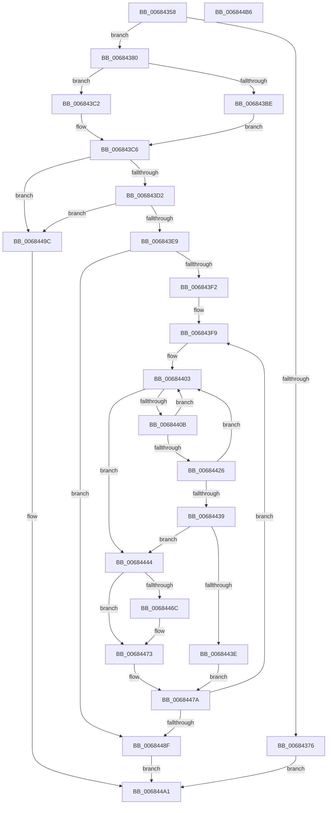

# MiAllocateDbgPatches

- RVA: `0x00684358`–`0x006844B7` (길이 `351` bytes)
- VA: `0x0000000140684358`
- 실행 섹션: `.text`
- PDB 이름 있음: `예`; PDB Function 태그: `아니요`
- unwind 정보 RVA: `0x000A5A38`
- 디코드: `92`개 명령, `351/351` bytes 표시
- 미해석 바이트: `0` (있으면 어셈블리에 `.byte`로 보존)

> 이 문서는 커널 이미지의 기계어와 PDB 기호를 분석해 생성했습니다. 4번과 5번은 함수 원형과 자료형을 바이너리 사용 방식에서 추정한 C 해석이며 원본 소스 복구 결과는 아닙니다.

## 1. Dependencies

- 직접 호출 지점: **0**; 고유 호출 대상: **0**
- 직접 호출자로 확인된 함수: **1**
- RIP 상대 이미지 참조: **6**

### Outgoing calls
- 직접 디코드된 call 명령이 없습니다.

### Direct callers
- [MiDbgCopyMemory](MiDbgCopyMemory_function_00684A18.md) at `0x00684D5E`

### Static image references
- `0x006843AB` → RVA `0x00E31BEC` (`.data`; read)
- `0x006843B4` → RVA `0x00E31BE8` (`.data`; read)
- `0x006843D2` → RVA `0x00E35BF8` (`.data`; read)
- `0x006843F2` → RVA `0x00E2CB40` (`.data`; read)
- `0x00684457` → RVA `0x00E31BE8` (`.data`; write)
- `0x0068446C` → RVA `0x00E31BE8` (`.data`; read/write)

## 2. Other-region calls and transfers

- 다른 실행 섹션으로 향하는 call: **0**
- 별도 외부 분기/꼬리 이동을 확인하지 못했습니다.

## 3. Assembly (complete function range)

```asm
00684358  48 8B C4                        mov rax, rsp
0068435B  48 89 58 08                     mov qword ptr [rax + 8], rbx
0068435F  48 89 68 10                     mov qword ptr [rax + 0x10], rbp
00684363  48 89 70 18                     mov qword ptr [rax + 0x18], rsi
00684367  48 89 78 20                     mov qword ptr [rax + 0x20], rdi
0068436B  4D 8B D9                        mov r11, r9
0068436E  4D 8B D0                        mov r10, r8
00684371  83 FA 08                        cmp edx, 8
00684374  76 0A                           jbe 0x140684380
00684376  B8 0D 00 00 C0                  mov eax, 0xc000000d
0068437B  E9 21 01 00 00                  jmp 0x1406844a1
00684380  45 8B 4A 30                     mov r9d, dword ptr [r10 + 0x30]
00684384  8D 42 FF                        lea eax, [rdx - 1]
00684387  81 E1 FF 0F 00 00               and ecx, 0xfff
0068438D  41 C1 E1 0C                     shl r9d, 0xc
00684391  03 C1                           add eax, ecx
00684393  44 8B C1                        mov r8d, ecx
00684396  C1 E8 02                        shr eax, 2
00684399  83 E1 FC                        and ecx, 0xfffffffc
0068439C  41 C1 E8 02                     shr r8d, 2
006843A0  44 03 C9                        add r9d, ecx
006843A3  44 2B C0                        sub r8d, eax
006843A6  BE 00 01 00 00                  mov esi, 0x100
006843AB  8B 05 3B D8 7A 00               mov eax, dword ptr [rip + 0x7ad83b]
006843B1  41 FF C0                        inc r8d
006843B4  8B 15 2E D8 7A 00               mov edx, dword ptr [rip + 0x7ad82e]
006843BA  3B C2                           cmp eax, edx
006843BC  77 04                           ja 0x1406843c2
006843BE  2B D0                           sub edx, eax
006843C0  EB 04                           jmp 0x1406843c6
006843C2  2B D0                           sub edx, eax
006843C4  03 D6                           add edx, esi
006843C6  41 8D 04 10                     lea eax, [r8 + rdx]
006843CA  3B C6                           cmp eax, esi
006843CC  0F 83 CA 00 00 00               jae 0x14068449c
006843D2  8B 0D 20 18 7B 00               mov ecx, dword ptr [rip + 0x7b1820]
006843D8  41 03 C8                        add ecx, r8d
006843DB  03 CA                           add ecx, edx
006843DD  81 F9 00 02 00 00               cmp ecx, 0x200
006843E3  0F 87 B3 00 00 00               ja 0x14068449c
006843E9  45 85 C0                        test r8d, r8d
006843EC  0F 84 9D 00 00 00               je 0x14068448f
006843F2  48 8D 2D 47 87 7A 00            lea rbp, [rip + 0x7a8747]
006843F9  49 8B 7A 28                     mov rdi, qword ptr [r10 + 0x28]
006843FD  8B 15 E5 D7 7A 00               mov edx, dword ptr [rip + 0x7ad7e5]
00684403  3B 15 E3 D7 7A 00               cmp edx, dword ptr [rip + 0x7ad7e3]
00684409  74 39                           je 0x140684444
0068440B  85 D2                           test edx, edx
0068440D  48 8D 8D A8 38 00 00            lea rcx, [rbp + 0x38a8]
00684414  0F 44 D6                        cmove edx, esi
00684417  FF CA                           dec edx
00684419  48 8D 1C 52                     lea rbx, [rdx + rdx*2]
0068441D  48 8D 0C D9                     lea rcx, [rcx + rbx*8]
00684421  48 3B 39                        cmp rdi, qword ptr [rcx]
00684424  75 DD                           jne 0x140684403
00684426  8B 9C DD B0 38 00 00            mov ebx, dword ptr [rbp + rbx*8 + 0x38b0]
0068442D  8B C3                           mov eax, ebx
0068442F  41 33 C1                        xor eax, r9d
00684432  A9 FC FF FF FF                  test eax, 0xfffffffc
00684437  75 CA                           jne 0x140684403
00684439  F6 C3 01                        test bl, 1
0068443C  75 06                           jne 0x140684444
0068443E  48 83 C9 01                     or rcx, 1
00684442  EB 36                           jmp 0x14068447a
00684444  8B 15 9E D7 7A 00               mov edx, dword ptr [rip + 0x7ad79e]
0068444A  48 8D 0C 55 15 07 00 00         lea rcx, [rdx*2 + 0x715]
00684452  48 03 CA                        add rcx, rdx
00684455  FF C2                           inc edx
00684457  89 15 8B D7 7A 00               mov dword ptr [rip + 0x7ad78b], edx
0068445D  48 8D 0C CD 00 00 00 00         lea rcx, [rcx*8]
00684465  48 03 CD                        add rcx, rbp
00684468  3B D6                           cmp edx, esi
0068446A  75 07                           jne 0x140684473
0068446C  83 25 75 D7 7A 00 00            and dword ptr [rip + 0x7ad775], 0
00684473  48 89 39                        mov qword ptr [rcx], rdi
00684476  44 89 49 08                     mov dword ptr [rcx + 8], r9d
0068447A  49 89 0B                        mov qword ptr [r11], rcx
0068447D  41 83 C1 04                     add r9d, 4
00684481  49 83 C3 08                     add r11, 8
00684485  41 83 C0 FF                     add r8d, -1
00684489  0F 85 6A FF FF FF               jne 0x1406843f9
0068448F  49 8B 42 28                     mov rax, qword ptr [r10 + 0x28]
00684493  F0 83 48 60 01                  lock or dword ptr [rax + 0x60], 1
00684498  33 C0                           xor eax, eax
0068449A  EB 05                           jmp 0x1406844a1
0068449C  B8 01 00 00 C0                  mov eax, 0xc0000001
006844A1  48 8B 5C 24 08                  mov rbx, qword ptr [rsp + 8]
006844A6  48 8B 6C 24 10                  mov rbp, qword ptr [rsp + 0x10]
006844AB  48 8B 74 24 18                  mov rsi, qword ptr [rsp + 0x18]
006844B0  48 8B 7C 24 20                  mov rdi, qword ptr [rsp + 0x20]
006844B5  C3                              ret
006844B6  CC                              int3
```

## 4. C-style interpretation (structured pseudocode)

```c
__int64 __fastcall MiAllocateDbgPatches(int a1, __int64 a2, __int64 a3, __int64 a4)
{
    __int64 result;
    __int64 v_r11;
    unsigned __int64 v_stack_p10;
    unsigned __int64 v_stack_p18;
    unsigned __int64 v_stack_p20;
    unsigned __int64 v_stack_p8;

    *(unsigned __int64 *)(v_rsp + 8) = v_rbx;
    *(unsigned __int64 *)(v_rsp + 16) = v_rbp;
    *(unsigned __int64 *)(v_rsp + 24) = v_rsi;
    *(unsigned __int64 *)(v_rsp + 32) = v_rdi;
    if (((unsigned int)(a2)) <= 8) goto loc_00684380;
    goto loc_006844A1;
loc_00684380:
    a1 = (unsigned int)((a1) & (0xFFFULL));
    a4 = (unsigned int)(((unsigned int)(*(unsigned int *)(a3 + 48))) << (12));
    result = (unsigned int)((a2 - 1) + (a1));
    result = (unsigned int)((result) >> (2));
    a1 = (unsigned int)((a1) & (0xFFFFFFFCULL));
    a3 = (unsigned int)(((unsigned int)(a1)) >> (2));
    a4 = (unsigned int)((a4) + (a1));
    a3 = (unsigned int)((a3) - ((unsigned int)(result)));
    a3 = (unsigned int)((a3) + 1);
    if (((unsigned int)((unsigned int)(*(unsigned int *)(v_rip + 8050747)))) > ((unsigned int)((unsigned int)(*(unsigned int *)(v_rip + 8050734))))) goto loc_006843C2;
    a2 = (unsigned int)(((unsigned int)(*(unsigned int *)(v_rip + 8050734))) - ((unsigned int)((unsigned int)(*(unsigned int *)(v_rip + 8050747)))));
    goto loc_006843C6;
loc_006843C2:
    a2 = (unsigned int)((a2) - ((unsigned int)((unsigned int)(*(unsigned int *)(v_rip + 8050747)))));
    a2 = (unsigned int)((a2) + (256));
loc_006843C6:
    if (((unsigned int)(a3 + a2 * 1)) >= 256) goto loc_0068449C;
    a1 = (unsigned int)(((unsigned int)(*(unsigned int *)(v_rip + 8067104))) + ((unsigned int)(a3)));
    a1 = (unsigned int)((a1) + ((unsigned int)(a2)));
    if (a1 > 512) goto loc_0068449C;
    if ((unsigned int)(a3) == 0) goto loc_0068448F;
loc_006843F9:
loc_00684403:
    if (((unsigned int)((unsigned int)(*(unsigned int *)(v_rip + 8050661)))) == (*(unsigned int *)(v_rip + 8050659))) goto loc_00684444;
    a2 = (unsigned int)(*(unsigned int *)(v_rip + 8050661));
    if ((unsigned int)((unsigned int)(*(unsigned int *)(v_rip + 8050661))) == 0) { a2 = 256; }
    a2 = (unsigned int)((a2) - 1);
    if ((*(unsigned __int64 *)(a3 + 40)) != (*(unsigned __int64 *)(v_rip + 8030023 + 14504 + a2 + a2 * 2 * 8))) goto loc_00684403;
    result = (unsigned int)(((unsigned int)((unsigned int)((unsigned int)(*(unsigned int *)(v_rip + 8030023 + a2 + a2 * 2 * 8 + 14512))))) ^ ((unsigned int)(a4)));
    if ((((unsigned int)(result)) & (0xFFFFFFFCULL)) != 0) goto loc_00684403;
    if ((((unsigned __int8)((unsigned int)(*(unsigned int *)(v_rip + 8030023 + a2 + a2 * 2 * 8 + 14512)))) & (1)) != 0) goto loc_00684444;
    a1 = (v_rip + 8030023 + 14504 + a2 + a2 * 2 * 8) | (1);
    goto loc_0068447A;
loc_00684444:
    a1 = ((unsigned int)(*(unsigned int *)(v_rip + 8050590)) * 2 + 1813) + ((unsigned int)(*(unsigned int *)(v_rip + 8050590)));
    a2 = (unsigned int)(((unsigned int)(*(unsigned int *)(v_rip + 8050590))) + 1);
    *(unsigned int *)(v_rip + 8050571) = (unsigned int)(a2);
    a1 = (a1 * 8) + (v_rip + 8030023);
    if (((unsigned int)(a2)) == 256) {
    }
    *(unsigned __int64 *)(a1) = *(unsigned __int64 *)(a3 + 40);
    *(unsigned int *)(a1 + 8) = (unsigned int)(a4);
loc_0068447A:
    *(unsigned __int64 *)(a4) = a1;
    a4 = (unsigned int)((a4) + (4));
    v_r11 = (a4) + (8);
    a3 = (unsigned int)((a3) + (-1));
    if (condition_is_not_equal) goto loc_006843F9;
loc_0068448F:
    result = 0;
    goto loc_006844A1;
loc_0068449C:
loc_006844A1:
    return (unsigned int)(0xC0000001ULL);
}
```

## 5. (Beta) C Style

```c
int64_t MiAllocateDbgPatches(int32_t Arg1, int64_t Arg2, void *Arg3, void *Arg4)
{
    uint8_t *arg3 = (uint8_t *)Arg3;
    uint8_t *arg4 = (uint8_t *)Arg4;

    int64_t result;
    int64_t local_r11;
    uint64_t v_stack_p10;
    uint64_t v_stack_p18;
    uint64_t v_stack_p20;
    uint64_t v_stack_p8;

    *(uint64_t *)(local_rsp + 0x8) = local_rbx;
    *(uint64_t *)(local_rsp + 0x10) = local_rbp;
    *(uint64_t *)(local_rsp + 0x18) = local_rsi;
    *(uint64_t *)(local_rsp + 0x20) = local_rdi;
    if (((uint32_t)(Arg2)) <= 8) goto loc_00684380;
    goto loc_006844A1;
loc_00684380:
    Arg1 = (uint32_t)((Arg1) & (0xFFFULL));
    Arg4 = (uint32_t)(((uint32_t)(*(uint32_t *)(arg3 + 0x30))) << (12));
    result = (uint32_t)((Arg2 - 1) + (Arg1));
    result = (uint32_t)((result) >> (2));
    Arg1 = (uint32_t)((Arg1) & (0xFFFFFFFCULL));
    Arg3 = (uint32_t)(((uint32_t)(Arg1)) >> (2));
    Arg4 = (uint32_t)((Arg4) + (Arg1));
    Arg3 = (uint32_t)((Arg3) - ((uint32_t)(result)));
    Arg3 = (uint32_t)((Arg3) + 1);
    if (((uint32_t)((uint32_t)(*(uint32_t *)(v_rip + 0x7AD83B)))) > ((uint32_t)((uint32_t)(*(uint32_t *)(v_rip + 0x7AD82E))))) goto loc_006843C2;
    Arg2 = (uint32_t)(((uint32_t)(*(uint32_t *)(v_rip + 0x7AD82E))) - ((uint32_t)((uint32_t)(*(uint32_t *)(v_rip + 0x7AD83B)))));
    goto loc_006843C6;
loc_006843C2:
    Arg2 = (uint32_t)((Arg2) - ((uint32_t)((uint32_t)(*(uint32_t *)(v_rip + 0x7AD83B)))));
    Arg2 = (uint32_t)((Arg2) + (256));
loc_006843C6:
    if (((uint32_t)(Arg3 + Arg2 * 1)) >= 256) goto loc_0068449C;
    Arg1 = (uint32_t)(((uint32_t)(*(uint32_t *)(v_rip + 0x7B1820))) + ((uint32_t)(Arg3)));
    Arg1 = (uint32_t)((Arg1) + ((uint32_t)(Arg2)));
    if (Arg1 > 512) goto loc_0068449C;
    if ((uint32_t)(Arg3) == 0) goto loc_0068448F;
loc_006843F9:
loc_00684403:
    if (((uint32_t)((uint32_t)(*(uint32_t *)(v_rip + 0x7AD7E5)))) == (*(uint32_t *)(v_rip + 0x7AD7E3))) goto loc_00684444;
    Arg2 = (uint32_t)(*(uint32_t *)(v_rip + 0x7AD7E5));
    if ((uint32_t)((uint32_t)(*(uint32_t *)(v_rip + 0x7AD7E5))) == 0) { Arg2 = 256; }
    Arg2 = (uint32_t)((Arg2) - 1);
    if ((*(uint64_t *)(arg3 + 0x28)) != (*(uint64_t *)(v_rip + 0x7A8747 + 0x38A8 + Arg2 + Arg2 * 2 * 8))) goto loc_00684403;
    result = (uint32_t)(((uint32_t)((uint32_t)((uint32_t)(*(uint32_t *)(v_rip + 0x7A8747 + Arg2 + Arg2 * 2 * 8 + 0x38B0))))) ^ ((uint32_t)(Arg4)));
    if ((((uint32_t)(result)) & (0xFFFFFFFCULL)) != 0) goto loc_00684403;
    if ((((uint8_t)((uint32_t)(*(uint32_t *)(v_rip + 0x7A8747 + Arg2 + Arg2 * 2 * 8 + 0x38B0)))) & (1)) != 0) goto loc_00684444;
    Arg1 = (v_rip + 8030023 + 14504 + Arg2 + Arg2 * 2 * 8) | (1);
    goto loc_0068447A;
loc_00684444:
    Arg1 = ((uint32_t)(*(uint32_t *)(v_rip + 0x7AD79E)) * 2 + 1813) + ((uint32_t)(*(uint32_t *)(v_rip + 0x7AD79E)));
    Arg2 = (uint32_t)(((uint32_t)(*(uint32_t *)(v_rip + 0x7AD79E))) + 1);
    *(uint32_t *)(v_rip + 0x7AD78B) = (uint32_t)(Arg2);
    Arg1 = (Arg1 * 8) + (v_rip + 8030023);
    if (((uint32_t)(Arg2)) == 256) {
    }
    *(uint64_t *)(Arg1) = *(uint64_t *)(arg3 + 0x28);
    *(uint32_t *)(Arg1 + 0x8) = (uint32_t)(Arg4);
loc_0068447A:
    *(uint64_t *)(arg4) = Arg1;
    Arg4 = (uint32_t)((Arg4) + (4));
    local_r11 = (Arg4) + (8);
    Arg3 = (uint32_t)((Arg3) + (-1));
    if (condition_is_not_equal) goto loc_006843F9;
loc_0068448F:
    result = 0;
    goto loc_006844A1;
loc_0068449C:
loc_006844A1:
    return (uint32_t)(0xC0000001ULL);
}
```

### 관측된 메모리 오프셋

구조체 형식이 확인되지 않은 접근은 인자 기준의 오프셋으로만 기록했습니다.

| 기준 인자 | 오프셋 표현 | 폭 (bit) | 접근 |
|---|---:|---:|---|
| `Arg3` | `+ 0x28` | `64` | `R` |
| `Arg3` | `+ 0x30` | `32` | `R` |
| `Arg4` | `+ 0x0` | `64` | `W` |

## 6. Execution-region graph

[열기: 2D/3D 그래프와 함수 탐색 컨트롤 패널](../../../control-panel.html?section=text&rva=0x00684358&view=graph)

- 2D 그래프는 위에서 아래로 흐르고, 3D 그래프는 빈 공간을 드래그해 회전합니다. Shift+드래그는 이동, 휠은 확대·축소, 함수 노드 선택은 대상 보고서 이동입니다.

### Static fallback


