# MiApplyLazyStampToAwePtes

- RVA: `0x006879C8`–`0x00687C7A` (길이 `690` bytes)
- VA: `0x00000001406879C8`
- 실행 섹션: `.text`
- PDB 이름 있음: `예`; PDB Function 태그: `아니요`
- unwind 정보 RVA: `0x00090F98`
- 디코드: `212`개 명령, `690/690` bytes 표시
- 미해석 바이트: `0` (있으면 어셈블리에 `.byte`로 보존)

> 이 문서는 커널 이미지의 기계어와 PDB 기호를 분석해 생성했습니다. 4번과 5번은 함수 원형과 자료형을 바이너리 사용 방식에서 추정한 C 해석이며 원본 소스 복구 결과는 아닙니다.

## 1. Dependencies

- 직접 호출 지점: **3**; 고유 호출 대상: **3**
- 직접 호출자로 확인된 함수: **1**
- RIP 상대 이미지 참조: **1**

### Outgoing calls
- `0x00687A08` → [MiInitializeTbFlushStamps](../44/MiInitializeTbFlushStamps_function_004499EC.md) (function, `0x004499EC`)
- `0x00687A46` → [MI_FLUSH_ENTIRE_TB](../31/MI_FLUSH_ENTIRE_TB_function_00314110.md) (function, `0x00314110`)
- `0x00687C37` → [MiWriteAweClusterPte](../4E/MiWriteAweClusterPte_function_004E16A8.md) (function, `0x004E16A8`)

### Direct callers
- [MiFinishPteChangesInPageTable](../4E/MiFinishPteChangesInPageTable_function_004EE660.md) at `0x004EE6C3`

### Static image references
- `0x00687A0D` → RVA `0x00E2DC80` (`.data`; read)

## 2. Other-region calls and transfers

- 다른 실행 섹션으로 향하는 call: **0**
- 별도 외부 분기/꼬리 이동을 확인하지 못했습니다.

## 3. Assembly (complete function range)

```asm
006879C8  4C 8B DC                        mov r11, rsp
006879CB  49 89 5B 18                     mov qword ptr [r11 + 0x18], rbx
006879CF  49 89 6B 20                     mov qword ptr [r11 + 0x20], rbp
006879D3  56                              push rsi
006879D4  57                              push rdi
006879D5  41 54                           push r12
006879D7  41 56                           push r14
006879D9  41 57                           push r15
006879DB  48 83 EC 30                     sub rsp, 0x30
006879DF  4C 8B 21                        mov r12, qword ptr [rcx]
006879E2  4C 8B F1                        mov r14, rcx
006879E5  49 C1 E4 19                     shl r12, 0x19
006879E9  48 B8 00 00 00 00 80 F6 FF FF   movabs rax, 0xfffff68000000000
006879F3  48 C1 E0 19                     shl rax, 0x19
006879F7  49 8D 4B 10                     lea rcx, [r11 + 0x10]
006879FB  4C 2B E0                        sub r12, rax
006879FE  33 F6                           xor esi, esi
00687A00  49 21 73 10                     and qword ptr [r11 + 0x10], rsi
00687A04  49 C1 FC 10                     sar r12, 0x10
00687A08  E8 DF 1F DC FF                  call 0x1404499ec
00687A0D  4C 8B 05 6C 62 7A 00            mov r8, qword ptr [rip + 0x7a626c]
00687A14  48 8B 4C 24 68                  mov rcx, qword ptr [rsp + 0x68]
00687A19  48 8B C1                        mov rax, rcx
00687A1C  4D 85 C0                        test r8, r8
00687A1F  74 0E                           je 0x140687a2f
00687A21  F6 C1 10                        test cl, 0x10
00687A24  75 09                           jne 0x140687a2f
00687A26  49 8B C0                        mov rax, r8
00687A29  48 F7 D0                        not rax
00687A2C  48 23 C1                        and rax, rcx
00687A2F  48 BA 00 00 00 00 FF FF FF FF   movabs rdx, 0xffffffff00000000
00687A39  48 85 C2                        test rdx, rax
00687A3C  75 12                           jne 0x140687a50
00687A3E  BA 01 00 00 00                  mov edx, 1
00687A43  8D 4A 01                        lea ecx, [rdx + 1]
00687A46  E8 C5 C6 C8 FF                  call 0x140314110
00687A4B  48 8B 4C 24 68                  mov rcx, qword ptr [rsp + 0x68]
00687A50  48 81 E1 1F FF FF FF            and rcx, 0xffffffffffffff1f
00687A57  48 81 C9 00 03 00 00            or rcx, 0x300
00687A5E  48 89 4C 24 68                  mov qword ptr [rsp + 0x68], rcx
00687A63  45 8B 5E 48                     mov r11d, dword ptr [r14 + 0x48]
00687A67  4D 8B 7E 50                     mov r15, qword ptr [r14 + 0x50]
00687A6B  49 8B CF                        mov rcx, r15
00687A6E  49 8B FF                        mov rdi, r15
00687A71  83 E1 04                        and ecx, 4
00687A74  8B C1                           mov eax, ecx
00687A76  41 8D 53 FF                     lea edx, [r11 - 1]
00687A7A  48 F7 D8                        neg rax
00687A7D  45 1B C9                        sbb r9d, r9d
00687A80  41 83 E1 20                     and r9d, 0x20
00687A84  41 3B F3                        cmp esi, r11d
00687A87  45 1B C0                        sbb r8d, r8d
00687A8A  44 23 C6                        and r8d, esi
00687A8D  48 F7 D9                        neg rcx
00687A90  48 1B C0                        sbb rax, rax
00687A93  83 E0 04                        and eax, 4
00687A96  48 2B F8                        sub rdi, rax
00687A99  83 64 24 60 00                  and dword ptr [rsp + 0x60], 0
00687A9E  45 8D 14 11                     lea r10d, [r9 + rdx]
00687AA2  41 8B C2                        mov eax, r10d
00687AA5  43 8D 0C 01                     lea ecx, [r9 + r8]
00687AA9  2B C1                           sub eax, ecx
00687AAB  FF C0                           inc eax
00687AAD  83 F8 01                        cmp eax, 1
00687AB0  73 05                           jae 0x140687ab7
00687AB2  83 CB FF                        or ebx, 0xffffffff
00687AB5  EB 61                           jmp 0x140687b18
00687AB7  41 8B C2                        mov eax, r10d
00687ABA  BA 01 00 00 00                  mov edx, 1
00687ABF  48 C1 E8 06                     shr rax, 6
00687AC3  48 8D 2C C7                     lea rbp, [rdi + rax*8]
00687AC7  48 8B C1                        mov rax, rcx
00687ACA  48 C1 E8 06                     shr rax, 6
00687ACE  80 E1 3F                        and cl, 0x3f
00687AD1  48 D3 E2                        shl rdx, cl
00687AD4  48 FF CA                        dec rdx
00687AD7  48 8D 1C C7                     lea rbx, [rdi + rax*8]
00687ADB  48 8B 03                        mov rax, qword ptr [rbx]
00687ADE  48 F7 D0                        not rax
00687AE1  48 0B D0                        or rdx, rax
00687AE4  48 83 FA FF                     cmp rdx, -1
00687AE8  75 11                           jne 0x140687afb
00687AEA  48 83 C3 08                     add rbx, 8
00687AEE  48 3B DD                        cmp rbx, rbp
00687AF1  77 BF                           ja 0x140687ab2
00687AF3  48 8B 13                        mov rdx, qword ptr [rbx]
00687AF6  48 F7 D2                        not rdx
00687AF9  EB E9                           jmp 0x140687ae4
00687AFB  48 2B DF                        sub rbx, rdi
00687AFE  48 F7 D2                        not rdx
00687B01  48 C1 FB 03                     sar rbx, 3
00687B05  48 0F BC C2                     bsf rax, rdx
00687B09  C1 E3 06                        shl ebx, 6
00687B0C  03 D8                           add ebx, eax
00687B0E  41 3B DA                        cmp ebx, r10d
00687B11  77 9F                           ja 0x140687ab2
00687B13  83 FB FF                        cmp ebx, -1
00687B16  75 19                           jne 0x140687b31
00687B18  45 85 C0                        test r8d, r8d
00687B1B  74 17                           je 0x140687b34
00687B1D  8D 56 01                        lea edx, [rsi + 1]
00687B20  41 3B D3                        cmp edx, r11d
00687B23  41 0F 47 D3                     cmova edx, r11d
00687B27  FF CA                           dec edx
00687B29  45 33 C0                        xor r8d, r8d
00687B2C  E9 68 FF FF FF                  jmp 0x140687a99
00687B31  41 2B D9                        sub ebx, r9d
00687B34  3B DE                           cmp ebx, esi
00687B36  0F 82 26 01 00 00               jb 0x140687c62
00687B3C  83 FB FF                        cmp ebx, -1
00687B3F  0F 84 1D 01 00 00               je 0x140687c62
00687B45  83 64 24 60 00                  and dword ptr [rsp + 0x60], 0
00687B4A  33 F6                           xor esi, esi
00687B4C  41 8B 56 48                     mov edx, dword ptr [r14 + 0x48]
00687B50  44 8B DB                        mov r11d, ebx
00687B53  3B D3                           cmp edx, ebx
00687B55  0F 86 AF 00 00 00               jbe 0x140687c0a
00687B5B  8D 4A FF                        lea ecx, [rdx - 1]
00687B5E  41 8B C3                        mov eax, r11d
00687B61  48 C1 E8 05                     shr rax, 5
00687B65  48 C1 E9 05                     shr rcx, 5
00687B69  4D 8D 04 87                     lea r8, [r15 + rax*4]
00687B6D  45 8B 08                        mov r9d, dword ptr [r8]
00687B70  4D 8D 14 8F                     lea r10, [r15 + rcx*4]
00687B74  8D 46 01                        lea eax, [rsi + 1]
00687B77  8B CB                           mov ecx, ebx
00687B79  83 E1 1F                        and ecx, 0x1f
00687B7C  D3 E0                           shl eax, cl
00687B7E  FF C8                           dec eax
00687B80  44 0B C8                        or r9d, eax
00687B83  49 8D 40 04                     lea rax, [r8 + 4]
00687B87  41 F7 D1                        not r9d
00687B8A  45 85 C9                        test r9d, r9d
00687B8D  75 12                           jne 0x140687ba1
00687B8F  49 3B C2                        cmp rax, r10
00687B92  77 27                           ja 0x140687bbb
00687B94  49 83 C0 04                     add r8, 4
00687B98  48 83 C0 04                     add rax, 4
00687B9C  45 8B 08                        mov r9d, dword ptr [r8]
00687B9F  EB E6                           jmp 0x140687b87
00687BA1  41 8B C1                        mov eax, r9d
00687BA4  49 8B F8                        mov rdi, r8
00687BA7  49 2B FF                        sub rdi, r15
00687BAA  48 C1 FF 02                     sar rdi, 2
00687BAE  48 0F BC C8                     bsf rcx, rax
00687BB2  C1 E7 05                        shl edi, 5
00687BB5  03 F9                           add edi, ecx
00687BB7  3B FA                           cmp edi, edx
00687BB9  76 04                           jbe 0x140687bbf
00687BBB  8B FA                           mov edi, edx
00687BBD  EB 43                           jmp 0x140687c02
00687BBF  B8 01 00 00 00                  mov eax, 1
00687BC4  D3 E0                           shl eax, cl
00687BC6  FF C8                           dec eax
00687BC8  41 0B C1                        or eax, r9d
00687BCB  F7 D0                           not eax
00687BCD  85 C0                           test eax, eax
00687BCF  75 17                           jne 0x140687be8
00687BD1  49 8D 40 04                     lea rax, [r8 + 4]
00687BD5  49 3B C2                        cmp rax, r10
00687BD8  77 07                           ja 0x140687be1
00687BDA  4C 8B C0                        mov r8, rax
00687BDD  8B 00                           mov eax, dword ptr [rax]
00687BDF  EB EC                           jmp 0x140687bcd
00687BE1  B8 20 00 00 00                  mov eax, 0x20
00687BE6  EB 04                           jmp 0x140687bec
00687BE8  48 0F BC C0                     bsf rax, rax
00687BEC  4D 2B C7                        sub r8, r15
00687BEF  49 8B F0                        mov rsi, r8
00687BF2  48 C1 FE 02                     sar rsi, 2
00687BF6  C1 E6 05                        shl esi, 5
00687BF9  03 F0                           add esi, eax
00687BFB  3B F2                           cmp esi, edx
00687BFD  0F 47 F2                        cmova esi, edx
00687C00  2B F7                           sub esi, edi
00687C02  85 F6                           test esi, esi
00687C04  74 04                           je 0x140687c0a
00687C06  2B FB                           sub edi, ebx
00687C08  EB 04                           jmp 0x140687c0e
00687C0A  2B D3                           sub edx, ebx
00687C0C  8B FA                           mov edi, edx
00687C0E  85 FF                           test edi, edi
00687C10  74 34                           je 0x140687c46
00687C12  49 8D 2C DC                     lea rbp, [r12 + rbx*8]
00687C16  44 8B FF                        mov r15d, edi
00687C19  49 8B 86 A0 00 00 00            mov rax, qword ptr [r14 + 0xa0]
00687C20  41 B9 06 00 00 00               mov r9d, 6
00687C26  4C 8B 44 24 68                  mov r8, qword ptr [rsp + 0x68]
00687C2B  48 8B D5                        mov rdx, rbp
00687C2E  49 8B 4E 28                     mov rcx, qword ptr [r14 + 0x28]
00687C32  48 89 44 24 20                  mov qword ptr [rsp + 0x20], rax
00687C37  E8 6C 9A E5 FF                  call 0x1404e16a8
00687C3C  48 83 C5 08                     add rbp, 8
00687C40  49 83 EF 01                     sub r15, 1
00687C44  75 D3                           jne 0x140687c19
00687C46  03 F3                           add esi, ebx
00687C48  8B C7                           mov eax, edi
00687C4A  41 0F AF 86 A0 00 00 00         imul eax, dword ptr [r14 + 0xa0]
00687C52  03 F7                           add esi, edi
00687C54  41 01 46 10                     add dword ptr [r14 + 0x10], eax
00687C58  41 3B 76 48                     cmp esi, dword ptr [r14 + 0x48]
00687C5C  0F 82 01 FE FF FF               jb 0x140687a63
00687C62  48 8B 5C 24 70                  mov rbx, qword ptr [rsp + 0x70]
00687C67  48 8B 6C 24 78                  mov rbp, qword ptr [rsp + 0x78]
00687C6C  48 83 C4 30                     add rsp, 0x30
00687C70  41 5F                           pop r15
00687C72  41 5E                           pop r14
00687C74  41 5C                           pop r12
00687C76  5F                              pop rdi
00687C77  5E                              pop rsi
00687C78  C3                              ret
00687C79  CC                              int3
```

## 4. C-style interpretation (structured pseudocode)

```c
__int64 __fastcall MiApplyLazyStampToAwePtes(__int64 a1, __int64 a2, __int64 a3, int a4)
{
    __int64 result;
    __int64 v_r12;
    __int64 v_r15;
    __int64 v_rbp;
    __int64 v_rbx;
    __int64 v_rdi;
    __int64 v_rsi;
    __int64 v_rsp;
    unsigned __int64 v_stack_m38;
    unsigned __int64 v_stack_p10;
    unsigned __int64 v_stack_p18;
    unsigned __int64 v_stack_p20;
    unsigned int v_stack_p8;

    *(unsigned __int64 *)(v_rsp + 24) = v_rbx;
    *(unsigned __int64 *)(v_rsp + 32) = v_rbp;
    v_rsp = (v_rsp) - (48);
    v_r12 = (*(unsigned __int64 *)(a1)) << (25);
    result = (result) << (25);
    v_r12 = (v_r12) - (result);
    v_rsi = 0;
    v_r12 = (v_r12) >> (16);
    result = MiInitializeTbFlushStamps(v_rsp + 16, a2, a3, a4);
    if (*(unsigned __int64 *)(v_rip + 8020588) == 0) goto loc_00687A2F;
    result = v_stack_p10;
    if ((((unsigned __int8)(v_stack_p10)) & (16)) == 0) {
        result = *(unsigned __int64 *)(v_rip + 8020588);
        result = ~(result);
        result = (result) & (v_stack_p10);
    }
    if (((a2) & (result)) == 0) {
        a2 = 1;
        a1 = a2 + 1;
        result = MI_FLUSH_ENTIRE_TB(a1, a2, *(unsigned __int64 *)(v_rip + 8020588), a4);
        a1 = v_stack_p10;
    }
    a1 = (a1) & (-225);
    a1 = (a1) | (768);
    v_stack_p10 = a1;
loc_00687A63:
    a1 = (unsigned int)((*(unsigned __int64 *)(a1 + 80)) & (4));
    result = -((unsigned int)((unsigned int)(a1)));
    a4 = (unsigned int)((a4) & (32));
    a3 = (unsigned int)((*(unsigned __int64 *)(v_rip + 8020588)) & (0));
    a1 = -(a1);
    result = (unsigned int)((result) & (4));
    v_rdi = (*(unsigned __int64 *)(a1 + 80)) - (result);
loc_00687A99:
    result = (unsigned int)(((unsigned int)((unsigned int)(a4 + (unsigned int)(*(unsigned int *)(a1 + 72)) - 1 * 1))) - ((unsigned int)(a4 + a3 * 1)));
    result = (unsigned int)((result) + 1);
    if (((unsigned int)(result)) >= 1) goto loc_00687AB7;
loc_00687AB2:
    v_rbx = (unsigned int)((v_rbx) | (0xFFFFFFFFULL));
    goto loc_00687B18;
loc_00687AB7:
    result = ((unsigned int)((unsigned int)(a4 + (unsigned int)(*(unsigned int *)(a1 + 72)) - 1 * 1))) >> (6);
    result = (a4 + a3 * 1) >> (6);
    a1 = (unsigned __int8)((a4 + a3 * 1) & (63));
    a2 = (1) << ((unsigned __int8)(a1));
    a2 = (a2) - 1;
    result = ~(*(unsigned __int64 *)(v_rdi + result * 8));
    a2 = (a2) | (result);
loc_00687AE4:
    if (a2 != -1) goto loc_00687AFB;
    v_rbx = (v_rdi + result * 8) + (8);
    if (v_rbx > (v_rdi + result * 8)) goto loc_00687AB2;
    a2 = ~(*(unsigned __int64 *)(v_rbx));
    goto loc_00687AE4;
loc_00687AFB:
    v_rbx = (v_rbx) - (v_rdi);
    a2 = ~(a2);
    v_rbx = (v_rbx) >> (3);
    v_rbx = (unsigned int)((v_rbx) << (6));
    v_rbx = (unsigned int)((v_rbx) + ((unsigned int)(result)));
    if (((unsigned int)(v_rbx)) > ((unsigned int)(a4 + (unsigned int)(*(unsigned int *)(a1 + 72)) - 1 * 1))) goto loc_00687AB2;
    if (((unsigned int)(v_rbx)) != -1) goto loc_00687B31;
loc_00687B18:
    if ((unsigned int)(a3) == 0) goto loc_00687B34;
    a2 = v_rsi + 1;
    if (((unsigned int)(v_rsi + 1)) > ((unsigned int)((unsigned int)(*(unsigned int *)(a1 + 72))))) { a2 = (unsigned int)((unsigned int)(*(unsigned int *)(a1 + 72))); }
    a2 = (unsigned int)((a2) - 1);
    a3 = 0;
    goto loc_00687A99;
loc_00687B31:
    v_rbx = (unsigned int)((v_rbx) - (a4));
loc_00687B34:
    if (((unsigned int)(v_rbx)) < 0) goto loc_00687C62;
    if (((unsigned int)(v_rbx)) == -1) goto loc_00687C62;
    v_rsi = 0;
    if (((unsigned int)((unsigned int)(*(unsigned int *)(a1 + 72)))) <= ((unsigned int)(v_rbx))) goto loc_00687C0A;
    result = ((unsigned int)((unsigned int)((unsigned int)((unsigned int)(v_rbx))))) >> (5);
    a1 = ((unsigned int)(*(unsigned int *)(a1 + 72)) - 1) >> (5);
    a1 = (unsigned int)(((unsigned int)((unsigned int)(v_rbx))) & (31));
    result = (unsigned int)((v_rsi + 1) << ((unsigned __int8)(a1)));
    result = (unsigned int)((result) - 1);
    a4 = (unsigned int)(((unsigned int)(*(unsigned int *)(*(unsigned __int64 *)(a1 + 80) + result * 4))) | ((unsigned int)(result)));
loc_00687B87:
    a4 = (unsigned int)(~(a4));
    if (a4 != 0) goto loc_00687BA1;
    if ((*(unsigned __int64 *)(a1 + 80) + result * 4 + 4) > (*(unsigned __int64 *)(a1 + 80) + a1 * 4)) goto loc_00687BBB;
    a3 = (*(unsigned __int64 *)(a1 + 80) + result * 4) + (4);
    result = (*(unsigned __int64 *)(a1 + 80) + result * 4 + 4) + (4);
    goto loc_00687B87;
loc_00687BA1:
    v_rdi = (a3) - (*(unsigned __int64 *)(a1 + 80));
    v_rdi = (v_rdi) >> (2);
    v_rdi = (unsigned int)((v_rdi) << (5));
    v_rdi = (unsigned int)((v_rdi) + ((unsigned int)(a1)));
    if (((unsigned int)(v_rdi)) <= ((unsigned int)((unsigned int)(*(unsigned int *)(a1 + 72))))) goto loc_00687BBF;
loc_00687BBB:
    goto loc_00687C02;
loc_00687BBF:
    result = (unsigned int)((1) << ((unsigned __int8)(a1)));
    result = (unsigned int)((result) - 1);
    result = (unsigned int)((result) | ((unsigned int)((unsigned int)(*(unsigned int *)(a3)))));
    result = (unsigned int)(~(result));
loc_00687BCD:
    if ((unsigned int)(result) != 0) goto loc_00687BE8;
    if ((a3 + 4) > (*(unsigned __int64 *)(a1 + 80) + a1 * 4)) goto loc_00687BE1;
    goto loc_00687BCD;
loc_00687BE1:
    goto loc_00687BEC;
loc_00687BE8:
loc_00687BEC:
    a3 = (a3 + 4) - (*(unsigned __int64 *)(a1 + 80));
    v_rsi = (a3) >> (2);
    v_rsi = (unsigned int)((v_rsi) << (5));
    v_rsi = (unsigned int)((v_rsi) + (32));
    if (((unsigned int)(v_rsi)) > ((unsigned int)((unsigned int)(*(unsigned int *)(a1 + 72))))) { v_rsi = (unsigned int)((unsigned int)(*(unsigned int *)(a1 + 72))); }
    v_rsi = (unsigned int)((v_rsi) - ((unsigned int)((unsigned int)((unsigned int)((unsigned int)(*(unsigned int *)(a1 + 72)))))));
loc_00687C02:
    if ((unsigned int)(v_rsi) == 0) goto loc_00687C0A;
    v_rdi = (unsigned int)(((unsigned int)((unsigned int)((unsigned int)(*(unsigned int *)(a1 + 72))))) - ((unsigned int)(v_rbx)));
    goto loc_00687C0E;
loc_00687C0A:
    a2 = (unsigned int)(((unsigned int)(*(unsigned int *)(a1 + 72))) - ((unsigned int)(v_rbx)));
loc_00687C0E:
    if ((unsigned int)((unsigned int)((unsigned int)(a2))) == 0) goto loc_00687C46;
loc_00687C19:
    v_stack_m38 = *(unsigned __int64 *)(a1 + 160);
    result = MiWriteAweClusterPte(*(unsigned __int64 *)(a1 + 40), v_r12 + v_rbx * 8, v_stack_p10, 6);
    v_rbp = (v_r12 + v_rbx * 8) + (8);
    v_r15 = ((unsigned int)((unsigned int)((unsigned int)((unsigned int)(a2))))) - (1);
    if (condition_is_not_equal) goto loc_00687C19;
loc_00687C46:
    v_rsi = (unsigned int)((v_rsi) + ((unsigned int)(v_rbx)));
    result = (unsigned int)(((unsigned int)((unsigned int)((unsigned int)((unsigned int)(a2))))) * (*(unsigned int *)(a1 + 160)));
    v_rsi = (unsigned int)((v_rsi) + ((unsigned int)((unsigned int)((unsigned int)(a2)))));
    if (((unsigned int)(v_rsi)) < (*(unsigned int *)(a1 + 72))) goto loc_00687A63;
loc_00687C62:
    v_rsp = (v_rsp) + (48);
    return result;
}
```

## 5. (Beta) C Style

```c
int64_t MiApplyLazyStampToAwePtes(void *Arg1, int64_t Arg2, int64_t Arg3, int32_t Arg4)
{
    uint8_t *arg1 = (uint8_t *)Arg1;

    int64_t result;
    int64_t local_r12;
    int64_t local_r15;
    int64_t local_rbp;
    int64_t local_rbx;
    int64_t local_rdi;
    int64_t local_rsi;
    int64_t local_rsp;
    uint64_t v_stack_m38;
    uint64_t v_stack_p10;
    uint64_t v_stack_p18;
    uint64_t v_stack_p20;
    uint32_t v_stack_p8;

    *(uint64_t *)(local_rsp + 0x18) = local_rbx;
    *(uint64_t *)(local_rsp + 0x20) = local_rbp;
    local_rsp = (local_rsp) - (48);
    local_r12 = (*(uint64_t *)(arg1)) << (25);
    result = (result) << (25);
    local_r12 = (local_r12) - (result);
    local_rsi = 0;
    local_r12 = (local_r12) >> (16);
    result = MiInitializeTbFlushStamps(local_rsp + 16, Arg2, Arg3, Arg4);
    if (*(uint64_t *)(v_rip + 0x7A626C) == 0) goto loc_00687A2F;
    result = v_stack_p10;
    if ((((uint8_t)(v_stack_p10)) & (16)) == 0) {
        result = *(uint64_t *)(v_rip + 0x7A626C);
        result = ~(result);
        result = (result) & (v_stack_p10);
    }
    if (((Arg2) & (result)) == 0) {
        Arg2 = 1;
        Arg1 = Arg2 + 1;
        result = MI_FLUSH_ENTIRE_TB(Arg1, Arg2, *(uint64_t *)(v_rip + 0x7A626C), Arg4);
        Arg1 = v_stack_p10;
    }
    Arg1 = (Arg1) & (-225);
    Arg1 = (Arg1) | (768);
    v_stack_p10 = Arg1;
loc_00687A63:
    Arg1 = (uint32_t)((*(uint64_t *)(arg1 + 0x50)) & (4));
    result = -((uint32_t)((uint32_t)(Arg1)));
    Arg4 = (uint32_t)((Arg4) & (32));
    Arg3 = (uint32_t)((*(uint64_t *)(v_rip + 0x7A626C)) & (0));
    Arg1 = -(Arg1);
    result = (uint32_t)((result) & (4));
    local_rdi = (*(uint64_t *)(arg1 + 0x50)) - (result);
loc_00687A99:
    result = (uint32_t)(((uint32_t)((uint32_t)(Arg4 + (uint32_t)(*(uint32_t *)(arg1 + 0x48)) - 1 * 1))) - ((uint32_t)(Arg4 + Arg3 * 1)));
    result = (uint32_t)((result) + 1);
    if (((uint32_t)(result)) >= 1) goto loc_00687AB7;
loc_00687AB2:
    local_rbx = (uint32_t)((local_rbx) | (0xFFFFFFFFULL));
    goto loc_00687B18;
loc_00687AB7:
    result = ((uint32_t)((uint32_t)(Arg4 + (uint32_t)(*(uint32_t *)(arg1 + 0x48)) - 1 * 1))) >> (6);
    result = (Arg4 + Arg3 * 1) >> (6);
    Arg1 = (uint8_t)((Arg4 + Arg3 * 1) & (63));
    Arg2 = (1) << ((uint8_t)(Arg1));
    Arg2 = (Arg2) - 1;
    result = ~(*(uint64_t *)(local_rdi + result * 8));
    Arg2 = (Arg2) | (result);
loc_00687AE4:
    if (Arg2 != -1) goto loc_00687AFB;
    local_rbx = (local_rdi + result * 8) + (8);
    if (local_rbx > (local_rdi + result * 8)) goto loc_00687AB2;
    Arg2 = ~(*(uint64_t *)(local_rbx));
    goto loc_00687AE4;
loc_00687AFB:
    local_rbx = (local_rbx) - (local_rdi);
    Arg2 = ~(Arg2);
    local_rbx = (local_rbx) >> (3);
    local_rbx = (uint32_t)((local_rbx) << (6));
    local_rbx = (uint32_t)((local_rbx) + ((uint32_t)(result)));
    if (((uint32_t)(local_rbx)) > ((uint32_t)(Arg4 + (uint32_t)(*(uint32_t *)(arg1 + 0x48)) - 1 * 1))) goto loc_00687AB2;
    if (((uint32_t)(local_rbx)) != -1) goto loc_00687B31;
loc_00687B18:
    if ((uint32_t)(Arg3) == 0) goto loc_00687B34;
    Arg2 = local_rsi + 1;
    if (((uint32_t)(local_rsi + 1)) > ((uint32_t)((uint32_t)(*(uint32_t *)(arg1 + 0x48))))) { Arg2 = (uint32_t)((uint32_t)(*(uint32_t *)(arg1 + 0x48))); }
    Arg2 = (uint32_t)((Arg2) - 1);
    Arg3 = 0;
    goto loc_00687A99;
loc_00687B31:
    local_rbx = (uint32_t)((local_rbx) - (Arg4));
loc_00687B34:
    if (((uint32_t)(local_rbx)) < 0) goto loc_00687C62;
    if (((uint32_t)(local_rbx)) == -1) goto loc_00687C62;
    local_rsi = 0;
    if (((uint32_t)((uint32_t)(*(uint32_t *)(arg1 + 0x48)))) <= ((uint32_t)(local_rbx))) goto loc_00687C0A;
    result = ((uint32_t)((uint32_t)((uint32_t)((uint32_t)(local_rbx))))) >> (5);
    Arg1 = ((uint32_t)(*(uint32_t *)(arg1 + 0x48)) - 1) >> (5);
    Arg1 = (uint32_t)(((uint32_t)((uint32_t)(local_rbx))) & (31));
    result = (uint32_t)((local_rsi + 1) << ((uint8_t)(Arg1)));
    result = (uint32_t)((result) - 1);
    Arg4 = (uint32_t)(((uint32_t)(*(uint32_t *)(*(uint64_t *)(arg1 + 0x50) + result * 4))) | ((uint32_t)(result)));
loc_00687B87:
    Arg4 = (uint32_t)(~(Arg4));
    if (Arg4 != 0) goto loc_00687BA1;
    if ((*(uint64_t *)(arg1 + 0x50) + result * 4 + 4) > (*(uint64_t *)(arg1 + 0x50) + Arg1 * 4)) goto loc_00687BBB;
    Arg3 = (*(uint64_t *)(arg1 + 0x50) + result * 4) + (4);
    result = (*(uint64_t *)(arg1 + 0x50) + result * 4 + 4) + (4);
    goto loc_00687B87;
loc_00687BA1:
    local_rdi = (Arg3) - (*(uint64_t *)(arg1 + 0x50));
    local_rdi = (local_rdi) >> (2);
    local_rdi = (uint32_t)((local_rdi) << (5));
    local_rdi = (uint32_t)((local_rdi) + ((uint32_t)(Arg1)));
    if (((uint32_t)(local_rdi)) <= ((uint32_t)((uint32_t)(*(uint32_t *)(arg1 + 0x48))))) goto loc_00687BBF;
loc_00687BBB:
    goto loc_00687C02;
loc_00687BBF:
    result = (uint32_t)((1) << ((uint8_t)(Arg1)));
    result = (uint32_t)((result) - 1);
    result = (uint32_t)((result) | ((uint32_t)((uint32_t)(*(uint32_t *)(Arg3)))));
    result = (uint32_t)(~(result));
loc_00687BCD:
    if ((uint32_t)(result) != 0) goto loc_00687BE8;
    if ((Arg3 + 4) > (*(uint64_t *)(arg1 + 0x50) + Arg1 * 4)) goto loc_00687BE1;
    goto loc_00687BCD;
loc_00687BE1:
    goto loc_00687BEC;
loc_00687BE8:
loc_00687BEC:
    Arg3 = (Arg3 + 4) - (*(uint64_t *)(arg1 + 0x50));
    local_rsi = (Arg3) >> (2);
    local_rsi = (uint32_t)((local_rsi) << (5));
    local_rsi = (uint32_t)((local_rsi) + (32));
    if (((uint32_t)(local_rsi)) > ((uint32_t)((uint32_t)(*(uint32_t *)(arg1 + 0x48))))) { local_rsi = (uint32_t)((uint32_t)(*(uint32_t *)(arg1 + 0x48))); }
    local_rsi = (uint32_t)((local_rsi) - ((uint32_t)((uint32_t)((uint32_t)((uint32_t)(*(uint32_t *)(arg1 + 0x48)))))));
loc_00687C02:
    if ((uint32_t)(local_rsi) == 0) goto loc_00687C0A;
    local_rdi = (uint32_t)(((uint32_t)((uint32_t)((uint32_t)(*(uint32_t *)(arg1 + 0x48))))) - ((uint32_t)(local_rbx)));
    goto loc_00687C0E;
loc_00687C0A:
    Arg2 = (uint32_t)(((uint32_t)(*(uint32_t *)(arg1 + 0x48))) - ((uint32_t)(local_rbx)));
loc_00687C0E:
    if ((uint32_t)((uint32_t)((uint32_t)(Arg2))) == 0) goto loc_00687C46;
loc_00687C19:
    v_stack_m38 = *(uint64_t *)(arg1 + 0xA0);
    result = MiWriteAweClusterPte(*(uint64_t *)(arg1 + 0x28), local_r12 + local_rbx * 8, v_stack_p10, 6);
    local_rbp = (local_r12 + local_rbx * 8) + (8);
    local_r15 = ((uint32_t)((uint32_t)((uint32_t)((uint32_t)(Arg2))))) - (1);
    if (condition_is_not_equal) goto loc_00687C19;
loc_00687C46:
    local_rsi = (uint32_t)((local_rsi) + ((uint32_t)(local_rbx)));
    result = (uint32_t)(((uint32_t)((uint32_t)((uint32_t)((uint32_t)(Arg2))))) * (*(uint32_t *)(arg1 + 0xA0)));
    local_rsi = (uint32_t)((local_rsi) + ((uint32_t)((uint32_t)((uint32_t)(Arg2)))));
    if (((uint32_t)(local_rsi)) < (*(uint32_t *)(arg1 + 0x48))) goto loc_00687A63;
loc_00687C62:
    local_rsp = (local_rsp) + (48);
    return result;
}
```

### 관측된 메모리 오프셋

구조체 형식이 확인되지 않은 접근은 인자 기준의 오프셋으로만 기록했습니다.

| 기준 인자 | 오프셋 표현 | 폭 (bit) | 접근 |
|---|---:|---:|---|
| `Arg1` | `+ 0x0` | `64` | `R` |
| `Arg1` | `+ 0x10` | `32` | `R/W` |
| `Arg1` | `+ 0x28` | `64` | `R` |
| `Arg1` | `+ 0x48` | `32` | `R` |
| `Arg1` | `+ 0x50` | `64` | `R` |
| `Arg1` | `+ 0xA0` | `32` | `R` |
| `Arg1` | `+ 0xA0` | `64` | `R` |

## 6. Execution-region graph

[열기: 2D/3D 그래프와 함수 탐색 컨트롤 패널](../../../control-panel.html?section=text&rva=0x006879C8&view=graph)

- 2D 그래프는 위에서 아래로 흐르고, 3D 그래프는 빈 공간을 드래그해 회전합니다. Shift+드래그는 이동, 휠은 확대·축소, 함수 노드 선택은 대상 보고서 이동입니다.

### Static fallback

```mermaid
flowchart TD
  bb_006879C8[BB_006879C8]
  bb_00687A21[BB_00687A21]
  bb_00687A26[BB_00687A26]
  bb_00687A2F[BB_00687A2F]
  bb_00687A3E[BB_00687A3E]
  bb_00687A50[BB_00687A50]
  bb_00687A63[BB_00687A63]
  bb_00687A99[BB_00687A99]
  bb_00687AB2[BB_00687AB2]
  bb_00687AB7[BB_00687AB7]
  bb_00687AE4[BB_00687AE4]
  bb_00687AEA[BB_00687AEA]
  bb_00687AF3[BB_00687AF3]
  bb_00687AFB[BB_00687AFB]
  bb_00687B13[BB_00687B13]
  bb_00687B18[BB_00687B18]
  bb_00687B1D[BB_00687B1D]
  bb_00687B31[BB_00687B31]
  bb_00687B34[BB_00687B34]
  bb_00687B3C[BB_00687B3C]
  bb_00687B45[BB_00687B45]
  bb_00687B5B[BB_00687B5B]
  bb_00687B87[BB_00687B87]
  bb_00687B8F[BB_00687B8F]
  bb_00687B94[BB_00687B94]
  bb_00687BA1[BB_00687BA1]
  bb_00687BBB[BB_00687BBB]
  bb_00687BBF[BB_00687BBF]
  bb_00687BCD[BB_00687BCD]
  bb_00687BD1[BB_00687BD1]
  bb_00687BDA[BB_00687BDA]
  bb_00687BE1[BB_00687BE1]
  bb_00687BE8[BB_00687BE8]
  bb_00687BEC[BB_00687BEC]
  bb_00687C02[BB_00687C02]
  bb_00687C06[BB_00687C06]
  bb_00687C0A[BB_00687C0A]
  bb_00687C0E[BB_00687C0E]
  bb_00687C12[BB_00687C12]
  bb_00687C19[BB_00687C19]
  bb_00687C46[BB_00687C46]
  bb_00687C62[BB_00687C62]
  bb_00687C79[BB_00687C79]
  bb_006879C8 -->|branch| bb_00687A2F
  bb_006879C8 -->|fallthrough| bb_00687A21
  bb_00687A21 -->|branch| bb_00687A2F
  bb_00687A21 -->|fallthrough| bb_00687A26
  bb_00687A26 -->|flow| bb_00687A2F
  bb_00687A2F -->|branch| bb_00687A50
  bb_00687A2F -->|fallthrough| bb_00687A3E
  bb_00687A3E -->|flow| bb_00687A50
  bb_00687A50 -->|flow| bb_00687A63
  bb_00687A63 -->|flow| bb_00687A99
  bb_00687A99 -->|branch| bb_00687AB7
  bb_00687A99 -->|fallthrough| bb_00687AB2
  bb_00687AB2 -->|branch| bb_00687B18
  bb_00687AB7 -->|flow| bb_00687AE4
  bb_00687AE4 -->|branch| bb_00687AFB
  bb_00687AE4 -->|fallthrough| bb_00687AEA
  bb_00687AEA -->|branch| bb_00687AB2
  bb_00687AEA -->|fallthrough| bb_00687AF3
  bb_00687AF3 -->|branch| bb_00687AE4
  bb_00687AFB -->|branch| bb_00687AB2
  bb_00687AFB -->|fallthrough| bb_00687B13
  bb_00687B13 -->|branch| bb_00687B31
  bb_00687B13 -->|fallthrough| bb_00687B18
  bb_00687B18 -->|branch| bb_00687B34
  bb_00687B18 -->|fallthrough| bb_00687B1D
  bb_00687B1D -->|branch| bb_00687A99
  bb_00687B31 -->|flow| bb_00687B34
  bb_00687B34 -->|branch| bb_00687C62
  bb_00687B34 -->|fallthrough| bb_00687B3C
  bb_00687B3C -->|branch| bb_00687C62
  bb_00687B3C -->|fallthrough| bb_00687B45
  bb_00687B45 -->|branch| bb_00687C0A
  bb_00687B45 -->|fallthrough| bb_00687B5B
  bb_00687B5B -->|flow| bb_00687B87
  bb_00687B87 -->|branch| bb_00687BA1
  bb_00687B87 -->|fallthrough| bb_00687B8F
  bb_00687B8F -->|branch| bb_00687BBB
  bb_00687B8F -->|fallthrough| bb_00687B94
  bb_00687B94 -->|branch| bb_00687B87
  bb_00687BA1 -->|branch| bb_00687BBF
  bb_00687BA1 -->|fallthrough| bb_00687BBB
  bb_00687BBB -->|branch| bb_00687C02
  bb_00687BBF -->|flow| bb_00687BCD
  bb_00687BCD -->|branch| bb_00687BE8
  bb_00687BCD -->|fallthrough| bb_00687BD1
  bb_00687BD1 -->|branch| bb_00687BE1
  bb_00687BD1 -->|fallthrough| bb_00687BDA
  bb_00687BDA -->|branch| bb_00687BCD
  bb_00687BE1 -->|branch| bb_00687BEC
  bb_00687BE8 -->|flow| bb_00687BEC
  bb_00687BEC -->|flow| bb_00687C02
  bb_00687C02 -->|branch| bb_00687C0A
  bb_00687C02 -->|fallthrough| bb_00687C06
  bb_00687C06 -->|branch| bb_00687C0E
  bb_00687C0A -->|flow| bb_00687C0E
  bb_00687C0E -->|branch| bb_00687C46
  bb_00687C0E -->|fallthrough| bb_00687C12
  bb_00687C12 -->|flow| bb_00687C19
  bb_00687C19 -->|branch| bb_00687C19
  bb_00687C19 -->|fallthrough| bb_00687C46
  bb_00687C46 -->|branch| bb_00687A63
  bb_00687C46 -->|fallthrough| bb_00687C62
```


