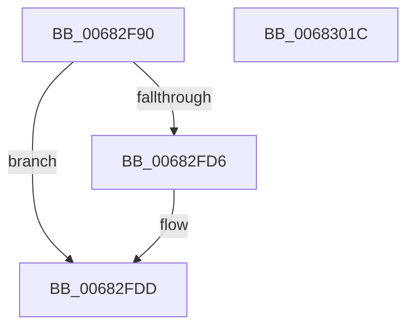

# MiBeginHoldingDirtyFaults

- RVA: `0x00682F90`–`0x0068301D` (길이 `141` bytes)
- VA: `0x0000000140682F90`
- 실행 섹션: `.text`
- PDB 이름 있음: `예`; PDB Function 태그: `아니요`
- unwind 정보 RVA: `0x00060BC4`
- 디코드: `36`개 명령, `141/141` bytes 표시
- 미해석 바이트: `0` (있으면 어셈블리에 `.byte`로 보존)

> 이 문서는 커널 이미지의 기계어와 PDB 기호를 분석해 생성했습니다. 4번과 5번은 함수 원형과 자료형을 바이너리 사용 방식에서 추정한 C 해석이며 원본 소스 복구 결과는 아닙니다.

## 1. Dependencies

- 직접 호출 지점: **3**; 고유 호출 대상: **3**
- 직접 호출자로 확인된 함수: **1**
- RIP 상대 이미지 참조: **0**

### Outgoing calls
- `0x00682FC4` → [MiLockWorkingSetExclusive](../32/MiLockWorkingSetExclusive_function_003238A0.md) (function, `0x003238A0`)
- `0x00682FF4` → [MiUnlockWorkingSetExclusive](../27/MiUnlockWorkingSetExclusive_function_0027EC70.md) (function, `0x0027EC70`)
- `0x00683007` → [MiMoveDirtyBitsToPfns](../2A/MiMoveDirtyBitsToPfns_function_002A8624.md) (function, `0x002A8624`)

### Direct callers
- [MiPrepareToHotPatchVad](../../page/80/MiPrepareToHotPatchVad_function_00806E70.md) at `0x00806ECF`

### Static image references
- 디코드된 RIP-relative 메모리 참조가 없습니다.

## 2. Other-region calls and transfers

- 다른 실행 섹션으로 향하는 call: **0**
- 별도 외부 분기/꼬리 이동을 확인하지 못했습니다.

## 3. Assembly (complete function range)

```asm
00682F90  48 89 5C 24 08                  mov qword ptr [rsp + 8], rbx
00682F95  48 89 74 24 10                  mov qword ptr [rsp + 0x10], rsi
00682F9A  57                              push rdi
00682F9B  48 83 EC 20                     sub rsp, 0x20
00682F9F  65 48 8B 04 25 88 01 00 00      mov rax, qword ptr gs:[0x188]
00682FA8  48 8B D9                        mov rbx, rcx
00682FAB  48 8B FA                        mov rdi, rdx
00682FAE  48 8B B0 B8 00 00 00            mov rsi, qword ptr [rax + 0xb8]
00682FB5  66 FF 88 E6 01 00 00            dec word ptr [rax + 0x1e6]
00682FBC  90                              nop
00682FBD  48 8D 8E 00 04 00 00            lea rcx, [rsi + 0x400]
00682FC4  E8 D7 08 CA FF                  call 0x1403238a0
00682FC9  48 8B 4B 20                     mov rcx, qword ptr [rbx + 0x20]
00682FCD  48 83 C3 18                     add rbx, 0x18
00682FD1  48 39 19                        cmp qword ptr [rcx], rbx
00682FD4  74 07                           je 0x140682fdd
00682FD6  B9 03 00 00 00                  mov ecx, 3
00682FDB  CD 29                           int 0x29
00682FDD  48 89 4F 08                     mov qword ptr [rdi + 8], rcx
00682FE1  8A D0                           mov dl, al
00682FE3  48 89 1F                        mov qword ptr [rdi], rbx
00682FE6  48 89 39                        mov qword ptr [rcx], rdi
00682FE9  48 8D 8E 00 04 00 00            lea rcx, [rsi + 0x400]
00682FF0  48 89 7B 08                     mov qword ptr [rbx + 8], rdi
00682FF4  E8 77 BC BF FF                  call 0x14027ec70
00682FF9  48 8B 57 18                     mov rdx, qword ptr [rdi + 0x18]
00682FFD  45 33 C9                        xor r9d, r9d
00683000  48 8B 4F 10                     mov rcx, qword ptr [rdi + 0x10]
00683004  45 33 C0                        xor r8d, r8d
00683007  E8 18 56 C2 FF                  call 0x1402a8624
0068300C  48 8B 5C 24 30                  mov rbx, qword ptr [rsp + 0x30]
00683011  48 8B 74 24 38                  mov rsi, qword ptr [rsp + 0x38]
00683016  48 83 C4 20                     add rsp, 0x20
0068301A  5F                              pop rdi
0068301B  C3                              ret
0068301C  CC                              int3
```

## 4. C-style interpretation (structured pseudocode)

```c
__int64 __fastcall MiBeginHoldingDirtyFaults(__int64 a1, __int64 a2, int a3, int a4)
{
    __int64 result;
    __int64 v_rbx;
    __int64 v_rsp;
    unsigned __int64 v_stack_p10;
    unsigned __int64 v_stack_p8;

    v_stack_p8 = v_rbx;
    v_stack_p10 = v_rsi;
    v_rsp = (v_rsp) - (32);
    result = MiLockWorkingSetExclusive(*(unsigned __int64 *)(*(unsigned __int64 *)(gs_base + (0 + 392)) + 184) + 1024, a2, a3, a4);
    v_rbx = (a1) + (24);
    if ((*(unsigned __int64 *)(*(unsigned __int64 *)(a1 + 32))) != v_rbx) {
        a1 = 3;
    }
    *(unsigned __int64 *)(a2 + 8) = a1;
    *(unsigned __int64 *)(a2) = v_rbx;
    *(unsigned __int64 *)(a1) = a2;
    *(unsigned __int64 *)(v_rbx + 8) = a2;
    result = MiUnlockWorkingSetExclusive(*(unsigned __int64 *)(*(unsigned __int64 *)(gs_base + (0 + 392)) + 184) + 1024, (unsigned __int8)(result), a3, a4);
    a4 = 0;
    a3 = 0;
    result = MiMoveDirtyBitsToPfns(*(unsigned __int64 *)(a2 + 16), *(unsigned __int64 *)(a2 + 24), a3, a4);
    v_rsp = (v_rsp) + (32);
    return result;
}
```

## 5. (Beta) C Style

```c
int64_t MiBeginHoldingDirtyFaults(void *Arg1, void *Arg2, int32_t Arg3, int32_t Arg4)
{
    uint8_t *arg1 = (uint8_t *)Arg1;
    uint8_t *arg2 = (uint8_t *)Arg2;

    int64_t result;
    int64_t local_rbx;
    int64_t local_rsp;
    uint64_t v_stack_p10;
    uint64_t v_stack_p8;

    v_stack_p8 = local_rbx;
    v_stack_p10 = local_rsi;
    local_rsp = (local_rsp) - (32);
    result = MiLockWorkingSetExclusive(*(uint64_t *)(*(uint64_t *)(gs_base + (0 + 0x188)) + 0xB8) + 1024, Arg2, Arg3, Arg4);
    local_rbx = (Arg1) + (24);
    if ((*(uint64_t *)(*(uint64_t *)(arg1 + 0x20))) != local_rbx) {
        Arg1 = 3;
    }
    *(void **)(arg2 + 0x8) = Arg1;
    *(uint64_t *)(arg2) = local_rbx;
    *(void **)(arg1) = Arg2;
    *(void **)(local_rbx + 0x8) = Arg2;
    result = MiUnlockWorkingSetExclusive(*(uint64_t *)(*(uint64_t *)(gs_base + (0 + 0x188)) + 0xB8) + 1024, (uint8_t)(result), Arg3, Arg4);
    Arg4 = 0;
    Arg3 = 0;
    result = MiMoveDirtyBitsToPfns(*(uint64_t *)(arg2 + 0x10), *(uint64_t *)(arg2 + 0x18), Arg3, Arg4);
    local_rsp = (local_rsp) + (32);
    return result;
}
```

### 관측된 메모리 오프셋

구조체 형식이 확인되지 않은 접근은 인자 기준의 오프셋으로만 기록했습니다.

| 기준 인자 | 오프셋 표현 | 폭 (bit) | 접근 |
|---|---:|---:|---|
| `Arg1` | `+ 0x8` | `64` | `W` |
| `Arg1` | `+ 0x20` | `64` | `R` |
| `Arg2` | `+ 0x0` | `64` | `W` |
| `Arg2` | `+ 0x8` | `64` | `W` |
| `Arg2` | `+ 0x10` | `64` | `R` |
| `Arg2` | `+ 0x18` | `64` | `R` |

## 6. Execution-region graph

[열기: 2D/3D 그래프와 함수 탐색 컨트롤 패널](../../../control-panel.html?section=text&rva=0x00682F90&view=graph)

- 2D 그래프는 위에서 아래로 흐르고, 3D 그래프는 빈 공간을 드래그해 회전합니다. Shift+드래그는 이동, 휠은 확대·축소, 함수 노드 선택은 대상 보고서 이동입니다.

### Static fallback


