# MiBuildPhysicalPageFreeChain

- RVA: `0x00687C80`–`0x00687FAC` (길이 `812` bytes)
- VA: `0x0000000140687C80`
- 실행 섹션: `.text`
- PDB 이름 있음: `예`; PDB Function 태그: `아니요`
- unwind 정보 RVA: `0x000CE300`
- 디코드: `210`개 명령, `812/812` bytes 표시
- 미해석 바이트: `0` (있으면 어셈블리에 `.byte`로 보존)

> 이 문서는 커널 이미지의 기계어와 PDB 기호를 분석해 생성했습니다. 4번과 5번은 함수 원형과 자료형을 바이너리 사용 방식에서 추정한 C 해석이며 원본 소스 복구 결과는 아닙니다.

## 1. Dependencies

- 직접 호출 지점: **22**; 고유 호출 대상: **17**
- 직접 호출자로 확인된 함수: **1**
- RIP 상대 이미지 참조: **2**

### Outgoing calls
- `0x00687CFB` → [qsort](../50/qsort_function_005009F0.md) (function, `0x005009F0`)
- `0x00687D2F` → [MiLockAweVadsShared](../4C/MiLockAweVadsShared_function_004CEE3C.md) (function, `0x004CEE3C`)
- `0x00687D3F` → [MiLockAwePagesExclusive](MiLockAwePagesExclusive_function_00689080.md) (function, `0x00689080`)
- `0x00687D59` → [ExAcquireAutoExpandPushLockShared](../20/ExAcquireAutoExpandPushLockShared_function_0020FAF0.md) (function, `0x0020FAF0`)
- `0x00687D7D` → [KiRaiseIrqlProcessIrqlFlags](../4F/KiRaiseIrqlProcessIrqlFlags_function_004F56FC.md) (function, `0x004F56FC`)
- `0x00687DA4` → [MiDecrementAweMapCount](MiDecrementAweMapCount_function_00688158.md) (function, `0x00688158`)
- `0x00687DC8` → [MiGetProcessorFlushList](../24/MiGetProcessorFlushList_function_00242C90.md) (function, `0x00242C90`)
- `0x00687DFC` → [MiInitializeTbFlushList](../29/MiInitializeTbFlushList_function_00294F00.md) (function, `0x00294F00`)
- `0x00687E12` → [MiUnmapLegacyAwePage](MiUnmapLegacyAwePage_function_0068993C.md) (function, `0x0068993C`)
- `0x00687E1A` → [MiFlushTbNowToAvoidOverflow](../41/MiFlushTbNowToAvoidOverflow_function_00419590.md) (function, `0x00419590`)
- `0x00687E6E` → [KeShouldYieldProcessor](../27/KeShouldYieldProcessor_function_002773E0.md) (function, `0x002773E0`)
- `0x00687E7F` → [MiFlushTbList](../31/MiFlushTbList_function_00311FC0.md) (function, `0x00311FC0`)
- `0x00687E84` → [MiReleaseProcessorFlushList](../31/MiReleaseProcessorFlushList_function_00313C70.md) (function, `0x00313C70`)
- `0x00687E9B` → [KiLowerIrqlProcessIrqlFlags](../4F/KiLowerIrqlProcessIrqlFlags_function_004F5698.md) (function, `0x004F5698`)
- `0x00687EC9` → [KiRaiseIrqlProcessIrqlFlags](../4F/KiRaiseIrqlProcessIrqlFlags_function_004F56FC.md) (function, `0x004F56FC`)
- `0x00687F08` → [MI_FLUSH_ENTIRE_TB](../31/MI_FLUSH_ENTIRE_TB_function_00314110.md) (function, `0x00314110`)
- `0x00687F2E` → [MiFlushTbList](../31/MiFlushTbList_function_00311FC0.md) (function, `0x00311FC0`)
- `0x00687F33` → [MiReleaseProcessorFlushList](../31/MiReleaseProcessorFlushList_function_00313C70.md) (function, `0x00313C70`)
- `0x00687F48` → [KiLowerIrqlProcessIrqlFlags](../4F/KiLowerIrqlProcessIrqlFlags_function_004F5698.md) (function, `0x004F5698`)
- `0x00687F65` → [MiUnlockAwePagesExclusive](MiUnlockAwePagesExclusive_function_006898FC.md) (function, `0x006898FC`)
- `0x00687F70` → [MiUnlockAwePagesShared](../4C/MiUnlockAwePagesShared_function_004C66C4.md) (function, `0x004C66C4`)
- `0x00687F7F` → [MiUnlockAwePagesShared](../4C/MiUnlockAwePagesShared_function_004C66C4.md) (function, `0x004C66C4`)

### Direct callers
- [NtFreeUserPhysicalPages](../../page/80/NtFreeUserPhysicalPages_function_0080AF30.md) at `0x0080B211`

### Static image references
- `0x00687CEB` → RVA `0x00558EA0` (`HalpNodeCostSort`; read)
- `0x00687D70` → RVA `0x00FC6D20` (`ALMOSTRO`; read)

## 2. Other-region calls and transfers

- 다른 실행 섹션으로 향하는 call: **0**
- 별도 외부 분기/꼬리 이동을 확인하지 못했습니다.

## 3. Assembly (complete function range)

```asm
00687C80  4C 89 44 24 18                  mov qword ptr [rsp + 0x18], r8
00687C85  53                              push rbx
00687C86  55                              push rbp
00687C87  56                              push rsi
00687C88  57                              push rdi
00687C89  41 54                           push r12
00687C8B  41 55                           push r13
00687C8D  41 56                           push r14
00687C8F  41 57                           push r15
00687C91  48 83 EC 58                     sub rsp, 0x58
00687C95  48 8B E9                        mov rbp, rcx
00687C98  4C 8D 72 30                     lea r14, [rdx + 0x30]
00687C9C  33 C9                           xor ecx, ecx
00687C9E  45 33 E4                        xor r12d, r12d
00687CA1  0F 57 C0                        xorps xmm0, xmm0
00687CA4  44 89 A4 24 A8 00 00 00         mov dword ptr [rsp + 0xa8], r12d
00687CAC  41 0F 11 00                     movups xmmword ptr [r8], xmm0
00687CB0  49 89 48 10                     mov qword ptr [r8 + 0x10], rcx
00687CB4  4C 8B EA                        mov r13, rdx
00687CB7  65 48 8B 34 25 88 01 00 00      mov rsi, qword ptr gs:[0x188]
00687CC0  49 8B C6                        mov rax, r14
00687CC3  8B 4A 28                        mov ecx, dword ptr [rdx + 0x28]
00687CC6  48 C1 E9 0C                     shr rcx, 0xc
00687CCA  48 89 4C 24 48                  mov qword ptr [rsp + 0x48], rcx
00687CCF  49 8D 14 CE                     lea rdx, [r14 + rcx*8]
00687CD3  48 89 54 24 40                  mov qword ptr [rsp + 0x40], rdx
00687CD8  48 3B C2                        cmp rax, rdx
00687CDB  74 23                           je 0x140687d00
00687CDD  4C 39 20                        cmp qword ptr [rax], r12
00687CE0  76 06                           jbe 0x140687ce8
00687CE2  48 83 C0 08                     add rax, 8
00687CE6  EB F0                           jmp 0x140687cd8
00687CE8  48 8B D1                        mov rdx, rcx
00687CEB  4C 8D 0D AE 11 ED FF            lea r9, [rip - 0x12ee52]
00687CF2  49 8B CE                        mov rcx, r14
00687CF5  41 B8 08 00 00 00               mov r8d, 8
00687CFB  E8 F0 8C E7 FF                  call 0x1405009f0
00687D00  8B 45 08                        mov eax, dword ptr [rbp + 8]
00687D03  48 83 CA FF                     or rdx, 0xffffffffffffffff
00687D07  49 8B FE                        mov rdi, r14
00687D0A  44 89 A4 24 A0 00 00 00         mov dword ptr [rsp + 0xa0], r12d
00687D12  4D 8B FC                        mov r15, r12
00687D15  4C 89 A4 24 B8 00 00 00         mov qword ptr [rsp + 0xb8], r12
00687D1D  49 8B DC                        mov rbx, r12
00687D20  8D 4A 02                        lea ecx, [rdx + 2]
00687D23  84 C1                           test cl, al
00687D25  74 1F                           je 0x140687d46
00687D27  48 8B CE                        mov rcx, rsi
00687D2A  4C 89 64 24 38                  mov qword ptr [rsp + 0x38], r12
00687D2F  E8 08 71 E4 FF                  call 0x1404cee3c
00687D34  48 8B D6                        mov rdx, rsi
00687D37  48 89 44 24 30                  mov qword ptr [rsp + 0x30], rax
00687D3C  48 8B CD                        mov rcx, rbp
00687D3F  E8 3C 13 00 00                  call 0x140689080
00687D44  EB 1D                           jmp 0x140687d63
00687D46  66 01 96 E6 01 00 00            add word ptr [rsi + 0x1e6], dx
00687D4D  48 8D 4D 40                     lea rcx, [rbp + 0x40]
00687D51  33 D2                           xor edx, edx
00687D53  4C 89 64 24 30                  mov qword ptr [rsp + 0x30], r12
00687D58  90                              nop
00687D59  E8 92 7D B8 FF                  call 0x14020faf0
00687D5E  48 89 44 24 38                  mov qword ptr [rsp + 0x38], rax
00687D63  45 0F 20 C4                     mov r12, cr8
00687D67  B8 02 00 00 00                  mov eax, 2
00687D6C  44 0F 22 C0                     mov cr8, rax
00687D70  39 1D AA EF 93 00               cmp dword ptr [rip + 0x93efaa], ebx
00687D76  74 0A                           je 0x140687d82
00687D78  8A D0                           mov dl, al
00687D7A  41 8A CC                        mov cl, r12b
00687D7D  E8 7A D9 E6 FF                  call 0x1404f56fc
00687D82  4C 3B 74 24 40                  cmp r14, qword ptr [rsp + 0x40]
00687D87  0F 83 5A 01 00 00               jae 0x140687ee7
00687D8D  4D 8B 3E                        mov r15, qword ptr [r14]
00687D90  41 B8 01 00 00 00               mov r8d, 1
00687D96  4C 8B 8C 24 B0 00 00 00         mov r9, qword ptr [rsp + 0xb0]
00687D9E  49 8B D7                        mov rdx, r15
00687DA1  48 8B CD                        mov rcx, rbp
00687DA4  E8 AF 03 00 00                  call 0x140688158
00687DA9  48 83 F8 FF                     cmp rax, -1
00687DAD  0F 84 24 01 00 00               je 0x140687ed7
00687DB3  48 85 C0                        test rax, rax
00687DB6  74 7F                           je 0x140687e37
00687DB8  8B 45 08                        mov eax, dword ptr [rbp + 8]
00687DBB  A8 01                           test al, 1
00687DBD  0F 84 81 00 00 00               je 0x140687e44
00687DC3  48 85 DB                        test rbx, rbx
00687DC6  75 39                           jne 0x140687e01
00687DC8  E8 C3 AE BB FF                  call 0x140242c90
00687DCD  48 8B D8                        mov rbx, rax
00687DD0  C7 44 24 20 01 00 00 00         mov dword ptr [rsp + 0x20], 1
00687DD8  65 48 8B 04 25 88 01 00 00      mov rax, qword ptr gs:[0x188]
00687DE1  41 B9 08 00 00 00               mov r9d, 8
00687DE7  48 8B CB                        mov rcx, rbx
00687DEA  44 8B 43 0C                     mov r8d, dword ptr [rbx + 0xc]
00687DEE  48 8B 90 B8 00 00 00            mov rdx, qword ptr [rax + 0xb8]
00687DF5  48 81 C2 00 04 00 00            add rdx, 0x400
00687DFC  E8 FF D0 C0 FF                  call 0x140294f00
00687E01  4C 8B 8C 24 B0 00 00 00         mov r9, qword ptr [rsp + 0xb0]
00687E09  4C 8B C3                        mov r8, rbx
00687E0C  49 8B D7                        mov rdx, r15
00687E0F  48 8B CD                        mov rcx, rbp
00687E12  E8 25 1B 00 00                  call 0x14068993c
00687E17  48 8B CB                        mov rcx, rbx
00687E1A  E8 71 17 D9 FF                  call 0x140419590
00687E1F  8B 8C 24 A0 00 00 00            mov ecx, dword ptr [rsp + 0xa0]
00687E26  85 C0                           test eax, eax
00687E28  B8 01 00 00 00                  mov eax, 1
00687E2D  0F 45 C8                        cmovne ecx, eax
00687E30  89 8C 24 A0 00 00 00            mov dword ptr [rsp + 0xa0], ecx
00687E37  49 83 FF FF                     cmp r15, -1
00687E3B  74 07                           je 0x140687e44
00687E3D  4C 89 3F                        mov qword ptr [rdi], r15
00687E40  48 83 C7 08                     add rdi, 8
00687E44  4C 8B BC 24 B8 00 00 00         mov r15, qword ptr [rsp + 0xb8]
00687E4C  49 FF C7                        inc r15
00687E4F  83 BC 24 A0 00 00 00 00         cmp dword ptr [rsp + 0xa0], 0
00687E57  4C 89 BC 24 B8 00 00 00         mov qword ptr [rsp + 0xb8], r15
00687E5F  75 16                           jne 0x140687e77
00687E61  41 F6 C7 3F                     test r15b, 0x3f
00687E65  75 67                           jne 0x140687ece
00687E67  4C 3B 7C 24 48                  cmp r15, qword ptr [rsp + 0x48]
00687E6C  74 60                           je 0x140687ece
00687E6E  E8 6D F5 BE FF                  call 0x1402773e0
00687E73  85 C0                           test eax, eax
00687E75  74 57                           je 0x140687ece
00687E77  48 85 DB                        test rbx, rbx
00687E7A  74 0F                           je 0x140687e8b
00687E7C  48 8B CB                        mov rcx, rbx
00687E7F  E8 3C A1 C8 FF                  call 0x140311fc0
00687E84  E8 E7 BD C8 FF                  call 0x140313c70
00687E89  33 DB                           xor ebx, ebx
00687E8B  83 3D 8E EE 93 00 00            cmp dword ptr [rip + 0x93ee8e], 0
00687E92  74 0C                           je 0x140687ea0
00687E94  44 0F 20 C1                     mov rcx, cr8
00687E98  41 8A D4                        mov dl, r12b
00687E9B  E8 F8 D7 E6 FF                  call 0x1404f5698
00687EA0  41 0F B6 C4                     movzx eax, r12b
00687EA4  44 0F 22 C0                     mov cr8, rax
00687EA8  33 C0                           xor eax, eax
00687EAA  89 84 24 A0 00 00 00            mov dword ptr [rsp + 0xa0], eax
00687EB1  44 0F 20 C1                     mov rcx, cr8
00687EB5  B8 02 00 00 00                  mov eax, 2
00687EBA  44 0F 22 C0                     mov cr8, rax
00687EBE  83 3D 5B EE 93 00 00            cmp dword ptr [rip + 0x93ee5b], 0
00687EC5  74 07                           je 0x140687ece
00687EC7  8A D0                           mov dl, al
00687EC9  E8 2E D8 E6 FF                  call 0x1404f56fc
00687ECE  49 83 C6 08                     add r14, 8
00687ED2  E9 AB FE FF FF                  jmp 0x140687d82
00687ED7  4C 8B BC 24 B8 00 00 00         mov r15, qword ptr [rsp + 0xb8]
00687EDF  41 BE 18 00 00 C0               mov r14d, 0xc0000018
00687EE5  EB 08                           jmp 0x140687eef
00687EE7  44 8B B4 24 A8 00 00 00         mov r14d, dword ptr [rsp + 0xa8]
00687EEF  48 8B 84 24 B0 00 00 00         mov rax, qword ptr [rsp + 0xb0]
00687EF7  80 78 14 00                     cmp byte ptr [rax + 0x14], 0
00687EFB  74 29                           je 0x140687f26
00687EFD  8B 55 08                        mov edx, dword ptr [rbp + 8]
00687F00  F7 D2                           not edx
00687F02  83 E2 01                        and edx, 1
00687F05  8D 4A 01                        lea ecx, [rdx + 1]
00687F08  E8 03 C2 C8 FF                  call 0x140314110
00687F0D  48 85 DB                        test rbx, rbx
00687F10  74 26                           je 0x140687f38
00687F12  66 83 63 19 00                  and word ptr [rbx + 0x19], 0
00687F17  83 63 1C 00                     and dword ptr [rbx + 0x1c], 0
00687F1B  48 83 63 20 00                  and qword ptr [rbx + 0x20], 0
00687F20  83 63 10 DB                     and dword ptr [rbx + 0x10], 0xffffffdb
00687F24  EB 0D                           jmp 0x140687f33
00687F26  48 85 DB                        test rbx, rbx
00687F29  74 0D                           je 0x140687f38
00687F2B  48 8B CB                        mov rcx, rbx
00687F2E  E8 8D A0 C8 FF                  call 0x140311fc0
00687F33  E8 38 BD C8 FF                  call 0x140313c70
00687F38  83 3D E1 ED 93 00 00            cmp dword ptr [rip + 0x93ede1], 0
00687F3F  74 0C                           je 0x140687f4d
00687F41  44 0F 20 C1                     mov rcx, cr8
00687F45  41 8A D4                        mov dl, r12b
00687F48  E8 4B D7 E6 FF                  call 0x1404f5698
00687F4D  41 0F B6 C4                     movzx eax, r12b
00687F51  44 0F 22 C0                     mov cr8, rax
00687F55  48 8B 5C 24 30                  mov rbx, qword ptr [rsp + 0x30]
00687F5A  48 85 DB                        test rbx, rbx
00687F5D  74 18                           je 0x140687f77
00687F5F  48 8B D6                        mov rdx, rsi
00687F62  48 8B CD                        mov rcx, rbp
00687F65  E8 92 19 00 00                  call 0x1406898fc
00687F6A  48 8B D3                        mov rdx, rbx
00687F6D  48 8B CE                        mov rcx, rsi
00687F70  E8 4F E7 E3 FF                  call 0x1404c66c4
00687F75  EB 0D                           jmp 0x140687f84
00687F77  48 8B 54 24 38                  mov rdx, qword ptr [rsp + 0x38]
00687F7C  48 8B CE                        mov rcx, rsi
00687F7F  E8 40 E7 E3 FF                  call 0x1404c66c4
00687F84  49 2B FD                        sub rdi, r13
00687F87  45 89 7D 2C                     mov dword ptr [r13 + 0x2c], r15d
00687F8B  48 83 EF 30                     sub rdi, 0x30
00687F8F  41 8B C6                        mov eax, r14d
00687F92  48 C1 FF 03                     sar rdi, 3
00687F96  41 89 7D 28                     mov dword ptr [r13 + 0x28], edi
00687F9A  48 83 C4 58                     add rsp, 0x58
00687F9E  41 5F                           pop r15
00687FA0  41 5E                           pop r14
00687FA2  41 5D                           pop r13
00687FA4  41 5C                           pop r12
00687FA6  5F                              pop rdi
00687FA7  5E                              pop rsi
00687FA8  5D                              pop rbp
00687FA9  5B                              pop rbx
00687FAA  C3                              ret
00687FAB  CC                              int3
```

## 4. C-style interpretation (structured pseudocode)

```c
__int64 __fastcall MiBuildPhysicalPageFreeChain(__int64 a1, __int64 a2, __int64 a3)
{
    __int64 result;
    __int64 v_r12;
    __int64 v_r14;
    __int64 v_r15;
    __int64 v_rbx;
    __int64 v_rdi;
    __int64 v_rsp;
    unsigned __int64 v_stack_m50;
    unsigned __int64 v_stack_m58;
    unsigned __int64 v_stack_m60;
    unsigned __int64 v_stack_m68;
    unsigned int v_stack_m78;
    unsigned int v_stack_p10;
    unsigned __int64 v_stack_p18;
    unsigned __int64 v_stack_p20;
    unsigned int v_stack_p8;

    v_stack_p18 = a3;
    v_rsp = (v_rsp) - (88);
    a1 = 0;
    v_r12 = 0;
    v_stack_p10 = 0;
    *(unsigned __int64 *)(a3) = v_xmm0;
    *(unsigned __int64 *)(a3 + 16) = 0;
    a1 = ((unsigned int)(*(unsigned int *)(a2 + 40))) >> (12);
    v_stack_m50 = a1;
    v_stack_m58 = a2 + 48 + a1 * 8;
loc_00687CD8:
    if ((a2 + 48) == (a2 + 48 + a1 * 8)) goto loc_00687D00;
    if ((*(unsigned __int64 *)(a2 + 48)) <= 0) goto loc_00687CE8;
    result = (a2 + 48) + (8);
    goto loc_00687CD8;
loc_00687CE8:
    result = qsort(a2 + 48, a1, 8, v_rip - 1240658);
loc_00687D00:
    a2 = (a1) | (-1);
    v_stack_p8 = 0;
    v_stack_p20 = 0;
    if ((((unsigned __int8)(a2 + 2)) & ((unsigned __int8)((unsigned int)(*(unsigned int *)(a1 + 8))))) == 0) goto loc_00687D46;
    v_stack_m60 = 0;
    result = MiLockAweVadsShared(*(unsigned __int64 *)(gs_base + (0 + 392)), a2, 8, v_rip - 1240658);
    v_stack_m68 = result;
    result = MiLockAwePagesExclusive(a1, *(unsigned __int64 *)(gs_base + (0 + 392)), 8, v_rip - 1240658);
    goto loc_00687D63;
loc_00687D46:
    a2 = 0;
    v_stack_m68 = 0;
    result = ExAcquireAutoExpandPushLockShared(a1 + 64, a2, 8, v_rip - 1240658);
    v_stack_m60 = result;
loc_00687D63:
    result = 2;
    if ((*(unsigned int *)(v_rip + 9695146)) != 0) {
        a2 = 2;
        a1 = (unsigned __int8)(v_cr8);
        result = KiRaiseIrqlProcessIrqlFlags(a1, a2, 8, v_rip - 1240658);
    }
    if ((a2 + 48) >= v_stack_m58) goto loc_00687EE7;
    result = MiDecrementAweMapCount(a1, *(unsigned __int64 *)(a2 + 48), 1, v_stack_p18);
    if (result == -1) goto loc_00687ED7;
    if (result == 0) goto loc_00687E37;
    if ((((unsigned __int8)((unsigned int)(*(unsigned int *)(a1 + 8)))) & (1)) == 0) goto loc_00687E44;
    result = (unsigned int)(*(unsigned int *)(a1 + 8));
    v_rbx = 0;
    if (0 == 0) {
        result = MiGetProcessorFlushList(a1, *(unsigned __int64 *)(a2 + 48), 1, v_stack_p18);
        v_rbx = result;
        v_stack_m78 = 1;
        result = *(unsigned __int64 *)(gs_base + (0 + 392));
        a4 = 8;
        a1 = v_rbx;
        a3 = *(unsigned int *)(v_rbx + 12);
        a2 = *(unsigned __int64 *)(result + 184);
        a2 = (a2) + (0x400ULL);
        result = MiInitializeTbFlushList(a1, a2, a3, a4);
    }
    result = MiUnmapLegacyAwePage(a1, *(unsigned __int64 *)(a2 + 48), v_rbx, v_stack_p18);
    result = MiFlushTbNowToAvoidOverflow(v_rbx, *(unsigned __int64 *)(a2 + 48), v_rbx, v_stack_p18);
    a1 = (unsigned int)(v_stack_p8);
    if ((unsigned int)(result) != 0) { a1 = 1; }
    v_stack_p8 = (unsigned int)(a1);
loc_00687E37:
    v_rdi = a2 + 48;
    if ((*(unsigned __int64 *)(a2 + 48)) != -1) {
        *(unsigned __int64 *)(a2 + 48) = *(unsigned __int64 *)(a2 + 48);
        v_rdi = (a2 + 48) + (8);
    }
    v_r15 = (v_stack_p20) + 1;
    v_stack_p20 = v_r15;
    if (v_stack_p8 != 0) goto loc_00687E77;
    if ((((unsigned __int8)(v_r15)) & (63)) != 0) goto loc_00687ECE;
    if (v_r15 == v_stack_m50) goto loc_00687ECE;
    result = KeShouldYieldProcessor(a1, *(unsigned __int64 *)(a2 + 48), v_rbx, v_stack_p18);
    if ((unsigned int)(result) == 0) goto loc_00687ECE;
loc_00687E77:
    if (v_rbx != 0) {
        a1 = v_rbx;
        result = MiFlushTbList(a1, *(unsigned __int64 *)(a2 + 48), v_rbx, v_stack_p18);
        result = MiReleaseProcessorFlushList(a1, *(unsigned __int64 *)(a2 + 48), v_rbx, v_stack_p18);
        v_rbx = 0;
    }
    if ((*(unsigned int *)(v_rip + 9694862)) != 0) {
        a1 = 2;
        a2 = (unsigned __int8)(v_cr8);
        result = KiLowerIrqlProcessIrqlFlags(a1, a2, v_rbx, v_stack_p18);
    }
    result = 0;
    v_stack_p8 = 0;
    result = 2;
    if ((*(unsigned int *)(v_rip + 9694811)) != 0) {
        a2 = 2;
        result = KiRaiseIrqlProcessIrqlFlags((unsigned __int8)(v_cr8), a2, v_rbx, v_stack_p18);
    }
    v_r14 = (a2 + 48) + (8);
    goto loc_00687D82;
loc_00687ED7:
    goto loc_00687EEF;
loc_00687EE7:
loc_00687EEF:
    if ((*(unsigned __int8 *)(v_stack_p18 + 20)) == 0) goto loc_00687F26;
    a2 = (unsigned int)(~((unsigned int)(*(unsigned int *)(a1 + 8))));
    a2 = (unsigned int)((a2) & (1));
    result = MI_FLUSH_ENTIRE_TB(a2 + 1, a2, v_rbx, v_stack_p18);
    if (0 == 0) goto loc_00687F38;
    goto loc_00687F33;
loc_00687F26:
    if (0 == 0) goto loc_00687F38;
    result = MiFlushTbList(0, a2, v_rbx, v_stack_p18);
loc_00687F33:
    result = MiReleaseProcessorFlushList(0, a2, v_rbx, v_stack_p18);
loc_00687F38:
    if ((*(unsigned int *)(v_rip + 9694689)) != 0) {
        a1 = 2;
        a2 = (unsigned __int8)(v_cr8);
        result = KiLowerIrqlProcessIrqlFlags(a1, a2, v_rbx, v_stack_p18);
    }
    if (v_stack_m68 == 0) goto loc_00687F77;
    result = MiUnlockAwePagesExclusive(a1, *(unsigned __int64 *)(gs_base + (0 + 392)), v_rbx, v_stack_p18);
    result = MiUnlockAwePagesShared(*(unsigned __int64 *)(gs_base + (0 + 392)), v_stack_m68, v_rbx, v_stack_p18);
    goto loc_00687F84;
loc_00687F77:
    result = MiUnlockAwePagesShared(*(unsigned __int64 *)(gs_base + (0 + 392)), v_stack_m60, v_rbx, v_stack_p18);
loc_00687F84:
    v_rdi = (v_rdi) - (a2);
    *(unsigned int *)(a2 + 44) = (unsigned int)(v_stack_p20);
    v_rdi = (v_rdi) - (48);
    v_rdi = (v_rdi) >> (3);
    *(unsigned int *)(a2 + 40) = (unsigned int)(v_rdi);
    v_rsp = (v_rsp) + (88);
    return (unsigned int)((unsigned int)((unsigned int)(v_stack_p10)));
}
```

## 5. (Beta) C Style

```c
int64_t MiBuildPhysicalPageFreeChain(void *Arg1, void *Arg2, void *Arg3)
{
    uint8_t *arg1 = (uint8_t *)Arg1;
    uint8_t *arg2 = (uint8_t *)Arg2;
    uint8_t *arg3 = (uint8_t *)Arg3;

    int64_t result;
    int64_t local_r12;
    int64_t local_r14;
    int64_t local_r15;
    int64_t local_rbx;
    int64_t local_rdi;
    int64_t local_rsp;
    uint64_t v_stack_m50;
    uint64_t v_stack_m58;
    uint64_t v_stack_m60;
    uint64_t v_stack_m68;
    uint32_t v_stack_m78;
    uint32_t v_stack_p10;
    uint64_t v_stack_p18;
    uint64_t v_stack_p20;
    uint32_t v_stack_p8;

    v_stack_p18 = Arg3;
    local_rsp = (local_rsp) - (88);
    Arg1 = 0;
    local_r12 = 0;
    v_stack_p10 = 0;
    *(uint64_t *)(arg3) = v_xmm0;
    *(uint64_t *)(arg3 + 0x10) = 0;
    Arg1 = ((uint32_t)(*(uint32_t *)(arg2 + 0x28))) >> (12);
    v_stack_m50 = Arg1;
    v_stack_m58 = Arg2 + 48 + Arg1 * 8;
loc_00687CD8:
    if ((Arg2 + 48) == (Arg2 + 48 + Arg1 * 8)) goto loc_00687D00;
    if ((*(uint64_t *)(arg2 + 0x30)) <= 0) goto loc_00687CE8;
    result = (Arg2 + 48) + (8);
    goto loc_00687CD8;
loc_00687CE8:
    result = qsort(Arg2 + 48, Arg1, 8, v_rip - 1240658);
loc_00687D00:
    Arg2 = (Arg1) | (-1);
    v_stack_p8 = 0;
    v_stack_p20 = 0;
    if ((((uint8_t)(Arg2 + 2)) & ((uint8_t)((uint32_t)(*(uint32_t *)(arg1 + 0x8))))) == 0) goto loc_00687D46;
    v_stack_m60 = 0;
    result = MiLockAweVadsShared(*(uint64_t *)(gs_base + (0 + 0x188)), Arg2, 8, v_rip - 1240658);
    v_stack_m68 = result;
    result = MiLockAwePagesExclusive(Arg1, *(uint64_t *)(gs_base + (0 + 0x188)), 8, v_rip - 1240658);
    goto loc_00687D63;
loc_00687D46:
    Arg2 = 0;
    v_stack_m68 = 0;
    result = ExAcquireAutoExpandPushLockShared(Arg1 + 64, Arg2, 8, v_rip - 1240658);
    v_stack_m60 = result;
loc_00687D63:
    result = 2;
    if ((*(uint32_t *)(v_rip + 0x93EFAA)) != 0) {
        Arg2 = 2;
        Arg1 = (uint8_t)(v_cr8);
        result = KiRaiseIrqlProcessIrqlFlags(Arg1, Arg2, 8, v_rip - 1240658);
    }
    if ((Arg2 + 48) >= v_stack_m58) goto loc_00687EE7;
    result = MiDecrementAweMapCount(Arg1, *(uint64_t *)(arg2 + 0x30), 1, v_stack_p18);
    if (result == -1) goto loc_00687ED7;
    if (result == 0) goto loc_00687E37;
    if ((((uint8_t)((uint32_t)(*(uint32_t *)(arg1 + 0x8)))) & (1)) == 0) goto loc_00687E44;
    result = (uint32_t)(*(uint32_t *)(arg1 + 0x8));
    local_rbx = 0;
    if (0 == 0) {
        result = MiGetProcessorFlushList(Arg1, *(uint64_t *)(arg2 + 0x30), 1, v_stack_p18);
        local_rbx = result;
        v_stack_m78 = 1;
        result = *(uint64_t *)(gs_base + (0 + 0x188));
        a4 = 8;
        Arg1 = local_rbx;
        Arg3 = *(uint32_t *)(local_rbx + 0xC);
        Arg2 = *(uint64_t *)(result + 0xB8);
        Arg2 = (Arg2) + (0x400ULL);
        result = MiInitializeTbFlushList(Arg1, Arg2, Arg3, a4);
    }
    result = MiUnmapLegacyAwePage(Arg1, *(uint64_t *)(arg2 + 0x30), local_rbx, v_stack_p18);
    result = MiFlushTbNowToAvoidOverflow(local_rbx, *(uint64_t *)(arg2 + 0x30), local_rbx, v_stack_p18);
    Arg1 = (uint32_t)(v_stack_p8);
    if ((uint32_t)(result) != 0) { Arg1 = 1; }
    v_stack_p8 = (uint32_t)(Arg1);
loc_00687E37:
    local_rdi = Arg2 + 48;
    if ((*(uint64_t *)(arg2 + 0x30)) != -1) {
        *(uint64_t *)(arg2 + 0x30) = *(uint64_t *)(arg2 + 0x30);
        local_rdi = (Arg2 + 48) + (8);
    }
    local_r15 = (v_stack_p20) + 1;
    v_stack_p20 = local_r15;
    if (v_stack_p8 != 0) goto loc_00687E77;
    if ((((uint8_t)(local_r15)) & (63)) != 0) goto loc_00687ECE;
    if (local_r15 == v_stack_m50) goto loc_00687ECE;
    result = KeShouldYieldProcessor(Arg1, *(uint64_t *)(arg2 + 0x30), local_rbx, v_stack_p18);
    if ((uint32_t)(result) == 0) goto loc_00687ECE;
loc_00687E77:
    if (local_rbx != 0) {
        Arg1 = local_rbx;
        result = MiFlushTbList(Arg1, *(uint64_t *)(arg2 + 0x30), local_rbx, v_stack_p18);
        result = MiReleaseProcessorFlushList(Arg1, *(uint64_t *)(arg2 + 0x30), local_rbx, v_stack_p18);
        local_rbx = 0;
    }
    if ((*(uint32_t *)(v_rip + 0x93EE8E)) != 0) {
        Arg1 = 2;
        Arg2 = (uint8_t)(v_cr8);
        result = KiLowerIrqlProcessIrqlFlags(Arg1, Arg2, local_rbx, v_stack_p18);
    }
    result = 0;
    v_stack_p8 = 0;
    result = 2;
    if ((*(uint32_t *)(v_rip + 0x93EE5B)) != 0) {
        Arg2 = 2;
        result = KiRaiseIrqlProcessIrqlFlags((uint8_t)(v_cr8), Arg2, local_rbx, v_stack_p18);
    }
    local_r14 = (Arg2 + 48) + (8);
    goto loc_00687D82;
loc_00687ED7:
    goto loc_00687EEF;
loc_00687EE7:
loc_00687EEF:
    if ((*(uint8_t *)(v_stack_p18 + 0x14)) == 0) goto loc_00687F26;
    Arg2 = (uint32_t)(~((uint32_t)(*(uint32_t *)(arg1 + 0x8))));
    Arg2 = (uint32_t)((Arg2) & (1));
    result = MI_FLUSH_ENTIRE_TB(Arg2 + 1, Arg2, local_rbx, v_stack_p18);
    if (0 == 0) goto loc_00687F38;
    goto loc_00687F33;
loc_00687F26:
    if (0 == 0) goto loc_00687F38;
    result = MiFlushTbList(0, Arg2, local_rbx, v_stack_p18);
loc_00687F33:
    result = MiReleaseProcessorFlushList(0, Arg2, local_rbx, v_stack_p18);
loc_00687F38:
    if ((*(uint32_t *)(v_rip + 0x93EDE1)) != 0) {
        Arg1 = 2;
        Arg2 = (uint8_t)(v_cr8);
        result = KiLowerIrqlProcessIrqlFlags(Arg1, Arg2, local_rbx, v_stack_p18);
    }
    if (v_stack_m68 == 0) goto loc_00687F77;
    result = MiUnlockAwePagesExclusive(Arg1, *(uint64_t *)(gs_base + (0 + 0x188)), local_rbx, v_stack_p18);
    result = MiUnlockAwePagesShared(*(uint64_t *)(gs_base + (0 + 0x188)), v_stack_m68, local_rbx, v_stack_p18);
    goto loc_00687F84;
loc_00687F77:
    result = MiUnlockAwePagesShared(*(uint64_t *)(gs_base + (0 + 0x188)), v_stack_m60, local_rbx, v_stack_p18);
loc_00687F84:
    local_rdi = (local_rdi) - (Arg2);
    *(uint32_t *)(arg2 + 0x2C) = (uint32_t)(v_stack_p20);
    local_rdi = (local_rdi) - (48);
    local_rdi = (local_rdi) >> (3);
    *(uint32_t *)(arg2 + 0x28) = (uint32_t)(local_rdi);
    local_rsp = (local_rsp) + (88);
    return (uint32_t)((uint32_t)((uint32_t)(v_stack_p10)));
}
```

### 관측된 메모리 오프셋

구조체 형식이 확인되지 않은 접근은 인자 기준의 오프셋으로만 기록했습니다.

| 기준 인자 | 오프셋 표현 | 폭 (bit) | 접근 |
|---|---:|---:|---|
| `Arg1` | `+ 0x8` | `32` | `R` |
| `Arg1` | `+ 0x40` | `64` | `R` |
| `Arg2` | `+ 0x0` | `64` | `W` |
| `Arg2` | `+ 0x0 + rcx*8` | `64` | `R` |
| `Arg2` | `+ 0x28` | `32` | `R` |
| `Arg2` | `+ 0x28` | `32` | `W` |
| `Arg2` | `+ 0x2C` | `32` | `W` |
| `Arg2` | `+ 0x30` | `64` | `R` |
| `Arg3` | `+ 0x0` | `128` | `R` |
| `Arg3` | `+ 0x10` | `64` | `W` |

## 6. Execution-region graph

[열기: 2D/3D 그래프와 함수 탐색 컨트롤 패널](../../../control-panel.html?section=text&rva=0x00687C80&view=graph)

- 2D 그래프는 위에서 아래로 흐르고, 3D 그래프는 빈 공간을 드래그해 회전합니다. Shift+드래그는 이동, 휠은 확대·축소, 함수 노드 선택은 대상 보고서 이동입니다.

### Static fallback

```mermaid
flowchart TD
  bb_00687C80[BB_00687C80]
  bb_00687CD8[BB_00687CD8]
  bb_00687CDD[BB_00687CDD]
  bb_00687CE2[BB_00687CE2]
  bb_00687CE8[BB_00687CE8]
  bb_00687D00[BB_00687D00]
  bb_00687D27[BB_00687D27]
  bb_00687D46[BB_00687D46]
  bb_00687D63[BB_00687D63]
  bb_00687D78[BB_00687D78]
  bb_00687D82[BB_00687D82]
  bb_00687D8D[BB_00687D8D]
  bb_00687DB3[BB_00687DB3]
  bb_00687DB8[BB_00687DB8]
  bb_00687DC3[BB_00687DC3]
  bb_00687DC8[BB_00687DC8]
  bb_00687E01[BB_00687E01]
  bb_00687E37[BB_00687E37]
  bb_00687E3D[BB_00687E3D]
  bb_00687E44[BB_00687E44]
  bb_00687E61[BB_00687E61]
  bb_00687E67[BB_00687E67]
  bb_00687E6E[BB_00687E6E]
  bb_00687E77[BB_00687E77]
  bb_00687E7C[BB_00687E7C]
  bb_00687E8B[BB_00687E8B]
  bb_00687E94[BB_00687E94]
  bb_00687EA0[BB_00687EA0]
  bb_00687EC7[BB_00687EC7]
  bb_00687ECE[BB_00687ECE]
  bb_00687ED7[BB_00687ED7]
  bb_00687EE7[BB_00687EE7]
  bb_00687EEF[BB_00687EEF]
  bb_00687EFD[BB_00687EFD]
  bb_00687F12[BB_00687F12]
  bb_00687F26[BB_00687F26]
  bb_00687F2B[BB_00687F2B]
  bb_00687F33[BB_00687F33]
  bb_00687F38[BB_00687F38]
  bb_00687F41[BB_00687F41]
  bb_00687F4D[BB_00687F4D]
  bb_00687F5F[BB_00687F5F]
  bb_00687F77[BB_00687F77]
  bb_00687F84[BB_00687F84]
  bb_00687FAB[BB_00687FAB]
  bb_00687C80 -->|flow| bb_00687CD8
  bb_00687CD8 -->|branch| bb_00687D00
  bb_00687CD8 -->|fallthrough| bb_00687CDD
  bb_00687CDD -->|branch| bb_00687CE8
  bb_00687CDD -->|fallthrough| bb_00687CE2
  bb_00687CE2 -->|branch| bb_00687CD8
  bb_00687CE8 -->|flow| bb_00687D00
  bb_00687D00 -->|branch| bb_00687D46
  bb_00687D00 -->|fallthrough| bb_00687D27
  bb_00687D27 -->|branch| bb_00687D63
  bb_00687D46 -->|flow| bb_00687D63
  bb_00687D63 -->|branch| bb_00687D82
  bb_00687D63 -->|fallthrough| bb_00687D78
  bb_00687D78 -->|flow| bb_00687D82
  bb_00687D82 -->|branch| bb_00687EE7
  bb_00687D82 -->|fallthrough| bb_00687D8D
  bb_00687D8D -->|branch| bb_00687ED7
  bb_00687D8D -->|fallthrough| bb_00687DB3
  bb_00687DB3 -->|branch| bb_00687E37
  bb_00687DB3 -->|fallthrough| bb_00687DB8
  bb_00687DB8 -->|branch| bb_00687E44
  bb_00687DB8 -->|fallthrough| bb_00687DC3
  bb_00687DC3 -->|branch| bb_00687E01
  bb_00687DC3 -->|fallthrough| bb_00687DC8
  bb_00687DC8 -->|flow| bb_00687E01
  bb_00687E01 -->|flow| bb_00687E37
  bb_00687E37 -->|branch| bb_00687E44
  bb_00687E37 -->|fallthrough| bb_00687E3D
  bb_00687E3D -->|flow| bb_00687E44
  bb_00687E44 -->|branch| bb_00687E77
  bb_00687E44 -->|fallthrough| bb_00687E61
  bb_00687E61 -->|branch| bb_00687ECE
  bb_00687E61 -->|fallthrough| bb_00687E67
  bb_00687E67 -->|branch| bb_00687ECE
  bb_00687E67 -->|fallthrough| bb_00687E6E
  bb_00687E6E -->|branch| bb_00687ECE
  bb_00687E6E -->|fallthrough| bb_00687E77
  bb_00687E77 -->|branch| bb_00687E8B
  bb_00687E77 -->|fallthrough| bb_00687E7C
  bb_00687E7C -->|flow| bb_00687E8B
  bb_00687E8B -->|branch| bb_00687EA0
  bb_00687E8B -->|fallthrough| bb_00687E94
  bb_00687E94 -->|flow| bb_00687EA0
  bb_00687EA0 -->|branch| bb_00687ECE
  bb_00687EA0 -->|fallthrough| bb_00687EC7
  bb_00687EC7 -->|flow| bb_00687ECE
  bb_00687ECE -->|branch| bb_00687D82
  bb_00687ED7 -->|branch| bb_00687EEF
  bb_00687EE7 -->|flow| bb_00687EEF
  bb_00687EEF -->|branch| bb_00687F26
  bb_00687EEF -->|fallthrough| bb_00687EFD
  bb_00687EFD -->|branch| bb_00687F38
  bb_00687EFD -->|fallthrough| bb_00687F12
  bb_00687F12 -->|branch| bb_00687F33
  bb_00687F26 -->|branch| bb_00687F38
  bb_00687F26 -->|fallthrough| bb_00687F2B
  bb_00687F2B -->|flow| bb_00687F33
  bb_00687F33 -->|flow| bb_00687F38
  bb_00687F38 -->|branch| bb_00687F4D
  bb_00687F38 -->|fallthrough| bb_00687F41
  bb_00687F41 -->|flow| bb_00687F4D
  bb_00687F4D -->|branch| bb_00687F77
  bb_00687F4D -->|fallthrough| bb_00687F5F
  bb_00687F5F -->|branch| bb_00687F84
  bb_00687F77 -->|flow| bb_00687F84
```


