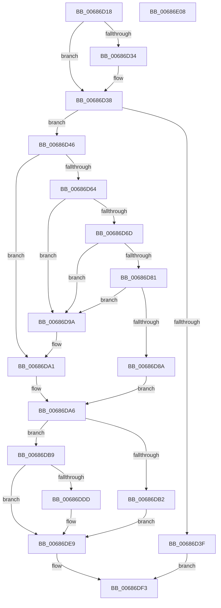

# MiCanDeleteEnclave

- RVA: `0x00686D18`–`0x00686E09` (길이 `241` bytes)
- VA: `0x0000000140686D18`
- 실행 섹션: `.text`
- PDB 이름 있음: `예`; PDB Function 태그: `아니요`
- unwind 정보 RVA: `0x0005C954`
- 디코드: `71`개 명령, `241/241` bytes 표시
- 미해석 바이트: `0` (있으면 어셈블리에 `.byte`로 보존)

> 이 문서는 커널 이미지의 기계어와 PDB 기호를 분석해 생성했습니다. 4번과 5번은 함수 원형과 자료형을 바이너리 사용 방식에서 추정한 C 해석이며 원본 소스 복구 결과는 아닙니다.

## 1. Dependencies

- 직접 호출 지점: **7**; 고유 호출 대상: **7**
- 직접 호출자로 확인된 함수: **1**
- RIP 상대 이미지 참조: **0**

### Outgoing calls
- `0x00686D56` → [PsReferenceVsmEnclave](../../page/A7/PsReferenceVsmEnclave_function_00A7C474.md) (function, `0x00A7C474`)
- `0x00686DA1` → [MiFreeEnclaveModules](../../page/70/MiFreeEnclaveModules_function_00701B1C.md) (function, `0x00701B1C`)
- `0x00686DA9` → [PsIsVsmEnclaveTerminated](../../page/78/PsIsVsmEnclaveTerminated_function_00788934.md) (function, `0x00788934`)
- `0x00686DBF` → [MiUnlockVad](../2A/MiUnlockVad_function_002A59C8.md) (function, `0x002A59C8`)
- `0x00686DC7` → [PsRundownVsmEnclave](../../page/78/PsRundownVsmEnclave_function_007889F8.md) (function, `0x007889F8`)
- `0x00686DD4` → [MiLockVad](../29/MiLockVad_function_00295810.md) (function, `0x00295810`)
- `0x00686DEC` → [PsDereferenceVsmEnclave](../../page/A0/PsDereferenceVsmEnclave_function_00A0D7D4.md) (function, `0x00A0D7D4`)

### Direct callers
- [MiFreeVadRange](../2A/MiFreeVadRange_function_002A77AC.md) at `0x002A79D3`

### Static image references
- 디코드된 RIP-relative 메모리 참조가 없습니다.

## 2. Other-region calls and transfers

- 다른 실행 섹션으로 향하는 call: **5**
  - `0x00686D56` → [PsReferenceVsmEnclave](../../page/A7/PsReferenceVsmEnclave_function_00A7C474.md) (`.text` → `PAGE`)
  - `0x00686DA1` → [MiFreeEnclaveModules](../../page/70/MiFreeEnclaveModules_function_00701B1C.md) (`.text` → `PAGE`)
  - `0x00686DA9` → [PsIsVsmEnclaveTerminated](../../page/78/PsIsVsmEnclaveTerminated_function_00788934.md) (`.text` → `PAGE`)
  - `0x00686DC7` → [PsRundownVsmEnclave](../../page/78/PsRundownVsmEnclave_function_007889F8.md) (`.text` → `PAGE`)
  - `0x00686DEC` → [PsDereferenceVsmEnclave](../../page/A0/PsDereferenceVsmEnclave_function_00A0D7D4.md) (`.text` → `PAGE`)
- 별도 외부 분기/꼬리 이동을 확인하지 못했습니다.

## 3. Assembly (complete function range)

```asm
00686D18  48 89 5C 24 08                  mov qword ptr [rsp + 8], rbx
00686D1D  48 89 6C 24 10                  mov qword ptr [rsp + 0x10], rbp
00686D22  48 89 74 24 18                  mov qword ptr [rsp + 0x18], rsi
00686D27  57                              push rdi
00686D28  48 83 EC 20                     sub rsp, 0x20
00686D2C  48 8B F9                        mov rdi, rcx
00686D2F  48 85 D2                        test rdx, rdx
00686D32  74 04                           je 0x140686d38
00686D34  48 83 22 00                     and qword ptr [rdx], 0
00686D38  8B 41 40                        mov eax, dword ptr [rcx + 0x40]
00686D3B  A8 01                           test al, 1
00686D3D  74 07                           je 0x140686d46
00686D3F  33 C0                           xor eax, eax
00686D41  E9 AD 00 00 00                  jmp 0x140686df3
00686D46  65 48 8B 2C 25 88 01 00 00      mov rbp, qword ptr gs:[0x188]
00686D4F  48 8B 71 48                     mov rsi, qword ptr [rcx + 0x48]
00686D53  48 8B CE                        mov rcx, rsi
00686D56  E8 19 57 3F 00                  call 0x140a7c474
00686D5B  48 8D 4F 50                     lea rcx, [rdi + 0x50]
00686D5F  48 85 D2                        test rdx, rdx
00686D62  74 3D                           je 0x140686da1
00686D64  48 8B 01                        mov rax, qword ptr [rcx]
00686D67  48 39 48 08                     cmp qword ptr [rax + 8], rcx
00686D6B  75 2D                           jne 0x140686d9a
00686D6D  48 89 02                        mov qword ptr [rdx], rax
00686D70  48 89 4A 08                     mov qword ptr [rdx + 8], rcx
00686D74  48 89 50 08                     mov qword ptr [rax + 8], rdx
00686D78  48 89 11                        mov qword ptr [rcx], rdx
00686D7B  48 39 4A 08                     cmp qword ptr [rdx + 8], rcx
00686D7F  75 19                           jne 0x140686d9a
00686D81  48 8B 41 08                     mov rax, qword ptr [rcx + 8]
00686D85  48 39 08                        cmp qword ptr [rax], rcx
00686D88  75 10                           jne 0x140686d9a
00686D8A  48 89 10                        mov qword ptr [rax], rdx
00686D8D  48 89 42 08                     mov qword ptr [rdx + 8], rax
00686D91  48 89 49 08                     mov qword ptr [rcx + 8], rcx
00686D95  48 89 09                        mov qword ptr [rcx], rcx
00686D98  EB 0C                           jmp 0x140686da6
00686D9A  B9 03 00 00 00                  mov ecx, 3
00686D9F  CD 29                           int 0x29
00686DA1  E8 76 AD 07 00                  call 0x140701b1c
00686DA6  48 8B CE                        mov rcx, rsi
00686DA9  E8 86 1B 10 00                  call 0x140788934
00686DAE  84 C0                           test al, al
00686DB0  75 07                           jne 0x140686db9
00686DB2  BB 11 05 00 C0                  mov ebx, 0xc0000511
00686DB7  EB 30                           jmp 0x140686de9
00686DB9  48 8B D7                        mov rdx, rdi
00686DBC  48 8B CD                        mov rcx, rbp
00686DBF  E8 04 EC C1 FF                  call 0x1402a59c8
00686DC4  48 8B CE                        mov rcx, rsi
00686DC7  E8 2C 1C 10 00                  call 0x1407889f8
00686DCC  48 8B D7                        mov rdx, rdi
00686DCF  48 8B CD                        mov rcx, rbp
00686DD2  8B D8                           mov ebx, eax
00686DD4  E8 37 EA C0 FF                  call 0x140295810
00686DD9  85 DB                           test ebx, ebx
00686DDB  78 0C                           js 0x140686de9
00686DDD  F6 47 30 04                     test byte ptr [rdi + 0x30], 4
00686DE1  B8 18 00 00 C0                  mov eax, 0xc0000018
00686DE6  0F 45 D8                        cmovne ebx, eax
00686DE9  48 8B CE                        mov rcx, rsi
00686DEC  E8 E3 69 38 00                  call 0x140a0d7d4
00686DF1  8B C3                           mov eax, ebx
00686DF3  48 8B 5C 24 30                  mov rbx, qword ptr [rsp + 0x30]
00686DF8  48 8B 6C 24 38                  mov rbp, qword ptr [rsp + 0x38]
00686DFD  48 8B 74 24 40                  mov rsi, qword ptr [rsp + 0x40]
00686E02  48 83 C4 20                     add rsp, 0x20
00686E06  5F                              pop rdi
00686E07  C3                              ret
00686E08  CC                              int3
```

## 4. C-style interpretation (structured pseudocode)

```c
__int64 __fastcall MiCanDeleteEnclave(__int64 a1, __int64 a2)
{
    __int64 result;
    __int64 v_rbx;
    __int64 v_rsp;
    unsigned __int64 v_stack_p10;
    unsigned __int64 v_stack_p18;
    unsigned __int64 v_stack_p8;

    v_stack_p8 = v_rbx;
    v_stack_p10 = v_rbp;
    v_stack_p18 = v_rsi;
    v_rsp = (v_rsp) - (32);
    if (a2 != 0) {
    }
    if ((((unsigned __int8)((unsigned int)(*(unsigned int *)(a1 + 64)))) & (1)) == 0) goto loc_00686D46;
    result = 0;
    goto loc_00686DF3;
loc_00686D46:
    result = PsReferenceVsmEnclave(*(unsigned __int64 *)(a1 + 72), a2, a3, a4);
    if (a2 == 0) goto loc_00686DA1;
    if ((*(unsigned __int64 *)(*(unsigned __int64 *)(a1 + 80) + 8)) != (a1 + 80)) goto loc_00686D9A;
    *(unsigned __int64 *)(a2) = *(unsigned __int64 *)(a1 + 80);
    *(unsigned __int64 *)(a2 + 8) = a1 + 80;
    *(unsigned __int64 *)(*(unsigned __int64 *)(a1 + 80) + 8) = a2;
    *(unsigned __int64 *)(a1 + 80) = a2;
    if ((*(unsigned __int64 *)(a2 + 8)) != (a1 + 80)) goto loc_00686D9A;
    if ((*(unsigned __int64 *)(*(unsigned __int64 *)(a1 + 80 + 8))) != (a1 + 80)) goto loc_00686D9A;
    *(unsigned __int64 *)(*(unsigned __int64 *)(a1 + 80 + 8)) = a2;
    *(unsigned __int64 *)(a2 + 8) = *(unsigned __int64 *)(a1 + 80 + 8);
    *(unsigned __int64 *)(a1 + 80 + 8) = a1 + 80;
    *(unsigned __int64 *)(a1 + 80) = a1 + 80;
    goto loc_00686DA6;
loc_00686D9A:
loc_00686DA1:
    result = MiFreeEnclaveModules(3, a2, a3, a4);
loc_00686DA6:
    result = PsIsVsmEnclaveTerminated(*(unsigned __int64 *)(a1 + 72), a2, a3, a4);
    if ((unsigned __int8)(result) != 0) goto loc_00686DB9;
    goto loc_00686DE9;
loc_00686DB9:
    result = MiUnlockVad(*(unsigned __int64 *)(gs_base + (0 + 392)), a1, a3, a4);
    result = PsRundownVsmEnclave(*(unsigned __int64 *)(a1 + 72), a1, a3, a4);
    result = MiLockVad(*(unsigned __int64 *)(gs_base + (0 + 392)), a1, a3, a4);
    v_rbx = (unsigned int)((unsigned int)(result));
    if (!(sign_flag)) {
        result = 0xC0000018ULL;
        v_rbx = (unsigned int)((unsigned int)(result));
        if (((*(unsigned __int8 *)(a1 + 48)) & (4)) != 0) { v_rbx = (unsigned int)(result); }
    }
    result = PsDereferenceVsmEnclave(*(unsigned __int64 *)(a1 + 72), a1, a3, a4);
loc_00686DF3:
    v_rsp = (v_rsp) + (32);
    return (unsigned int)((unsigned int)(v_rbx));
}
```

## 5. (Beta) C Style

```c
int64_t MiCanDeleteEnclave(void *Arg1, int64_t Arg2)
{
    uint8_t *arg1 = (uint8_t *)Arg1;

    int64_t result;
    int64_t local_rbx;
    int64_t local_rsp;
    uint64_t v_stack_p10;
    uint64_t v_stack_p18;
    uint64_t v_stack_p8;

    v_stack_p8 = local_rbx;
    v_stack_p10 = local_rbp;
    v_stack_p18 = local_rsi;
    local_rsp = (local_rsp) - (32);
    if (Arg2 != 0) {
    }
    if ((((uint8_t)((uint32_t)(*(uint32_t *)(arg1 + 0x40)))) & (1)) == 0) goto loc_00686D46;
    result = 0;
    goto loc_00686DF3;
loc_00686D46:
    result = PsReferenceVsmEnclave(*(uint64_t *)(arg1 + 0x48), Arg2, a3, a4);
    if (Arg2 == 0) goto loc_00686DA1;
    if ((*(uint64_t *)(*(uint64_t *)(arg1 + 0x50) + 0x8)) != (Arg1 + 80)) goto loc_00686D9A;
    *(uint64_t *)(Arg2) = *(uint64_t *)(arg1 + 0x50);
    *(void **)(Arg2 + 0x8) = Arg1 + 80;
    *(uint64_t *)(*(uint64_t *)(arg1 + 0x50) + 0x8) = Arg2;
    *(uint64_t *)(arg1 + 0x50) = Arg2;
    if ((*(uint64_t *)(Arg2 + 0x8)) != (Arg1 + 80)) goto loc_00686D9A;
    if ((*(uint64_t *)(*(uint64_t *)(arg1 + 0x50 + 0x8))) != (Arg1 + 80)) goto loc_00686D9A;
    *(uint64_t *)(*(uint64_t *)(arg1 + 0x50 + 0x8)) = Arg2;
    *(uint64_t *)(Arg2 + 0x8) = *(uint64_t *)(arg1 + 0x50 + 0x8);
    *(void **)(arg1 + 0x50 + 0x8) = Arg1 + 80;
    *(void **)(arg1 + 0x50) = Arg1 + 80;
    goto loc_00686DA6;
loc_00686D9A:
loc_00686DA1:
    result = MiFreeEnclaveModules(3, Arg2, a3, a4);
loc_00686DA6:
    result = PsIsVsmEnclaveTerminated(*(uint64_t *)(arg1 + 0x48), Arg2, a3, a4);
    if ((uint8_t)(result) != 0) goto loc_00686DB9;
    goto loc_00686DE9;
loc_00686DB9:
    result = MiUnlockVad(*(uint64_t *)(gs_base + (0 + 0x188)), Arg1, a3, a4);
    result = PsRundownVsmEnclave(*(uint64_t *)(arg1 + 0x48), Arg1, a3, a4);
    result = MiLockVad(*(uint64_t *)(gs_base + (0 + 0x188)), Arg1, a3, a4);
    local_rbx = (uint32_t)((uint32_t)(result));
    if (!(sign_flag)) {
        result = 0xC0000018ULL;
        local_rbx = (uint32_t)((uint32_t)(result));
        if (((*(uint8_t *)(arg1 + 0x30)) & (4)) != 0) { local_rbx = (uint32_t)(result); }
    }
    result = PsDereferenceVsmEnclave(*(uint64_t *)(arg1 + 0x48), Arg1, a3, a4);
loc_00686DF3:
    local_rsp = (local_rsp) + (32);
    return (uint32_t)((uint32_t)(local_rbx));
}
```

### 관측된 메모리 오프셋

구조체 형식이 확인되지 않은 접근은 인자 기준의 오프셋으로만 기록했습니다.

| 기준 인자 | 오프셋 표현 | 폭 (bit) | 접근 |
|---|---:|---:|---|
| `Arg1` | `+ 0x0` | `64` | `R` |
| `Arg1` | `+ 0x0` | `64` | `W` |
| `Arg1` | `+ 0x8` | `64` | `R` |
| `Arg1` | `+ 0x8` | `64` | `W` |
| `Arg1` | `+ 0x30` | `8` | `R` |
| `Arg1` | `+ 0x40` | `32` | `R` |
| `Arg1` | `+ 0x48` | `64` | `R` |
| `Arg1` | `+ 0x50` | `64` | `R` |

## 6. Execution-region graph

[열기: 2D/3D 그래프와 함수 탐색 컨트롤 패널](../../../control-panel.html?section=text&rva=0x00686D18&view=graph)

- 2D 그래프는 위에서 아래로 흐르고, 3D 그래프는 빈 공간을 드래그해 회전합니다. Shift+드래그는 이동, 휠은 확대·축소, 함수 노드 선택은 대상 보고서 이동입니다.

### Static fallback


