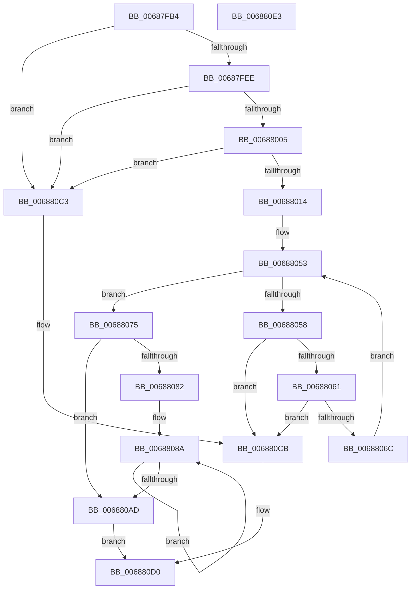

# MiChangeAwePageAttributes

- RVA: `0x00687FB4`–`0x006880E4` (길이 `304` bytes)
- VA: `0x0000000140687FB4`
- 실행 섹션: `.text`
- PDB 이름 있음: `예`; PDB Function 태그: `아니요`
- unwind 정보 RVA: `0x000701D4`
- 디코드: `81`개 명령, `304/304` bytes 표시
- 미해석 바이트: `0` (있으면 어셈블리에 `.byte`로 보존)

> 이 문서는 커널 이미지의 기계어와 PDB 기호를 분석해 생성했습니다. 4번과 5번은 함수 원형과 자료형을 바이너리 사용 방식에서 추정한 C 해석이며 원본 소스 복구 결과는 아닙니다.

## 1. Dependencies

- 직접 호출 지점: **5**; 고유 호출 대상: **4**
- 직접 호출자로 확인된 함수: **1**
- RIP 상대 이미지 참조: **0**

### Outgoing calls
- `0x00687FD3` → [MiLockPageInline](../31/MiLockPageInline_function_0031A340.md) (function, `0x0031A340`)
- `0x0068801B` → [MiUnlockPage](../31/MiUnlockPage_function_0031A3E0.md) (function, `0x0031A3E0`)
- `0x0068808D` → [MiMakeLinkedListPte](../2C/MiMakeLinkedListPte_function_002C98C0.md) (function, `0x002C98C0`)
- `0x006880BA` → [MiChangePageAttributeBatch](../2A/MiChangePageAttributeBatch_function_002A06E0.md) (function, `0x002A06E0`)
- `0x006880C6` → [MiUnlockPage](../31/MiUnlockPage_function_0031A3E0.md) (function, `0x0031A3E0`)

### Direct callers
- [MiResolveAwePageConflict](MiResolveAwePageConflict_function_00689758.md) at `0x006898A4`

### Static image references
- 디코드된 RIP-relative 메모리 참조가 없습니다.

## 2. Other-region calls and transfers

- 다른 실행 섹션으로 향하는 call: **0**
- 별도 외부 분기/꼬리 이동을 확인하지 못했습니다.

## 3. Assembly (complete function range)

```asm
00687FB4  48 89 5C 24 10                  mov qword ptr [rsp + 0x10], rbx
00687FB9  48 89 6C 24 18                  mov qword ptr [rsp + 0x18], rbp
00687FBE  56                              push rsi
00687FBF  57                              push rdi
00687FC0  41 56                           push r14
00687FC2  48 83 EC 20                     sub rsp, 0x20
00687FC6  48 8B 71 10                     mov rsi, qword ptr [rcx + 0x10]
00687FCA  41 8B E8                        mov ebp, r8d
00687FCD  48 8B CA                        mov rcx, rdx
00687FD0  48 8B FA                        mov rdi, rdx
00687FD3  E8 68 23 C9 FF                  call 0x14031a340
00687FD8  8B 4F 20                        mov ecx, dword ptr [rdi + 0x20]
00687FDB  8A D0                           mov dl, al
00687FDD  4C 8B 47 18                     mov r8, qword ptr [rdi + 0x18]
00687FE1  8B 4F 20                        mov ecx, dword ptr [rdi + 0x20]
00687FE4  66 83 F9 02                     cmp cx, 2
00687FE8  0F 87 D5 00 00 00               ja 0x1406880c3
00687FEE  48 B8 FF FF FF FF FF FF FF 3F   movabs rax, 0x3fffffffffffffff
00687FF8  4C 23 C0                        and r8, rax
00687FFB  49 83 F8 01                     cmp r8, 1
00687FFF  0F 85 BE 00 00 00               jne 0x1406880c3
00688005  48 8B 47 18                     mov rax, qword ptr [rdi + 0x18]
00688009  48 0F BA E0 3E                  bt rax, 0x3e
0068800E  0F 82 AF 00 00 00               jb 0x1406880c3
00688014  48 8B 5F 10                     mov rbx, qword ptr [rdi + 0x10]
00688018  48 8B CF                        mov rcx, rdi
0068801B  E8 C0 23 C9 FF                  call 0x14031a3e0
00688020  48 B8 00 00 00 00 00 DE FF FF   movabs rax, 0xffffde0000000000
0068802A  48 8B D7                        mov rdx, rdi
0068802D  48 2B D0                        sub rdx, rax
00688030  48 B8 AB AA AA AA AA AA AA AA   movabs rax, 0xaaaaaaaaaaaaaaab
0068803A  48 C1 FA 04                     sar rdx, 4
0068803E  48 0F AF D0                     imul rdx, rax
00688042  48 B8 FF FF FF FF 7F 00 00 00   movabs rax, 0x7fffffffff
0068804C  33 C9                           xor ecx, ecx
0068804E  48 89 44 24 40                  mov qword ptr [rsp + 0x40], rax
00688053  48 3B CE                        cmp rcx, rsi
00688056  73 1D                           jae 0x140688075
00688058  8B 47 20                        mov eax, dword ptr [rdi + 0x20]
0068805B  66 83 F8 02                     cmp ax, 2
0068805F  77 6A                           ja 0x1406880cb
00688061  48 8B 47 18                     mov rax, qword ptr [rdi + 0x18]
00688065  48 0F BA E0 3E                  bt rax, 0x3e
0068806A  72 5F                           jb 0x1406880cb
0068806C  48 83 C7 30                     add rdi, 0x30
00688070  48 FF C1                        inc rcx
00688073  EB DE                           jmp 0x140688053
00688075  48 6B C6 D0                     imul rax, rsi, -0x30
00688079  48 83 C7 10                     add rdi, 0x10
0068807D  48 85 F6                        test rsi, rsi
00688080  74 2B                           je 0x1406880ad
00688082  48 03 F8                        add rdi, rax
00688085  48 8B 44 24 40                  mov rax, qword ptr [rsp + 0x40]
0068808A  48 8B C8                        mov rcx, rax
0068808D  E8 2E 18 C4 FF                  call 0x1402c98c0
00688092  48 89 07                        mov qword ptr [rdi], rax
00688095  48 8B D8                        mov rbx, rax
00688098  48 8B C2                        mov rax, rdx
0068809B  48 89 54 24 40                  mov qword ptr [rsp + 0x40], rdx
006880A0  48 FF C2                        inc rdx
006880A3  48 8D 7F 30                     lea rdi, [rdi + 0x30]
006880A7  48 83 EE 01                     sub rsi, 1
006880AB  75 DD                           jne 0x14068808a
006880AD  45 33 C9                        xor r9d, r9d
006880B0  48 8D 4C 24 40                  lea rcx, [rsp + 0x40]
006880B5  4C 8B C3                        mov r8, rbx
006880B8  8B D5                           mov edx, ebp
006880BA  E8 21 86 C1 FF                  call 0x1402a06e0
006880BF  33 C0                           xor eax, eax
006880C1  EB 0D                           jmp 0x1406880d0
006880C3  48 8B CF                        mov rcx, rdi
006880C6  E8 15 23 C9 FF                  call 0x14031a3e0
006880CB  B8 18 00 00 C0                  mov eax, 0xc0000018
006880D0  48 8B 5C 24 48                  mov rbx, qword ptr [rsp + 0x48]
006880D5  48 8B 6C 24 50                  mov rbp, qword ptr [rsp + 0x50]
006880DA  48 83 C4 20                     add rsp, 0x20
006880DE  41 5E                           pop r14
006880E0  5F                              pop rdi
006880E1  5E                              pop rsi
006880E2  C3                              ret
006880E3  CC                              int3
```

## 4. C-style interpretation (structured pseudocode)

```c
__int64 __fastcall MiChangeAwePageAttributes(__int64 a1, __int64 a2, int a3, int a4)
{
    __int64 result;
    __int64 v_rdi;
    __int64 v_rsi;
    __int64 v_rsp;
    unsigned __int64 v_stack_p10;
    unsigned __int64 v_stack_p18;
    unsigned __int64 v_stack_p8;

    v_stack_p10 = v_rbx;
    v_stack_p18 = v_rbp;
    v_rsp = (v_rsp) - (32);
    result = MiLockPageInline(a2, a2, a3, a4);
    if (((unsigned __int16)((unsigned int)(*(unsigned int *)(a2 + 32)))) > 2) goto loc_006880C3;
    a3 = (*(unsigned __int64 *)(a2 + 24)) & (result);
    if (a3 != 1) goto loc_006880C3;
    if (a3 < 1) goto loc_006880C3;
    result = MiUnlockPage(a2, (unsigned __int8)(result), a3, a4);
    a2 = (a2) - (result);
    a2 = (a2) >> (4);
    a2 = (a2) * (result);
    a1 = 0;
    v_stack_p8 = result;
loc_00688053:
    if (0 >= (*(unsigned __int64 *)(a1 + 16))) goto loc_00688075;
    if (((unsigned __int16)((unsigned int)(*(unsigned int *)(a2 + 32)))) > 2) goto loc_006880CB;
    if (((unsigned __int16)((unsigned int)(*(unsigned int *)(a2 + 32)))) < 2) goto loc_006880CB;
    v_rdi = (a2) + (48);
    a1 = (a1) + 1;
    goto loc_00688053;
loc_00688075:
    result = (*(unsigned __int64 *)(a2 + 24)) * (*(unsigned __int64 *)(a1 + 16));
    v_rdi = (v_rdi) + (16);
    if (*(unsigned __int64 *)(a1 + 16) == 0) goto loc_006880AD;
    v_rdi = (v_rdi) + (result);
loc_0068808A:
    result = MiMakeLinkedListPte(v_stack_p8, a2, a3, a4);
    *(unsigned __int64 *)(v_rdi) = result;
    v_stack_p8 = a2;
    a2 = (a2) + 1;
    v_rsi = (*(unsigned __int64 *)(a1 + 16)) - (1);
    if (condition_is_not_equal) goto loc_0068808A;
loc_006880AD:
    a4 = 0;
    result = MiChangePageAttributeBatch(v_stack_p8, (unsigned int)((unsigned int)((unsigned int)(a3))), result, a4);
    result = 0;
    goto loc_006880D0;
loc_006880C3:
    result = MiUnlockPage(v_rdi + 48, (unsigned int)((unsigned int)((unsigned int)(a3))), result, a4);
loc_006880CB:
loc_006880D0:
    v_rsp = (v_rsp) + (32);
    return (unsigned int)(0xC0000018ULL);
}
```

## 5. (Beta) C Style

```c
int64_t MiChangeAwePageAttributes(void *Arg1, void *Arg2, int32_t Arg3, int32_t Arg4)
{
    uint8_t *arg1 = (uint8_t *)Arg1;
    uint8_t *arg2 = (uint8_t *)Arg2;

    int64_t result;
    int64_t local_rdi;
    int64_t local_rsi;
    int64_t local_rsp;
    uint64_t v_stack_p10;
    uint64_t v_stack_p18;
    uint64_t v_stack_p8;

    v_stack_p10 = local_rbx;
    v_stack_p18 = local_rbp;
    local_rsp = (local_rsp) - (32);
    result = MiLockPageInline(Arg2, Arg2, Arg3, Arg4);
    if (((uint16_t)((uint32_t)(*(uint32_t *)(arg2 + 0x20)))) > 2) goto loc_006880C3;
    Arg3 = (*(uint64_t *)(arg2 + 0x18)) & (result);
    if (Arg3 != 1) goto loc_006880C3;
    if (Arg3 < 1) goto loc_006880C3;
    result = MiUnlockPage(Arg2, (uint8_t)(result), Arg3, Arg4);
    Arg2 = (Arg2) - (result);
    Arg2 = (Arg2) >> (4);
    Arg2 = (Arg2) * (result);
    Arg1 = 0;
    v_stack_p8 = result;
loc_00688053:
    if (0 >= (*(uint64_t *)(arg1 + 0x10))) goto loc_00688075;
    if (((uint16_t)((uint32_t)(*(uint32_t *)(arg2 + 0x20)))) > 2) goto loc_006880CB;
    if (((uint16_t)((uint32_t)(*(uint32_t *)(arg2 + 0x20)))) < 2) goto loc_006880CB;
    local_rdi = (Arg2) + (48);
    Arg1 = (Arg1) + 1;
    goto loc_00688053;
loc_00688075:
    result = (*(uint64_t *)(arg2 + 0x18)) * (*(uint64_t *)(arg1 + 0x10));
    local_rdi = (local_rdi) + (16);
    if (*(uint64_t *)(arg1 + 0x10) == 0) goto loc_006880AD;
    local_rdi = (local_rdi) + (result);
loc_0068808A:
    result = MiMakeLinkedListPte(v_stack_p8, Arg2, Arg3, Arg4);
    *(uint64_t *)(local_rdi) = result;
    v_stack_p8 = Arg2;
    Arg2 = (Arg2) + 1;
    local_rsi = (*(uint64_t *)(arg1 + 0x10)) - (1);
    if (condition_is_not_equal) goto loc_0068808A;
loc_006880AD:
    Arg4 = 0;
    result = MiChangePageAttributeBatch(v_stack_p8, (uint32_t)((uint32_t)((uint32_t)(Arg3))), result, Arg4);
    result = 0;
    goto loc_006880D0;
loc_006880C3:
    result = MiUnlockPage(local_rdi + 48, (uint32_t)((uint32_t)((uint32_t)(Arg3))), result, Arg4);
loc_006880CB:
loc_006880D0:
    local_rsp = (local_rsp) + (32);
    return (uint32_t)(0xC0000018ULL);
}
```

### 관측된 메모리 오프셋

구조체 형식이 확인되지 않은 접근은 인자 기준의 오프셋으로만 기록했습니다.

| 기준 인자 | 오프셋 표현 | 폭 (bit) | 접근 |
|---|---:|---:|---|
| `Arg1` | `+ 0x10` | `64` | `R` |
| `Arg2` | `+ 0x0` | `64` | `W` |
| `Arg2` | `+ 0x10` | `64` | `R` |
| `Arg2` | `+ 0x18` | `64` | `R` |
| `Arg2` | `+ 0x20` | `32` | `R` |
| `Arg2` | `+ 0x30` | `64` | `R` |

## 6. Execution-region graph

[열기: 2D/3D 그래프와 함수 탐색 컨트롤 패널](../../../control-panel.html?section=text&rva=0x00687FB4&view=graph)

- 2D 그래프는 위에서 아래로 흐르고, 3D 그래프는 빈 공간을 드래그해 회전합니다. Shift+드래그는 이동, 휠은 확대·축소, 함수 노드 선택은 대상 보고서 이동입니다.

### Static fallback


