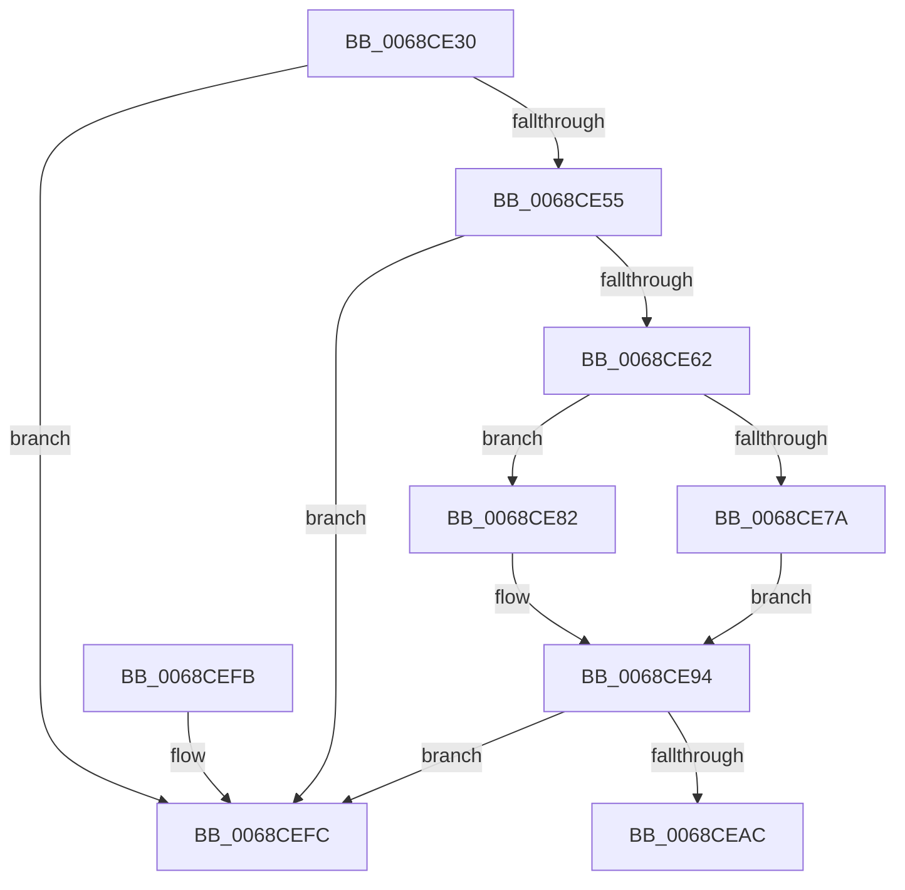

# MiChangeSlabEntryIdentity

- RVA: `0x0068CE30`–`0x0068CF03` (길이 `211` bytes)
- VA: `0x000000014068CE30`
- 실행 섹션: `.text`
- PDB 이름 있음: `예`; PDB Function 태그: `아니요`
- unwind 정보 RVA: `0x000A3E54`
- 디코드: `60`개 명령, `211/211` bytes 표시
- 미해석 바이트: `0` (있으면 어셈블리에 `.byte`로 보존)

> 이 문서는 커널 이미지의 기계어와 PDB 기호를 분석해 생성했습니다. 4번과 5번은 함수 원형과 자료형을 바이너리 사용 방식에서 추정한 C 해석이며 원본 소스 복구 결과는 아닙니다.

## 1. Dependencies

- 직접 호출 지점: **2**; 고유 호출 대상: **2**
- 직접 호출자로 확인된 함수: **2**
- RIP 상대 이미지 참조: **1**

### Outgoing calls
- `0x0068CE6C` → [MiClearHintSlabEntry](../44/MiClearHintSlabEntry_function_0044CFFC.md) (function, `0x0044CFFC`)
- `0x0068CEEB` → [MiSetSlabTypeIdentifiers](../49/MiSetSlabTypeIdentifiers_function_00498AC8.md) (function, `0x00498AC8`)

### Direct callers
- [MiReplenishSlabAllocatorByIdentity](../3B/MiReplenishSlabAllocatorByIdentity_function_003BD8A8.md) at `0x003BDAC5`
- [MiDeleteSlabEntriesForIdentity](MiDeleteSlabEntriesForIdentity_function_0068DE10.md) at `0x0068DF4D`

### Static image references
- `0x0068CEAF` → RVA `0x00011C60` (`.rdata`; read)

## 2. Other-region calls and transfers

- 다른 실행 섹션으로 향하는 call: **0**
- 별도 외부 분기/꼬리 이동을 확인하지 못했습니다.

## 3. Assembly (complete function range)

```asm
0068CE30  48 89 5C 24 08                  mov qword ptr [rsp + 8], rbx
0068CE35  57                              push rdi
0068CE36  48 83 EC 30                     sub rsp, 0x30
0068CE3A  4C 8D 52 18                     lea r10, [rdx + 0x18]
0068CE3E  45 0F B6 D8                     movzx r11d, r8b
0068CE42  48 8B DA                        mov rbx, rdx
0068CE45  48 8B F9                        mov rdi, rcx
0068CE48  49 8B 12                        mov rdx, qword ptr [r10]
0068CE4B  4C 39 52 08                     cmp qword ptr [rdx + 8], r10
0068CE4F  0F 85 A7 00 00 00               jne 0x14068cefc
0068CE55  49 8B 42 08                     mov rax, qword ptr [r10 + 8]
0068CE59  4C 39 10                        cmp qword ptr [rax], r10
0068CE5C  0F 85 9A 00 00 00               jne 0x14068cefc
0068CE62  48 89 10                        mov qword ptr [rax], rdx
0068CE65  48 89 42 08                     mov qword ptr [rdx + 8], rax
0068CE69  48 8B D3                        mov rdx, rbx
0068CE6C  E8 8B 01 DC FF                  call 0x14044cffc
0068CE71  8B 4B 5C                        mov ecx, dword ptr [rbx + 0x5c]
0068CE74  41 80 FB FF                     cmp r11b, 0xff
0068CE78  75 08                           jne 0x14068ce82
0068CE7A  41 B3 40                        mov r11b, 0x40
0068CE7D  83 E1 FB                        and ecx, 0xfffffffb
0068CE80  EB 12                           jmp 0x14068ce94
0068CE82  41 8B C3                        mov eax, r11d
0068CE85  C1 E0 03                        shl eax, 3
0068CE88  33 C1                           xor eax, ecx
0068CE8A  25 F8 01 00 00                  and eax, 0x1f8
0068CE8F  33 C8                           xor ecx, eax
0068CE91  83 C9 04                        or ecx, 4
0068CE94  89 4B 5C                        mov dword ptr [rbx + 0x5c], ecx
0068CE97  41 0F B6 C3                     movzx eax, r11b
0068CE9B  48 C1 E0 04                     shl rax, 4
0068CE9F  48 03 47 58                     add rax, qword ptr [rdi + 0x58]
0068CEA3  48 8B 48 08                     mov rcx, qword ptr [rax + 8]
0068CEA7  48 39 01                        cmp qword ptr [rcx], rax
0068CEAA  75 50                           jne 0x14068cefc
0068CEAC  49 89 02                        mov qword ptr [r10], rax
0068CEAF  48 8D 15 AA 4D 98 FF            lea rdx, [rip - 0x67b256]
0068CEB6  49 89 4A 08                     mov qword ptr [r10 + 8], rcx
0068CEBA  45 8A CB                        mov r9b, r11b
0068CEBD  4C 89 11                        mov qword ptr [rcx], r10
0068CEC0  4C 89 50 08                     mov qword ptr [rax + 8], r10
0068CEC4  8B 4B 5C                        mov ecx, dword ptr [rbx + 0x5c]
0068CEC7  8B 87 88 00 00 00               mov eax, dword ptr [rdi + 0x88]
0068CECD  44 8B 87 80 00 00 00            mov r8d, dword ptr [rdi + 0x80]
0068CED4  48 C1 E8 04                     shr rax, 4
0068CED8  D1 E9                           shr ecx, 1
0068CEDA  83 E0 03                        and eax, 3
0068CEDD  83 E1 01                        and ecx, 1
0068CEE0  89 4C 24 20                     mov dword ptr [rsp + 0x20], ecx
0068CEE4  48 8B 4B 28                     mov rcx, qword ptr [rbx + 0x28]
0068CEE8  8B 14 C2                        mov edx, dword ptr [rdx + rax*8]
0068CEEB  E8 D8 BB E0 FF                  call 0x140498ac8
0068CEF0  48 8B 5C 24 40                  mov rbx, qword ptr [rsp + 0x40]
0068CEF5  48 83 C4 30                     add rsp, 0x30
0068CEF9  5F                              pop rdi
0068CEFA  C3                              ret
0068CEFB  CC                              int3
0068CEFC  B9 03 00 00 00                  mov ecx, 3
0068CF01  CD 29                           int 0x29
```

## 4. C-style interpretation (structured pseudocode)

```c
__int64 __fastcall MiChangeSlabEntryIdentity(__int64 a1, __int64 a2, unsigned __int8 a3)
{
    __int64 result;
    __int64 v_rsp;
    unsigned int v_stack_m18;
    unsigned __int64 v_stack_p8;

    v_stack_p8 = v_rbx;
    v_rsp = (v_rsp) - (48);
    if ((*(unsigned __int64 *)(*(unsigned __int64 *)(a2 + 24) + 8)) != (a2 + 24)) goto loc_0068CEFC;
    if ((*(unsigned __int64 *)(*(unsigned __int64 *)(a2 + 24 + 8))) != (a2 + 24)) goto loc_0068CEFC;
    *(unsigned __int64 *)(*(unsigned __int64 *)(a2 + 24 + 8)) = *(unsigned __int64 *)(a2 + 24);
    *(unsigned __int64 *)(*(unsigned __int64 *)(a2 + 24) + 8) = *(unsigned __int64 *)(a2 + 24 + 8);
    result = MiClearHintSlabEntry(a1, a2, a3, a4);
    if (a3 != 255) goto loc_0068CE82;
    a1 = (unsigned int)(((unsigned int)(*(unsigned int *)(a2 + 92))) & (0xFFFFFFFBULL));
    goto loc_0068CE94;
loc_0068CE82:
    result = (unsigned int)((64) << (3));
    result = (unsigned int)((result) ^ ((unsigned int)(a1)));
    result = (unsigned int)((result) & (504));
    a1 = (unsigned int)((a1) ^ ((unsigned int)(result)));
    a1 = (unsigned int)((a1) | (4));
loc_0068CE94:
    *(unsigned int *)(a2 + 92) = (unsigned int)(a1);
    result = (64) << (4);
    result = (result) + (*(unsigned __int64 *)(a1 + 88));
    if ((*(unsigned __int64 *)(*(unsigned __int64 *)(result + 8))) != result) goto loc_0068CEFC;
    *(unsigned __int64 *)(a2 + 24) = result;
    *(unsigned __int64 *)(a2 + 24 + 8) = *(unsigned __int64 *)(result + 8);
    *(unsigned __int64 *)(*(unsigned __int64 *)(result + 8)) = a2 + 24;
    *(unsigned __int64 *)(result + 8) = a2 + 24;
    result = ((unsigned int)(*(unsigned int *)(a1 + 136))) >> (4);
    a1 = (unsigned int)(((unsigned int)(*(unsigned int *)(a2 + 92))) >> (1));
    result = (unsigned int)((result) & (3));
    a1 = (unsigned int)((a1) & (1));
    v_stack_m18 = (unsigned int)(a1);
    result = MiSetSlabTypeIdentifiers(*(unsigned __int64 *)(a2 + 40), (unsigned int)(*(unsigned int *)(v_rip - 6795862 + result * 8)), (unsigned int)(*(unsigned int *)(a1 + 128)), 64);
    v_rsp = (v_rsp) + (48);
    return result;
loc_0068CEFC:
    return result;
}
```

## 5. (Beta) C Style

```c
int64_t MiChangeSlabEntryIdentity(void *Arg1, void *Arg2, uint8_t Arg3)
{
    uint8_t *arg1 = (uint8_t *)Arg1;
    uint8_t *arg2 = (uint8_t *)Arg2;

    int64_t result;
    int64_t local_rsp;
    uint32_t v_stack_m18;
    uint64_t v_stack_p8;

    v_stack_p8 = local_rbx;
    local_rsp = (local_rsp) - (48);
    if ((*(uint64_t *)(*(uint64_t *)(arg2 + 0x18) + 0x8)) != (Arg2 + 24)) goto loc_0068CEFC;
    if ((*(uint64_t *)(*(uint64_t *)(arg2 + 0x18 + 0x8))) != (Arg2 + 24)) goto loc_0068CEFC;
    *(uint64_t *)(*(uint64_t *)(arg2 + 0x18 + 0x8)) = *(uint64_t *)(arg2 + 0x18);
    *(uint64_t *)(*(uint64_t *)(arg2 + 0x18) + 0x8) = *(uint64_t *)(arg2 + 0x18 + 0x8);
    result = MiClearHintSlabEntry(Arg1, Arg2, Arg3, a4);
    if (Arg3 != 255) goto loc_0068CE82;
    Arg1 = (uint32_t)(((uint32_t)(*(uint32_t *)(arg2 + 0x5C))) & (0xFFFFFFFBULL));
    goto loc_0068CE94;
loc_0068CE82:
    result = (uint32_t)((64) << (3));
    result = (uint32_t)((result) ^ ((uint32_t)(Arg1)));
    result = (uint32_t)((result) & (504));
    Arg1 = (uint32_t)((Arg1) ^ ((uint32_t)(result)));
    Arg1 = (uint32_t)((Arg1) | (4));
loc_0068CE94:
    *(uint32_t *)(arg2 + 0x5C) = (uint32_t)(Arg1);
    result = (64) << (4);
    result = (result) + (*(uint64_t *)(arg1 + 0x58));
    if ((*(uint64_t *)(*(uint64_t *)(result + 0x8))) != result) goto loc_0068CEFC;
    *(uint64_t *)(arg2 + 0x18) = result;
    *(uint64_t *)(arg2 + 0x18 + 0x8) = *(uint64_t *)(result + 0x8);
    *(void **)(*(uint64_t *)(result + 0x8)) = Arg2 + 24;
    *(void **)(result + 0x8) = Arg2 + 24;
    result = ((uint32_t)(*(uint32_t *)(arg1 + 0x88))) >> (4);
    Arg1 = (uint32_t)(((uint32_t)(*(uint32_t *)(arg2 + 0x5C))) >> (1));
    result = (uint32_t)((result) & (3));
    Arg1 = (uint32_t)((Arg1) & (1));
    v_stack_m18 = (uint32_t)(Arg1);
    result = MiSetSlabTypeIdentifiers(*(uint64_t *)(arg2 + 0x28), (uint32_t)(*(uint32_t *)(v_rip - 0x67B256 + result * 8)), (uint32_t)(*(uint32_t *)(arg1 + 0x80)), 64);
    local_rsp = (local_rsp) + (48);
    return result;
loc_0068CEFC:
    return result;
}
```

### 관측된 메모리 오프셋

구조체 형식이 확인되지 않은 접근은 인자 기준의 오프셋으로만 기록했습니다.

| 기준 인자 | 오프셋 표현 | 폭 (bit) | 접근 |
|---|---:|---:|---|
| `Arg1` | `+ 0x58` | `64` | `R` |
| `Arg1` | `+ 0x80` | `32` | `R` |
| `Arg1` | `+ 0x88` | `32` | `R` |
| `Arg2` | `+ 0x0` | `64` | `R` |
| `Arg2` | `+ 0x8` | `64` | `R` |
| `Arg2` | `+ 0x18` | `64` | `R` |
| `Arg2` | `+ 0x28` | `64` | `R` |
| `Arg2` | `+ 0x5C` | `32` | `R` |
| `Arg2` | `+ 0x5C` | `32` | `W` |

## 6. Execution-region graph

[열기: 2D/3D 그래프와 함수 탐색 컨트롤 패널](../../../control-panel.html?section=text&rva=0x0068CE30&view=graph)

- 2D 그래프는 위에서 아래로 흐르고, 3D 그래프는 빈 공간을 드래그해 회전합니다. Shift+드래그는 이동, 휠은 확대·축소, 함수 노드 선택은 대상 보고서 이동입니다.

### Static fallback


