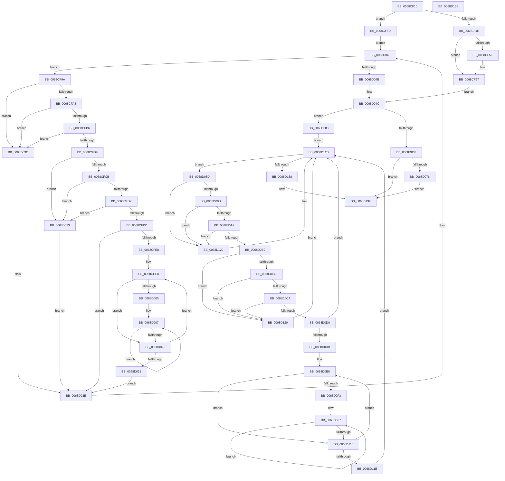

# MiChangeSlabIdentitiesDpc

- RVA: `0x0068CF10`–`0x0068D156` (길이 `582` bytes)
- VA: `0x000000014068CF10`
- 실행 섹션: `.text`
- PDB 이름 있음: `예`; PDB Function 태그: `아니요`
- unwind 정보 RVA: `0x000D8F74`
- 디코드: `179`개 명령, `582/582` bytes 표시
- 미해석 바이트: `0` (있으면 어셈블리에 `.byte`로 보존)

> 이 문서는 커널 이미지의 기계어와 PDB 기호를 분석해 생성했습니다. 4번과 5번은 함수 원형과 자료형을 바이너리 사용 방식에서 추정한 C 해석이며 원본 소스 복구 결과는 아닙니다.

## 1. Dependencies

- 직접 호출 지점: **11**; 고유 호출 대상: **6**
- 직접 호출자로 확인된 함수: **0**
- RIP 상대 이미지 참조: **4**

### Outgoing calls
- `0x0068CF62` → [KeWakeAddressAll](../21/KeWakeAddressAll_function_00217C20.md) (function, `0x00217C20`)
- `0x0068CF83` → [MiEnumerateSlabAllocatorsEx](../47/MiEnumerateSlabAllocatorsEx_function_004746F8.md) (function, `0x004746F8`)
- `0x0068CFB6` → [KiCheckVpBackingLongSpinWaitHypercall](../30/KiCheckVpBackingLongSpinWaitHypercall_function_0030F490.md) (function, `0x0030F490`)
- `0x0068CFC2` → [KeCanUseHaltOnAddress](../4F/KeCanUseHaltOnAddress_function_004FC22C.md) (function, `0x004FC22C`)
- `0x0068D018` → [KiHaltOnAddress](../4F/KiHaltOnAddress_function_004FBA3C.md) (function, `0x004FBA3C`)
- `0x0068D035` → [HvlNotifyLongSpinWait](../30/HvlNotifyLongSpinWait_function_0030F460.md) (function, `0x0030F460`)
- `0x0068D079` → [KeWakeAddressAll](../21/KeWakeAddressAll_function_00217C20.md) (function, `0x00217C20`)
- `0x0068D0A9` → [KiCheckVpBackingLongSpinWaitHypercall](../30/KiCheckVpBackingLongSpinWaitHypercall_function_0030F490.md) (function, `0x0030F490`)
- `0x0068D0B5` → [KeCanUseHaltOnAddress](../4F/KeCanUseHaltOnAddress_function_004FC22C.md) (function, `0x004FC22C`)
- `0x0068D105` → [KiHaltOnAddress](../4F/KiHaltOnAddress_function_004FBA3C.md) (function, `0x004FBA3C`)
- `0x0068D122` → [HvlNotifyLongSpinWait](../30/HvlNotifyLongSpinWait_function_0030F460.md) (function, `0x0030F460`)

### Direct callers
- 이 함수 시작 RVA로 연결되는 직접 call은 확인되지 않았습니다. 간접 호출은 완전히 역산할 수 없습니다.

### Static image references
- `0x0068CF79` → RVA `0x0068DE10` (`MiDeleteSlabEntriesForIdentity`; read)
- `0x0068CF9C` → RVA `0x00FC52AC` (`ALMOSTRO`; reference)
- `0x0068CFA8` → RVA `0x00FC6AB8` (`ALMOSTRO`; read)
- `0x0068CFCB` → RVA `0x00FC6B38` (`ALMOSTRO`; read)

## 2. Other-region calls and transfers

- 다른 실행 섹션으로 향하는 call: **0**
- 별도 외부 분기/꼬리 이동을 확인하지 못했습니다.

## 3. Assembly (complete function range)

```asm
0068CF10  4C 8B DC                        mov r11, rsp
0068CF13  49 89 5B 08                     mov qword ptr [r11 + 8], rbx
0068CF17  49 89 6B 10                     mov qword ptr [r11 + 0x10], rbp
0068CF1B  56                              push rsi
0068CF1C  57                              push rdi
0068CF1D  41 54                           push r12
0068CF1F  41 55                           push r13
0068CF21  41 56                           push r14
0068CF23  48 83 EC 40                     sub rsp, 0x40
0068CF27  49 8B D9                        mov rbx, r9
0068CF2A  4D 8B E0                        mov r12, r8
0068CF2D  48 8B F2                        mov rsi, rdx
0068CF30  83 C8 FF                        or eax, 0xffffffff
0068CF33  F0 41 0F C1 01                  lock xadd dword ptr [r9], eax
0068CF38  FF C8                           dec eax
0068CF3A  41 BD 00 00 00 80               mov r13d, 0x80000000
0068CF40  8B F8                           mov edi, eax
0068CF42  F7 D7                           not edi
0068CF44  41 23 FD                        and edi, r13d
0068CF47  A9 FF FF FF 3F                  test eax, 0x3fffffff
0068CF4C  75 3F                           jne 0x14068cf8d
0068CF4E  41 0B 79 04                     or edi, dword ptr [r9 + 4]
0068CF52  41 87 39                        xchg dword ptr [r9], edi
0068CF55  41 89 7B 20                     mov dword ptr [r11 + 0x20], edi
0068CF59  0F BA E7 1E                     bt edi, 0x1e
0068CF5D  73 08                           jae 0x14068cf67
0068CF5F  48 8B CB                        mov rcx, rbx
0068CF62  E8 B9 AC B8 FF                  call 0x140217c20
0068CF67  41 83 C9 FF                     or r9d, 0xffffffff
0068CF6B  C7 44 24 20 08 00 00 00         mov dword ptr [rsp + 0x20], 8
0068CF73  41 B8 01 00 00 00               mov r8d, 1
0068CF79  48 8D 15 90 0E 00 00            lea rdx, [rip + 0xe90]
0068CF80  48 8B CE                        mov rcx, rsi
0068CF83  E8 70 77 DE FF                  call 0x1404746f8
0068CF88  E9 BF 00 00 00                  jmp 0x14068d04c
0068CF8D  41 8B 01                        mov eax, dword ptr [r9]
0068CF90  33 ED                           xor ebp, ebp
0068CF92  45 33 F6                        xor r14d, r14d
0068CF95  E9 A6 00 00 00                  jmp 0x14068d040
0068CF9A  FF C5                           inc ebp
0068CF9C  85 2D 0A 83 93 00               test dword ptr [rip + 0x93830a], ebp
0068CFA2  0F 85 94 00 00 00               jne 0x14068d03c
0068CFA8  8B 05 0A 9B 93 00               mov eax, dword ptr [rip + 0x939b0a]
0068CFAE  A8 40                           test al, 0x40
0068CFB0  0F 84 86 00 00 00               je 0x14068d03c
0068CFB6  E8 D5 24 C8 FF                  call 0x14030f490
0068CFBB  84 C0                           test al, al
0068CFBD  74 7D                           je 0x14068d03c
0068CFBF  41 FF C6                        inc r14d
0068CFC2  E8 65 F2 E6 FF                  call 0x1404fc22c
0068CFC7  84 C0                           test al, al
0068CFC9  74 68                           je 0x14068d033
0068CFCB  F7 05 63 9B 93 00 00 00 02 00   test dword ptr [rip + 0x939b63], 0x20000
0068CFD5  74 5C                           je 0x14068d033
0068CFD7  41 F6 C6 07                     test r14b, 7
0068CFDB  75 56                           jne 0x14068d033
0068CFDD  8B 0B                           mov ecx, dword ptr [rbx]
0068CFDF  8B C1                           mov eax, ecx
0068CFE1  41 23 C5                        and eax, r13d
0068CFE4  3B C7                           cmp eax, edi
0068CFE6  74 56                           je 0x14068d03e
0068CFE8  8B D1                           mov edx, ecx
0068CFEA  44 8B C1                        mov r8d, ecx
0068CFED  0F BA E9 1E                     bts ecx, 0x1e
0068CFF1  8B C2                           mov eax, edx
0068CFF3  8B F1                           mov esi, ecx
0068CFF5  F0 0F B1 33                     lock cmpxchg dword ptr [rbx], esi
0068CFF9  8B C8                           mov ecx, eax
0068CFFB  41 3B C0                        cmp eax, r8d
0068CFFE  75 23                           jne 0x14068d023
0068D000  89 B4 24 88 00 00 00            mov dword ptr [rsp + 0x88], esi
0068D007  41 B8 04 00 00 00               mov r8d, 4
0068D00D  48 8D 94 24 88 00 00 00         lea rdx, [rsp + 0x88]
0068D015  48 8B CB                        mov rcx, rbx
0068D018  E8 1F EA E6 FF                  call 0x1404fba3c
0068D01D  8B 0B                           mov ecx, dword ptr [rbx]
0068D01F  3B CE                           cmp ecx, esi
0068D021  74 E4                           je 0x14068d007
0068D023  8B C1                           mov eax, ecx
0068D025  8B D1                           mov edx, ecx
0068D027  41 23 C5                        and eax, r13d
0068D02A  44 8B C1                        mov r8d, ecx
0068D02D  3B C7                           cmp eax, edi
0068D02F  75 BC                           jne 0x14068cfed
0068D031  EB 0B                           jmp 0x14068d03e
0068D033  8B CD                           mov ecx, ebp
0068D035  E8 26 24 C8 FF                  call 0x14030f460
0068D03A  EB 02                           jmp 0x14068d03e
0068D03C  F3 90                           pause
0068D03E  8B 03                           mov eax, dword ptr [rbx]
0068D040  41 23 C5                        and eax, r13d
0068D043  3B C7                           cmp eax, edi
0068D045  0F 85 4F FF FF FF               jne 0x14068cf9a
0068D04B  90                              nop
0068D04C  83 C8 FF                        or eax, 0xffffffff
0068D04F  F0 0F C1 03                     lock xadd dword ptr [rbx], eax
0068D053  FF C8                           dec eax
0068D055  8B F8                           mov edi, eax
0068D057  F7 D7                           not edi
0068D059  41 23 FD                        and edi, r13d
0068D05C  A9 FF FF FF 3F                  test eax, 0x3fffffff
0068D061  75 20                           jne 0x14068d083
0068D063  0B 7B 04                        or edi, dword ptr [rbx + 4]
0068D066  87 3B                           xchg dword ptr [rbx], edi
0068D068  89 7C 24 30                     mov dword ptr [rsp + 0x30], edi
0068D06C  0F BA E7 1E                     bt edi, 0x1e
0068D070  0F 83 C3 00 00 00               jae 0x14068d139
0068D076  48 8B CB                        mov rcx, rbx
0068D079  E8 A2 AB B8 FF                  call 0x140217c20
0068D07E  E9 B6 00 00 00                  jmp 0x14068d139
0068D083  33 ED                           xor ebp, ebp
0068D085  45 33 F6                        xor r14d, r14d
0068D088  E9 9E 00 00 00                  jmp 0x14068d12b
0068D08D  FF C5                           inc ebp
0068D08F  85 2D 17 82 93 00               test dword ptr [rip + 0x938217], ebp
0068D095  0F 85 8E 00 00 00               jne 0x14068d129
0068D09B  8B 05 17 9A 93 00               mov eax, dword ptr [rip + 0x939a17]
0068D0A1  A8 40                           test al, 0x40
0068D0A3  0F 84 80 00 00 00               je 0x14068d129
0068D0A9  E8 E2 23 C8 FF                  call 0x14030f490
0068D0AE  84 C0                           test al, al
0068D0B0  74 77                           je 0x14068d129
0068D0B2  41 FF C6                        inc r14d
0068D0B5  E8 72 F1 E6 FF                  call 0x1404fc22c
0068D0BA  84 C0                           test al, al
0068D0BC  74 62                           je 0x14068d120
0068D0BE  F7 05 70 9A 93 00 00 00 02 00   test dword ptr [rip + 0x939a70], 0x20000
0068D0C8  74 56                           je 0x14068d120
0068D0CA  41 F6 C6 07                     test r14b, 7
0068D0CE  75 50                           jne 0x14068d120
0068D0D0  8B 0B                           mov ecx, dword ptr [rbx]
0068D0D2  8B C1                           mov eax, ecx
0068D0D4  41 23 C5                        and eax, r13d
0068D0D7  3B C7                           cmp eax, edi
0068D0D9  74 50                           je 0x14068d12b
0068D0DB  8B D1                           mov edx, ecx
0068D0DD  44 8B C1                        mov r8d, ecx
0068D0E0  0F BA E9 1E                     bts ecx, 0x1e
0068D0E4  8B C2                           mov eax, edx
0068D0E6  8B F1                           mov esi, ecx
0068D0E8  F0 0F B1 33                     lock cmpxchg dword ptr [rbx], esi
0068D0EC  8B C8                           mov ecx, eax
0068D0EE  41 3B C0                        cmp eax, r8d
0068D0F1  75 1D                           jne 0x14068d110
0068D0F3  89 74 24 30                     mov dword ptr [rsp + 0x30], esi
0068D0F7  41 B8 04 00 00 00               mov r8d, 4
0068D0FD  48 8D 54 24 30                  lea rdx, [rsp + 0x30]
0068D102  48 8B CB                        mov rcx, rbx
0068D105  E8 32 E9 E6 FF                  call 0x1404fba3c
0068D10A  8B 0B                           mov ecx, dword ptr [rbx]
0068D10C  3B CE                           cmp ecx, esi
0068D10E  74 E7                           je 0x14068d0f7
0068D110  8B C1                           mov eax, ecx
0068D112  8B D1                           mov edx, ecx
0068D114  41 23 C5                        and eax, r13d
0068D117  44 8B C1                        mov r8d, ecx
0068D11A  3B C7                           cmp eax, edi
0068D11C  75 C2                           jne 0x14068d0e0
0068D11E  EB 0B                           jmp 0x14068d12b
0068D120  8B CD                           mov ecx, ebp
0068D122  E8 39 23 C8 FF                  call 0x14030f460
0068D127  EB 02                           jmp 0x14068d12b
0068D129  F3 90                           pause
0068D12B  8B 03                           mov eax, dword ptr [rbx]
0068D12D  41 23 C5                        and eax, r13d
0068D130  3B C7                           cmp eax, edi
0068D132  0F 85 55 FF FF FF               jne 0x14068d08d
0068D138  90                              nop
0068D139  F0 41 FF 0C 24                  lock dec dword ptr [r12]
0068D13E  48 8B 5C 24 70                  mov rbx, qword ptr [rsp + 0x70]
0068D143  48 8B 6C 24 78                  mov rbp, qword ptr [rsp + 0x78]
0068D148  48 83 C4 40                     add rsp, 0x40
0068D14C  41 5E                           pop r14
0068D14E  41 5D                           pop r13
0068D150  41 5C                           pop r12
0068D152  5F                              pop rdi
0068D153  5E                              pop rsi
0068D154  C3                              ret
0068D155  CC                              int3
```

## 4. C-style interpretation (structured pseudocode)

```c
__int64 __fastcall MiChangeSlabIdentitiesDpc(__int64 a1, __int64 a2, __int64 a3, __int64 a4)
{
    __int64 result;
    __int64 v_r14;
    __int64 v_rbp;
    __int64 v_rdi;
    __int64 v_rsp;
    unsigned int v_stack_m38;
    unsigned int v_stack_m48;
    unsigned __int64 v_stack_p10;
    unsigned int v_stack_p20;
    unsigned __int64 v_stack_p8;

    *(unsigned __int64 *)(v_rsp + 8) = v_rbx;
    *(unsigned __int64 *)(v_rsp + 16) = v_rbp;
    v_rsp = (v_rsp) - (64);
    result = (unsigned int)((result) | (0xFFFFFFFFULL));
    result = (unsigned int)((result) - 1);
    v_rdi = (unsigned int)(~((unsigned int)((unsigned int)(result))));
    v_rdi = (unsigned int)((v_rdi) & ((unsigned int)((unsigned int)(0x80000000ULL))));
    if ((((unsigned int)(result)) & (0x3FFFFFFFULL)) != 0) goto loc_0068CF8D;
    v_rdi = (unsigned int)((v_rdi) | (*(unsigned int *)(a4 + 4)));
    *(unsigned int *)(v_rsp + 32) = (unsigned int)(v_rdi);
    if (!(condition_is_above_or_equal)) {
        a1 = a4;
        result = KeWakeAddressAll(a1, a2, a3, a4);
    }
    a4 = (unsigned int)((a4) | (0xFFFFFFFFULL));
    v_stack_m48 = 8;
    result = MiEnumerateSlabAllocatorsEx(a2, v_rip + 3728, 1, a4);
    goto loc_0068D04C;
loc_0068CF8D:
    v_rbp = 0;
    v_r14 = 0;
    goto loc_0068D040;
loc_0068CF9A:
    v_rbp = (unsigned int)((v_rbp) + 1);
    if (((*(unsigned int *)(v_rip + 9667338)) & ((unsigned int)(v_rbp))) != 0) goto loc_0068D03C;
    if ((((unsigned __int8)((unsigned int)(*(unsigned int *)(v_rip + 9673482)))) & (64)) == 0) goto loc_0068D03C;
    result = KiCheckVpBackingLongSpinWaitHypercall(a2, v_rip + 3728, 1, a4);
    if ((unsigned __int8)(result) == 0) goto loc_0068D03C;
    v_r14 = (unsigned int)((v_r14) + 1);
    result = KeCanUseHaltOnAddress(a2, v_rip + 3728, 1, a4);
    if ((unsigned __int8)(result) == 0) goto loc_0068D033;
    if (((*(unsigned int *)(v_rip + 9673571)) & (0x20000ULL)) == 0) goto loc_0068D033;
    if ((((unsigned __int8)(v_r14)) & (7)) != 0) goto loc_0068D033;
    result = (unsigned int)(((unsigned int)((unsigned int)((unsigned int)(*(unsigned int *)(a4))))) & ((unsigned int)((unsigned int)(0x80000000ULL))));
    if (((unsigned int)(result)) == ((unsigned int)(v_rdi))) goto loc_0068D03E;
loc_0068CFED:
    if (((unsigned int)((unsigned int)((unsigned int)((unsigned int)((unsigned int)((unsigned int)(*(unsigned int *)(a4)))))))) != ((unsigned int)((unsigned int)((unsigned int)((unsigned int)(*(unsigned int *)(a4))))))) goto loc_0068D023;
    v_stack_p20 = (unsigned int)((unsigned int)((unsigned int)((unsigned int)(*(unsigned int *)(a4)))));
loc_0068D007:
    result = KiHaltOnAddress(a4, v_stack_p20, 4, a4);
    if (((unsigned int)((unsigned int)(*(unsigned int *)(a4)))) == ((unsigned int)((unsigned int)((unsigned int)((unsigned int)(*(unsigned int *)(a4))))))) goto loc_0068D007;
loc_0068D023:
    result = (unsigned int)(((unsigned int)((unsigned int)((unsigned int)(*(unsigned int *)(a4))))) & ((unsigned int)((unsigned int)(0x80000000ULL))));
    if (((unsigned int)(result)) != ((unsigned int)(v_rdi))) goto loc_0068CFED;
    goto loc_0068D03E;
loc_0068D033:
    result = HvlNotifyLongSpinWait((unsigned int)((unsigned int)(v_rbp)), (unsigned int)((unsigned int)((unsigned int)(*(unsigned int *)(a4)))), (unsigned int)((unsigned int)((unsigned int)(*(unsigned int *)(a4)))), a4);
    goto loc_0068D03E;
loc_0068D03C:
loc_0068D03E:
loc_0068D040:
    result = (unsigned int)(((unsigned int)(*(unsigned int *)(a4))) & ((unsigned int)((unsigned int)(0x80000000ULL))));
    if (((unsigned int)(result)) != ((unsigned int)(v_rdi))) goto loc_0068CF9A;
loc_0068D04C:
    result = (unsigned int)((result) | (0xFFFFFFFFULL));
    result = (unsigned int)((result) - 1);
    v_rdi = (unsigned int)(~((unsigned int)((unsigned int)(result))));
    v_rdi = (unsigned int)((v_rdi) & ((unsigned int)((unsigned int)(0x80000000ULL))));
    if ((((unsigned int)(result)) & (0x3FFFFFFFULL)) != 0) goto loc_0068D083;
    v_rdi = (unsigned int)((v_rdi) | (*(unsigned int *)(a4 + 4)));
    v_stack_m38 = (unsigned int)(v_rdi);
    if (condition_is_above_or_equal) goto loc_0068D139;
    result = KeWakeAddressAll(a4, (unsigned int)((unsigned int)((unsigned int)(*(unsigned int *)(a4)))), (unsigned int)((unsigned int)((unsigned int)(*(unsigned int *)(a4)))), a4);
    goto loc_0068D139;
loc_0068D083:
    v_rbp = 0;
    v_r14 = 0;
    goto loc_0068D12B;
loc_0068D08D:
    v_rbp = (unsigned int)((v_rbp) + 1);
    if (((*(unsigned int *)(v_rip + 9667095)) & ((unsigned int)(v_rbp))) != 0) goto loc_0068D129;
    if ((((unsigned __int8)((unsigned int)(*(unsigned int *)(v_rip + 9673239)))) & (64)) == 0) goto loc_0068D129;
    result = KiCheckVpBackingLongSpinWaitHypercall(a4, (unsigned int)((unsigned int)((unsigned int)(*(unsigned int *)(a4)))), (unsigned int)((unsigned int)((unsigned int)(*(unsigned int *)(a4)))), a4);
    if ((unsigned __int8)(result) == 0) goto loc_0068D129;
    v_r14 = (unsigned int)((v_r14) + 1);
    result = KeCanUseHaltOnAddress(a4, (unsigned int)((unsigned int)((unsigned int)(*(unsigned int *)(a4)))), (unsigned int)((unsigned int)((unsigned int)(*(unsigned int *)(a4)))), a4);
    if ((unsigned __int8)(result) == 0) goto loc_0068D120;
    if (((*(unsigned int *)(v_rip + 9673328)) & (0x20000ULL)) == 0) goto loc_0068D120;
    if ((((unsigned __int8)(v_r14)) & (7)) != 0) goto loc_0068D120;
    result = (unsigned int)(((unsigned int)((unsigned int)((unsigned int)(*(unsigned int *)(a4))))) & ((unsigned int)((unsigned int)(0x80000000ULL))));
    if (((unsigned int)(result)) == ((unsigned int)(v_rdi))) goto loc_0068D12B;
loc_0068D0E0:
    if (((unsigned int)((unsigned int)((unsigned int)((unsigned int)((unsigned int)((unsigned int)(*(unsigned int *)(a4)))))))) != ((unsigned int)((unsigned int)((unsigned int)((unsigned int)(*(unsigned int *)(a4))))))) goto loc_0068D110;
    v_stack_m38 = (unsigned int)((unsigned int)((unsigned int)((unsigned int)(*(unsigned int *)(a4)))));
loc_0068D0F7:
    result = KiHaltOnAddress(a4, v_stack_m38, 4, a4);
    if (((unsigned int)((unsigned int)(*(unsigned int *)(a4)))) == ((unsigned int)((unsigned int)((unsigned int)((unsigned int)(*(unsigned int *)(a4))))))) goto loc_0068D0F7;
loc_0068D110:
    result = (unsigned int)(((unsigned int)((unsigned int)((unsigned int)(*(unsigned int *)(a4))))) & ((unsigned int)((unsigned int)(0x80000000ULL))));
    if (((unsigned int)(result)) != ((unsigned int)(v_rdi))) goto loc_0068D0E0;
    goto loc_0068D12B;
loc_0068D120:
    result = HvlNotifyLongSpinWait((unsigned int)((unsigned int)(v_rbp)), (unsigned int)((unsigned int)((unsigned int)(*(unsigned int *)(a4)))), (unsigned int)((unsigned int)((unsigned int)(*(unsigned int *)(a4)))), a4);
    goto loc_0068D12B;
loc_0068D129:
loc_0068D12B:
    result = (unsigned int)(((unsigned int)(*(unsigned int *)(a4))) & ((unsigned int)((unsigned int)(0x80000000ULL))));
    if (((unsigned int)(result)) != ((unsigned int)(v_rdi))) goto loc_0068D08D;
loc_0068D139:
    v_rsp = (v_rsp) + (64);
    return result;
}
```

## 5. (Beta) C Style

```c
int64_t MiChangeSlabIdentitiesDpc(int64_t Arg1, int64_t Arg2, void *Arg3, void *Arg4)
{
    uint8_t *arg3 = (uint8_t *)Arg3;
    uint8_t *arg4 = (uint8_t *)Arg4;

    int64_t result;
    int64_t local_r14;
    int64_t local_rbp;
    int64_t local_rdi;
    int64_t local_rsp;
    uint32_t v_stack_m38;
    uint32_t v_stack_m48;
    uint64_t v_stack_p10;
    uint32_t v_stack_p20;
    uint64_t v_stack_p8;

    *(uint64_t *)(local_rsp + 0x8) = local_rbx;
    *(uint64_t *)(local_rsp + 0x10) = local_rbp;
    local_rsp = (local_rsp) - (64);
    result = (uint32_t)((result) | (0xFFFFFFFFULL));
    result = (uint32_t)((result) - 1);
    local_rdi = (uint32_t)(~((uint32_t)((uint32_t)(result))));
    local_rdi = (uint32_t)((local_rdi) & ((uint32_t)((uint32_t)(0x80000000ULL))));
    if ((((uint32_t)(result)) & (0x3FFFFFFFULL)) != 0) goto loc_0068CF8D;
    local_rdi = (uint32_t)((local_rdi) | (*(uint32_t *)(arg4 + 0x4)));
    *(uint32_t *)(local_rsp + 0x20) = (uint32_t)(local_rdi);
    if (!(condition_is_above_or_equal)) {
        Arg1 = Arg4;
        result = KeWakeAddressAll(Arg1, Arg2, Arg3, Arg4);
    }
    Arg4 = (uint32_t)((Arg4) | (0xFFFFFFFFULL));
    v_stack_m48 = 8;
    result = MiEnumerateSlabAllocatorsEx(Arg2, v_rip + 3728, 1, Arg4);
    goto loc_0068D04C;
loc_0068CF8D:
    local_rbp = 0;
    local_r14 = 0;
    goto loc_0068D040;
loc_0068CF9A:
    local_rbp = (uint32_t)((local_rbp) + 1);
    if (((*(uint32_t *)(v_rip + 0x93830A)) & ((uint32_t)(local_rbp))) != 0) goto loc_0068D03C;
    if ((((uint8_t)((uint32_t)(*(uint32_t *)(v_rip + 0x939B0A)))) & (64)) == 0) goto loc_0068D03C;
    result = KiCheckVpBackingLongSpinWaitHypercall(Arg2, v_rip + 3728, 1, Arg4);
    if ((uint8_t)(result) == 0) goto loc_0068D03C;
    local_r14 = (uint32_t)((local_r14) + 1);
    result = KeCanUseHaltOnAddress(Arg2, v_rip + 3728, 1, Arg4);
    if ((uint8_t)(result) == 0) goto loc_0068D033;
    if (((*(uint32_t *)(v_rip + 0x939B63)) & (0x20000ULL)) == 0) goto loc_0068D033;
    if ((((uint8_t)(local_r14)) & (7)) != 0) goto loc_0068D033;
    result = (uint32_t)(((uint32_t)((uint32_t)((uint32_t)(*(uint32_t *)(arg4))))) & ((uint32_t)((uint32_t)(0x80000000ULL))));
    if (((uint32_t)(result)) == ((uint32_t)(local_rdi))) goto loc_0068D03E;
loc_0068CFED:
    if (((uint32_t)((uint32_t)((uint32_t)((uint32_t)((uint32_t)((uint32_t)(*(uint32_t *)(arg4)))))))) != ((uint32_t)((uint32_t)((uint32_t)((uint32_t)(*(uint32_t *)(arg4))))))) goto loc_0068D023;
    v_stack_p20 = (uint32_t)((uint32_t)((uint32_t)((uint32_t)(*(uint32_t *)(arg4)))));
loc_0068D007:
    result = KiHaltOnAddress(Arg4, v_stack_p20, 4, Arg4);
    if (((uint32_t)((uint32_t)(*(uint32_t *)(arg4)))) == ((uint32_t)((uint32_t)((uint32_t)((uint32_t)(*(uint32_t *)(arg4))))))) goto loc_0068D007;
loc_0068D023:
    result = (uint32_t)(((uint32_t)((uint32_t)((uint32_t)(*(uint32_t *)(arg4))))) & ((uint32_t)((uint32_t)(0x80000000ULL))));
    if (((uint32_t)(result)) != ((uint32_t)(local_rdi))) goto loc_0068CFED;
    goto loc_0068D03E;
loc_0068D033:
    result = HvlNotifyLongSpinWait((uint32_t)((uint32_t)(local_rbp)), (uint32_t)((uint32_t)((uint32_t)(*(uint32_t *)(arg4)))), (uint32_t)((uint32_t)((uint32_t)(*(uint32_t *)(arg4)))), Arg4);
    goto loc_0068D03E;
loc_0068D03C:
loc_0068D03E:
loc_0068D040:
    result = (uint32_t)(((uint32_t)(*(uint32_t *)(arg4))) & ((uint32_t)((uint32_t)(0x80000000ULL))));
    if (((uint32_t)(result)) != ((uint32_t)(local_rdi))) goto loc_0068CF9A;
loc_0068D04C:
    result = (uint32_t)((result) | (0xFFFFFFFFULL));
    result = (uint32_t)((result) - 1);
    local_rdi = (uint32_t)(~((uint32_t)((uint32_t)(result))));
    local_rdi = (uint32_t)((local_rdi) & ((uint32_t)((uint32_t)(0x80000000ULL))));
    if ((((uint32_t)(result)) & (0x3FFFFFFFULL)) != 0) goto loc_0068D083;
    local_rdi = (uint32_t)((local_rdi) | (*(uint32_t *)(arg4 + 0x4)));
    v_stack_m38 = (uint32_t)(local_rdi);
    if (condition_is_above_or_equal) goto loc_0068D139;
    result = KeWakeAddressAll(Arg4, (uint32_t)((uint32_t)((uint32_t)(*(uint32_t *)(arg4)))), (uint32_t)((uint32_t)((uint32_t)(*(uint32_t *)(arg4)))), Arg4);
    goto loc_0068D139;
loc_0068D083:
    local_rbp = 0;
    local_r14 = 0;
    goto loc_0068D12B;
loc_0068D08D:
    local_rbp = (uint32_t)((local_rbp) + 1);
    if (((*(uint32_t *)(v_rip + 0x938217)) & ((uint32_t)(local_rbp))) != 0) goto loc_0068D129;
    if ((((uint8_t)((uint32_t)(*(uint32_t *)(v_rip + 0x939A17)))) & (64)) == 0) goto loc_0068D129;
    result = KiCheckVpBackingLongSpinWaitHypercall(Arg4, (uint32_t)((uint32_t)((uint32_t)(*(uint32_t *)(arg4)))), (uint32_t)((uint32_t)((uint32_t)(*(uint32_t *)(arg4)))), Arg4);
    if ((uint8_t)(result) == 0) goto loc_0068D129;
    local_r14 = (uint32_t)((local_r14) + 1);
    result = KeCanUseHaltOnAddress(Arg4, (uint32_t)((uint32_t)((uint32_t)(*(uint32_t *)(arg4)))), (uint32_t)((uint32_t)((uint32_t)(*(uint32_t *)(arg4)))), Arg4);
    if ((uint8_t)(result) == 0) goto loc_0068D120;
    if (((*(uint32_t *)(v_rip + 0x939A70)) & (0x20000ULL)) == 0) goto loc_0068D120;
    if ((((uint8_t)(local_r14)) & (7)) != 0) goto loc_0068D120;
    result = (uint32_t)(((uint32_t)((uint32_t)((uint32_t)(*(uint32_t *)(arg4))))) & ((uint32_t)((uint32_t)(0x80000000ULL))));
    if (((uint32_t)(result)) == ((uint32_t)(local_rdi))) goto loc_0068D12B;
loc_0068D0E0:
    if (((uint32_t)((uint32_t)((uint32_t)((uint32_t)((uint32_t)((uint32_t)(*(uint32_t *)(arg4)))))))) != ((uint32_t)((uint32_t)((uint32_t)((uint32_t)(*(uint32_t *)(arg4))))))) goto loc_0068D110;
    v_stack_m38 = (uint32_t)((uint32_t)((uint32_t)((uint32_t)(*(uint32_t *)(arg4)))));
loc_0068D0F7:
    result = KiHaltOnAddress(Arg4, v_stack_m38, 4, Arg4);
    if (((uint32_t)((uint32_t)(*(uint32_t *)(arg4)))) == ((uint32_t)((uint32_t)((uint32_t)((uint32_t)(*(uint32_t *)(arg4))))))) goto loc_0068D0F7;
loc_0068D110:
    result = (uint32_t)(((uint32_t)((uint32_t)((uint32_t)(*(uint32_t *)(arg4))))) & ((uint32_t)((uint32_t)(0x80000000ULL))));
    if (((uint32_t)(result)) != ((uint32_t)(local_rdi))) goto loc_0068D0E0;
    goto loc_0068D12B;
loc_0068D120:
    result = HvlNotifyLongSpinWait((uint32_t)((uint32_t)(local_rbp)), (uint32_t)((uint32_t)((uint32_t)(*(uint32_t *)(arg4)))), (uint32_t)((uint32_t)((uint32_t)(*(uint32_t *)(arg4)))), Arg4);
    goto loc_0068D12B;
loc_0068D129:
loc_0068D12B:
    result = (uint32_t)(((uint32_t)(*(uint32_t *)(arg4))) & ((uint32_t)((uint32_t)(0x80000000ULL))));
    if (((uint32_t)(result)) != ((uint32_t)(local_rdi))) goto loc_0068D08D;
loc_0068D139:
    local_rsp = (local_rsp) + (64);
    return result;
}
```

### 관측된 메모리 오프셋

구조체 형식이 확인되지 않은 접근은 인자 기준의 오프셋으로만 기록했습니다.

| 기준 인자 | 오프셋 표현 | 폭 (bit) | 접근 |
|---|---:|---:|---|
| `Arg3` | `+ 0x0` | `32` | `R/W` |
| `Arg4` | `+ 0x0` | `32` | `R` |
| `Arg4` | `+ 0x0` | `32` | `R/W` |
| `Arg4` | `+ 0x4` | `32` | `R` |

## 6. Execution-region graph

[열기: 2D/3D 그래프와 함수 탐색 컨트롤 패널](../../../control-panel.html?section=text&rva=0x0068CF10&view=graph)

- 2D 그래프는 위에서 아래로 흐르고, 3D 그래프는 빈 공간을 드래그해 회전합니다. Shift+드래그는 이동, 휠은 확대·축소, 함수 노드 선택은 대상 보고서 이동입니다.

### Static fallback


