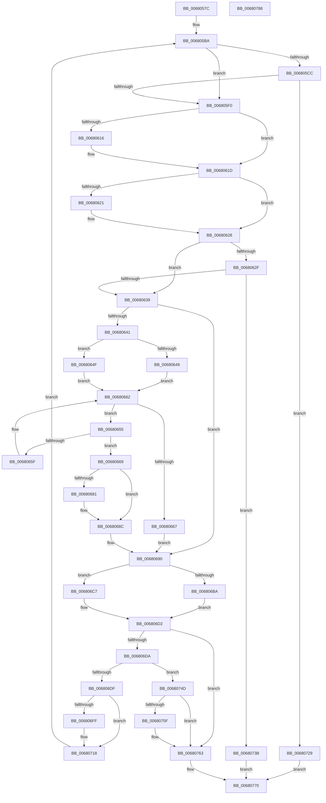

# MiChangingSubsectionProtos

- RVA: `0x0068057C`–`0x00680789` (길이 `525` bytes)
- VA: `0x000000014068057C`
- 실행 섹션: `.text`
- PDB 이름 있음: `예`; PDB Function 태그: `아니요`
- unwind 정보 RVA: `0x00099E84`
- 디코드: `160`개 명령, `525/525` bytes 표시
- 미해석 바이트: `0` (있으면 어셈블리에 `.byte`로 보존)

> 이 문서는 커널 이미지의 기계어와 PDB 기호를 분석해 생성했습니다. 4번과 5번은 함수 원형과 자료형을 바이너리 사용 방식에서 추정한 C 해석이며 원본 소스 복구 결과는 아닙니다.

## 1. Dependencies

- 직접 호출 지점: **12**; 고유 호출 대상: **7**
- 직접 호출자로 확인된 함수: **3**
- RIP 상대 이미지 참조: **0**

### Outgoing calls
- `0x006805C0` → [ExAcquireSpinLockExclusive](../24/ExAcquireSpinLockExclusive_function_00248690.md) (function, `0x00248690`)
- `0x006805D8` → [MiUnlinkSubsectionWaitBlock](MiUnlinkSubsectionWaitBlock_function_00681EDC.md) (function, `0x00681EDC`)
- `0x00680671` → [KeAbPreAcquire](../21/KeAbPreAcquire_function_00210230.md) (function, `0x00210230`)
- `0x00680684` → [KeAbPreWait](../20/KeAbPreWait_function_0020E560.md) (function, `0x0020E560`)
- `0x006806E5` → [MiReleaseSpinLockExclusive](../24/MiReleaseSpinLockExclusive_function_002482C0.md) (function, `0x002482C0`)
- `0x006806F5` → [KeWaitForGate](../2C/KeWaitForGate_function_002CA794.md) (function, `0x002CA794`)
- `0x00680708` → [KeAbPreAcquire](../21/KeAbPreAcquire_function_00210230.md) (function, `0x00210230`)
- `0x00680713` → [KeAbPostReleaseEx](../26/KeAbPostReleaseEx_function_00262210.md) (function, `0x00262210`)
- `0x0068072F` → [MiReleaseSpinLockExclusive](../24/MiReleaseSpinLockExclusive_function_002482C0.md) (function, `0x002482C0`)
- `0x00680741` → [MiReleaseSpinLockExclusive](../24/MiReleaseSpinLockExclusive_function_002482C0.md) (function, `0x002482C0`)
- `0x00680755` → [KeAbPreAcquire](../21/KeAbPreAcquire_function_00210230.md) (function, `0x00210230`)
- `0x00680769` → [MiReleaseSpinLockExclusive](../24/MiReleaseSpinLockExclusive_function_002482C0.md) (function, `0x002482C0`)

### Direct callers
- [MiPurgeSubsection](../37/MiPurgeSubsection_function_003712F0.md) at `0x0037199A`
- [MiPurgeFileOnlyPfn](MiPurgeFileOnlyPfn_function_00681CEC.md) at `0x00681D5F`
- [MiAllocateFileExtents](../../page/AB/MiAllocateFileExtents_function_00ABDF54.md) at `0x00ABE13D`
- [MiAllocateFileExtents](../../page/AB/MiAllocateFileExtents_function_00ABDF54.md) at `0x00ABE257`

### Static image references
- 디코드된 RIP-relative 메모리 참조가 없습니다.

## 2. Other-region calls and transfers

- 다른 실행 섹션으로 향하는 call: **0**
- 별도 외부 분기/꼬리 이동을 확인하지 못했습니다.

## 3. Assembly (complete function range)

```asm
0068057C  48 89 5C 24 18                  mov qword ptr [rsp + 0x18], rbx
00680581  89 54 24 10                     mov dword ptr [rsp + 0x10], edx
00680585  55                              push rbp
00680586  56                              push rsi
00680587  57                              push rdi
00680588  41 54                           push r12
0068058A  41 55                           push r13
0068058C  41 56                           push r14
0068058E  41 57                           push r15
00680590  48 83 EC 30                     sub rsp, 0x30
00680594  4C 8B 29                        mov r13, qword ptr [rcx]
00680597  49 8D 40 08                     lea rax, [r8 + 8]
0068059B  8B EA                           mov ebp, edx
0068059D  48 89 44 24 20                  mov qword ptr [rsp + 0x20], rax
006805A2  83 E5 10                        and ebp, 0x10
006805A5  4D 8D 60 0C                     lea r12, [r8 + 0xc]
006805A9  4D 8B F8                        mov r15, r8
006805AC  89 AC 24 88 00 00 00            mov dword ptr [rsp + 0x88], ebp
006805B3  49 8D 7D 48                     lea rdi, [r13 + 0x48]
006805B7  48 8B D9                        mov rbx, rcx
006805BA  48 8B CF                        mov rcx, rdi
006805BD  4C 8B F0                        mov r14, rax
006805C0  E8 CB 80 BC FF                  call 0x140248690
006805C5  40 8A F0                        mov sil, al
006805C8  85 ED                           test ebp, ebp
006805CA  74 24                           je 0x1406805f0
006805CC  41 B8 01 00 00 00               mov r8d, 1
006805D2  49 8B D7                        mov rdx, r15
006805D5  48 8B CB                        mov rcx, rbx
006805D8  E8 FF 18 00 00                  call 0x140681edc
006805DD  48 8B 44 24 20                  mov rax, qword ptr [rsp + 0x20]
006805E2  83 20 00                        and dword ptr [rax], 0
006805E5  41 83 3C 24 02                  cmp dword ptr [r12], 2
006805EA  0F 84 39 01 00 00               je 0x140680729
006805F0  44 8B 44 24 78                  mov r8d, dword ptr [rsp + 0x78]
006805F5  41 8B D0                        mov edx, r8d
006805F8  83 E2 08                        and edx, 8
006805FB  4C 89 74 24 20                  mov qword ptr [rsp + 0x20], r14
00680600  8B C2                           mov eax, edx
00680602  89 54 24 70                     mov dword ptr [rsp + 0x70], edx
00680606  F7 D8                           neg eax
00680608  1B C9                           sbb ecx, ecx
0068060A  83 E1 40                        and ecx, 0x40
0068060D  41 89 0E                        mov dword ptr [r14], ecx
00680610  41 F6 C0 20                     test r8b, 0x20
00680614  74 07                           je 0x14068061d
00680616  0F BA E9 08                     bts ecx, 8
0068061A  41 89 0E                        mov dword ptr [r14], ecx
0068061D  85 ED                           test ebp, ebp
0068061F  74 07                           je 0x140680628
00680621  0F BA E9 07                     bts ecx, 7
00680625  41 89 0E                        mov dword ptr [r14], ecx
00680628  48 83 7B 08 00                  cmp qword ptr [rbx + 8], 0
0068062D  74 0A                           je 0x140680639
0068062F  41 F6 C0 01                     test r8b, 1
00680633  0F 85 02 01 00 00               jne 0x14068073b
00680639  33 C9                           xor ecx, ecx
0068063B  33 ED                           xor ebp, ebp
0068063D  85 D2                           test edx, edx
0068063F  75 4F                           jne 0x140680690
00680641  41 8B 45 38                     mov eax, dword ptr [r13 + 0x38]
00680645  A8 20                           test al, 0x20
00680647  74 06                           je 0x14068064f
00680649  49 8B 4D 50                     mov rcx, qword ptr [r13 + 0x50]
0068064D  EB 13                           jmp 0x140680662
0068064F  48 8B 4B 18                     mov rcx, qword ptr [rbx + 0x18]
00680653  EB 0D                           jmp 0x140680662
00680655  8B 41 08                        mov eax, dword ptr [rcx + 8]
00680658  4C 8B F1                        mov r14, rcx
0068065B  A8 40                           test al, 0x40
0068065D  74 0A                           je 0x140680669
0068065F  48 8B 09                        mov rcx, qword ptr [rcx]
00680662  48 85 C9                        test rcx, rcx
00680665  75 EE                           jne 0x140680655
00680667  EB 27                           jmp 0x140680690
00680669  45 33 C0                        xor r8d, r8d
0068066C  33 D2                           xor edx, edx
0068066E  48 8B CB                        mov rcx, rbx
00680671  E8 BA FB B8 FF                  call 0x140210230
00680676  48 8B E8                        mov rbp, rax
00680679  49 8B CE                        mov rcx, r14
0068067C  48 85 C0                        test rax, rax
0068067F  74 0B                           je 0x14068068c
00680681  48 8B C8                        mov rcx, rax
00680684  E8 D7 DE B8 FF                  call 0x14020e560
00680689  49 8B CE                        mov rcx, r14
0068068C  8B 54 24 70                     mov edx, dword ptr [rsp + 0x70]
00680690  49 8B C4                        mov rax, r12
00680693  83 20 00                        and dword ptr [rax], 0
00680696  49 8D 47 18                     lea rax, [r15 + 0x18]
0068069A  41 83 67 14 00                  and dword ptr [r15 + 0x14], 0
0068069F  66 41 C7 47 10 07 01            mov word ptr [r15 + 0x10], 0x107
006806A6  41 C6 47 12 06                  mov byte ptr [r15 + 0x12], 6
006806AB  48 89 40 08                     mov qword ptr [rax + 8], rax
006806AF  48 89 00                        mov qword ptr [rax], rax
006806B2  41 8B 45 38                     mov eax, dword ptr [r13 + 0x38]
006806B6  A8 20                           test al, 0x20
006806B8  74 0D                           je 0x1406806c7
006806BA  49 8B 45 50                     mov rax, qword ptr [r13 + 0x50]
006806BE  49 89 07                        mov qword ptr [r15], rax
006806C1  4D 89 7D 50                     mov qword ptr [r13 + 0x50], r15
006806C5  EB 0B                           jmp 0x1406806d2
006806C7  48 8B 43 18                     mov rax, qword ptr [rbx + 0x18]
006806CB  49 89 07                        mov qword ptr [r15], rax
006806CE  4C 89 7B 18                     mov qword ptr [rbx + 0x18], r15
006806D2  85 D2                           test edx, edx
006806D4  0F 85 89 00 00 00               jne 0x140680763
006806DA  48 85 C9                        test rcx, rcx
006806DD  74 6E                           je 0x14068074d
006806DF  40 8A D6                        mov dl, sil
006806E2  48 8B CF                        mov rcx, rdi
006806E5  E8 D6 7B BC FF                  call 0x1402482c0
006806EA  45 33 C0                        xor r8d, r8d
006806ED  49 8D 4F 10                     lea rcx, [r15 + 0x10]
006806F1  41 8D 50 12                     lea edx, [r8 + 0x12]
006806F5  E8 9A A0 C4 FF                  call 0x1402ca794
006806FA  48 85 ED                        test rbp, rbp
006806FD  74 19                           je 0x140680718
006806FF  45 33 C0                        xor r8d, r8d
00680702  48 8B D5                        mov rdx, rbp
00680705  48 8B CB                        mov rcx, rbx
00680708  E8 23 FB B8 FF                  call 0x140210230
0068070D  48 8B D5                        mov rdx, rbp
00680710  48 8B CB                        mov rcx, rbx
00680713  E8 F8 1A BE FF                  call 0x140262210
00680718  8B AC 24 88 00 00 00            mov ebp, dword ptr [rsp + 0x88]
0068071F  48 8B 44 24 20                  mov rax, qword ptr [rsp + 0x20]
00680724  E9 91 FE FF FF                  jmp 0x1406805ba
00680729  40 8A D6                        mov dl, sil
0068072C  48 8B CF                        mov rcx, rdi
0068072F  E8 8C 7B BC FF                  call 0x1402482c0
00680734  B8 34 04 00 C0                  mov eax, 0xc0000434
00680739  EB 35                           jmp 0x140680770
0068073B  40 8A D6                        mov dl, sil
0068073E  48 8B CF                        mov rcx, rdi
00680741  E8 7A 7B BC FF                  call 0x1402482c0
00680746  B8 0A 02 00 C0                  mov eax, 0xc000020a
0068074B  EB 23                           jmp 0x140680770
0068074D  45 33 C0                        xor r8d, r8d
00680750  33 D2                           xor edx, edx
00680752  48 8B CB                        mov rcx, rbx
00680755  E8 D6 FA B8 FF                  call 0x140210230
0068075A  48 85 C0                        test rax, rax
0068075D  74 04                           je 0x140680763
0068075F  C6 40 0A 01                     mov byte ptr [rax + 0xa], 1
00680763  40 8A D6                        mov dl, sil
00680766  48 8B CF                        mov rcx, rdi
00680769  E8 52 7B BC FF                  call 0x1402482c0
0068076E  33 C0                           xor eax, eax
00680770  48 8B 9C 24 80 00 00 00         mov rbx, qword ptr [rsp + 0x80]
00680778  48 83 C4 30                     add rsp, 0x30
0068077C  41 5F                           pop r15
0068077E  41 5E                           pop r14
00680780  41 5D                           pop r13
00680782  41 5C                           pop r12
00680784  5F                              pop rdi
00680785  5E                              pop rsi
00680786  5D                              pop rbp
00680787  C3                              ret
00680788  CC                              int3
```

## 4. C-style interpretation (structured pseudocode)

```c
__int64 __fastcall MiChangingSubsectionProtos(__int64 a1, int a2, __int64 a3)
{
    __int64 result;
    __int64 v_rbp;
    __int64 v_rsp;
    unsigned __int64 v_stack_m48;
    unsigned int v_stack_p10;
    unsigned __int64 v_stack_p18;
    unsigned int v_stack_p20;
    unsigned int v_stack_p8;

    v_stack_p18 = v_rbx;
    v_stack_p10 = a2;
    v_rsp = (v_rsp) - (48);
    v_stack_m48 = a3 + 8;
    v_rbp = (unsigned int)(((unsigned int)(a2)) & (16));
    v_stack_p20 = (unsigned int)(v_rbp);
loc_006805BA:
    result = ExAcquireSpinLockExclusive(*(unsigned __int64 *)(a1) + 72, a2, a3, a4);
    if ((unsigned int)(v_rbp) == 0) goto loc_006805F0;
    result = MiUnlinkSubsectionWaitBlock(a1, a3, 1, a4);
    if ((*(unsigned int *)(a3 + 12)) == 2) goto loc_00680729;
loc_006805F0:
    a2 = (unsigned int)(((unsigned int)((unsigned int)((unsigned int)(v_stack_p10)))) & (8));
    v_stack_m48 = a3 + 8;
    v_stack_p8 = a2;
    result = (unsigned int)(-((unsigned int)(a2)));
    a1 = (unsigned int)((a1) & (64));
    *(unsigned int *)(a3 + 8) = (unsigned int)(a1);
    if ((((unsigned __int8)((unsigned int)(v_stack_p10))) & (32)) != 0) {
        *(unsigned int *)(a3 + 8) = (unsigned int)(a1);
    }
    if ((unsigned int)(v_rbp) != 0) {
        *(unsigned int *)(a3 + 8) = (unsigned int)(a1);
    }
    if ((*(unsigned __int64 *)(a1 + 8)) == 0) goto loc_00680639;
    if ((((unsigned __int8)((unsigned int)(v_stack_p10))) & (1)) != 0) goto loc_0068073B;
loc_00680639:
    a1 = 0;
    v_rbp = 0;
    if (a2 != 0) goto loc_00680690;
    if ((((unsigned __int8)((unsigned int)(*(unsigned int *)(*(unsigned __int64 *)(a1) + 56)))) & (32)) == 0) goto loc_0068064F;
    goto loc_00680662;
loc_0068064F:
    goto loc_00680662;
loc_00680655:
    if ((((unsigned __int8)((unsigned int)(*(unsigned int *)(*(unsigned __int64 *)(a1 + 24) + 8)))) & (64)) == 0) goto loc_00680669;
loc_00680662:
    if (*(unsigned __int64 *)(*(unsigned __int64 *)(a1 + 24)) != 0) goto loc_00680655;
    goto loc_00680690;
loc_00680669:
    a3 = 0;
    a2 = 0;
    result = KeAbPreAcquire(0, a2, a3, a4);
    if (result != 0) {
        a1 = result;
        result = KeAbPreWait(a1, a2, a3, a4);
        a1 = *(unsigned __int64 *)(a1 + 24);
    }
loc_00680690:
    *(unsigned __int16 *)(a3 + 16) = 263;
    *(unsigned __int8 *)(a3 + 18) = 6;
    *(unsigned __int64 *)(a3 + 24 + 8) = a3 + 24;
    *(unsigned __int64 *)(a3 + 24) = a3 + 24;
    if ((((unsigned __int8)((unsigned int)(*(unsigned int *)(*(unsigned __int64 *)(a1) + 56)))) & (32)) == 0) goto loc_006806C7;
    *(unsigned __int64 *)(a3) = *(unsigned __int64 *)(*(unsigned __int64 *)(a1) + 80);
    *(unsigned __int64 *)(*(unsigned __int64 *)(a1) + 80) = 0;
    goto loc_006806D2;
loc_006806C7:
    *(unsigned __int64 *)(a3) = *(unsigned __int64 *)(a1 + 24);
    *(unsigned __int64 *)(a1 + 24) = 0;
loc_006806D2:
    if ((unsigned int)((unsigned int)(v_stack_p8)) != 0) goto loc_00680763;
    if (a1 == 0) goto loc_0068074D;
    result = MiReleaseSpinLockExclusive(*(unsigned __int64 *)(a1) + 72, (unsigned __int8)((unsigned __int8)(result)), a3, a4);
    a3 = 0;
    result = KeWaitForGate(a3 + 16, a3 + 18, a3, a4);
    if (result != 0) {
        a3 = 0;
        a2 = result;
        a1 = a1;
        result = KeAbPreAcquire(a1, a2, a3, a4);
        a2 = result;
        a1 = a1;
        result = KeAbPostReleaseEx(a1, a2, a3, a4);
    }
    goto loc_006805BA;
loc_00680729:
    result = MiReleaseSpinLockExclusive(*(unsigned __int64 *)(a1) + 72, (unsigned __int8)((unsigned __int8)(result)), a3, a4);
    goto loc_00680770;
loc_0068073B:
    result = MiReleaseSpinLockExclusive(*(unsigned __int64 *)(a1) + 72, (unsigned __int8)((unsigned __int8)(result)), a3, a4);
    goto loc_00680770;
loc_0068074D:
    a3 = 0;
    a2 = 0;
    result = KeAbPreAcquire(a1, a2, a3, a4);
    if (result != 0) {
        *(unsigned __int8 *)(result + 10) = 1;
    }
    result = MiReleaseSpinLockExclusive(*(unsigned __int64 *)(a1) + 72, (unsigned __int8)((unsigned __int8)(result)), a3, a4);
    result = 0;
loc_00680770:
    v_rsp = (v_rsp) + (48);
    return result;
}
```

## 5. (Beta) C Style

```c
int64_t MiChangingSubsectionProtos(void *Arg1, int32_t Arg2, void *Arg3)
{
    uint8_t *arg1 = (uint8_t *)Arg1;
    uint8_t *arg3 = (uint8_t *)Arg3;

    int64_t result;
    int64_t local_rbp;
    int64_t local_rsp;
    uint64_t v_stack_m48;
    uint32_t v_stack_p10;
    uint64_t v_stack_p18;
    uint32_t v_stack_p20;
    uint32_t v_stack_p8;

    v_stack_p18 = local_rbx;
    v_stack_p10 = Arg2;
    local_rsp = (local_rsp) - (48);
    v_stack_m48 = Arg3 + 8;
    local_rbp = (uint32_t)(((uint32_t)(Arg2)) & (16));
    v_stack_p20 = (uint32_t)(local_rbp);
loc_006805BA:
    result = ExAcquireSpinLockExclusive(*(uint64_t *)(arg1) + 72, Arg2, Arg3, a4);
    if ((uint32_t)(local_rbp) == 0) goto loc_006805F0;
    result = MiUnlinkSubsectionWaitBlock(Arg1, Arg3, 1, a4);
    if ((*(uint32_t *)(arg3 + 0xC)) == 2) goto loc_00680729;
loc_006805F0:
    Arg2 = (uint32_t)(((uint32_t)((uint32_t)((uint32_t)(v_stack_p10)))) & (8));
    v_stack_m48 = Arg3 + 8;
    v_stack_p8 = Arg2;
    result = (uint32_t)(-((uint32_t)(Arg2)));
    Arg1 = (uint32_t)((Arg1) & (64));
    *(uint32_t *)(arg3 + 0x8) = (uint32_t)(Arg1);
    if ((((uint8_t)((uint32_t)(v_stack_p10))) & (32)) != 0) {
        *(uint32_t *)(arg3 + 0x8) = (uint32_t)(Arg1);
    }
    if ((uint32_t)(local_rbp) != 0) {
        *(uint32_t *)(arg3 + 0x8) = (uint32_t)(Arg1);
    }
    if ((*(uint64_t *)(arg1 + 0x8)) == 0) goto loc_00680639;
    if ((((uint8_t)((uint32_t)(v_stack_p10))) & (1)) != 0) goto loc_0068073B;
loc_00680639:
    Arg1 = 0;
    local_rbp = 0;
    if (Arg2 != 0) goto loc_00680690;
    if ((((uint8_t)((uint32_t)(*(uint32_t *)(*(uint64_t *)(arg1) + 0x38)))) & (32)) == 0) goto loc_0068064F;
    goto loc_00680662;
loc_0068064F:
    goto loc_00680662;
loc_00680655:
    if ((((uint8_t)((uint32_t)(*(uint32_t *)(*(uint64_t *)(arg1 + 0x18) + 0x8)))) & (64)) == 0) goto loc_00680669;
loc_00680662:
    if (*(uint64_t *)(*(uint64_t *)(arg1 + 0x18)) != 0) goto loc_00680655;
    goto loc_00680690;
loc_00680669:
    Arg3 = 0;
    Arg2 = 0;
    result = KeAbPreAcquire(0, Arg2, Arg3, a4);
    if (result != 0) {
        Arg1 = result;
        result = KeAbPreWait(Arg1, Arg2, Arg3, a4);
        Arg1 = *(uint64_t *)(arg1 + 0x18);
    }
loc_00680690:
    *(uint16_t *)(arg3 + 0x10) = 263;
    *(uint8_t *)(arg3 + 0x12) = 6;
    *(void **)(arg3 + 0x18 + 0x8) = Arg3 + 24;
    *(void **)(arg3 + 0x18) = Arg3 + 24;
    if ((((uint8_t)((uint32_t)(*(uint32_t *)(*(uint64_t *)(arg1) + 0x38)))) & (32)) == 0) goto loc_006806C7;
    *(uint64_t *)(arg3) = *(uint64_t *)(*(uint64_t *)(arg1) + 0x50);
    *(uint64_t *)(*(uint64_t *)(arg1) + 0x50) = 0;
    goto loc_006806D2;
loc_006806C7:
    *(uint64_t *)(arg3) = *(uint64_t *)(arg1 + 0x18);
    *(uint64_t *)(arg1 + 0x18) = 0;
loc_006806D2:
    if ((uint32_t)((uint32_t)(v_stack_p8)) != 0) goto loc_00680763;
    if (Arg1 == NULL) goto loc_0068074D;
    result = MiReleaseSpinLockExclusive(*(uint64_t *)(arg1) + 72, (uint8_t)((uint8_t)(result)), Arg3, a4);
    Arg3 = 0;
    result = KeWaitForGate(Arg3 + 16, Arg3 + 18, Arg3, a4);
    if (result != 0) {
        Arg3 = 0;
        Arg2 = result;
        Arg1 = Arg1;
        result = KeAbPreAcquire(Arg1, Arg2, Arg3, a4);
        Arg2 = result;
        Arg1 = Arg1;
        result = KeAbPostReleaseEx(Arg1, Arg2, Arg3, a4);
    }
    goto loc_006805BA;
loc_00680729:
    result = MiReleaseSpinLockExclusive(*(uint64_t *)(arg1) + 72, (uint8_t)((uint8_t)(result)), Arg3, a4);
    goto loc_00680770;
loc_0068073B:
    result = MiReleaseSpinLockExclusive(*(uint64_t *)(arg1) + 72, (uint8_t)((uint8_t)(result)), Arg3, a4);
    goto loc_00680770;
loc_0068074D:
    Arg3 = 0;
    Arg2 = 0;
    result = KeAbPreAcquire(Arg1, Arg2, Arg3, a4);
    if (result != 0) {
        *(uint8_t *)(result + 0xA) = 1;
    }
    result = MiReleaseSpinLockExclusive(*(uint64_t *)(arg1) + 72, (uint8_t)((uint8_t)(result)), Arg3, a4);
    result = 0;
loc_00680770:
    local_rsp = (local_rsp) + (48);
    return result;
}
```

### 관측된 메모리 오프셋

구조체 형식이 확인되지 않은 접근은 인자 기준의 오프셋으로만 기록했습니다.

| 기준 인자 | 오프셋 표현 | 폭 (bit) | 접근 |
|---|---:|---:|---|
| `Arg1` | `+ 0x0` | `64` | `R` |
| `Arg1` | `+ 0x8` | `64` | `R` |
| `Arg1` | `+ 0x18` | `64` | `R` |
| `Arg1` | `+ 0x18` | `64` | `W` |
| `Arg3` | `+ 0x0` | `32` | `R` |
| `Arg3` | `+ 0x0` | `32` | `R/W` |
| `Arg3` | `+ 0x0` | `64` | `W` |
| `Arg3` | `+ 0x8` | `64` | `R` |
| `Arg3` | `+ 0x8` | `64` | `W` |
| `Arg3` | `+ 0xC` | `64` | `R` |
| `Arg3` | `+ 0x10` | `16` | `W` |
| `Arg3` | `+ 0x10` | `64` | `R` |
| `Arg3` | `+ 0x12` | `8` | `W` |
| `Arg3` | `+ 0x14` | `32` | `R/W` |
| `Arg3` | `+ 0x18` | `64` | `R` |

## 6. Execution-region graph

[열기: 2D/3D 그래프와 함수 탐색 컨트롤 패널](../../../control-panel.html?section=text&rva=0x0068057C&view=graph)

- 2D 그래프는 위에서 아래로 흐르고, 3D 그래프는 빈 공간을 드래그해 회전합니다. Shift+드래그는 이동, 휠은 확대·축소, 함수 노드 선택은 대상 보고서 이동입니다.

### Static fallback


