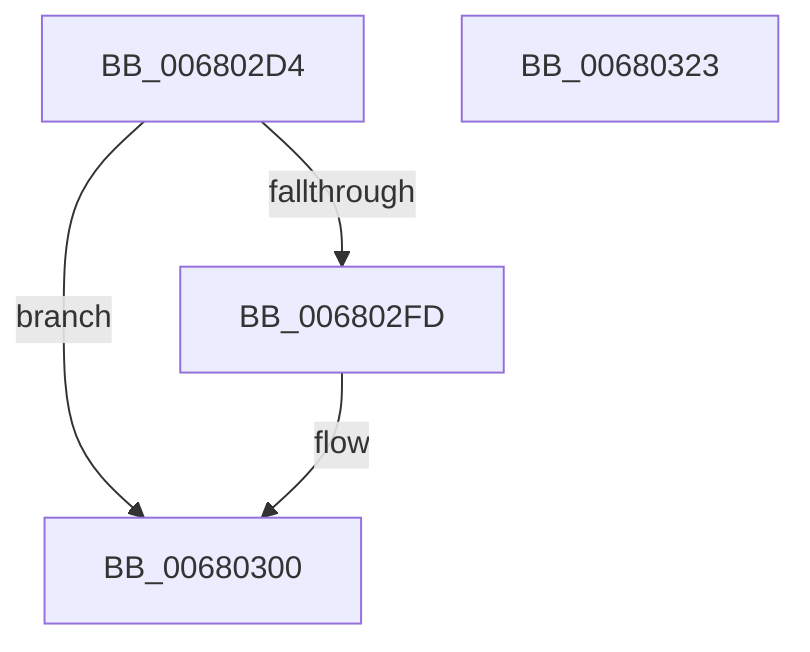

# MiCheckAndUpdatePagingFileMinimum

- RVA: `0x006802D4`–`0x00680324` (길이 `80` bytes)
- VA: `0x00000001406802D4`
- 실행 섹션: `.text`
- PDB 이름 있음: `예`; PDB Function 태그: `아니요`
- unwind 정보 RVA: `0x00060BC4`
- 디코드: `26`개 명령, `80/80` bytes 표시
- 미해석 바이트: `0` (있으면 어셈블리에 `.byte`로 보존)

> 이 문서는 커널 이미지의 기계어와 PDB 기호를 분석해 생성했습니다. 4번과 5번은 함수 원형과 자료형을 바이너리 사용 방식에서 추정한 C 해석이며 원본 소스 복구 결과는 아닙니다.

## 1. Dependencies

- 직접 호출 지점: **2**; 고유 호출 대상: **2**
- 직접 호출자로 확인된 함수: **1**
- RIP 상대 이미지 참조: **0**

### Outgoing calls
- `0x006802F2` → [ExAcquireSpinLockExclusive](../24/ExAcquireSpinLockExclusive_function_00248690.md) (function, `0x00248690`)
- `0x0068030C` → [MiReleaseSpinLockExclusive](../24/MiReleaseSpinLockExclusive_function_002482C0.md) (function, `0x002482C0`)

### Direct callers
- [MiCreatePagingFile](../../page/7F/MiCreatePagingFile_function_007FEFF4.md) at `0x007FFAE7`

### Static image references
- 디코드된 RIP-relative 메모리 참조가 없습니다.

## 2. Other-region calls and transfers

- 다른 실행 섹션으로 향하는 call: **0**
- 별도 외부 분기/꼬리 이동을 확인하지 못했습니다.

## 3. Assembly (complete function range)

```asm
006802D4  48 89 5C 24 08                  mov qword ptr [rsp + 8], rbx
006802D9  48 89 74 24 10                  mov qword ptr [rsp + 0x10], rsi
006802DE  57                              push rdi
006802DF  48 83 EC 20                     sub rsp, 0x20
006802E3  48 8D B1 C8 00 00 00            lea rsi, [rcx + 0xc8]
006802EA  48 8B D9                        mov rbx, rcx
006802ED  48 8B CE                        mov rcx, rsi
006802F0  8B FA                           mov edi, edx
006802F2  E8 99 83 BC FF                  call 0x140248690
006802F7  8B 0B                           mov ecx, dword ptr [rbx]
006802F9  3B F9                           cmp edi, ecx
006802FB  77 03                           ja 0x140680300
006802FD  89 7B 08                        mov dword ptr [rbx + 8], edi
00680300  33 DB                           xor ebx, ebx
00680302  8A D0                           mov dl, al
00680304  3B F9                           cmp edi, ecx
00680306  48 8B CE                        mov rcx, rsi
00680309  0F 96 C3                        setbe bl
0068030C  E8 AF 7F BC FF                  call 0x1402482c0
00680311  48 8B 74 24 38                  mov rsi, qword ptr [rsp + 0x38]
00680316  8B C3                           mov eax, ebx
00680318  48 8B 5C 24 30                  mov rbx, qword ptr [rsp + 0x30]
0068031D  48 83 C4 20                     add rsp, 0x20
00680321  5F                              pop rdi
00680322  C3                              ret
00680323  CC                              int3
```

## 4. C-style interpretation (structured pseudocode)

```c
__int64 __fastcall MiCheckAndUpdatePagingFileMinimum(__int64 a1, int a2)
{
    __int64 result;
    __int64 v_rbx;
    __int64 v_rsp;
    unsigned __int64 v_stack_p10;
    unsigned __int64 v_stack_p8;

    v_stack_p8 = v_rbx;
    v_stack_p10 = v_rsi;
    v_rsp = (v_rsp) - (32);
    result = ExAcquireSpinLockExclusive(a1 + 200, a2, a3, a4);
    if (((unsigned int)((unsigned int)(a2))) <= ((unsigned int)((unsigned int)(*(unsigned int *)(a1))))) {
        *(unsigned int *)(a1 + 8) = (unsigned int)((unsigned int)(a2));
    }
    v_rbx = 0;
    v_rbx = (((unsigned int)((unsigned int)(a2))) <= ((unsigned int)((unsigned int)(*(unsigned int *)(a1))))) ? 1 : 0;
    result = MiReleaseSpinLockExclusive(a1 + 200, (unsigned __int8)(result), a3, a4);
    v_rsp = (v_rsp) + (32);
    return (unsigned int)((unsigned int)(v_rbx));
}
```

## 5. (Beta) C Style

```c
int64_t MiCheckAndUpdatePagingFileMinimum(void *Arg1, int32_t Arg2)
{
    uint8_t *arg1 = (uint8_t *)Arg1;

    int64_t result;
    int64_t local_rbx;
    int64_t local_rsp;
    uint64_t v_stack_p10;
    uint64_t v_stack_p8;

    v_stack_p8 = local_rbx;
    v_stack_p10 = local_rsi;
    local_rsp = (local_rsp) - (32);
    result = ExAcquireSpinLockExclusive(Arg1 + 200, Arg2, a3, a4);
    if (((uint32_t)((uint32_t)(Arg2))) <= ((uint32_t)((uint32_t)(*(uint32_t *)(arg1))))) {
        *(uint32_t *)(arg1 + 0x8) = (uint32_t)((uint32_t)(Arg2));
    }
    local_rbx = 0;
    local_rbx = (((uint32_t)((uint32_t)(Arg2))) <= ((uint32_t)((uint32_t)(*(uint32_t *)(arg1))))) ? 1 : 0;
    result = MiReleaseSpinLockExclusive(Arg1 + 200, (uint8_t)(result), a3, a4);
    local_rsp = (local_rsp) + (32);
    return (uint32_t)((uint32_t)(local_rbx));
}
```

### 관측된 메모리 오프셋

구조체 형식이 확인되지 않은 접근은 인자 기준의 오프셋으로만 기록했습니다.

| 기준 인자 | 오프셋 표현 | 폭 (bit) | 접근 |
|---|---:|---:|---|
| `Arg1` | `+ 0x0` | `32` | `R` |
| `Arg1` | `+ 0x8` | `32` | `W` |
| `Arg1` | `+ 0xC8` | `64` | `R` |

## 6. Execution-region graph

[열기: 2D/3D 그래프와 함수 탐색 컨트롤 패널](../../../control-panel.html?section=text&rva=0x006802D4&view=graph)

- 2D 그래프는 위에서 아래로 흐르고, 3D 그래프는 빈 공간을 드래그해 회전합니다. Shift+드래그는 이동, 휠은 확대·축소, 함수 노드 선택은 대상 보고서 이동입니다.

### Static fallback


