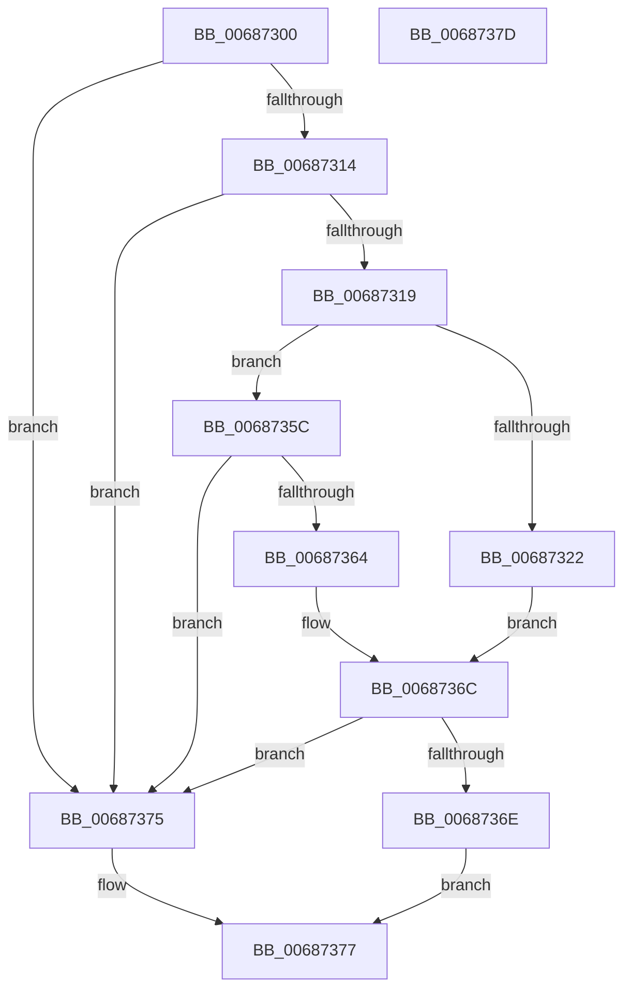

# MiCheckContiguityTradeEligible

- RVA: `0x00687300`–`0x0068737E` (길이 `126` bytes)
- VA: `0x0000000140687300`
- 실행 섹션: `.text`
- PDB 이름 있음: `예`; PDB Function 태그: `아니요`
- unwind 정보 RVA: `0x00064C80`
- 디코드: `40`개 명령, `126/126` bytes 표시
- 미해석 바이트: `0` (있으면 어셈블리에 `.byte`로 보존)

> 이 문서는 커널 이미지의 기계어와 PDB 기호를 분석해 생성했습니다. 4번과 5번은 함수 원형과 자료형을 바이너리 사용 방식에서 추정한 C 해석이며 원본 소스 복구 결과는 아닙니다.

## 1. Dependencies

- 직접 호출 지점: **2**; 고유 호출 대상: **2**
- 직접 호출자로 확인된 함수: **2**
- RIP 상대 이미지 참조: **1**

### Outgoing calls
- `0x00687352` → [MiActivePageClaimCandidate](../31/MiActivePageClaimCandidate_function_0031BB00.md) (function, `0x0031BB00`)
- `0x00687364` → [MiGetPfnSlabType](../28/MiGetPfnSlabType_function_0028E2D0.md) (function, `0x0028E2D0`)

### Direct callers
- [MiQueryVaPhysicalContiguity](MiQueryVaPhysicalContiguity_function_006875B8.md) at `0x00687858`
- [MiMakeVaRangePhysicallyContiguous](../69/MiMakeVaRangePhysicallyContiguous_function_006936E0.md) at `0x00693832`

### Static image references
- `0x00687329` → RVA `0x00E30088` (`.data`; read)

## 2. Other-region calls and transfers

- 다른 실행 섹션으로 향하는 call: **0**
- 별도 외부 분기/꼬리 이동을 확인하지 못했습니다.

## 3. Assembly (complete function range)

```asm
00687300  40 53                           push rbx
00687302  48 83 EC 30                     sub rsp, 0x30
00687306  48 8B 41 28                     mov rax, qword ptr [rcx + 0x28]
0068730A  33 DB                           xor ebx, ebx
0068730C  48 8B D1                        mov rdx, rcx
0068730F  48 85 C0                        test rax, rax
00687312  78 61                           js 0x140687375
00687314  38 59 23                        cmp byte ptr [rcx + 0x23], bl
00687317  7C 5C                           jl 0x140687375
00687319  8A 41 22                        mov al, byte ptr [rcx + 0x22]
0068731C  24 07                           and al, 7
0068731E  3C 06                           cmp al, 6
00687320  75 3A                           jne 0x14068735c
00687322  48 8B 41 28                     mov rax, qword ptr [rcx + 0x28]
00687326  45 33 C9                        xor r9d, r9d
00687329  48 8B 0D 58 8D 7A 00            mov rcx, qword ptr [rip + 0x7a8d58]
00687330  45 33 C0                        xor r8d, r8d
00687333  48 C1 E8 2B                     shr rax, 0x2b
00687337  25 FF 03 00 00                  and eax, 0x3ff
0068733C  89 5C 24 40                     mov dword ptr [rsp + 0x40], ebx
00687340  48 8B 0C C1                     mov rcx, qword ptr [rcx + rax*8]
00687344  48 8D 44 24 40                  lea rax, [rsp + 0x40]
00687349  48 89 44 24 28                  mov qword ptr [rsp + 0x28], rax
0068734E  89 5C 24 20                     mov dword ptr [rsp + 0x20], ebx
00687352  E8 A9 47 C9 FF                  call 0x14031bb00
00687357  48 85 C0                        test rax, rax
0068735A  EB 10                           jmp 0x14068736c
0068735C  8B 41 20                        mov eax, dword ptr [rcx + 0x20]
0068735F  66 85 C0                        test ax, ax
00687362  75 11                           jne 0x140687375
00687364  E8 67 6F C0 FF                  call 0x14028e2d0
00687369  83 F8 09                        cmp eax, 9
0068736C  75 07                           jne 0x140687375
0068736E  B8 01 00 00 00                  mov eax, 1
00687373  EB 02                           jmp 0x140687377
00687375  33 C0                           xor eax, eax
00687377  48 83 C4 30                     add rsp, 0x30
0068737B  5B                              pop rbx
0068737C  C3                              ret
0068737D  CC                              int3
```

## 4. C-style interpretation (structured pseudocode)

```c
__int64 __fastcall MiCheckContiguityTradeEligible(__int64 a1, __int64 a2, int a3, int a4)
{
    __int64 result;
    __int64 v_rbx;
    __int64 v_rsp;
    unsigned __int64 v_stack_m10;
    unsigned int v_stack_m18;
    unsigned int v_stack_p8;

    v_rsp = (v_rsp) - (48);
    v_rbx = 0;
    if (sign_flag) goto loc_00687375;
    if ((*(unsigned __int8 *)(a1 + 35)) < 0) goto loc_00687375;
    result = (unsigned __int8)((*(unsigned __int8 *)(a1 + 34)) & (7));
    if (((unsigned __int8)(result)) != 6) goto loc_0068735C;
    a4 = 0;
    a3 = 0;
    result = (*(unsigned __int64 *)(a1 + 40)) >> (43);
    result = (unsigned int)((result) & (0x3FFULL));
    v_stack_p8 = 0;
    v_stack_m10 = v_stack_p8;
    v_stack_m18 = 0;
    result = MiActivePageClaimCandidate(*(unsigned __int64 *)(*(unsigned __int64 *)(v_rip + 8031576) + result * 8), a1, a3, a4);
    goto loc_0068736C;
loc_0068735C:
    if ((unsigned __int16)((unsigned int)(*(unsigned int *)(*(unsigned __int64 *)(*(unsigned __int64 *)(v_rip + 8031576) + result * 8) + 32))) != 0) goto loc_00687375;
    result = MiGetPfnSlabType(*(unsigned __int64 *)(*(unsigned __int64 *)(v_rip + 8031576) + result * 8), a1, a3, a4);
loc_0068736C:
    if (((unsigned int)(result)) != 9) goto loc_00687375;
    goto loc_00687377;
loc_00687375:
    result = 0;
loc_00687377:
    v_rsp = (v_rsp) + (48);
    return result;
}
```

## 5. (Beta) C Style

```c
int64_t MiCheckContiguityTradeEligible(void *Arg1, int64_t Arg2, int32_t Arg3, int32_t Arg4)
{
    uint8_t *arg1 = (uint8_t *)Arg1;

    int64_t result;
    int64_t local_rbx;
    int64_t local_rsp;
    uint64_t v_stack_m10;
    uint32_t v_stack_m18;
    uint32_t v_stack_p8;

    local_rsp = (local_rsp) - (48);
    local_rbx = 0;
    if (sign_flag) goto loc_00687375;
    if ((*(uint8_t *)(arg1 + 0x23)) < 0) goto loc_00687375;
    result = (uint8_t)((*(uint8_t *)(arg1 + 0x22)) & (7));
    if (((uint8_t)(result)) != 6) goto loc_0068735C;
    Arg4 = 0;
    Arg3 = 0;
    result = (*(uint64_t *)(arg1 + 0x28)) >> (43);
    result = (uint32_t)((result) & (0x3FFULL));
    v_stack_p8 = 0;
    v_stack_m10 = v_stack_p8;
    v_stack_m18 = 0;
    result = MiActivePageClaimCandidate(*(uint64_t *)(*(uint64_t *)(v_rip + 0x7A8D58) + result * 8), Arg1, Arg3, Arg4);
    goto loc_0068736C;
loc_0068735C:
    if ((uint16_t)((uint32_t)(*(uint32_t *)(*(uint64_t *)(*(uint64_t *)(v_rip + 0x7A8D58) + result * 8) + 0x20))) != 0) goto loc_00687375;
    result = MiGetPfnSlabType(*(uint64_t *)(*(uint64_t *)(v_rip + 0x7A8D58) + result * 8), Arg1, Arg3, Arg4);
loc_0068736C:
    if (((uint32_t)(result)) != 9) goto loc_00687375;
    goto loc_00687377;
loc_00687375:
    result = 0;
loc_00687377:
    local_rsp = (local_rsp) + (48);
    return result;
}
```

### 관측된 메모리 오프셋

구조체 형식이 확인되지 않은 접근은 인자 기준의 오프셋으로만 기록했습니다.

| 기준 인자 | 오프셋 표현 | 폭 (bit) | 접근 |
|---|---:|---:|---|
| `Arg1` | `+ 0x20` | `32` | `R` |
| `Arg1` | `+ 0x22` | `8` | `R` |
| `Arg1` | `+ 0x23` | `8` | `R` |
| `Arg1` | `+ 0x28` | `64` | `R` |

## 6. Execution-region graph

[열기: 2D/3D 그래프와 함수 탐색 컨트롤 패널](../../../control-panel.html?section=text&rva=0x00687300&view=graph)

- 2D 그래프는 위에서 아래로 흐르고, 3D 그래프는 빈 공간을 드래그해 회전합니다. Shift+드래그는 이동, 휠은 확대·축소, 함수 노드 선택은 대상 보고서 이동입니다.

### Static fallback


