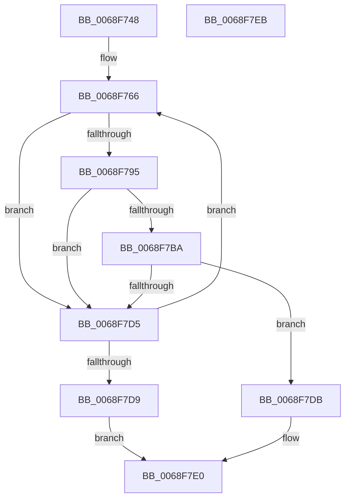

# MiCheckForDiscardableLongJumpTable

- RVA: `0x0068F748`–`0x0068F7EC` (길이 `164` bytes)
- VA: `0x000000014068F748`
- 실행 섹션: `.text`
- PDB 이름 있음: `예`; PDB Function 태그: `아니요`
- unwind 정보 RVA: `0x0006E5F8`
- 디코드: `44`개 명령, `164/164` bytes 표시
- 미해석 바이트: `0` (있으면 어셈블리에 `.byte`로 보존)

> 이 문서는 커널 이미지의 기계어와 PDB 기호를 분석해 생성했습니다. 4번과 5번은 함수 원형과 자료형을 바이너리 사용 방식에서 추정한 C 해석이며 원본 소스 복구 결과는 아닙니다.

## 1. Dependencies

- 직접 호출 지점: **1**; 고유 호출 대상: **1**
- 직접 호출자로 확인된 함수: **1**
- RIP 상대 이미지 참조: **0**

### Outgoing calls
- `0x0068F784` → [MiSnapDriverRange](../../page/A4/MiSnapDriverRange_function_00A4B328.md) (function, `0x00A4B328`)

### Direct callers
- [MiProcessKernelCfgImageLoadConfig](../../page/A7/MiProcessKernelCfgImageLoadConfig_function_00A7FE40.md) at `0x00A7FFF3`

### Static image references
- 디코드된 RIP-relative 메모리 참조가 없습니다.

## 2. Other-region calls and transfers

- 다른 실행 섹션으로 향하는 call: **1**
  - `0x0068F784` → [MiSnapDriverRange](../../page/A4/MiSnapDriverRange_function_00A4B328.md) (`.text` → `PAGE`)
- 별도 외부 분기/꼬리 이동을 확인하지 못했습니다.

## 3. Assembly (complete function range)

```asm
0068F748  48 89 5C 24 08                  mov qword ptr [rsp + 8], rbx
0068F74D  57                              push rdi
0068F74E  48 83 EC 30                     sub rsp, 0x30
0068F752  48 83 64 24 58 00               and qword ptr [rsp + 0x58], 0
0068F758  48 8B FA                        mov rdi, rdx
0068F75B  48 83 64 24 50 00               and qword ptr [rsp + 0x50], 0
0068F761  48 8B D9                        mov rbx, rcx
0068F764  33 D2                           xor edx, edx
0068F766  45 33 C9                        xor r9d, r9d
0068F769  48 8D 44 24 58                  lea rax, [rsp + 0x58]
0068F76E  48 89 44 24 28                  mov qword ptr [rsp + 0x28], rax
0068F773  48 8B CB                        mov rcx, rbx
0068F776  48 8D 44 24 50                  lea rax, [rsp + 0x50]
0068F77B  48 89 44 24 20                  mov qword ptr [rsp + 0x20], rax
0068F780  45 8D 41 02                     lea r8d, [r9 + 2]
0068F784  E8 9F BB 3B 00                  call 0x140a4b328
0068F789  8B D0                           mov edx, eax
0068F78B  48 8B 44 24 50                  mov rax, qword ptr [rsp + 0x50]
0068F790  48 85 C0                        test rax, rax
0068F793  74 40                           je 0x14068f7d5
0068F795  48 B9 00 00 00 00 80 F6 FF FF   movabs rcx, 0xfffff68000000000
0068F79F  4C 8B 87 B0 00 00 00            mov r8, qword ptr [rdi + 0xb0]
0068F7A6  48 C1 E0 19                     shl rax, 0x19
0068F7AA  48 C1 E1 19                     shl rcx, 0x19
0068F7AE  48 2B C1                        sub rax, rcx
0068F7B1  48 C1 F8 10                     sar rax, 0x10
0068F7B5  4C 3B C0                        cmp r8, rax
0068F7B8  72 1B                           jb 0x14068f7d5
0068F7BA  48 8B 44 24 58                  mov rax, qword ptr [rsp + 0x58]
0068F7BF  48 C1 E0 19                     shl rax, 0x19
0068F7C3  48 2B C1                        sub rax, rcx
0068F7C6  48 0D 00 00 FF 0F               or rax, 0xfff0000
0068F7CC  48 C1 F8 10                     sar rax, 0x10
0068F7D0  4C 3B C0                        cmp r8, rax
0068F7D3  76 06                           jbe 0x14068f7db
0068F7D5  85 D2                           test edx, edx
0068F7D7  75 8D                           jne 0x14068f766
0068F7D9  EB 05                           jmp 0x14068f7e0
0068F7DB  0F BA 6B 68 0B                  bts dword ptr [rbx + 0x68], 0xb
0068F7E0  48 8B 5C 24 40                  mov rbx, qword ptr [rsp + 0x40]
0068F7E5  48 83 C4 30                     add rsp, 0x30
0068F7E9  5F                              pop rdi
0068F7EA  C3                              ret
0068F7EB  CC                              int3
```

## 4. C-style interpretation (structured pseudocode)

```c
__int64 __fastcall MiCheckForDiscardableLongJumpTable(__int64 a1, __int64 a2, __int64 a3, int a4)
{
    __int64 result;
    __int64 v_rsp;
    unsigned __int64 v_stack_m10;
    unsigned __int64 v_stack_m18;
    unsigned __int64 v_stack_p18;
    unsigned __int64 v_stack_p20;
    unsigned __int64 v_stack_p8;

    v_stack_p8 = v_rbx;
    v_rsp = (v_rsp) - (48);
    a2 = 0;
loc_0068F766:
    a4 = 0;
    v_stack_m10 = v_stack_p20;
    v_stack_m18 = v_stack_p18;
    result = MiSnapDriverRange(a1, a2, a4 + 2, a4);
    if (v_stack_p18 == 0) goto loc_0068F7D5;
    result = (v_stack_p18) << (25);
    a1 = (a1) << (25);
    result = (result) - (a1);
    result = (result) >> (16);
    if ((*(unsigned __int64 *)(a2 + 176)) < result) goto loc_0068F7D5;
    result = (v_stack_p20) << (25);
    result = (result) - (a1);
    result = (result) | (0xFFF0000ULL);
    result = (result) >> (16);
    if ((*(unsigned __int64 *)(a2 + 176)) <= result) goto loc_0068F7DB;
loc_0068F7D5:
    if ((unsigned int)((unsigned int)((unsigned int)(result))) != 0) goto loc_0068F766;
    goto loc_0068F7E0;
loc_0068F7DB:
loc_0068F7E0:
    v_rsp = (v_rsp) + (48);
    return result;
}
```

## 5. (Beta) C Style

```c
int64_t MiCheckForDiscardableLongJumpTable(void *Arg1, void *Arg2, int64_t Arg3, int32_t Arg4)
{
    uint8_t *arg1 = (uint8_t *)Arg1;
    uint8_t *arg2 = (uint8_t *)Arg2;

    int64_t result;
    int64_t local_rsp;
    uint64_t v_stack_m10;
    uint64_t v_stack_m18;
    uint64_t v_stack_p18;
    uint64_t v_stack_p20;
    uint64_t v_stack_p8;

    v_stack_p8 = local_rbx;
    local_rsp = (local_rsp) - (48);
    Arg2 = 0;
loc_0068F766:
    Arg4 = 0;
    v_stack_m10 = v_stack_p20;
    v_stack_m18 = v_stack_p18;
    result = MiSnapDriverRange(Arg1, Arg2, Arg4 + 2, Arg4);
    if (v_stack_p18 == 0) goto loc_0068F7D5;
    result = (v_stack_p18) << (25);
    Arg1 = (Arg1) << (25);
    result = (result) - (Arg1);
    result = (result) >> (16);
    if ((*(uint64_t *)(arg2 + 0xB0)) < result) goto loc_0068F7D5;
    result = (v_stack_p20) << (25);
    result = (result) - (Arg1);
    result = (result) | (0xFFF0000ULL);
    result = (result) >> (16);
    if ((*(uint64_t *)(arg2 + 0xB0)) <= result) goto loc_0068F7DB;
loc_0068F7D5:
    if ((uint32_t)((uint32_t)((uint32_t)(result))) != 0) goto loc_0068F766;
    goto loc_0068F7E0;
loc_0068F7DB:
loc_0068F7E0:
    local_rsp = (local_rsp) + (48);
    return result;
}
```

### 관측된 메모리 오프셋

구조체 형식이 확인되지 않은 접근은 인자 기준의 오프셋으로만 기록했습니다.

| 기준 인자 | 오프셋 표현 | 폭 (bit) | 접근 |
|---|---:|---:|---|
| `Arg1` | `+ 0x68` | `32` | `R/W` |
| `Arg2` | `+ 0xB0` | `64` | `R` |

## 6. Execution-region graph

[열기: 2D/3D 그래프와 함수 탐색 컨트롤 패널](../../../control-panel.html?section=text&rva=0x0068F748&view=graph)

- 2D 그래프는 위에서 아래로 흐르고, 3D 그래프는 빈 공간을 드래그해 회전합니다. Shift+드래그는 이동, 휠은 확대·축소, 함수 노드 선택은 대상 보고서 이동입니다.

### Static fallback


