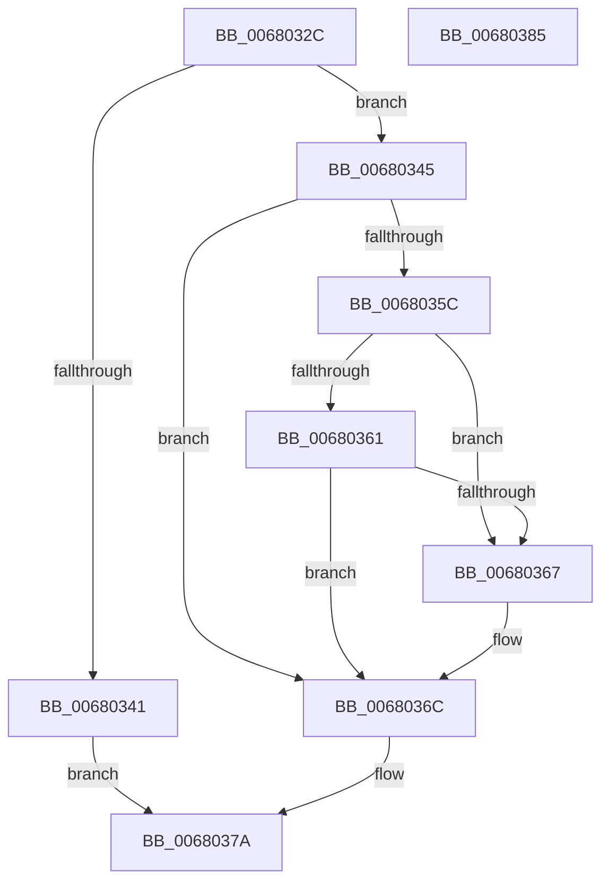

# MiCheckPageFileMapping

- RVA: `0x0068032C`–`0x00680386` (길이 `90` bytes)
- VA: `0x000000014068032C`
- 실행 섹션: `.text`
- PDB 이름 있음: `예`; PDB Function 태그: `아니요`
- unwind 정보 RVA: `0x0005CAAC`
- 디코드: `28`개 명령, `90/90` bytes 표시
- 미해석 바이트: `0` (있으면 어셈블리에 `.byte`로 보존)

> 이 문서는 커널 이미지의 기계어와 PDB 기호를 분석해 생성했습니다. 4번과 5번은 함수 원형과 자료형을 바이너리 사용 방식에서 추정한 C 해석이며 원본 소스 복구 결과는 아닙니다.

## 1. Dependencies

- 직접 호출 지점: **2**; 고유 호출 대상: **2**
- 직접 호출자로 확인된 함수: **1**
- RIP 상대 이미지 참조: **1**

### Outgoing calls
- `0x0068034C` → [ExAcquireSpinLockExclusive](../24/ExAcquireSpinLockExclusive_function_00248690.md) (function, `0x00248690`)
- `0x00680373` → [MiReleaseSpinLockExclusive](../24/MiReleaseSpinLockExclusive_function_002482C0.md) (function, `0x002482C0`)

### Direct callers
- [MiCreatePagingFile](../../page/7F/MiCreatePagingFile_function_007FEFF4.md) at `0x007FF620`

### Static image references
- `0x00680345` → RVA `0x00E2CD00` (`.data`; read)

## 2. Other-region calls and transfers

- 다른 실행 섹션으로 향하는 call: **0**
- 별도 외부 분기/꼬리 이동을 확인하지 못했습니다.

## 3. Assembly (complete function range)

```asm
0068032C  48 89 5C 24 08                  mov qword ptr [rsp + 8], rbx
00680331  57                              push rdi
00680332  48 83 EC 20                     sub rsp, 0x20
00680336  33 DB                           xor ebx, ebx
00680338  48 8B F9                        mov rdi, rcx
0068033B  48 39 59 28                     cmp qword ptr [rcx + 0x28], rbx
0068033F  75 04                           jne 0x140680345
00680341  33 C0                           xor eax, eax
00680343  EB 35                           jmp 0x14068037a
00680345  48 8D 0D B4 C9 7A 00            lea rcx, [rip + 0x7ac9b4]
0068034C  E8 3F 83 BC FF                  call 0x140248690
00680351  8A D0                           mov dl, al
00680353  48 8B 47 28                     mov rax, qword ptr [rdi + 0x28]
00680357  48 85 C0                        test rax, rax
0068035A  74 10                           je 0x14068036c
0068035C  48 39 18                        cmp qword ptr [rax], rbx
0068035F  75 06                           jne 0x140680367
00680361  48 39 58 10                     cmp qword ptr [rax + 0x10], rbx
00680365  74 05                           je 0x14068036c
00680367  BB 4D 00 00 C0                  mov ebx, 0xc000004d
0068036C  48 8D 0D 8D C9 7A 00            lea rcx, [rip + 0x7ac98d]
00680373  E8 48 7F BC FF                  call 0x1402482c0
00680378  8B C3                           mov eax, ebx
0068037A  48 8B 5C 24 30                  mov rbx, qword ptr [rsp + 0x30]
0068037F  48 83 C4 20                     add rsp, 0x20
00680383  5F                              pop rdi
00680384  C3                              ret
00680385  CC                              int3
```

## 4. C-style interpretation (structured pseudocode)

```c
__int64 __fastcall MiCheckPageFileMapping(__int64 a1)
{
    __int64 result;
    __int64 v_rbx;
    __int64 v_rsp;
    unsigned __int64 v_stack_p8;

    v_stack_p8 = v_rbx;
    v_rsp = (v_rsp) - (32);
    v_rbx = 0;
    if ((*(unsigned __int64 *)(a1 + 40)) != 0) goto loc_00680345;
    result = 0;
    goto loc_0068037A;
loc_00680345:
    result = ExAcquireSpinLockExclusive(v_rip + 8047028, a2, a3, a4);
    if (*(unsigned __int64 *)(a1 + 40) == 0) goto loc_0068036C;
    if ((*(unsigned __int64 *)(*(unsigned __int64 *)(a1 + 40))) != 0) goto loc_00680367;
    if ((*(unsigned __int64 *)(*(unsigned __int64 *)(a1 + 40) + 16)) != 0) {
        v_rbx = 0xC000004DULL;
    }
    result = MiReleaseSpinLockExclusive(v_rip + 8046989, (unsigned __int8)(result), a3, a4);
loc_0068037A:
    v_rsp = (v_rsp) + (32);
    return (unsigned int)((unsigned int)(v_rbx));
}
```

## 5. (Beta) C Style

```c
int64_t MiCheckPageFileMapping(void *Arg1)
{
    uint8_t *arg1 = (uint8_t *)Arg1;

    int64_t result;
    int64_t local_rbx;
    int64_t local_rsp;
    uint64_t v_stack_p8;

    v_stack_p8 = local_rbx;
    local_rsp = (local_rsp) - (32);
    local_rbx = 0;
    if ((*(uint64_t *)(arg1 + 0x28)) != 0) goto loc_00680345;
    result = 0;
    goto loc_0068037A;
loc_00680345:
    result = ExAcquireSpinLockExclusive(v_rip + 8047028, a2, a3, a4);
    if (*(uint64_t *)(arg1 + 0x28) == 0) goto loc_0068036C;
    if ((*(uint64_t *)(*(uint64_t *)(arg1 + 0x28))) != 0) goto loc_00680367;
    if ((*(uint64_t *)(*(uint64_t *)(arg1 + 0x28) + 0x10)) != 0) {
        local_rbx = 0xC000004DULL;
    }
    result = MiReleaseSpinLockExclusive(v_rip + 8046989, (uint8_t)(result), a3, a4);
loc_0068037A:
    local_rsp = (local_rsp) + (32);
    return (uint32_t)((uint32_t)(local_rbx));
}
```

### 관측된 메모리 오프셋

구조체 형식이 확인되지 않은 접근은 인자 기준의 오프셋으로만 기록했습니다.

| 기준 인자 | 오프셋 표현 | 폭 (bit) | 접근 |
|---|---:|---:|---|
| `Arg1` | `+ 0x28` | `64` | `R` |

## 6. Execution-region graph

[열기: 2D/3D 그래프와 함수 탐색 컨트롤 패널](../../../control-panel.html?section=text&rva=0x0068032C&view=graph)

- 2D 그래프는 위에서 아래로 흐르고, 3D 그래프는 빈 공간을 드래그해 회전합니다. Shift+드래그는 이동, 휠은 확대·축소, 함수 노드 선택은 대상 보고서 이동입니다.

### Static fallback


