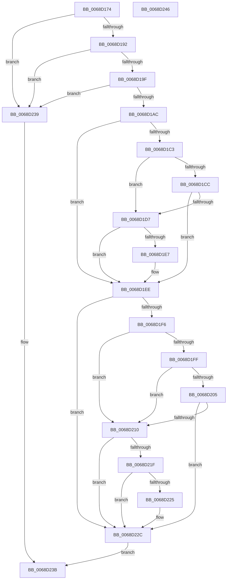

# MiCheckSlabEntryForDefrag

- RVA: `0x0068D174`–`0x0068D247` (길이 `211` bytes)
- VA: `0x000000014068D174`
- 실행 섹션: `.text`
- PDB 이름 있음: `예`; PDB Function 태그: `아니요`
- unwind 정보 RVA: `0x000950EC`
- 디코드: `68`개 명령, `211/211` bytes 표시
- 미해석 바이트: `0` (있으면 어셈블리에 `.byte`로 보존)

> 이 문서는 커널 이미지의 기계어와 PDB 기호를 분석해 생성했습니다. 4번과 5번은 함수 원형과 자료형을 바이너리 사용 방식에서 추정한 C 해석이며 원본 소스 복구 결과는 아닙니다.

## 1. Dependencies

- 직접 호출 지점: **0**; 고유 호출 대상: **0**
- 직접 호출자로 확인된 함수: **2**
- RIP 상대 이미지 참조: **0**

### Outgoing calls
- 직접 디코드된 call 명령이 없습니다.

### Direct callers
- [MiFindDefragmentSlabEntriesHelper](MiFindDefragmentSlabEntriesHelper_function_0068E530.md) at `0x0068E569`
- [MiFindDefragmentSlabEntriesHelperByIdentity](MiFindDefragmentSlabEntriesHelperByIdentity_function_0068E5D0.md) at `0x0068E60E`

### Static image references
- 디코드된 RIP-relative 메모리 참조가 없습니다.

## 2. Other-region calls and transfers

- 다른 실행 섹션으로 향하는 call: **0**
- 별도 외부 분기/꼬리 이동을 확인하지 못했습니다.

## 3. Assembly (complete function range)

```asm
0068D174  48 89 5C 24 08                  mov qword ptr [rsp + 8], rbx
0068D179  48 89 7C 24 10                  mov qword ptr [rsp + 0x10], rdi
0068D17E  44 8B 4A 58                     mov r9d, dword ptr [rdx + 0x58]
0068D182  4C 8B D2                        mov r10, rdx
0068D185  4C 8B C1                        mov r8, rcx
0068D188  44 03 4A 54                     add r9d, dword ptr [rdx + 0x54]
0068D18C  0F 84 A7 00 00 00               je 0x14068d239
0068D192  44 8B 59 4C                     mov r11d, dword ptr [rcx + 0x4c]
0068D196  45 3B CB                        cmp r9d, r11d
0068D199  0F 83 9A 00 00 00               jae 0x14068d239
0068D19F  8B 42 5C                        mov eax, dword ptr [rdx + 0x5c]
0068D1A2  0F BA E0 09                     bt eax, 9
0068D1A6  0F 82 8D 00 00 00               jb 0x14068d239
0068D1AC  8B 79 54                        mov edi, dword ptr [rcx + 0x54]
0068D1AF  40 F6 C7 10                     test dil, 0x10
0068D1B3  8B D7                           mov edx, edi
0068D1B5  0F 95 C1                        setne cl
0068D1B8  A8 01                           test al, 1
0068D1BA  0F 94 C0                        sete al
0068D1BD  33 DB                           xor ebx, ebx
0068D1BF  84 C8                           test al, cl
0068D1C1  74 2B                           je 0x14068d1ee
0068D1C3  49 8B 48 28                     mov rcx, qword ptr [r8 + 0x28]
0068D1C7  48 85 C9                        test rcx, rcx
0068D1CA  74 0B                           je 0x14068d1d7
0068D1CC  8B 41 58                        mov eax, dword ptr [rcx + 0x58]
0068D1CF  03 41 54                        add eax, dword ptr [rcx + 0x54]
0068D1D2  41 3B C1                        cmp eax, r9d
0068D1D5  73 17                           jae 0x14068d1ee
0068D1D7  41 8B C3                        mov eax, r11d
0068D1DA  4D 89 50 28                     mov qword ptr [r8 + 0x28], r10
0068D1DE  D1 E8                           shr eax, 1
0068D1E0  8B D7                           mov edx, edi
0068D1E2  44 3B C8                        cmp r9d, eax
0068D1E5  72 07                           jb 0x14068d1ee
0068D1E7  83 CA 20                        or edx, 0x20
0068D1EA  41 89 50 54                     mov dword ptr [r8 + 0x54], edx
0068D1EE  8B CA                           mov ecx, edx
0068D1F0  49 39 58 38                     cmp qword ptr [r8 + 0x38], rbx
0068D1F4  75 36                           jne 0x14068d22c
0068D1F6  49 8B 78 30                     mov rdi, qword ptr [r8 + 0x30]
0068D1FA  48 85 FF                        test rdi, rdi
0068D1FD  74 11                           je 0x14068d210
0068D1FF  49 3B 78 28                     cmp rdi, qword ptr [r8 + 0x28]
0068D203  74 0B                           je 0x14068d210
0068D205  8B 47 58                        mov eax, dword ptr [rdi + 0x58]
0068D208  03 47 54                        add eax, dword ptr [rdi + 0x54]
0068D20B  41 3B C1                        cmp eax, r9d
0068D20E  76 1C                           jbe 0x14068d22c
0068D210  41 C1 EB 02                     shr r11d, 2
0068D214  8B CA                           mov ecx, edx
0068D216  4D 89 50 30                     mov qword ptr [r8 + 0x30], r10
0068D21A  45 3B CB                        cmp r9d, r11d
0068D21D  77 0D                           ja 0x14068d22c
0068D21F  4D 3B 50 28                     cmp r10, qword ptr [r8 + 0x28]
0068D223  74 07                           je 0x14068d22c
0068D225  83 C9 40                        or ecx, 0x40
0068D228  41 89 48 54                     mov dword ptr [r8 + 0x54], ecx
0068D22C  83 E1 60                        and ecx, 0x60
0068D22F  80 F9 60                        cmp cl, 0x60
0068D232  0F 94 C3                        sete bl
0068D235  8B C3                           mov eax, ebx
0068D237  EB 02                           jmp 0x14068d23b
0068D239  33 C0                           xor eax, eax
0068D23B  48 8B 5C 24 08                  mov rbx, qword ptr [rsp + 8]
0068D240  48 8B 7C 24 10                  mov rdi, qword ptr [rsp + 0x10]
0068D245  C3                              ret
0068D246  CC                              int3
```

## 4. C-style interpretation (structured pseudocode)

```c
__int64 __fastcall MiCheckSlabEntryForDefrag(__int64 a1, __int64 a2)
{
    __int64 result;
    __int64 v_r11;
    __int64 v_rbx;
    unsigned __int64 v_stack_p10;
    unsigned __int64 v_stack_p8;

    v_stack_p8 = v_rbx;
    v_stack_p10 = v_rdi;
    a4 = (unsigned int)(((unsigned int)(*(unsigned int *)(a2 + 88))) + (*(unsigned int *)(a2 + 84)));
    if (condition_is_equal) goto loc_0068D239;
    if (((unsigned int)(a4)) >= ((unsigned int)((unsigned int)(*(unsigned int *)(a1 + 76))))) goto loc_0068D239;
    if (((unsigned int)(a4)) < ((unsigned int)((unsigned int)(*(unsigned int *)(a1 + 76))))) goto loc_0068D239;
    a1 = ((((unsigned __int8)((unsigned int)(*(unsigned int *)(a1 + 84)))) & (16)) != 0) ? 1 : 0;
    result = ((((unsigned __int8)((unsigned int)(*(unsigned int *)(a2 + 92)))) & (1)) == 0) ? 1 : 0;
    v_rbx = 0;
    if ((((unsigned __int8)(result)) & ((unsigned __int8)(a1))) == 0) goto loc_0068D1EE;
    if (*(unsigned __int64 *)(a1 + 40) == 0) goto loc_0068D1D7;
    result = (unsigned int)(((unsigned int)(*(unsigned int *)(*(unsigned __int64 *)(a1 + 40) + 88))) + (*(unsigned int *)(*(unsigned __int64 *)(a1 + 40) + 84)));
    if (((unsigned int)(result)) >= ((unsigned int)(a4))) goto loc_0068D1EE;
loc_0068D1D7:
    *(unsigned __int64 *)(a1 + 40) = a2;
    result = (unsigned int)(((unsigned int)((unsigned int)((unsigned int)(*(unsigned int *)(a1 + 76))))) >> (1));
    if (((unsigned int)(a4)) >= ((unsigned int)(result))) {
        a2 = (unsigned int)(((unsigned int)((unsigned int)((unsigned int)(*(unsigned int *)(a1 + 84))))) | (32));
        *(unsigned int *)(a1 + 84) = (unsigned int)(a2);
    }
    if ((*(unsigned __int64 *)(a1 + 56)) != 0) goto loc_0068D22C;
    if (*(unsigned __int64 *)(a1 + 48) == 0) goto loc_0068D210;
    if ((*(unsigned __int64 *)(a1 + 48)) == (*(unsigned __int64 *)(a1 + 40))) goto loc_0068D210;
    result = (unsigned int)(((unsigned int)(*(unsigned int *)(*(unsigned __int64 *)(a1 + 48) + 88))) + (*(unsigned int *)(*(unsigned __int64 *)(a1 + 48) + 84)));
    if (((unsigned int)(result)) <= ((unsigned int)(a4))) goto loc_0068D22C;
loc_0068D210:
    v_r11 = (unsigned int)(((unsigned int)(*(unsigned int *)(a1 + 76))) >> (2));
    *(unsigned __int64 *)(a1 + 48) = a2;
    if (((unsigned int)(a4)) > ((unsigned int)(v_r11))) goto loc_0068D22C;
    if (a2 != (*(unsigned __int64 *)(a1 + 40))) {
        a1 = (unsigned int)(((unsigned int)((unsigned int)(a2))) | (64));
        *(unsigned int *)(a1 + 84) = (unsigned int)(a1);
    }
    a1 = (unsigned int)((a1) & (96));
    v_rbx = (((unsigned __int8)(a1)) == 96) ? 1 : 0;
    goto loc_0068D23B;
loc_0068D239:
    result = 0;
loc_0068D23B:
    return result;
}
```

## 5. (Beta) C Style

```c
int64_t MiCheckSlabEntryForDefrag(void *Arg1, void *Arg2)
{
    uint8_t *arg1 = (uint8_t *)Arg1;
    uint8_t *arg2 = (uint8_t *)Arg2;

    int64_t result;
    int64_t local_r11;
    int64_t local_rbx;
    uint64_t v_stack_p10;
    uint64_t v_stack_p8;

    v_stack_p8 = local_rbx;
    v_stack_p10 = local_rdi;
    a4 = (uint32_t)(((uint32_t)(*(uint32_t *)(arg2 + 0x58))) + (*(uint32_t *)(arg2 + 0x54)));
    if (condition_is_equal) goto loc_0068D239;
    if (((uint32_t)(a4)) >= ((uint32_t)((uint32_t)(*(uint32_t *)(arg1 + 0x4C))))) goto loc_0068D239;
    if (((uint32_t)(a4)) < ((uint32_t)((uint32_t)(*(uint32_t *)(arg1 + 0x4C))))) goto loc_0068D239;
    Arg1 = ((((uint8_t)((uint32_t)(*(uint32_t *)(arg1 + 0x54)))) & (16)) != 0) ? 1 : 0;
    result = ((((uint8_t)((uint32_t)(*(uint32_t *)(arg2 + 0x5C)))) & (1)) == 0) ? 1 : 0;
    local_rbx = 0;
    if ((((uint8_t)(result)) & ((uint8_t)(Arg1))) == 0) goto loc_0068D1EE;
    if (*(uint64_t *)(arg1 + 0x28) == 0) goto loc_0068D1D7;
    result = (uint32_t)(((uint32_t)(*(uint32_t *)(*(uint64_t *)(arg1 + 0x28) + 0x58))) + (*(uint32_t *)(*(uint64_t *)(arg1 + 0x28) + 0x54)));
    if (((uint32_t)(result)) >= ((uint32_t)(a4))) goto loc_0068D1EE;
loc_0068D1D7:
    *(void **)(arg1 + 0x28) = Arg2;
    result = (uint32_t)(((uint32_t)((uint32_t)((uint32_t)(*(uint32_t *)(arg1 + 0x4C))))) >> (1));
    if (((uint32_t)(a4)) >= ((uint32_t)(result))) {
        Arg2 = (uint32_t)(((uint32_t)((uint32_t)((uint32_t)(*(uint32_t *)(arg1 + 0x54))))) | (32));
        *(uint32_t *)(arg1 + 0x54) = (uint32_t)(Arg2);
    }
    if ((*(uint64_t *)(arg1 + 0x38)) != 0) goto loc_0068D22C;
    if (*(uint64_t *)(arg1 + 0x30) == 0) goto loc_0068D210;
    if ((*(uint64_t *)(arg1 + 0x30)) == (*(uint64_t *)(arg1 + 0x28))) goto loc_0068D210;
    result = (uint32_t)(((uint32_t)(*(uint32_t *)(*(uint64_t *)(arg1 + 0x30) + 0x58))) + (*(uint32_t *)(*(uint64_t *)(arg1 + 0x30) + 0x54)));
    if (((uint32_t)(result)) <= ((uint32_t)(a4))) goto loc_0068D22C;
loc_0068D210:
    local_r11 = (uint32_t)(((uint32_t)(*(uint32_t *)(arg1 + 0x4C))) >> (2));
    *(void **)(arg1 + 0x30) = Arg2;
    if (((uint32_t)(a4)) > ((uint32_t)(local_r11))) goto loc_0068D22C;
    if (Arg2 != (*(uint64_t *)(arg1 + 0x28))) {
        Arg1 = (uint32_t)(((uint32_t)((uint32_t)(Arg2))) | (64));
        *(uint32_t *)(arg1 + 0x54) = (uint32_t)(Arg1);
    }
    Arg1 = (uint32_t)((Arg1) & (96));
    local_rbx = (((uint8_t)(Arg1)) == 96) ? 1 : 0;
    goto loc_0068D23B;
loc_0068D239:
    result = 0;
loc_0068D23B:
    return result;
}
```

### 관측된 메모리 오프셋

구조체 형식이 확인되지 않은 접근은 인자 기준의 오프셋으로만 기록했습니다.

| 기준 인자 | 오프셋 표현 | 폭 (bit) | 접근 |
|---|---:|---:|---|
| `Arg1` | `+ 0x28` | `64` | `R` |
| `Arg1` | `+ 0x28` | `64` | `W` |
| `Arg1` | `+ 0x30` | `64` | `R` |
| `Arg1` | `+ 0x30` | `64` | `W` |
| `Arg1` | `+ 0x38` | `64` | `R` |
| `Arg1` | `+ 0x4C` | `32` | `R` |
| `Arg1` | `+ 0x54` | `32` | `R` |
| `Arg1` | `+ 0x54` | `32` | `W` |
| `Arg2` | `+ 0x54` | `32` | `R` |
| `Arg2` | `+ 0x58` | `32` | `R` |
| `Arg2` | `+ 0x5C` | `32` | `R` |

## 6. Execution-region graph

[열기: 2D/3D 그래프와 함수 탐색 컨트롤 패널](../../../control-panel.html?section=text&rva=0x0068D174&view=graph)

- 2D 그래프는 위에서 아래로 흐르고, 3D 그래프는 빈 공간을 드래그해 회전합니다. Shift+드래그는 이동, 휠은 확대·축소, 함수 노드 선택은 대상 보고서 이동입니다.

### Static fallback


