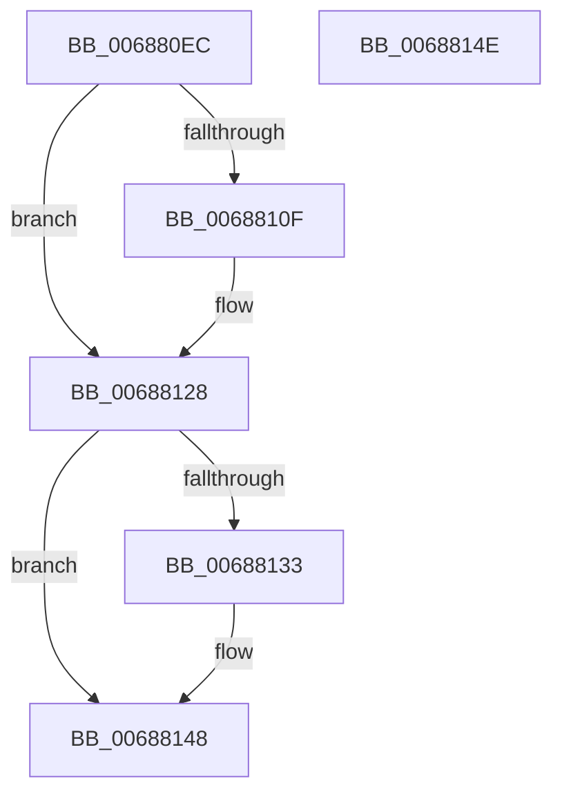

# MiClearAweLargePageMetadata

- RVA: `0x006880EC`–`0x0068814F` (길이 `99` bytes)
- VA: `0x00000001406880EC`
- 실행 섹션: `.text`
- PDB 이름 있음: `예`; PDB Function 태그: `아니요`
- unwind 정보 RVA: `0x0005CF00`
- 디코드: `31`개 명령, `99/99` bytes 표시
- 미해석 바이트: `0` (있으면 어셈블리에 `.byte`로 보존)

> 이 문서는 커널 이미지의 기계어와 PDB 기호를 분석해 생성했습니다. 4번과 5번은 함수 원형과 자료형을 바이너리 사용 방식에서 추정한 C 해석이며 원본 소스 복구 결과는 아닙니다.

## 1. Dependencies

- 직접 호출 지점: **2**; 고유 호출 대상: **2**
- 직접 호출자로 확인된 함수: **2**
- RIP 상대 이미지 참조: **0**

### Outgoing calls
- `0x006880F7` → [MiSetPfnIdentity](../2A/MiSetPfnIdentity_function_002A2350.md) (function, `0x002A2350`)
- `0x00688101` → [MiSetPfnContainingFrame](../36/MiSetPfnContainingFrame_function_00363FC0.md) (function, `0x00363FC0`)

### Direct callers
- [MiFreeContiguousLargePageRun](MiFreeContiguousLargePageRun_function_00688A34.md) at `0x00688B65`
- [MiReadyLargeAwePageForFree](MiReadyLargeAwePageForFree_function_00689258.md) at `0x0068926F`

### Static image references
- 디코드된 RIP-relative 메모리 참조가 없습니다.

## 2. Other-region calls and transfers

- 다른 실행 섹션으로 향하는 call: **0**
- 별도 외부 분기/꼬리 이동을 확인하지 못했습니다.

## 3. Assembly (complete function range)

```asm
006880EC  40 53                           push rbx
006880EE  48 83 EC 20                     sub rsp, 0x20
006880F2  33 D2                           xor edx, edx
006880F4  48 8B D9                        mov rbx, rcx
006880F7  E8 54 A2 C1 FF                  call 0x1402a2350
006880FC  33 D2                           xor edx, edx
006880FE  48 8B CB                        mov rcx, rbx
00688101  E8 BA BE CD FF                  call 0x140363fc0
00688106  8A 43 22                        mov al, byte ptr [rbx + 0x22]
00688109  24 07                           and al, 7
0068810B  3C 05                           cmp al, 5
0068810D  74 19                           je 0x140688128
0068810F  8B 43 20                        mov eax, dword ptr [rbx + 0x20]
00688112  89 44 24 30                     mov dword ptr [rsp + 0x30], eax
00688116  C1 E8 10                        shr eax, 0x10
00688119  24 FD                           and al, 0xfd
0068811B  0C 05                           or al, 5
0068811D  88 44 24 32                     mov byte ptr [rsp + 0x32], al
00688121  8B 44 24 30                     mov eax, dword ptr [rsp + 0x30]
00688125  89 43 20                        mov dword ptr [rbx + 0x20], eax
00688128  48 8B 43 18                     mov rax, qword ptr [rbx + 0x18]
0068812C  48 0F BA E0 3E                  bt rax, 0x3e
00688131  73 15                           jae 0x140688148
00688133  48 8B 43 18                     mov rax, qword ptr [rbx + 0x18]
00688137  48 B9 FF FF FF FF FF FF FF BF   movabs rcx, 0xbfffffffffffffff
00688141  48 23 C1                        and rax, rcx
00688144  48 89 43 18                     mov qword ptr [rbx + 0x18], rax
00688148  48 83 C4 20                     add rsp, 0x20
0068814C  5B                              pop rbx
0068814D  C3                              ret
0068814E  CC                              int3
```

## 4. C-style interpretation (structured pseudocode)

```c
__int64 __fastcall MiClearAweLargePageMetadata(__int64 a1, int a2)
{
    __int64 result;
    __int64 v_rsp;
    unsigned int v_stack_p8;
    unsigned __int8 v_stack_pA;

    v_rsp = (v_rsp) - (32);
    a2 = 0;
    result = MiSetPfnIdentity(a1, a2, a3, a4);
    a2 = 0;
    result = MiSetPfnContainingFrame(a1, a2, a3, a4);
    result = (unsigned __int8)((*(unsigned __int8 *)(a1 + 34)) & (7));
    if (((unsigned __int8)(result)) != 5) {
        result = *(unsigned int *)(a1 + 32);
        v_stack_p8 = (unsigned int)(result);
        result = (unsigned int)((result) >> (16));
        result = (unsigned __int8)((result) & (253));
        result = (unsigned __int8)((result) | (5));
        v_stack_pA = (unsigned __int8)(result);
        result = v_stack_p8;
        *(unsigned int *)(a1 + 32) = (unsigned int)(result);
    }
    result = *(unsigned __int64 *)(a1 + 24);
    if (!(condition_is_above_or_equal)) {
        result = *(unsigned __int64 *)(a1 + 24);
        result = (result) & (a1);
        *(unsigned __int64 *)(a1 + 24) = result;
    }
    v_rsp = (v_rsp) + (32);
    return result;
}
```

## 5. (Beta) C Style

```c
int64_t MiClearAweLargePageMetadata(void *Arg1, int32_t Arg2)
{
    uint8_t *arg1 = (uint8_t *)Arg1;

    int64_t result;
    int64_t local_rsp;
    uint32_t v_stack_p8;
    uint8_t v_stack_pA;

    local_rsp = (local_rsp) - (32);
    Arg2 = 0;
    result = MiSetPfnIdentity(Arg1, Arg2, a3, a4);
    Arg2 = 0;
    result = MiSetPfnContainingFrame(Arg1, Arg2, a3, a4);
    result = (uint8_t)((*(uint8_t *)(arg1 + 0x22)) & (7));
    if (((uint8_t)(result)) != 5) {
        result = *(uint32_t *)(arg1 + 0x20);
        v_stack_p8 = (uint32_t)(result);
        result = (uint32_t)((result) >> (16));
        result = (uint8_t)((result) & (253));
        result = (uint8_t)((result) | (5));
        v_stack_pA = (uint8_t)(result);
        result = v_stack_p8;
        *(uint32_t *)(arg1 + 0x20) = (uint32_t)(result);
    }
    result = *(uint64_t *)(arg1 + 0x18);
    if (!(condition_is_above_or_equal)) {
        result = *(uint64_t *)(arg1 + 0x18);
        result = (result) & (Arg1);
        *(uint64_t *)(arg1 + 0x18) = result;
    }
    local_rsp = (local_rsp) + (32);
    return result;
}
```

### 관측된 메모리 오프셋

구조체 형식이 확인되지 않은 접근은 인자 기준의 오프셋으로만 기록했습니다.

| 기준 인자 | 오프셋 표현 | 폭 (bit) | 접근 |
|---|---:|---:|---|
| `Arg1` | `+ 0x18` | `64` | `R` |
| `Arg1` | `+ 0x18` | `64` | `W` |
| `Arg1` | `+ 0x20` | `32` | `R` |
| `Arg1` | `+ 0x20` | `32` | `W` |
| `Arg1` | `+ 0x22` | `8` | `R` |

## 6. Execution-region graph

[열기: 2D/3D 그래프와 함수 탐색 컨트롤 패널](../../../control-panel.html?section=text&rva=0x006880EC&view=graph)

- 2D 그래프는 위에서 아래로 흐르고, 3D 그래프는 빈 공간을 드래그해 회전합니다. Shift+드래그는 이동, 휠은 확대·축소, 함수 노드 선택은 대상 보고서 이동입니다.

### Static fallback


