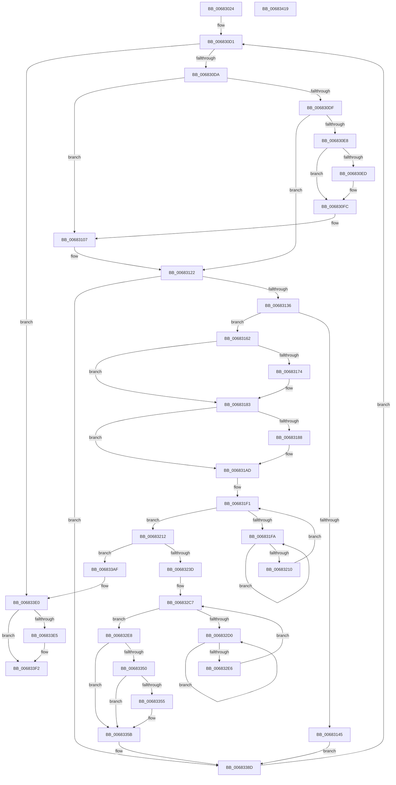

# MiClearDriverTablePtes

- RVA: `0x00683024`–`0x0068341A` (길이 `1,014` bytes)
- VA: `0x0000000140683024`
- 실행 섹션: `.text`
- PDB 이름 있음: `예`; PDB Function 태그: `아니요`
- unwind 정보 RVA: `0x000BE788`
- 디코드: `244`개 명령, `1,014/1,014` bytes 표시
- 미해석 바이트: `0` (있으면 어셈블리에 `.byte`로 보존)

> 이 문서는 커널 이미지의 기계어와 PDB 기호를 분석해 생성했습니다. 4번과 5번은 함수 원형과 자료형을 바이너리 사용 방식에서 추정한 C 해석이며 원본 소스 복구 결과는 아닙니다.

## 1. Dependencies

- 직접 호출 지점: **25**; 고유 호출 대상: **21**
- 직접 호출자로 확인된 함수: **1**
- RIP 상대 이미지 참조: **4**

### Outgoing calls
- `0x00683079` → [MiGetAnyMultiplexedVm](../44/MiGetAnyMultiplexedVm_function_00448BD0.md) (function, `0x00448BD0`)
- `0x00683084` → [MiLockWorkingSetShared](../27/MiLockWorkingSetShared_function_0027CBF0.md) (function, `0x0027CBF0`)
- `0x006830F0` → [MiFlushTbList](../31/MiFlushTbList_function_00311FC0.md) (function, `0x00311FC0`)
- `0x006830F5` → [MiReleaseProcessorFlushList](../31/MiReleaseProcessorFlushList_function_00313C70.md) (function, `0x00313C70`)
- `0x00683102` → [MiUnlockPageTable](../21/MiUnlockPageTable_function_00216EC0.md) (function, `0x00216EC0`)
- `0x0068311D` → [MiLockNestedPageTable](../23/MiLockNestedPageTable_function_0023E890.md) (function, `0x0023E890`)
- `0x00683125` → [MI_READ_PTE_LOCK_FREE](../28/MI_READ_PTE_LOCK_FREE_function_002828A0.md) (function, `0x002828A0`)
- `0x0068313B` → [MiMakeDemandZeroPte](../33/MiMakeDemandZeroPte_function_00337A00.md) (function, `0x00337A00`)
- `0x00683158` → [MiReducePteUseCount](../32/MiReducePteUseCount_function_0032A160.md) (function, `0x0032A160`)
- `0x00683165` → [MiGetWsleContents](../31/MiGetWsleContents_function_00316540.md) (function, `0x00316540`)
- `0x0068317E` → [MiWriteWsle](../29/MiWriteWsle_function_00292CA0.md) (function, `0x00292CA0`)
- `0x00683188` → [MiGetProcessorFlushList](../24/MiGetProcessorFlushList_function_00242C90.md) (function, `0x00242C90`)
- `0x006831A8` → [MiInitializeTbFlushList](../29/MiInitializeTbFlushList_function_00294F00.md) (function, `0x00294F00`)
- `0x006831BA` → [MiInsertTbFlushEntry](../29/MiInsertTbFlushEntry_function_00293670.md) (function, `0x00293670`)
- `0x00683202` → [KeYieldProcessorEx](../3F/KeYieldProcessorEx_function_003FBD00.md) (function, `0x003FBD00`)
- `0x00683217` → [MiDecrementShareCountEx](../33/MiDecrementShareCountEx_function_00333F70.md) (function, `0x00333F70`)
- `0x006832D8` → [KeYieldProcessorEx](../3F/KeYieldProcessorEx_function_003FBD00.md) (function, `0x003FBD00`)
- `0x006832F0` → [MiDecreaseUsedPtesInPfn](../2A/MiDecreaseUsedPtesInPfn_function_002A27AC.md) (function, `0x002A27AC`)
- `0x00683333` → [MiSetPfnContainingFrame](../36/MiSetPfnContainingFrame_function_00363FC0.md) (function, `0x00363FC0`)
- `0x0068336B` → [MiUpdatePageFileHighInPte](../36/MiUpdatePageFileHighInPte_function_0036D840.md) (function, `0x0036D840`)
- `0x006833DA` → [KeBugCheckEx](../4F/KeBugCheckEx_function_004FD660.md) (function, `0x004FD660`)
- `0x006833E8` → [MiFlushTbList](../31/MiFlushTbList_function_00311FC0.md) (function, `0x00311FC0`)
- `0x006833ED` → [MiReleaseProcessorFlushList](../31/MiReleaseProcessorFlushList_function_00313C70.md) (function, `0x00313C70`)
- `0x006833F8` → [MiUnlockPageTable](../21/MiUnlockPageTable_function_00216EC0.md) (function, `0x00216EC0`)
- `0x00683403` → [MiUnlockWorkingSetShared](../27/MiUnlockWorkingSetShared_function_0027D690.md) (function, `0x0027D690`)

### Direct callers
- [MiUnloadSystemImage](../../page/AA/MiUnloadSystemImage_function_00AA2FD4.md) at `0x00AA313E`

### Static image references
- `0x00683089` → RVA `0x00E375B0` (`.data`; read)
- `0x00683093` → RVA `0x00E375AC` (`.data`; read)
- `0x00683145` → RVA `0x00010880` (`.rdata`; read)
- `0x00683338` → RVA `0x00E2DC80` (`.data`; read)

## 2. Other-region calls and transfers

- 다른 실행 섹션으로 향하는 call: **0**
- 별도 외부 분기/꼬리 이동을 확인하지 못했습니다.

## 3. Assembly (complete function range)

```asm
00683024  40 53                           push rbx
00683026  55                              push rbp
00683027  56                              push rsi
00683028  57                              push rdi
00683029  41 54                           push r12
0068302B  41 55                           push r13
0068302D  41 56                           push r14
0068302F  41 57                           push r15
00683031  48 83 EC 48                     sub rsp, 0x48
00683035  8B 51 40                        mov edx, dword ptr [rcx + 0x40]
00683038  45 33 F6                        xor r14d, r14d
0068303B  F7 C2 FF 0F 00 00               test edx, 0xfff
00683041  48 BB 00 00 00 00 80 F6 FF FF   movabs rbx, 0xfffff68000000000
0068304B  41 8B C6                        mov eax, r14d
0068304E  48 BE F8 FF FF FF 7F 00 00 00   movabs rsi, 0x7ffffffff8
00683058  0F 95 C0                        setne al
0068305B  C1 EA 0C                        shr edx, 0xc
0068305E  03 D0                           add edx, eax
00683060  48 8B 41 30                     mov rax, qword ptr [rcx + 0x30]
00683064  48 C1 E8 09                     shr rax, 9
00683068  48 23 C6                        and rax, rsi
0068306B  48 8D 3C D0                     lea rdi, [rax + rdx*8]
0068306F  48 8B C3                        mov rax, rbx
00683072  41 8D 4E 01                     lea ecx, [r14 + 1]
00683076  48 03 F8                        add rdi, rax
00683079  E8 52 5B DC FF                  call 0x140448bd0
0068307E  48 8B C8                        mov rcx, rax
00683081  4C 8B F8                        mov r15, rax
00683084  E8 67 9B BF FF                  call 0x14027cbf0
00683089  44 8B 05 20 45 7B 00            mov r8d, dword ptr [rip + 0x7b4520]
00683090  41 8B CE                        mov ecx, r14d
00683093  44 03 05 12 45 7B 00            add r8d, dword ptr [rip + 0x7b4512]
0068309A  4C 8B E7                        mov r12, rdi
0068309D  41 F7 C0 FF 0F 00 00            test r8d, 0xfff
006830A4  44 8A E8                        mov r13b, al
006830A7  0F 95 C1                        setne cl
006830AA  41 C1 E8 0C                     shr r8d, 0xc
006830AE  41 03 C8                        add ecx, r8d
006830B1  49 C1 E4 19                     shl r12, 0x19
006830B5  48 8D 0C CF                     lea rcx, [rdi + rcx*8]
006830B9  48 89 8C 24 A0 00 00 00         mov qword ptr [rsp + 0xa0], rcx
006830C1  48 8B C3                        mov rax, rbx
006830C4  48 C1 E0 19                     shl rax, 0x19
006830C8  4C 2B E0                        sub r12, rax
006830CB  49 C1 FC 10                     sar r12, 0x10
006830CF  33 ED                           xor ebp, ebp
006830D1  48 3B F9                        cmp rdi, rcx
006830D4  0F 83 06 03 00 00               jae 0x1406833e0
006830DA  4D 85 F6                        test r14, r14
006830DD  74 28                           je 0x140683107
006830DF  48 F7 C7 FF 0F 00 00            test rdi, 0xfff
006830E6  75 3A                           jne 0x140683122
006830E8  48 85 ED                        test rbp, rbp
006830EB  74 0F                           je 0x1406830fc
006830ED  48 8B CD                        mov rcx, rbp
006830F0  E8 CB EE C8 FF                  call 0x140311fc0
006830F5  E8 76 0B C9 FF                  call 0x140313c70
006830FA  33 ED                           xor ebp, ebp
006830FC  49 8B D6                        mov rdx, r14
006830FF  49 8B CF                        mov rcx, r15
00683102  E8 B9 3D B9 FF                  call 0x140216ec0
00683107  4C 8B F7                        mov r14, rdi
0068310A  49 C1 EE 09                     shr r14, 9
0068310E  4C 23 F6                        and r14, rsi
00683111  48 8B C3                        mov rax, rbx
00683114  4C 03 F0                        add r14, rax
00683117  49 8B CF                        mov rcx, r15
0068311A  49 8B D6                        mov rdx, r14
0068311D  E8 6E B7 BB FF                  call 0x14023e890
00683122  48 8B CF                        mov rcx, rdi
00683125  E8 76 F7 BF FF                  call 0x1402828a0
0068312A  48 8B D8                        mov rbx, rax
0068312D  48 85 C0                        test rax, rax
00683130  0F 84 57 02 00 00               je 0x14068338d
00683136  B9 10 00 00 00                  mov ecx, 0x10
0068313B  E8 C0 48 CB FF                  call 0x140337a00
00683140  48 3B D8                        cmp rbx, rax
00683143  75 1D                           jne 0x140683162
00683145  48 8B 05 34 D7 98 FF            mov rax, qword ptr [rip - 0x6728cc]
0068314C  41 B8 01 00 00 00               mov r8d, 1
00683152  48 8B D7                        mov rdx, rdi
00683155  48 89 07                        mov qword ptr [rdi], rax
00683158  E8 03 70 CA FF                  call 0x14032a160
0068315D  E9 2B 02 00 00                  jmp 0x14068338d
00683162  49 8B D4                        mov rdx, r12
00683165  E8 D6 33 C9 FF                  call 0x140316540
0068316A  8A C8                           mov cl, al
0068316C  80 E1 0F                        and cl, 0xf
0068316F  80 F9 09                        cmp cl, 9
00683172  75 0F                           jne 0x140683183
00683174  24 FA                           and al, 0xfa
00683176  49 8B D4                        mov rdx, r12
00683179  0C 0A                           or al, 0xa
0068317B  44 8A C0                        mov r8b, al
0068317E  E8 1D FB C0 FF                  call 0x140292ca0
00683183  48 85 ED                        test rbp, rbp
00683186  75 25                           jne 0x1406831ad
00683188  E8 03 FB BB FF                  call 0x140242c90
0068318D  41 B9 08 00 00 00               mov r9d, 8
00683193  C7 44 24 20 01 00 00 00         mov dword ptr [rsp + 0x20], 1
0068319B  49 8B D7                        mov rdx, r15
0068319E  48 8B C8                        mov rcx, rax
006831A1  48 8B E8                        mov rbp, rax
006831A4  44 8B 40 0C                     mov r8d, dword ptr [rax + 0xc]
006831A8  E8 53 1D C1 FF                  call 0x140294f00
006831AD  45 33 C9                        xor r9d, r9d
006831B0  49 8B D4                        mov rdx, r12
006831B3  48 8B CD                        mov rcx, rbp
006831B6  45 8D 41 01                     lea r8d, [r9 + 1]
006831BA  E8 B1 04 C1 FF                  call 0x140293670
006831BF  48 B8 FF FF FF FF FF 00 00 00   movabs rax, 0xffffffffff
006831C9  48 C1 EB 0C                     shr rbx, 0xc
006831CD  48 23 D8                        and rbx, rax
006831D0  48 B8 00 00 00 00 00 DE FF FF   movabs rax, 0xffffde0000000000
006831DA  48 8D 34 5B                     lea rsi, [rbx + rbx*2]
006831DE  48 C1 E6 04                     shl rsi, 4
006831E2  48 8B C0                        mov rax, rax
006831E5  83 A4 24 98 00 00 00 00         and dword ptr [rsp + 0x98], 0
006831ED  48 8D 1C 06                     lea rbx, [rsi + rax]
006831F1  F0 48 0F BA 6B 18 3F            lock bts qword ptr [rbx + 0x18], 0x3f
006831F8  73 18                           jae 0x140683212
006831FA  48 8D 8C 24 98 00 00 00         lea rcx, [rsp + 0x98]
00683202  E8 F9 8A D7 FF                  call 0x1403fbd00
00683207  48 8B 43 18                     mov rax, qword ptr [rbx + 0x18]
0068320B  48 85 C0                        test rax, rax
0068320E  78 EA                           js 0x1406831fa
00683210  EB DF                           jmp 0x1406831f1
00683212  33 D2                           xor edx, edx
00683214  48 8B CB                        mov rcx, rbx
00683217  E8 54 0D CB FF                  call 0x140333f70
0068321C  48 8B 05 5D D6 98 FF            mov rax, qword ptr [rip - 0x6729a3]
00683223  48 B9 FF FF FF FF FF FF FF 3F   movabs rcx, 0x3fffffffffffffff
0068322D  48 89 07                        mov qword ptr [rdi], rax
00683230  48 8B 43 18                     mov rax, qword ptr [rbx + 0x18]
00683234  48 85 C1                        test rcx, rax
00683237  0F 85 72 01 00 00               jne 0x1406833af
0068323D  8B 43 20                        mov eax, dword ptr [rbx + 0x20]
00683240  89 84 24 90 00 00 00            mov dword ptr [rsp + 0x90], eax
00683247  C1 E8 10                        shr eax, 0x10
0068324A  24 FE                           and al, 0xfe
0068324C  0C 06                           or al, 6
0068324E  88 84 24 92 00 00 00            mov byte ptr [rsp + 0x92], al
00683255  8B 84 24 90 00 00 00            mov eax, dword ptr [rsp + 0x90]
0068325C  89 43 20                        mov dword ptr [rbx + 0x20], eax
0068325F  48 8B 43 18                     mov rax, qword ptr [rbx + 0x18]
00683263  48 8D 48 01                     lea rcx, [rax + 1]
00683267  48 8B D1                        mov rdx, rcx
0068326A  48 33 D0                        xor rdx, rax
0068326D  48 B8 00 00 00 00 00 00 00 C0   movabs rax, 0xc000000000000000
00683277  48 23 D0                        and rdx, rax
0068327A  48 33 D1                        xor rdx, rcx
0068327D  48 B9 00 00 00 00 00 00 00 40   movabs rcx, 0x4000000000000000
00683287  48 89 53 18                     mov qword ptr [rbx + 0x18], rdx
0068328B  48 8B 43 18                     mov rax, qword ptr [rbx + 0x18]
0068328F  48 0B C1                        or rax, rcx
00683292  48 B9 FF FF FF FF FF 00 00 00   movabs rcx, 0xffffffffff
0068329C  48 89 43 18                     mov qword ptr [rbx + 0x18], rax
006832A0  48 8B 43 28                     mov rax, qword ptr [rbx + 0x28]
006832A4  48 23 C1                        and rax, rcx
006832A7  48 8D 34 40                     lea rsi, [rax + rax*2]
006832AB  48 B8 00 00 00 00 00 DE FF FF   movabs rax, 0xffffde0000000000
006832B5  48 C1 E6 04                     shl rsi, 4
006832B9  48 8B C0                        mov rax, rax
006832BC  48 03 F0                        add rsi, rax
006832BF  83 A4 24 90 00 00 00 00         and dword ptr [rsp + 0x90], 0
006832C7  F0 48 0F BA 6E 18 3F            lock bts qword ptr [rsi + 0x18], 0x3f
006832CE  73 18                           jae 0x1406832e8
006832D0  48 8D 8C 24 90 00 00 00         lea rcx, [rsp + 0x90]
006832D8  E8 23 8A D7 FF                  call 0x1403fbd00
006832DD  48 8B 46 18                     mov rax, qword ptr [rsi + 0x18]
006832E1  48 85 C0                        test rax, rax
006832E4  78 EA                           js 0x1406832d0
006832E6  EB DF                           jmp 0x1406832c7
006832E8  BA 01 00 00 00                  mov edx, 1
006832ED  48 8B CE                        mov rcx, rsi
006832F0  E8 B7 F4 C1 FF                  call 0x1402a27ac
006832F5  48 8B 46 18                     mov rax, qword ptr [rsi + 0x18]
006832F9  48 8D 48 FF                     lea rcx, [rax - 1]
006832FD  48 8B D1                        mov rdx, rcx
00683300  48 33 D0                        xor rdx, rax
00683303  48 B8 00 00 00 00 00 00 00 C0   movabs rax, 0xc000000000000000
0068330D  48 23 D0                        and rdx, rax
00683310  48 B8 FF FF FF FF FF FF FF 7F   movabs rax, 0x7fffffffffffffff
0068331A  48 33 D1                        xor rdx, rcx
0068331D  48 89 56 18                     mov qword ptr [rsi + 0x18], rdx
00683321  F0 48 21 46 18                  lock and qword ptr [rsi + 0x18], rax
00683326  48 BA FE FF FF FF 3F 00 00 00   movabs rdx, 0x3ffffffffe
00683330  48 8B CB                        mov rcx, rbx
00683333  E8 88 0C CE FF                  call 0x140363fc0
00683338  48 8B 05 41 A9 7A 00            mov rax, qword ptr [rip + 0x7aa941]
0068333F  48 C7 43 08 00 00 00 00         mov qword ptr [rbx + 8], 0
00683347  48 8B 53 10                     mov rdx, qword ptr [rbx + 0x10]
0068334B  48 85 C0                        test rax, rax
0068334E  74 0B                           je 0x14068335b
00683350  F6 C2 10                        test dl, 0x10
00683353  75 06                           jne 0x14068335b
00683355  48 F7 D0                        not rax
00683358  48 23 D0                        and rdx, rax
0068335B  48 C7 43 10 00 00 00 00         mov qword ptr [rbx + 0x10], 0
00683363  48 8B 4B 10                     mov rcx, qword ptr [rbx + 0x10]
00683367  48 C1 EA 20                     shr rdx, 0x20
0068336B  E8 D0 A4 CE FF                  call 0x14036d840
00683370  48 89 43 10                     mov qword ptr [rbx + 0x10], rax
00683374  48 B8 FF FF FF FF FF FF FF 7F   movabs rax, 0x7fffffffffffffff
0068337E  F0 48 21 43 18                  lock and qword ptr [rbx + 0x18], rax
00683383  48 BE F8 FF FF FF 7F 00 00 00   movabs rsi, 0x7ffffffff8
0068338D  48 8B 8C 24 A0 00 00 00         mov rcx, qword ptr [rsp + 0xa0]
00683395  48 83 C7 08                     add rdi, 8
00683399  49 81 C4 00 10 00 00            add r12, 0x1000
006833A0  48 BB 00 00 00 00 80 F6 FF FF   movabs rbx, 0xfffff68000000000
006833AA  E9 22 FD FF FF                  jmp 0x1406830d1
006833AF  48 8B 43 18                     mov rax, qword ptr [rbx + 0x18]
006833B3  49 B9 AB AA AA AA AA AA AA AA   movabs r9, 0xaaaaaaaaaaaaaaab
006833BD  48 23 C1                        and rax, rcx
006833C0  48 C1 FE 04                     sar rsi, 4
006833C4  4C 0F AF CE                     imul r9, rsi
006833C8  4C 8B C7                        mov r8, rdi
006833CB  48 89 44 24 20                  mov qword ptr [rsp + 0x20], rax
006833D0  BA C0 15 05 00                  mov edx, 0x515c0
006833D5  B9 1A 00 00 00                  mov ecx, 0x1a
006833DA  E8 81 A2 E7 FF                  call 0x1404fd660
006833DF  CC                              int3
006833E0  48 85 ED                        test rbp, rbp
006833E3  74 0D                           je 0x1406833f2
006833E5  48 8B CD                        mov rcx, rbp
006833E8  E8 D3 EB C8 FF                  call 0x140311fc0
006833ED  E8 7E 08 C9 FF                  call 0x140313c70
006833F2  49 8B D6                        mov rdx, r14
006833F5  49 8B CF                        mov rcx, r15
006833F8  E8 C3 3A B9 FF                  call 0x140216ec0
006833FD  41 8A D5                        mov dl, r13b
00683400  49 8B CF                        mov rcx, r15
00683403  E8 88 A2 BF FF                  call 0x14027d690
00683408  48 83 C4 48                     add rsp, 0x48
0068340C  41 5F                           pop r15
0068340E  41 5E                           pop r14
00683410  41 5D                           pop r13
00683412  41 5C                           pop r12
00683414  5F                              pop rdi
00683415  5E                              pop rsi
00683416  5D                              pop rbp
00683417  5B                              pop rbx
00683418  C3                              ret
00683419  CC                              int3
```

## 4. C-style interpretation (structured pseudocode)

```c
__int64 __fastcall MiClearDriverTablePtes(__int64 a1)
{
    __int64 result;
    __int64 v_r12;
    __int64 v_r14;
    __int64 v_rbp;
    __int64 v_rbx;
    __int64 v_rdi;
    __int64 v_rsi;
    __int64 v_rsp;
    unsigned int v_stack_m68;
    unsigned int v_stack_p10;
    unsigned __int64 v_stack_p18;
    unsigned int v_stack_p8;
    unsigned __int8 v_stack_pA;

    v_rsp = (v_rsp) - (72);
    v_r14 = 0;
    result = ((((unsigned int)((unsigned int)(*(unsigned int *)(a1 + 64)))) & (0xFFFULL)) != 0) ? 1 : 0;
    a2 = (unsigned int)(((unsigned int)(*(unsigned int *)(a1 + 64))) >> (12));
    a2 = (unsigned int)((a2) + ((unsigned int)(result)));
    result = (*(unsigned __int64 *)(a1 + 48)) >> (9);
    result = (result) & (v_rsi);
    v_rdi = (result + a2 * 8) + (v_rbx);
    result = MiGetAnyMultiplexedVm(v_r14 + 1, a2, a3, a4);
    result = MiLockWorkingSetShared(result, a2, a3, a4);
    a3 = (unsigned int)(((unsigned int)(*(unsigned int *)(v_rip + 8078624))) + (*(unsigned int *)(v_rip + 8078610)));
    a1 = ((((unsigned int)(a3)) & (0xFFFULL)) != 0) ? 1 : 0;
    a3 = (unsigned int)((a3) >> (12));
    a1 = (unsigned int)((a1) + ((unsigned int)(a3)));
    v_r12 = (v_rdi) << (25);
    v_stack_p18 = v_rdi + a1 * 8;
    result = (v_rbx) << (25);
    v_r12 = (v_r12) - (result);
    v_r12 = (v_r12) >> (16);
    v_rbp = 0;
loc_006830D1:
    if (v_rdi >= (v_rdi + a1 * 8)) goto loc_006833E0;
    if (0 == 0) goto loc_00683107;
    if (((v_rdi) & (0xFFFULL)) != 0) goto loc_00683122;
    if (0 != 0) {
        a1 = 0;
        result = MiFlushTbList(a1, a2, a3, a4);
        result = MiReleaseProcessorFlushList(a1, a2, a3, a4);
        v_rbp = 0;
    }
    result = MiUnlockPageTable(result, 0, a3, a4);
loc_00683107:
    v_r14 = (v_rdi) >> (9);
    v_r14 = (v_r14) & (v_rsi);
    v_r14 = (v_r14) + (v_rbx);
    result = MiLockNestedPageTable(result, v_r14, a3, a4);
loc_00683122:
    result = MI_READ_PTE_LOCK_FREE(v_rdi, v_r14, a3, a4);
    if (result == 0) goto loc_0068338D;
    result = MiMakeDemandZeroPte(16, v_r14, a3, a4);
    if (result != result) goto loc_00683162;
    *(unsigned __int64 *)(v_rdi) = *(unsigned __int64 *)(v_rip - 6760652);
    result = MiReducePteUseCount(16, v_rdi, 1, a4);
    goto loc_0068338D;
loc_00683162:
    result = MiGetWsleContents(16, v_r12, 1, a4);
    a1 = (unsigned __int8)(((unsigned __int8)(result)) & (15));
    if (((unsigned __int8)(a1)) == 9) {
        result = (unsigned __int8)((result) & (250));
        a2 = v_r12;
        result = (unsigned __int8)((result) | (10));
        a3 = (unsigned __int8)(result);
        result = MiWriteWsle(a1, a2, a3, a4);
    }
    if (0 == 0) {
        result = MiGetProcessorFlushList(a1, a2, a3, a4);
        a4 = 8;
        v_stack_m68 = 1;
        a2 = result;
        a1 = result;
        v_rbp = result;
        a3 = *(unsigned int *)(result + 12);
        result = MiInitializeTbFlushList(a1, a2, a3, a4);
    }
    a4 = 0;
    result = MiInsertTbFlushEntry(v_rbp, v_r12, a4 + 1, a4);
    v_rbx = (result) >> (12);
    v_rbx = (v_rbx) & (result);
    v_rsi = (v_rbx + v_rbx * 2) << (4);
loc_006831F1:
    if (condition_is_above_or_equal) goto loc_00683212;
loc_006831FA:
    result = KeYieldProcessorEx(v_stack_p10, v_r12, a4 + 1, a4);
    if (sign_flag) goto loc_006831FA;
    goto loc_006831F1;
loc_00683212:
    a2 = 0;
    result = MiDecrementShareCountEx(v_rsi + result * 1, a2, a4 + 1, a4);
    *(unsigned __int64 *)(v_rdi) = *(unsigned __int64 *)(v_rip - 6760867);
    if (((v_rsi + result * 1) & (*(unsigned __int64 *)(v_rsi + result * 1 + 24))) != 0) goto loc_006833AF;
    v_stack_p8 = (unsigned int)((unsigned int)(*(unsigned int *)(v_rsi + result * 1 + 32)));
    result = (unsigned int)(((unsigned int)(*(unsigned int *)(v_rsi + result * 1 + 32))) >> (16));
    result = (unsigned __int8)((result) & (254));
    result = (unsigned __int8)((result) | (6));
    v_stack_pA = (unsigned __int8)(result);
    *(unsigned int *)(v_rsi + result * 1 + 32) = (unsigned int)((unsigned int)(v_stack_p8));
    a2 = (*(unsigned __int64 *)(v_rsi + result * 1 + 24) + 1) ^ (*(unsigned __int64 *)(v_rsi + result * 1 + 24));
    a2 = (a2) & (*(unsigned __int64 *)(v_rsi + result * 1 + 24));
    a2 = (a2) ^ (*(unsigned __int64 *)(v_rsi + result * 1 + 24) + 1);
    *(unsigned __int64 *)(v_rsi + result * 1 + 24) = a2;
    result = (*(unsigned __int64 *)(v_rsi + result * 1 + 24)) | (*(unsigned __int64 *)(v_rsi + result * 1 + 24) + 1);
    *(unsigned __int64 *)(v_rsi + result * 1 + 24) = result;
    result = (*(unsigned __int64 *)(v_rsi + result * 1 + 40)) & (*(unsigned __int64 *)(v_rsi + result * 1 + 24) + 1);
    v_rsi = (result + result * 2) << (4);
    v_rsi = (v_rsi) + (result);
loc_006832C7:
    if (condition_is_above_or_equal) goto loc_006832E8;
loc_006832D0:
    result = KeYieldProcessorEx(v_stack_p8, a2, a4 + 1, a4);
    if (sign_flag) goto loc_006832D0;
    goto loc_006832C7;
loc_006832E8:
    result = MiDecreaseUsedPtesInPfn(v_rsi, 1, a4 + 1, a4);
    a2 = (*(unsigned __int64 *)(v_rsi + 24) - 1) ^ (*(unsigned __int64 *)(v_rsi + 24));
    a2 = (a2) & (*(unsigned __int64 *)(v_rsi + 24));
    a2 = (a2) ^ (*(unsigned __int64 *)(v_rsi + 24) - 1);
    *(unsigned __int64 *)(v_rsi + 24) = a2;
    result = MiSetPfnContainingFrame(v_rsi + result * 1, a2, a4 + 1, a4);
    *(unsigned __int64 *)(v_rsi + result * 1 + 8) = 0;
    if (*(unsigned __int64 *)(v_rip + 8038721) == 0) goto loc_0068335B;
    result = *(unsigned __int64 *)(v_rip + 8038721);
    if ((((unsigned __int8)(*(unsigned __int64 *)(v_rsi + result * 1 + 16))) & (16)) == 0) {
        result = ~(*(unsigned __int64 *)(v_rip + 8038721));
        a2 = (*(unsigned __int64 *)(v_rsi + result * 1 + 16)) & (result);
    }
    *(unsigned __int64 *)(v_rsi + result * 1 + 16) = 0;
    a2 = (a2) >> (32);
    result = MiUpdatePageFileHighInPte(*(unsigned __int64 *)(v_rsi + result * 1 + 16), a2, a4 + 1, a4);
    *(unsigned __int64 *)(v_rsi + result * 1 + 16) = result;
loc_0068338D:
    v_rdi = (v_rdi) + (8);
    v_r12 = (v_r12) + (0x1000ULL);
    goto loc_006830D1;
loc_006833AF:
    result = (*(unsigned __int64 *)(v_rsi + result * 1 + 24)) & (v_stack_p18);
    v_rsi = (v_rsi) >> (4);
    a4 = (a4) * (v_rsi);
    v_stack_m68 = result;
    result = KeBugCheckEx(26, (unsigned int)(0x515C0ULL), v_rdi, a4);
loc_006833E0:
    if (v_rbp != 0) {
        a1 = v_rbp;
        result = MiFlushTbList(a1, (unsigned int)(0x515C0ULL), v_rdi, a4);
        result = MiReleaseProcessorFlushList(a1, (unsigned int)(0x515C0ULL), v_rdi, a4);
    }
    result = MiUnlockPageTable(result, v_r14, v_rdi, a4);
    result = MiUnlockWorkingSetShared(result, (unsigned __int8)((unsigned __int8)(result)), v_rdi, a4);
    v_rsp = (v_rsp) + (72);
    return result;
}
```

## 5. (Beta) C Style

```c
int64_t MiClearDriverTablePtes(void *Arg1)
{
    uint8_t *arg1 = (uint8_t *)Arg1;

    int64_t result;
    int64_t local_r12;
    int64_t local_r14;
    int64_t local_rbp;
    int64_t local_rbx;
    int64_t local_rdi;
    int64_t local_rsi;
    int64_t local_rsp;
    uint32_t v_stack_m68;
    uint32_t v_stack_p10;
    uint64_t v_stack_p18;
    uint32_t v_stack_p8;
    uint8_t v_stack_pA;

    local_rsp = (local_rsp) - (72);
    local_r14 = 0;
    result = ((((uint32_t)((uint32_t)(*(uint32_t *)(arg1 + 0x40)))) & (0xFFFULL)) != 0) ? 1 : 0;
    a2 = (uint32_t)(((uint32_t)(*(uint32_t *)(arg1 + 0x40))) >> (12));
    a2 = (uint32_t)((a2) + ((uint32_t)(result)));
    result = (*(uint64_t *)(arg1 + 0x30)) >> (9);
    result = (result) & (local_rsi);
    local_rdi = (result + a2 * 8) + (local_rbx);
    result = MiGetAnyMultiplexedVm(local_r14 + 1, a2, a3, a4);
    result = MiLockWorkingSetShared(result, a2, a3, a4);
    a3 = (uint32_t)(((uint32_t)(*(uint32_t *)(v_rip + 0x7B4520))) + (*(uint32_t *)(v_rip + 0x7B4512)));
    Arg1 = ((((uint32_t)(a3)) & (0xFFFULL)) != 0) ? 1 : 0;
    a3 = (uint32_t)((a3) >> (12));
    Arg1 = (uint32_t)((Arg1) + ((uint32_t)(a3)));
    local_r12 = (local_rdi) << (25);
    v_stack_p18 = local_rdi + Arg1 * 8;
    result = (local_rbx) << (25);
    local_r12 = (local_r12) - (result);
    local_r12 = (local_r12) >> (16);
    local_rbp = 0;
loc_006830D1:
    if (local_rdi >= (local_rdi + Arg1 * 8)) goto loc_006833E0;
    if (0 == 0) goto loc_00683107;
    if (((local_rdi) & (0xFFFULL)) != 0) goto loc_00683122;
    if (0 != 0) {
        Arg1 = 0;
        result = MiFlushTbList(Arg1, a2, a3, a4);
        result = MiReleaseProcessorFlushList(Arg1, a2, a3, a4);
        local_rbp = 0;
    }
    result = MiUnlockPageTable(result, 0, a3, a4);
loc_00683107:
    local_r14 = (local_rdi) >> (9);
    local_r14 = (local_r14) & (local_rsi);
    local_r14 = (local_r14) + (local_rbx);
    result = MiLockNestedPageTable(result, local_r14, a3, a4);
loc_00683122:
    result = MI_READ_PTE_LOCK_FREE(local_rdi, local_r14, a3, a4);
    if (result == 0) goto loc_0068338D;
    result = MiMakeDemandZeroPte(16, local_r14, a3, a4);
    if (result != result) goto loc_00683162;
    *(uint64_t *)(local_rdi) = *(uint64_t *)(v_rip - 0x6728CC);
    result = MiReducePteUseCount(16, local_rdi, 1, a4);
    goto loc_0068338D;
loc_00683162:
    result = MiGetWsleContents(16, local_r12, 1, a4);
    Arg1 = (uint8_t)(((uint8_t)(result)) & (15));
    if (((uint8_t)(Arg1)) == 9) {
        result = (uint8_t)((result) & (250));
        a2 = local_r12;
        result = (uint8_t)((result) | (10));
        a3 = (uint8_t)(result);
        result = MiWriteWsle(Arg1, a2, a3, a4);
    }
    if (0 == 0) {
        result = MiGetProcessorFlushList(Arg1, a2, a3, a4);
        a4 = 8;
        v_stack_m68 = 1;
        a2 = result;
        Arg1 = result;
        local_rbp = result;
        a3 = *(uint32_t *)(result + 0xC);
        result = MiInitializeTbFlushList(Arg1, a2, a3, a4);
    }
    a4 = 0;
    result = MiInsertTbFlushEntry(local_rbp, local_r12, a4 + 1, a4);
    local_rbx = (result) >> (12);
    local_rbx = (local_rbx) & (result);
    local_rsi = (local_rbx + local_rbx * 2) << (4);
loc_006831F1:
    if (condition_is_above_or_equal) goto loc_00683212;
loc_006831FA:
    result = KeYieldProcessorEx(v_stack_p10, local_r12, a4 + 1, a4);
    if (sign_flag) goto loc_006831FA;
    goto loc_006831F1;
loc_00683212:
    a2 = 0;
    result = MiDecrementShareCountEx(local_rsi + result * 1, a2, a4 + 1, a4);
    *(uint64_t *)(local_rdi) = *(uint64_t *)(v_rip - 0x6729A3);
    if (((local_rsi + result * 1) & (*(uint64_t *)(local_rsi + result * 1 + 0x18))) != 0) goto loc_006833AF;
    v_stack_p8 = (uint32_t)((uint32_t)(*(uint32_t *)(local_rsi + result * 1 + 0x20)));
    result = (uint32_t)(((uint32_t)(*(uint32_t *)(local_rsi + result * 1 + 0x20))) >> (16));
    result = (uint8_t)((result) & (254));
    result = (uint8_t)((result) | (6));
    v_stack_pA = (uint8_t)(result);
    *(uint32_t *)(local_rsi + result * 1 + 0x20) = (uint32_t)((uint32_t)(v_stack_p8));
    a2 = (*(uint64_t *)(local_rsi + result * 1 + 0x18) + 1) ^ (*(uint64_t *)(local_rsi + result * 1 + 0x18));
    a2 = (a2) & (*(uint64_t *)(local_rsi + result * 1 + 0x18));
    a2 = (a2) ^ (*(uint64_t *)(local_rsi + result * 1 + 0x18) + 1);
    *(uint64_t *)(local_rsi + result * 1 + 0x18) = a2;
    result = (*(uint64_t *)(local_rsi + result * 1 + 0x18)) | (*(uint64_t *)(local_rsi + result * 1 + 0x18) + 1);
    *(uint64_t *)(local_rsi + result * 1 + 0x18) = result;
    result = (*(uint64_t *)(local_rsi + result * 1 + 0x28)) & (*(uint64_t *)(local_rsi + result * 1 + 0x18) + 1);
    local_rsi = (result + result * 2) << (4);
    local_rsi = (local_rsi) + (result);
loc_006832C7:
    if (condition_is_above_or_equal) goto loc_006832E8;
loc_006832D0:
    result = KeYieldProcessorEx(v_stack_p8, a2, a4 + 1, a4);
    if (sign_flag) goto loc_006832D0;
    goto loc_006832C7;
loc_006832E8:
    result = MiDecreaseUsedPtesInPfn(local_rsi, 1, a4 + 1, a4);
    a2 = (*(uint64_t *)(local_rsi + 0x18) - 1) ^ (*(uint64_t *)(local_rsi + 0x18));
    a2 = (a2) & (*(uint64_t *)(local_rsi + 0x18));
    a2 = (a2) ^ (*(uint64_t *)(local_rsi + 0x18) - 1);
    *(uint64_t *)(local_rsi + 0x18) = a2;
    result = MiSetPfnContainingFrame(local_rsi + result * 1, a2, a4 + 1, a4);
    *(uint64_t *)(local_rsi + result * 1 + 0x8) = 0;
    if (*(uint64_t *)(v_rip + 0x7AA941) == 0) goto loc_0068335B;
    result = *(uint64_t *)(v_rip + 0x7AA941);
    if ((((uint8_t)(*(uint64_t *)(local_rsi + result * 1 + 0x10))) & (16)) == 0) {
        result = ~(*(uint64_t *)(v_rip + 0x7AA941));
        a2 = (*(uint64_t *)(local_rsi + result * 1 + 0x10)) & (result);
    }
    *(uint64_t *)(local_rsi + result * 1 + 0x10) = 0;
    a2 = (a2) >> (32);
    result = MiUpdatePageFileHighInPte(*(uint64_t *)(local_rsi + result * 1 + 0x10), a2, a4 + 1, a4);
    *(uint64_t *)(local_rsi + result * 1 + 0x10) = result;
loc_0068338D:
    local_rdi = (local_rdi) + (8);
    local_r12 = (local_r12) + (0x1000ULL);
    goto loc_006830D1;
loc_006833AF:
    result = (*(uint64_t *)(local_rsi + result * 1 + 0x18)) & (v_stack_p18);
    local_rsi = (local_rsi) >> (4);
    a4 = (a4) * (local_rsi);
    v_stack_m68 = result;
    result = KeBugCheckEx(26, (uint32_t)(0x515C0ULL), local_rdi, a4);
loc_006833E0:
    if (local_rbp != 0) {
        Arg1 = local_rbp;
        result = MiFlushTbList(Arg1, (uint32_t)(0x515C0ULL), local_rdi, a4);
        result = MiReleaseProcessorFlushList(Arg1, (uint32_t)(0x515C0ULL), local_rdi, a4);
    }
    result = MiUnlockPageTable(result, local_r14, local_rdi, a4);
    result = MiUnlockWorkingSetShared(result, (uint8_t)((uint8_t)(result)), local_rdi, a4);
    local_rsp = (local_rsp) + (72);
    return result;
}
```

### 관측된 메모리 오프셋

구조체 형식이 확인되지 않은 접근은 인자 기준의 오프셋으로만 기록했습니다.

| 기준 인자 | 오프셋 표현 | 폭 (bit) | 접근 |
|---|---:|---:|---|
| `Arg1` | `+ 0x30` | `64` | `R` |
| `Arg1` | `+ 0x40` | `32` | `R` |

## 6. Execution-region graph

[열기: 2D/3D 그래프와 함수 탐색 컨트롤 패널](../../../control-panel.html?section=text&rva=0x00683024&view=graph)

- 2D 그래프는 위에서 아래로 흐르고, 3D 그래프는 빈 공간을 드래그해 회전합니다. Shift+드래그는 이동, 휠은 확대·축소, 함수 노드 선택은 대상 보고서 이동입니다.

### Static fallback


