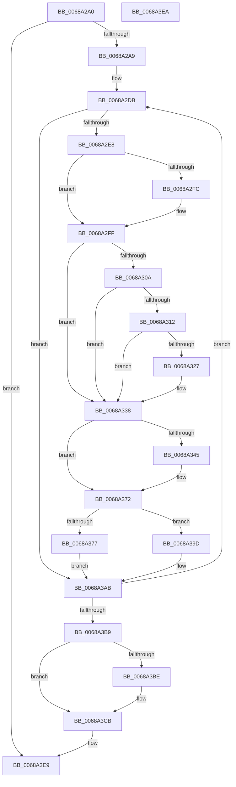

# MiClearSystemAccessBits

- RVA: `0x0068A2A0`–`0x0068A3EB` (길이 `331` bytes)
- VA: `0x000000014068A2A0`
- 실행 섹션: `.text`
- PDB 이름 있음: `예`; PDB Function 태그: `아니요`
- unwind 정보 RVA: `0x000D8D4C`
- 디코드: `89`개 명령, `331/331` bytes 표시
- 미해석 바이트: `0` (있으면 어셈블리에 `.byte`로 보존)

> 이 문서는 커널 이미지의 기계어와 PDB 기호를 분석해 생성했습니다. 4번과 5번은 함수 원형과 자료형을 바이너리 사용 방식에서 추정한 C 해석이며 원본 소스 복구 결과는 아닙니다.

## 1. Dependencies

- 직접 호출 지점: **8**; 고유 호출 대상: **8**
- 직접 호출자로 확인된 함수: **1**
- RIP 상대 이미지 참조: **1**

### Outgoing calls
- `0x0068A333` → [MiCheckLinearProtectedPteAccessedBit](../29/MiCheckLinearProtectedPteAccessedBit_function_00292D80.md) (function, `0x00292D80`)
- `0x0068A348` → [MiVaToFlushVm](../31/MiVaToFlushVm_function_0031AD84.md) (function, `0x0031AD84`)
- `0x0068A350` → [MiGetProcessorFlushList](../24/MiGetProcessorFlushList_function_00242C90.md) (function, `0x00242C90`)
- `0x0068A36D` → [MiInitializeTbFlushList](../29/MiInitializeTbFlushList_function_00294F00.md) (function, `0x00294F00`)
- `0x0068A396` → [MiInsertTbFlushEntry](../29/MiInsertTbFlushEntry_function_00293670.md) (function, `0x00293670`)
- `0x0068A3A6` → [MiInsertLargeTbFlushEntry](../37/MiInsertLargeTbFlushEntry_function_0037827C.md) (function, `0x0037827C`)
- `0x0068A3C1` → [MiFlushTbList](../31/MiFlushTbList_function_00311FC0.md) (function, `0x00311FC0`)
- `0x0068A3C6` → [MiReleaseProcessorFlushList](../31/MiReleaseProcessorFlushList_function_00313C70.md) (function, `0x00313C70`)

### Direct callers
- [MiPfnRangeIsZero](../67/MiPfnRangeIsZero_function_006735C0.md) at `0x0067374E`
- [MiPfnRangeIsZero](../67/MiPfnRangeIsZero_function_006735C0.md) at `0x0067379E`

### Static image references
- `0x0068A2EF` → RVA `0x00FC6A88` (`ALMOSTRO`; read)

## 2. Other-region calls and transfers

- 다른 실행 섹션으로 향하는 call: **0**
- 별도 외부 분기/꼬리 이동을 확인하지 못했습니다.

## 3. Assembly (complete function range)

```asm
0068A2A0  48 85 D2                        test rdx, rdx
0068A2A3  0F 84 40 01 00 00               je 0x14068a3e9
0068A2A9  48 8B C4                        mov rax, rsp
0068A2AC  48 89 58 08                     mov qword ptr [rax + 8], rbx
0068A2B0  48 89 68 10                     mov qword ptr [rax + 0x10], rbp
0068A2B4  48 89 70 18                     mov qword ptr [rax + 0x18], rsi
0068A2B8  48 89 78 20                     mov qword ptr [rax + 0x20], rdi
0068A2BC  41 54                           push r12
0068A2BE  41 56                           push r14
0068A2C0  41 57                           push r15
0068A2C2  48 83 EC 30                     sub rsp, 0x30
0068A2C6  45 8B F8                        mov r15d, r8d
0068A2C9  49 BC 00 00 00 00 80 F6 FF FF   movabs r12, 0xfffff68000000000
0068A2D3  4C 8B F2                        mov r14, rdx
0068A2D6  48 8B F1                        mov rsi, rcx
0068A2D9  33 ED                           xor ebp, ebp
0068A2DB  48 8B 3E                        mov rdi, qword ptr [rsi]
0068A2DE  40 F6 C7 20                     test dil, 0x20
0068A2E2  0F 84 C3 00 00 00               je 0x14068a3ab
0068A2E8  48 8B DF                        mov rbx, rdi
0068A2EB  48 83 E3 DF                     and rbx, 0xffffffffffffffdf
0068A2EF  48 F7 05 8E C7 93 00 00 00 00 02  test qword ptr [rip + 0x93c78e], 0x2000000
0068A2FA  74 03                           je 0x14068a2ff
0068A2FC  0F AE E8                        lfence
0068A2FF  48 0F BA 25 80 C7 93 00 24      bt qword ptr [rip + 0x93c780], 0x24
0068A308  73 2E                           jae 0x14068a338
0068A30A  8A C3                           mov al, bl
0068A30C  24 21                           and al, 0x21
0068A30E  3C 01                           cmp al, 1
0068A310  75 26                           jne 0x14068a338
0068A312  49 8B C4                        mov rax, r12
0068A315  48 B9 00 00 00 00 40 00 00 00   movabs rcx, 0x4000000000
0068A31F  48 03 C1                        add rax, rcx
0068A322  48 3B F0                        cmp rsi, rax
0068A325  72 11                           jb 0x14068a338
0068A327  41 B8 80 00 00 00               mov r8d, 0x80
0068A32D  48 8B D3                        mov rdx, rbx
0068A330  48 8B CE                        mov rcx, rsi
0068A333  E8 48 8A C0 FF                  call 0x140292d80
0068A338  48 8B C7                        mov rax, rdi
0068A33B  F0 48 0F B1 1E                  lock cmpxchg qword ptr [rsi], rbx
0068A340  48 85 ED                        test rbp, rbp
0068A343  75 2D                           jne 0x14068a372
0068A345  48 8B CE                        mov rcx, rsi
0068A348  E8 37 0A C9 FF                  call 0x14031ad84
0068A34D  48 8B D8                        mov rbx, rax
0068A350  E8 3B 89 BB FF                  call 0x140242c90
0068A355  45 33 C9                        xor r9d, r9d
0068A358  C7 44 24 20 02 00 00 00         mov dword ptr [rsp + 0x20], 2
0068A360  48 8B D3                        mov rdx, rbx
0068A363  48 8B C8                        mov rcx, rax
0068A366  48 8B E8                        mov rbp, rax
0068A369  44 8B 40 0C                     mov r8d, dword ptr [rax + 0xc]
0068A36D  E8 8E AB C0 FF                  call 0x140294f00
0068A372  45 85 FF                        test r15d, r15d
0068A375  75 26                           jne 0x14068a39d
0068A377  48 8B D6                        mov rdx, rsi
0068A37A  48 C1 E2 19                     shl rdx, 0x19
0068A37E  49 8B CC                        mov rcx, r12
0068A381  48 C1 E1 19                     shl rcx, 0x19
0068A385  45 8D 47 01                     lea r8d, [r15 + 1]
0068A389  48 2B D1                        sub rdx, rcx
0068A38C  45 33 C9                        xor r9d, r9d
0068A38F  48 C1 FA 10                     sar rdx, 0x10
0068A393  48 8B CD                        mov rcx, rbp
0068A396  E8 D5 92 C0 FF                  call 0x140293670
0068A39B  EB 0E                           jmp 0x14068a3ab
0068A39D  4C 8B C6                        mov r8, rsi
0068A3A0  41 8B D7                        mov edx, r15d
0068A3A3  48 8B CD                        mov rcx, rbp
0068A3A6  E8 D1 DE CE FF                  call 0x14037827c
0068A3AB  48 83 C6 08                     add rsi, 8
0068A3AF  49 83 EE 01                     sub r14, 1
0068A3B3  0F 85 22 FF FF FF               jne 0x14068a2db
0068A3B9  48 85 ED                        test rbp, rbp
0068A3BC  74 0D                           je 0x14068a3cb
0068A3BE  48 8B CD                        mov rcx, rbp
0068A3C1  E8 FA 7B C8 FF                  call 0x140311fc0
0068A3C6  E8 A5 98 C8 FF                  call 0x140313c70
0068A3CB  48 8B 5C 24 50                  mov rbx, qword ptr [rsp + 0x50]
0068A3D0  48 8B 6C 24 58                  mov rbp, qword ptr [rsp + 0x58]
0068A3D5  48 8B 74 24 60                  mov rsi, qword ptr [rsp + 0x60]
0068A3DA  48 8B 7C 24 68                  mov rdi, qword ptr [rsp + 0x68]
0068A3DF  48 83 C4 30                     add rsp, 0x30
0068A3E3  41 5F                           pop r15
0068A3E5  41 5E                           pop r14
0068A3E7  41 5C                           pop r12
0068A3E9  C3                              ret
0068A3EA  CC                              int3
```

## 4. C-style interpretation (structured pseudocode)

```c
__int64 __fastcall MiClearSystemAccessBits(__int64 a1, __int64 a2, int a3, int a4)
{
    __int64 result;
    __int64 v_r14;
    __int64 v_rbp;
    __int64 v_rbx;
    __int64 v_rsi;
    __int64 v_rsp;
    unsigned int v_stack_m28;
    unsigned __int64 v_stack_p10;
    unsigned __int64 v_stack_p18;
    unsigned __int64 v_stack_p20;
    unsigned __int64 v_stack_p8;

    if (a2 == 0) goto loc_0068A3E9;
    *(unsigned __int64 *)(v_rsp + 8) = v_rbx;
    *(unsigned __int64 *)(v_rsp + 16) = v_rbp;
    *(unsigned __int64 *)(v_rsp + 24) = v_rsi;
    *(unsigned __int64 *)(v_rsp + 32) = v_rdi;
    v_rsp = (v_rsp) - (48);
    v_rbp = 0;
loc_0068A2DB:
    if ((((unsigned __int8)(*(unsigned __int64 *)(a1))) & (32)) == 0) goto loc_0068A3AB;
    v_rbx = (*(unsigned __int64 *)(a1)) & (-33);
    if (((*(unsigned __int64 *)(v_rip + 9684878)) & (0x2000000ULL)) != 0) {
    }
    if (condition_is_above_or_equal) goto loc_0068A338;
    result = (unsigned __int8)(((unsigned __int8)(v_rbx)) & (33));
    if (((unsigned __int8)(result)) != 1) goto loc_0068A338;
    result = (v_r12) + (a1);
    if (a1 >= result) {
        a3 = 128;
        a2 = v_rbx;
        a1 = a1;
        result = MiCheckLinearProtectedPteAccessedBit(a1, a2, a3, a4);
    }
    result = *(unsigned __int64 *)(a1);
    if (0 == 0) {
        a1 = a1;
        result = MiVaToFlushVm(a1, a2, a3, a4);
        v_rbx = result;
        result = MiGetProcessorFlushList(a1, a2, a3, a4);
        a4 = 0;
        v_stack_m28 = 2;
        a2 = v_rbx;
        a1 = result;
        v_rbp = result;
        a3 = *(unsigned int *)(result + 12);
        result = MiInitializeTbFlushList(a1, a2, a3, a4);
    }
    if ((unsigned int)((unsigned int)(a3)) != 0) goto loc_0068A39D;
    a2 = (a1) << (25);
    a1 = (v_r12) << (25);
    a2 = (a2) - (a1);
    a4 = 0;
    a2 = (a2) >> (16);
    result = MiInsertTbFlushEntry(v_rbp, a2, (unsigned int)(a3) + 1, a4);
    goto loc_0068A3AB;
loc_0068A39D:
    result = MiInsertLargeTbFlushEntry(v_rbp, (unsigned int)((unsigned int)((unsigned int)(a3))), a1, a4);
loc_0068A3AB:
    v_rsi = (a1) + (8);
    v_r14 = (a2) - (1);
    if (condition_is_not_equal) goto loc_0068A2DB;
    if (v_rbp != 0) {
        a1 = v_rbp;
        result = MiFlushTbList(a1, (unsigned int)((unsigned int)((unsigned int)(a3))), a1, a4);
        result = MiReleaseProcessorFlushList(a1, (unsigned int)((unsigned int)((unsigned int)(a3))), a1, a4);
    }
    v_rsp = (v_rsp) + (48);
loc_0068A3E9:
    return result;
}
```

## 5. (Beta) C Style

```c
int64_t MiClearSystemAccessBits(int64_t Arg1, int64_t Arg2, int32_t Arg3, int32_t Arg4)
{
    int64_t result;
    int64_t local_r14;
    int64_t local_rbp;
    int64_t local_rbx;
    int64_t local_rsi;
    int64_t local_rsp;
    uint32_t v_stack_m28;
    uint64_t v_stack_p10;
    uint64_t v_stack_p18;
    uint64_t v_stack_p20;
    uint64_t v_stack_p8;

    if (Arg2 == 0) goto loc_0068A3E9;
    *(uint64_t *)(local_rsp + 0x8) = local_rbx;
    *(uint64_t *)(local_rsp + 0x10) = local_rbp;
    *(uint64_t *)(local_rsp + 0x18) = local_rsi;
    *(uint64_t *)(local_rsp + 0x20) = local_rdi;
    local_rsp = (local_rsp) - (48);
    local_rbp = 0;
loc_0068A2DB:
    if ((((uint8_t)(*(uint64_t *)(Arg1))) & (32)) == 0) goto loc_0068A3AB;
    local_rbx = (*(uint64_t *)(Arg1)) & (-33);
    if (((*(uint64_t *)(v_rip + 0x93C78E)) & (0x2000000ULL)) != 0) {
    }
    if (condition_is_above_or_equal) goto loc_0068A338;
    result = (uint8_t)(((uint8_t)(local_rbx)) & (33));
    if (((uint8_t)(result)) != 1) goto loc_0068A338;
    result = (local_r12) + (Arg1);
    if (Arg1 >= result) {
        Arg3 = 128;
        Arg2 = local_rbx;
        Arg1 = Arg1;
        result = MiCheckLinearProtectedPteAccessedBit(Arg1, Arg2, Arg3, Arg4);
    }
    result = *(uint64_t *)(Arg1);
    if (0 == 0) {
        Arg1 = Arg1;
        result = MiVaToFlushVm(Arg1, Arg2, Arg3, Arg4);
        local_rbx = result;
        result = MiGetProcessorFlushList(Arg1, Arg2, Arg3, Arg4);
        Arg4 = 0;
        v_stack_m28 = 2;
        Arg2 = local_rbx;
        Arg1 = result;
        local_rbp = result;
        Arg3 = *(uint32_t *)(result + 0xC);
        result = MiInitializeTbFlushList(Arg1, Arg2, Arg3, Arg4);
    }
    if ((uint32_t)((uint32_t)(Arg3)) != 0) goto loc_0068A39D;
    Arg2 = (Arg1) << (25);
    Arg1 = (local_r12) << (25);
    Arg2 = (Arg2) - (Arg1);
    Arg4 = 0;
    Arg2 = (Arg2) >> (16);
    result = MiInsertTbFlushEntry(local_rbp, Arg2, (uint32_t)(Arg3) + 1, Arg4);
    goto loc_0068A3AB;
loc_0068A39D:
    result = MiInsertLargeTbFlushEntry(local_rbp, (uint32_t)((uint32_t)((uint32_t)(Arg3))), Arg1, Arg4);
loc_0068A3AB:
    local_rsi = (Arg1) + (8);
    local_r14 = (Arg2) - (1);
    if (condition_is_not_equal) goto loc_0068A2DB;
    if (local_rbp != 0) {
        Arg1 = local_rbp;
        result = MiFlushTbList(Arg1, (uint32_t)((uint32_t)((uint32_t)(Arg3))), Arg1, Arg4);
        result = MiReleaseProcessorFlushList(Arg1, (uint32_t)((uint32_t)((uint32_t)(Arg3))), Arg1, Arg4);
    }
    local_rsp = (local_rsp) + (48);
loc_0068A3E9:
    return result;
}
```

## 6. Execution-region graph

[열기: 2D/3D 그래프와 함수 탐색 컨트롤 패널](../../../control-panel.html?section=text&rva=0x0068A2A0&view=graph)

- 2D 그래프는 위에서 아래로 흐르고, 3D 그래프는 빈 공간을 드래그해 회전합니다. Shift+드래그는 이동, 휠은 확대·축소, 함수 노드 선택은 대상 보고서 이동입니다.

### Static fallback


