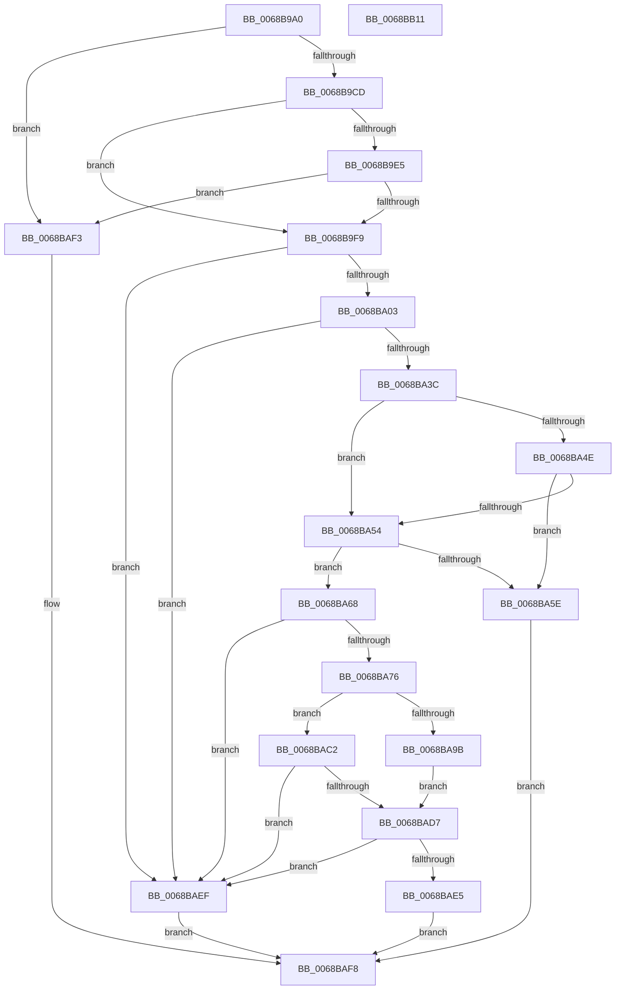

# MiCombinePte

- RVA: `0x0068B9A0`–`0x0068BB12` (길이 `370` bytes)
- VA: `0x000000014068B9A0`
- 실행 섹션: `.text`
- PDB 이름 있음: `예`; PDB Function 태그: `아니요`
- unwind 정보 RVA: `0x00060300`
- 디코드: `96`개 명령, `370/370` bytes 표시
- 미해석 바이트: `0` (있으면 어셈블리에 `.byte`로 보존)

> 이 문서는 커널 이미지의 기계어와 PDB 기호를 분석해 생성했습니다. 4번과 5번은 함수 원형과 자료형을 바이너리 사용 방식에서 추정한 C 해석이며 원본 소스 복구 결과는 아닙니다.

## 1. Dependencies

- 직접 호출 지점: **5**; 고유 호출 대상: **5**
- 직접 호출자로 확인된 함수: **0**
- RIP 상대 이미지 참조: **0**

### Outgoing calls
- `0x0068B9EC` → [MiProcessSuitableForCombining](../2B/MiProcessSuitableForCombining_function_002B6294.md) (function, `0x002B6294`)
- `0x0068BA6D` → [MiCombineCandidate](../31/MiCombineCandidate_function_00316290.md) (function, `0x00316290`)
- `0x0068BAB7` → [MiComputeHash64](../43/MiComputeHash64_function_00432DC0.md) (function, `0x00432DC0`)
- `0x0068BACE` → [MiComputeCombineHash](../32/MiComputeCombineHash_function_003227C0.md) (function, `0x003227C0`)
- `0x0068BAE8` → [MiCombineWorkingSetTail](MiCombineWorkingSetTail_function_0068BD00.md) (function, `0x0068BD00`)

### Direct callers
- 이 함수 시작 RVA로 연결되는 직접 call은 확인되지 않았습니다. 간접 호출은 완전히 역산할 수 없습니다.

### Static image references
- 디코드된 RIP-relative 메모리 참조가 없습니다.

## 2. Other-region calls and transfers

- 다른 실행 섹션으로 향하는 call: **0**
- 별도 외부 분기/꼬리 이동을 확인하지 못했습니다.

## 3. Assembly (complete function range)

```asm
0068B9A0  48 89 5C 24 08                  mov qword ptr [rsp + 8], rbx
0068B9A5  48 89 6C 24 10                  mov qword ptr [rsp + 0x10], rbp
0068B9AA  48 89 74 24 18                  mov qword ptr [rsp + 0x18], rsi
0068B9AF  57                              push rdi
0068B9B0  41 56                           push r14
0068B9B2  41 57                           push r15
0068B9B4  48 83 EC 20                     sub rsp, 0x20
0068B9B8  48 8B E9                        mov rbp, rcx
0068B9BB  48 8B F2                        mov rsi, rdx
0068B9BE  48 8B 49 20                     mov rcx, qword ptr [rcx + 0x20]
0068B9C2  48 83 79 68 00                  cmp qword ptr [rcx + 0x68], 0
0068B9C7  0F 85 26 01 00 00               jne 0x14068baf3
0068B9CD  48 8B BD B8 00 00 00            mov rdi, qword ptr [rbp + 0xb8]
0068B9D4  8B 81 B8 00 00 00               mov eax, dword ptr [rcx + 0xb8]
0068B9DA  4C 8B 77 18                     mov r14, qword ptr [rdi + 0x18]
0068B9DE  4D 8B 0E                        mov r9, qword ptr [r14]
0068B9E1  A8 0F                           test al, 0xf
0068B9E3  75 14                           jne 0x14068b9f9
0068B9E5  48 81 C1 00 FC FF FF            add rcx, -0x400
0068B9EC  E8 A3 A8 C2 FF                  call 0x1402b6294
0068B9F1  85 C0                           test eax, eax
0068B9F3  0F 84 FA 00 00 00               je 0x14068baf3
0068B9F9  41 83 F8 01                     cmp r8d, 1
0068B9FD  0F 8D EC 00 00 00               jge 0x14068baef
0068BA03  48 8B 1E                        mov rbx, qword ptr [rsi]
0068BA06  48 B8 FF FF FF FF FF 00 00 00   movabs rax, 0xffffffffff
0068BA10  4C 8B FB                        mov r15, rbx
0068BA13  49 C1 EF 0C                     shr r15, 0xc
0068BA17  4C 23 F8                        and r15, rax
0068BA1A  4F 8D 04 7F                     lea r8, [r15 + r15*2]
0068BA1E  49 C1 E0 04                     shl r8, 4
0068BA22  48 B8 00 00 00 00 00 DE FF FF   movabs rax, 0xffffde0000000000
0068BA2C  4C 03 C0                        add r8, rax
0068BA2F  49 8B 40 28                     mov rax, qword ptr [r8 + 0x28]
0068BA33  48 85 C0                        test rax, rax
0068BA36  0F 88 B3 00 00 00               js 0x14068baef
0068BA3C  49 8B 46 08                     mov rax, qword ptr [r14 + 8]
0068BA40  65 48 8B 0C 25 88 01 00 00      mov rcx, qword ptr gs:[0x188]
0068BA49  48 85 C0                        test rax, rax
0068BA4C  74 06                           je 0x14068ba54
0068BA4E  83 78 04 00                     cmp dword ptr [rax + 4], 0
0068BA52  75 0A                           jne 0x14068ba5e
0068BA54  8B 81 A0 05 00 00               mov eax, dword ptr [rcx + 0x5a0]
0068BA5A  A8 01                           test al, 1
0068BA5C  74 0A                           je 0x14068ba68
0068BA5E  B8 05 00 00 00                  mov eax, 5
0068BA63  E9 90 00 00 00                  jmp 0x14068baf8
0068BA68  33 D2                           xor edx, edx
0068BA6A  49 8B C9                        mov rcx, r9
0068BA6D  E8 1E A8 C8 FF                  call 0x140316290
0068BA72  85 C0                           test eax, eax
0068BA74  74 79                           je 0x14068baef
0068BA76  49 8B 46 68                     mov rax, qword ptr [r14 + 0x68]
0068BA7A  48 FF 40 10                     inc qword ptr [rax + 0x10]
0068BA7E  48 8B 47 08                     mov rax, qword ptr [rdi + 8]
0068BA82  48 8D 0C 80                     lea rcx, [rax + rax*4]
0068BA86  48 8B 47 20                     mov rax, qword ptr [rdi + 0x20]
0068BA8A  4C 8D 1C C8                     lea r11, [rax + rcx*8]
0068BA8E  49 83 23 00                     and qword ptr [r11], 0
0068BA92  4D 89 7B 10                     mov qword ptr [r11 + 0x10], r15
0068BA96  F6 C3 20                        test bl, 0x20
0068BA99  74 27                           je 0x14068bac2
0068BA9B  48 C1 E6 19                     shl rsi, 0x19
0068BA9F  48 B8 00 00 00 00 80 F6 FF FF   movabs rax, 0xfffff68000000000
0068BAA9  48 C1 E0 19                     shl rax, 0x19
0068BAAD  48 2B F0                        sub rsi, rax
0068BAB0  48 C1 FE 10                     sar rsi, 0x10
0068BAB4  48 8B CE                        mov rcx, rsi
0068BAB7  E8 04 73 DA FF                  call 0x140432dc0
0068BABC  49 89 43 08                     mov qword ptr [r11 + 8], rax
0068BAC0  EB 15                           jmp 0x14068bad7
0068BAC2  41 B8 01 00 00 00               mov r8d, 1
0068BAC8  49 8B D3                        mov rdx, r11
0068BACB  49 8B CE                        mov rcx, r14
0068BACE  E8 ED 6C C9 FF                  call 0x1403227c0
0068BAD3  85 C0                           test eax, eax
0068BAD5  74 18                           je 0x14068baef
0068BAD7  48 FF 47 08                     inc qword ptr [rdi + 8]
0068BADB  48 8B 47 08                     mov rax, qword ptr [rdi + 8]
0068BADF  48 3B 47 10                     cmp rax, qword ptr [rdi + 0x10]
0068BAE3  75 0A                           jne 0x14068baef
0068BAE5  48 8B CD                        mov rcx, rbp
0068BAE8  E8 13 02 00 00                  call 0x14068bd00
0068BAED  EB 09                           jmp 0x14068baf8
0068BAEF  33 C0                           xor eax, eax
0068BAF1  EB 05                           jmp 0x14068baf8
0068BAF3  B8 04 00 00 00                  mov eax, 4
0068BAF8  48 8B 5C 24 40                  mov rbx, qword ptr [rsp + 0x40]
0068BAFD  48 8B 6C 24 48                  mov rbp, qword ptr [rsp + 0x48]
0068BB02  48 8B 74 24 50                  mov rsi, qword ptr [rsp + 0x50]
0068BB07  48 83 C4 20                     add rsp, 0x20
0068BB0B  41 5F                           pop r15
0068BB0D  41 5E                           pop r14
0068BB0F  5F                              pop rdi
0068BB10  C3                              ret
0068BB11  CC                              int3
```

## 4. C-style interpretation (structured pseudocode)

```c
__int64 __fastcall MiCombinePte(__int64 a1, __int64 a2, int a3)
{
    __int64 result;
    __int64 v_r15;
    __int64 v_rsi;
    __int64 v_rsp;
    unsigned __int64 v_stack_p10;
    unsigned __int64 v_stack_p18;
    unsigned __int64 v_stack_p8;

    v_stack_p8 = v_rbx;
    v_stack_p10 = v_rbp;
    v_stack_p18 = v_rsi;
    v_rsp = (v_rsp) - (32);
    if ((*(unsigned __int64 *)(*(unsigned __int64 *)(a1 + 32) + 104)) != 0) goto loc_0068BAF3;
    if ((((unsigned __int8)((unsigned int)(*(unsigned int *)(*(unsigned __int64 *)(a1 + 32) + 184)))) & (15)) != 0) goto loc_0068B9F9;
    a1 = (*(unsigned __int64 *)(a1 + 32)) + (0xFFFFFFFFFFFFFC00ULL);
    result = MiProcessSuitableForCombining(a1, a2, a3, *(unsigned __int64 *)(*(unsigned __int64 *)(*(unsigned __int64 *)(a1 + 184) + 24)));
    if ((unsigned int)(result) == 0) goto loc_0068BAF3;
loc_0068B9F9:
    if (a3 >= 1) goto loc_0068BAEF;
    v_r15 = (*(unsigned __int64 *)(a2)) >> (12);
    v_r15 = (v_r15) & (result);
    a3 = (v_r15 + v_r15 * 2) << (4);
    a3 = (a3) + (result);
    if (sign_flag) goto loc_0068BAEF;
    if (*(unsigned __int64 *)(*(unsigned __int64 *)(*(unsigned __int64 *)(a1 + 184) + 24) + 8) == 0) goto loc_0068BA54;
    if ((*(unsigned int *)(*(unsigned __int64 *)(*(unsigned __int64 *)(*(unsigned __int64 *)(a1 + 184) + 24) + 8) + 4)) != 0) goto loc_0068BA5E;
loc_0068BA54:
    if ((((unsigned __int8)((unsigned int)(*(unsigned int *)(*(unsigned __int64 *)(gs_base + (0 + 392)) + 1440)))) & (1)) == 0) goto loc_0068BA68;
loc_0068BA5E:
    goto loc_0068BAF8;
loc_0068BA68:
    a2 = 0;
    result = MiCombineCandidate(*(unsigned __int64 *)(*(unsigned __int64 *)(*(unsigned __int64 *)(a1 + 184) + 24)), a2, a3, *(unsigned __int64 *)(*(unsigned __int64 *)(*(unsigned __int64 *)(a1 + 184) + 24)));
    if ((unsigned int)(result) == 0) goto loc_0068BAEF;
    *(unsigned __int64 *)(*(unsigned __int64 *)(*(unsigned __int64 *)(a1 + 184) + 32) + *(unsigned __int64 *)(*(unsigned __int64 *)(a1 + 184) + 8) + *(unsigned __int64 *)(*(unsigned __int64 *)(a1 + 184) + 8) * 4 * 8 + 16) = v_r15;
    if ((((unsigned __int8)(*(unsigned __int64 *)(a2))) & (32)) == 0) goto loc_0068BAC2;
    v_rsi = (a2) << (25);
    result = (*(unsigned __int64 *)(*(unsigned __int64 *)(a1 + 184) + 32)) << (25);
    v_rsi = (v_rsi) - (result);
    v_rsi = (v_rsi) >> (16);
    result = MiComputeHash64(v_rsi, a2, a3, *(unsigned __int64 *)(*(unsigned __int64 *)(*(unsigned __int64 *)(a1 + 184) + 24)));
    *(unsigned __int64 *)(*(unsigned __int64 *)(*(unsigned __int64 *)(a1 + 184) + 32) + *(unsigned __int64 *)(*(unsigned __int64 *)(a1 + 184) + 8) + *(unsigned __int64 *)(*(unsigned __int64 *)(a1 + 184) + 8) * 4 * 8 + 8) = result;
    goto loc_0068BAD7;
loc_0068BAC2:
    result = MiComputeCombineHash(*(unsigned __int64 *)(*(unsigned __int64 *)(a1 + 184) + 24), *(unsigned __int64 *)(*(unsigned __int64 *)(a1 + 184) + 32) + *(unsigned __int64 *)(*(unsigned __int64 *)(a1 + 184) + 8) + *(unsigned __int64 *)(*(unsigned __int64 *)(a1 + 184) + 8) * 4 * 8, 1, *(unsigned __int64 *)(*(unsigned __int64 *)(*(unsigned __int64 *)(a1 + 184) + 24)));
    if ((unsigned int)(result) == 0) goto loc_0068BAEF;
loc_0068BAD7:
    if ((*(unsigned __int64 *)(*(unsigned __int64 *)(a1 + 184) + 8)) != (*(unsigned __int64 *)(*(unsigned __int64 *)(a1 + 184) + 16))) goto loc_0068BAEF;
    result = MiCombineWorkingSetTail(a1, *(unsigned __int64 *)(*(unsigned __int64 *)(a1 + 184) + 32) + *(unsigned __int64 *)(*(unsigned __int64 *)(a1 + 184) + 8) + *(unsigned __int64 *)(*(unsigned __int64 *)(a1 + 184) + 8) * 4 * 8, 1, *(unsigned __int64 *)(*(unsigned __int64 *)(*(unsigned __int64 *)(a1 + 184) + 24)));
    goto loc_0068BAF8;
loc_0068BAEF:
    result = 0;
    goto loc_0068BAF8;
loc_0068BAF3:
loc_0068BAF8:
    v_rsp = (v_rsp) + (32);
    return 4;
}
```

## 5. (Beta) C Style

```c
int64_t MiCombinePte(void *Arg1, void *Arg2, int32_t Arg3)
{
    uint8_t *arg1 = (uint8_t *)Arg1;
    uint8_t *arg2 = (uint8_t *)Arg2;

    int64_t result;
    int64_t local_r15;
    int64_t local_rsi;
    int64_t local_rsp;
    uint64_t v_stack_p10;
    uint64_t v_stack_p18;
    uint64_t v_stack_p8;

    v_stack_p8 = local_rbx;
    v_stack_p10 = local_rbp;
    v_stack_p18 = local_rsi;
    local_rsp = (local_rsp) - (32);
    if ((*(uint64_t *)(*(uint64_t *)(arg1 + 0x20) + 0x68)) != 0) goto loc_0068BAF3;
    if ((((uint8_t)((uint32_t)(*(uint32_t *)(*(uint64_t *)(arg1 + 0x20) + 0xB8)))) & (15)) != 0) goto loc_0068B9F9;
    Arg1 = (*(uint64_t *)(arg1 + 0x20)) + (0xFFFFFFFFFFFFFC00ULL);
    result = MiProcessSuitableForCombining(Arg1, Arg2, Arg3, *(uint64_t *)(*(uint64_t *)(*(uint64_t *)(arg1 + 0xB8) + 0x18)));
    if ((uint32_t)(result) == 0) goto loc_0068BAF3;
loc_0068B9F9:
    if (Arg3 >= 1) goto loc_0068BAEF;
    local_r15 = (*(uint64_t *)(arg2)) >> (12);
    local_r15 = (local_r15) & (result);
    Arg3 = (local_r15 + local_r15 * 2) << (4);
    Arg3 = (Arg3) + (result);
    if (sign_flag) goto loc_0068BAEF;
    if (*(uint64_t *)(*(uint64_t *)(*(uint64_t *)(arg1 + 0xB8) + 0x18) + 0x8) == 0) goto loc_0068BA54;
    if ((*(uint32_t *)(*(uint64_t *)(*(uint64_t *)(*(uint64_t *)(arg1 + 0xB8) + 0x18) + 0x8) + 0x4)) != 0) goto loc_0068BA5E;
loc_0068BA54:
    if ((((uint8_t)((uint32_t)(*(uint32_t *)(*(uint64_t *)(gs_base + (0 + 0x188)) + 0x5A0)))) & (1)) == 0) goto loc_0068BA68;
loc_0068BA5E:
    goto loc_0068BAF8;
loc_0068BA68:
    Arg2 = 0;
    result = MiCombineCandidate(*(uint64_t *)(*(uint64_t *)(*(uint64_t *)(arg1 + 0xB8) + 0x18)), Arg2, Arg3, *(uint64_t *)(*(uint64_t *)(*(uint64_t *)(arg1 + 0xB8) + 0x18)));
    if ((uint32_t)(result) == 0) goto loc_0068BAEF;
    *(uint64_t *)(*(uint64_t *)(*(uint64_t *)(arg1 + 0xB8) + 0x20) + *(uint64_t *)(*(uint64_t *)(arg1 + 0xB8) + 0x8) + *(uint64_t *)(*(uint64_t *)(arg1 + 0xB8) + 0x8) * 4 * 8 + 0x10) = local_r15;
    if ((((uint8_t)(*(uint64_t *)(arg2))) & (32)) == 0) goto loc_0068BAC2;
    local_rsi = (Arg2) << (25);
    result = (*(uint64_t *)(*(uint64_t *)(arg1 + 0xB8) + 0x20)) << (25);
    local_rsi = (local_rsi) - (result);
    local_rsi = (local_rsi) >> (16);
    result = MiComputeHash64(local_rsi, Arg2, Arg3, *(uint64_t *)(*(uint64_t *)(*(uint64_t *)(arg1 + 0xB8) + 0x18)));
    *(uint64_t *)(*(uint64_t *)(*(uint64_t *)(arg1 + 0xB8) + 0x20) + *(uint64_t *)(*(uint64_t *)(arg1 + 0xB8) + 0x8) + *(uint64_t *)(*(uint64_t *)(arg1 + 0xB8) + 0x8) * 4 * 8 + 0x8) = result;
    goto loc_0068BAD7;
loc_0068BAC2:
    result = MiComputeCombineHash(*(uint64_t *)(*(uint64_t *)(arg1 + 0xB8) + 0x18), *(uint64_t *)(*(uint64_t *)(arg1 + 0xB8) + 0x20) + *(uint64_t *)(*(uint64_t *)(arg1 + 0xB8) + 0x8) + *(uint64_t *)(*(uint64_t *)(arg1 + 0xB8) + 0x8) * 4 * 8, 1, *(uint64_t *)(*(uint64_t *)(*(uint64_t *)(arg1 + 0xB8) + 0x18)));
    if ((uint32_t)(result) == 0) goto loc_0068BAEF;
loc_0068BAD7:
    if ((*(uint64_t *)(*(uint64_t *)(arg1 + 0xB8) + 0x8)) != (*(uint64_t *)(*(uint64_t *)(arg1 + 0xB8) + 0x10))) goto loc_0068BAEF;
    result = MiCombineWorkingSetTail(Arg1, *(uint64_t *)(*(uint64_t *)(arg1 + 0xB8) + 0x20) + *(uint64_t *)(*(uint64_t *)(arg1 + 0xB8) + 0x8) + *(uint64_t *)(*(uint64_t *)(arg1 + 0xB8) + 0x8) * 4 * 8, 1, *(uint64_t *)(*(uint64_t *)(*(uint64_t *)(arg1 + 0xB8) + 0x18)));
    goto loc_0068BAF8;
loc_0068BAEF:
    result = 0;
    goto loc_0068BAF8;
loc_0068BAF3:
loc_0068BAF8:
    local_rsp = (local_rsp) + (32);
    return 4;
}
```

### 관측된 메모리 오프셋

구조체 형식이 확인되지 않은 접근은 인자 기준의 오프셋으로만 기록했습니다.

| 기준 인자 | 오프셋 표현 | 폭 (bit) | 접근 |
|---|---:|---:|---|
| `Arg1` | `+ 0x20` | `64` | `R` |
| `Arg1` | `+ 0xB8` | `64` | `R` |
| `Arg2` | `+ 0x0` | `64` | `R` |

## 6. Execution-region graph

[열기: 2D/3D 그래프와 함수 탐색 컨트롤 패널](../../../control-panel.html?section=text&rva=0x0068B9A0&view=graph)

- 2D 그래프는 위에서 아래로 흐르고, 3D 그래프는 빈 공간을 드래그해 회전합니다. Shift+드래그는 이동, 휠은 확대·축소, 함수 노드 선택은 대상 보고서 이동입니다.

### Static fallback


