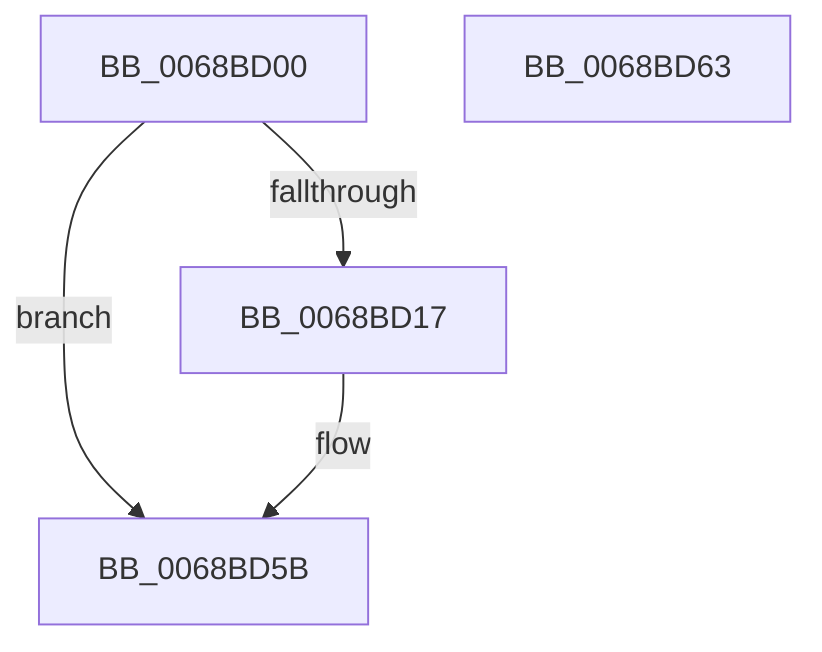

# MiCombineWorkingSetTail

- RVA: `0x0068BD00`–`0x0068BD64` (길이 `100` bytes)
- VA: `0x000000014068BD00`
- 실행 섹션: `.text`
- PDB 이름 있음: `예`; PDB Function 태그: `아니요`
- unwind 정보 RVA: `0x0005CF00`
- 디코드: `23`개 명령, `100/100` bytes 표시
- 미해석 바이트: `0` (있으면 어셈블리에 `.byte`로 보존)

> 이 문서는 커널 이미지의 기계어와 PDB 기호를 분석해 생성했습니다. 4번과 5번은 함수 원형과 자료형을 바이너리 사용 방식에서 추정한 C 해석이며 원본 소스 복구 결과는 아닙니다.

## 1. Dependencies

- 직접 호출 지점: **2**; 고유 호출 대상: **2**
- 직접 호출자로 확인된 함수: **1**
- RIP 상대 이미지 참조: **1**

### Outgoing calls
- `0x0068BD17` → [MiReleaseWalkLocks](../23/MiReleaseWalkLocks_function_00239FD0.md) (function, `0x00239FD0`)
- `0x0068BD51` → [MiProcessCrcList](../../page/9F/MiProcessCrcList_function_009F6F94.md) (function, `0x009F6F94`)

### Direct callers
- [MiCombinePte](MiCombinePte_function_0068B9A0.md) at `0x0068BAE8`

### Static image references
- `0x0068BD25` → RVA `0x00FC8C40` (`ALMOSTRO`; read)

## 2. Other-region calls and transfers

- 다른 실행 섹션으로 향하는 call: **1**
  - `0x0068BD51` → [MiProcessCrcList](../../page/9F/MiProcessCrcList_function_009F6F94.md) (`.text` → `PAGE`)
- 별도 외부 분기/꼬리 이동을 확인하지 못했습니다.

## 3. Assembly (complete function range)

```asm
0068BD00  40 53                           push rbx
0068BD02  48 83 EC 20                     sub rsp, 0x20
0068BD06  48 8B 99 B8 00 00 00            mov rbx, qword ptr [rcx + 0xb8]
0068BD0D  48 8B 43 10                     mov rax, qword ptr [rbx + 0x10]
0068BD11  48 39 43 08                     cmp qword ptr [rbx + 8], rax
0068BD15  75 44                           jne 0x14068bd5b
0068BD17  E8 B4 E2 BA FF                  call 0x140239fd0
0068BD1C  65 48 8B 04 25 88 01 00 00      mov rax, qword ptr gs:[0x188]
0068BD25  48 8D 0D 14 CF 93 00            lea rcx, [rip + 0x93cf14]
0068BD2C  4C 8B 43 08                     mov r8, qword ptr [rbx + 8]
0068BD30  48 8B 53 20                     mov rdx, qword ptr [rbx + 0x20]
0068BD34  8B 80 4C 02 00 00               mov eax, dword ptr [rax + 0x24c]
0068BD3A  48 8B 04 C1                     mov rax, qword ptr [rcx + rax*8]
0068BD3E  48 8B 88 C0 00 00 00            mov rcx, qword ptr [rax + 0xc0]
0068BD45  44 0F B7 89 8A 00 00 00         movzx r9d, word ptr [rcx + 0x8a]
0068BD4D  48 8B 4B 18                     mov rcx, qword ptr [rbx + 0x18]
0068BD51  E8 3E B2 36 00                  call 0x1409f6f94
0068BD56  48 83 63 08 00                  and qword ptr [rbx + 8], 0
0068BD5B  33 C0                           xor eax, eax
0068BD5D  48 83 C4 20                     add rsp, 0x20
0068BD61  5B                              pop rbx
0068BD62  C3                              ret
0068BD63  CC                              int3
```

## 4. C-style interpretation (structured pseudocode)

```c
__int64 __fastcall MiCombineWorkingSetTail(__int64 a1)
{
    __int64 result;
    __int64 v_rsp;

    v_rsp = (v_rsp) - (32);
    result = *(unsigned __int64 *)(*(unsigned __int64 *)(a1 + 184) + 16);
    if ((*(unsigned __int64 *)(*(unsigned __int64 *)(a1 + 184) + 8)) == (*(unsigned __int64 *)(*(unsigned __int64 *)(a1 + 184) + 16))) {
        result = MiReleaseWalkLocks(a1, a2, a3, a4);
        result = *(unsigned __int64 *)(gs_base + (0 + 392));
        a1 = v_rip + 9686804;
        a3 = *(unsigned __int64 *)(*(unsigned __int64 *)(a1 + 184) + 8);
        a2 = *(unsigned __int64 *)(*(unsigned __int64 *)(a1 + 184) + 32);
        result = *(unsigned int *)(result + 588);
        result = *(unsigned __int64 *)(a1 + result * 8);
        a1 = *(unsigned __int64 *)(result + 192);
        a4 = *(unsigned __int16 *)(a1 + 138);
        a1 = *(unsigned __int64 *)(*(unsigned __int64 *)(a1 + 184) + 24);
        result = MiProcessCrcList(a1, a2, a3, a4);
    }
    result = 0;
    v_rsp = (v_rsp) + (32);
    return result;
}
```

## 5. (Beta) C Style

```c
int64_t MiCombineWorkingSetTail(void *Arg1)
{
    uint8_t *arg1 = (uint8_t *)Arg1;

    int64_t result;
    int64_t local_rsp;

    local_rsp = (local_rsp) - (32);
    result = *(uint64_t *)(*(uint64_t *)(arg1 + 0xB8) + 0x10);
    if ((*(uint64_t *)(*(uint64_t *)(arg1 + 0xB8) + 0x8)) == (*(uint64_t *)(*(uint64_t *)(arg1 + 0xB8) + 0x10))) {
        result = MiReleaseWalkLocks(Arg1, a2, a3, a4);
        result = *(uint64_t *)(gs_base + (0 + 0x188));
        Arg1 = v_rip + 9686804;
        a3 = *(uint64_t *)(*(uint64_t *)(arg1 + 0xB8) + 0x8);
        a2 = *(uint64_t *)(*(uint64_t *)(arg1 + 0xB8) + 0x20);
        result = *(uint32_t *)(result + 0x24C);
        result = *(uint64_t *)(arg1 + result * 8);
        Arg1 = *(uint64_t *)(result + 0xC0);
        a4 = *(uint16_t *)(arg1 + 0x8A);
        Arg1 = *(uint64_t *)(*(uint64_t *)(arg1 + 0xB8) + 0x18);
        result = MiProcessCrcList(Arg1, a2, a3, a4);
    }
    result = 0;
    local_rsp = (local_rsp) + (32);
    return result;
}
```

### 관측된 메모리 오프셋

구조체 형식이 확인되지 않은 접근은 인자 기준의 오프셋으로만 기록했습니다.

| 기준 인자 | 오프셋 표현 | 폭 (bit) | 접근 |
|---|---:|---:|---|
| `Arg1` | `+ 0xB8` | `64` | `R` |

## 6. Execution-region graph

[열기: 2D/3D 그래프와 함수 탐색 컨트롤 패널](../../../control-panel.html?section=text&rva=0x0068BD00&view=graph)

- 2D 그래프는 위에서 아래로 흐르고, 3D 그래프는 빈 공간을 드래그해 회전합니다. Shift+드래그는 이동, 휠은 확대·축소, 함수 노드 선택은 대상 보고서 이동입니다.

### Static fallback


