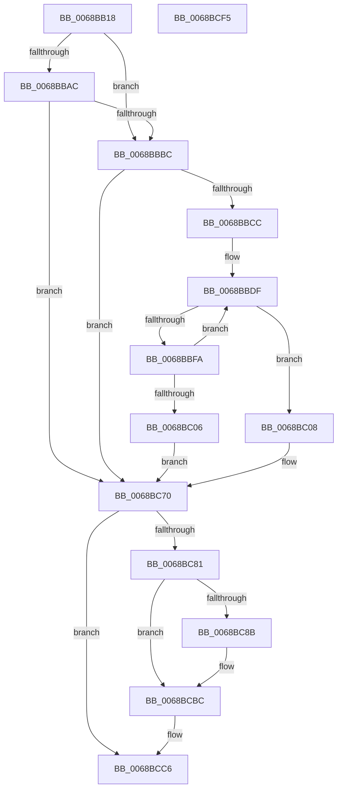

# MiCombineWorkingSet

- RVA: `0x0068BB18`–`0x0068BCF6` (길이 `478` bytes)
- VA: `0x000000014068BB18`
- 실행 섹션: `.text`
- PDB 이름 있음: `예`; PDB Function 태그: `아니요`
- unwind 정보 RVA: `0x000D8DE0`
- 디코드: `114`개 명령, `478/478` bytes 표시
- 미해석 바이트: `0` (있으면 어셈블리에 `.byte`로 보존)

> 이 문서는 커널 이미지의 기계어와 PDB 기호를 분석해 생성했습니다. 4번과 5번은 함수 원형과 자료형을 바이너리 사용 방식에서 추정한 C 해석이며 원본 소스 복구 결과는 아닙니다.

## 1. Dependencies

- 직접 호출 지점: **8**; 고유 호출 대상: **8**
- 직접 호출자로 확인된 함수: **1**
- RIP 상대 이미지 참조: **3**

### Outgoing calls
- `0x0068BB5F` → [memset](../6C/memset_function_006C6C40.md) (function, `0x006C6C40`)
- `0x0068BB9E` → [MiLockWorkingSetShared](../27/MiLockWorkingSetShared_function_0027CBF0.md) (function, `0x0027CBF0`)
- `0x0068BBAF` → [MiProcessSuitableForCombining](../2B/MiProcessSuitableForCombining_function_002B6294.md) (function, `0x002B6294`)
- `0x0068BBED` → [MiAllocatePool](../35/MiAllocatePool_function_0035B540.md) (function, `0x0035B540`)
- `0x0068BC68` → [MiWalkPageTables](../2C/MiWalkPageTables_function_002C2710.md) (function, `0x002C2710`)
- `0x0068BC77` → [MiUnlockWorkingSetShared](../27/MiUnlockWorkingSetShared_function_0027D690.md) (function, `0x0027D690`)
- `0x0068BCB7` → [MiProcessCrcList](../../page/9F/MiProcessCrcList_function_009F6F94.md) (function, `0x009F6F94`)
- `0x0068BCC1` → [ExFreePoolWithTag](../../poolcode/B8/ExFreePoolWithTag_function_00B82870.md) (function, `0x00B82870`)

### Direct callers
- [MiCombineIdenticalPages](../../page/AB/MiCombineIdenticalPages_function_00AB2324.md) at `0x00AB25BE`

### Static image references
- `0x0068BC32` → RVA `0x0068B9A0` (`MiCombinePte`; read)
- `0x0068BC3D` → RVA `0x0068BD00` (`MiCombineWorkingSetTail`; read)
- `0x0068BC8F` → RVA `0x00FC8C40` (`ALMOSTRO`; read)

## 2. Other-region calls and transfers

- 다른 실행 섹션으로 향하는 call: **2**
  - `0x0068BCB7` → [MiProcessCrcList](../../page/9F/MiProcessCrcList_function_009F6F94.md) (`.text` → `PAGE`)
  - `0x0068BCC1` → [ExFreePoolWithTag](../../poolcode/B8/ExFreePoolWithTag_function_00B82870.md) (`.text` → `POOLCODE`)
- 별도 외부 분기/꼬리 이동을 확인하지 못했습니다.

## 3. Assembly (complete function range)

```asm
0068BB18  48 8B C4                        mov rax, rsp
0068BB1B  48 89 58 10                     mov qword ptr [rax + 0x10], rbx
0068BB1F  48 89 70 18                     mov qword ptr [rax + 0x18], rsi
0068BB23  48 89 78 20                     mov qword ptr [rax + 0x20], rdi
0068BB27  55                              push rbp
0068BB28  41 54                           push r12
0068BB2A  41 55                           push r13
0068BB2C  41 56                           push r14
0068BB2E  41 57                           push r15
0068BB30  48 8D 68 C8                     lea rbp, [rax - 0x38]
0068BB34  48 81 EC 10 01 00 00            sub rsp, 0x110
0068BB3B  0F 57 C0                        xorps xmm0, xmm0
0068BB3E  4C 8B E9                        mov r13, rcx
0068BB41  33 C0                           xor eax, eax
0068BB43  48 8D 4C 24 50                  lea rcx, [rsp + 0x50]
0068BB48  33 D2                           xor edx, edx
0068BB4A  48 89 44 24 40                  mov qword ptr [rsp + 0x40], rax
0068BB4F  41 B8 C0 00 00 00               mov r8d, 0xc0
0068BB55  0F 11 44 24 20                  movups xmmword ptr [rsp + 0x20], xmm0
0068BB5A  0F 11 44 24 30                  movups xmmword ptr [rsp + 0x30], xmm0
0068BB5F  E8 DC B0 03 00                  call 0x1406c6c40
0068BB64  4D 8B 75 70                     mov r14, qword ptr [r13 + 0x70]
0068BB68  BB 00 00 00 00                  mov ebx, 0
0068BB6D  45 8B A5 8C 00 00 00            mov r12d, dword ptr [r13 + 0x8c]
0068BB74  49 8B CE                        mov rcx, r14
0068BB77  8B F3                           mov esi, ebx
0068BB79  41 8B 86 B8 00 00 00            mov eax, dword ptr [r14 + 0xb8]
0068BB80  49 8D BE 00 FC FF FF            lea rdi, [r14 - 0x400]
0068BB87  A8 0F                           test al, 0xf
0068BB89  44 8D 7B 04                     lea r15d, [rbx + 4]
0068BB8D  65 48 8B 04 25 88 01 00 00      mov rax, qword ptr gs:[0x188]
0068BB96  48 0F 45 FB                     cmovne rdi, rbx
0068BB9A  48 89 45 40                     mov qword ptr [rbp + 0x40], rax
0068BB9E  E8 4D 10 BF FF                  call 0x14027cbf0
0068BBA3  88 44 24 59                     mov byte ptr [rsp + 0x59], al
0068BBA7  48 85 FF                        test rdi, rdi
0068BBAA  74 10                           je 0x14068bbbc
0068BBAC  48 8B CF                        mov rcx, rdi
0068BBAF  E8 E0 A6 C2 FF                  call 0x1402b6294
0068BBB4  85 C0                           test eax, eax
0068BBB6  0F 84 B4 00 00 00               je 0x14068bc70
0068BBBC  49 8B 86 98 00 00 00            mov rax, qword ptr [r14 + 0x98]
0068BBC3  48 85 C0                        test rax, rax
0068BBC6  0F 84 A4 00 00 00               je 0x14068bc70
0068BBCC  48 8D 04 80                     lea rax, [rax + rax*4]
0068BBD0  48 8D 3C C5 FF 0F 00 00         lea rdi, [rax*8 + 0xfff]
0068BBD8  48 81 E7 00 F0 FF FF            and rdi, 0xfffffffffffff000
0068BBDF  41 B8 4D 53 75 6D               mov r8d, 0x6d75534d
0068BBE5  48 8B D7                        mov rdx, rdi
0068BBE8  B9 40 00 00 00                  mov ecx, 0x40
0068BBED  E8 4E F9 CC FF                  call 0x14035b540
0068BBF2  48 8B F0                        mov rsi, rax
0068BBF5  48 85 C0                        test rax, rax
0068BBF8  75 0E                           jne 0x14068bc08
0068BBFA  48 D1 EF                        shr rdi, 1
0068BBFD  48 81 FF 00 00 01 00            cmp rdi, 0x10000
0068BC04  73 D9                           jae 0x14068bbdf
0068BC06  EB 68                           jmp 0x14068bc70
0068BC08  48 83 4D 80 FF                  or qword ptr [rbp - 0x80], 0xffffffffffffffff
0068BC0D  48 8D 4C 24 50                  lea rcx, [rsp + 0x50]
0068BC12  48 B8 CD CC CC CC CC CC CC CC   movabs rax, 0xcccccccccccccccd
0068BC1C  4C 89 6C 24 38                  mov qword ptr [rsp + 0x38], r13
0068BC21  48 F7 E7                        mul rdi
0068BC24  48 8D 44 24 20                  lea rax, [rsp + 0x20]
0068BC29  48 89 74 24 40                  mov qword ptr [rsp + 0x40], rsi
0068BC2E  48 89 45 08                     mov qword ptr [rbp + 8], rax
0068BC32  48 8D 05 67 FD FF FF            lea rax, [rip - 0x299]
0068BC39  48 89 45 F8                     mov qword ptr [rbp - 8], rax
0068BC3D  48 8D 05 BC 00 00 00            lea rax, [rip + 0xbc]
0068BC44  48 C1 EA 05                     shr rdx, 5
0068BC48  48 89 54 24 30                  mov qword ptr [rsp + 0x30], rdx
0068BC4D  44 89 64 24 20                  mov dword ptr [rsp + 0x20], r12d
0068BC52  4C 89 74 24 70                  mov qword ptr [rsp + 0x70], r14
0068BC57  48 89 45 00                     mov qword ptr [rbp], rax
0068BC5B  C7 44 24 50 06 00 00 00         mov dword ptr [rsp + 0x50], 6
0068BC63  C6 44 24 58 07                  mov byte ptr [rsp + 0x58], 7
0068BC68  E8 A3 6A C3 FF                  call 0x1402c2710
0068BC6D  44 8B F8                        mov r15d, eax
0068BC70  8A 54 24 59                     mov dl, byte ptr [rsp + 0x59]
0068BC74  49 8B CE                        mov rcx, r14
0068BC77  E8 14 1A BF FF                  call 0x14027d690
0068BC7C  48 85 F6                        test rsi, rsi
0068BC7F  74 45                           je 0x14068bcc6
0068BC81  4C 8B 44 24 28                  mov r8, qword ptr [rsp + 0x28]
0068BC86  4D 85 C0                        test r8, r8
0068BC89  74 31                           je 0x14068bcbc
0068BC8B  48 8B 45 40                     mov rax, qword ptr [rbp + 0x40]
0068BC8F  48 8D 0D AA CF 93 00            lea rcx, [rip + 0x93cfaa]
0068BC96  48 8B D6                        mov rdx, rsi
0068BC99  8B 80 4C 02 00 00               mov eax, dword ptr [rax + 0x24c]
0068BC9F  48 8B 04 C1                     mov rax, qword ptr [rcx + rax*8]
0068BCA3  48 8B 88 C0 00 00 00            mov rcx, qword ptr [rax + 0xc0]
0068BCAA  44 0F B7 89 8A 00 00 00         movzx r9d, word ptr [rcx + 0x8a]
0068BCB2  48 8B 4C 24 38                  mov rcx, qword ptr [rsp + 0x38]
0068BCB7  E8 D8 B2 36 00                  call 0x1409f6f94
0068BCBC  33 D2                           xor edx, edx
0068BCBE  48 8B CE                        mov rcx, rsi
0068BCC1  E8 AA 6B 4F 00                  call 0x140b82870
0068BCC6  4C 8D 9C 24 10 01 00 00         lea r11, [rsp + 0x110]
0068BCCE  B8 40 02 00 C0                  mov eax, 0xc0000240
0068BCD3  49 8B 73 40                     mov rsi, qword ptr [r11 + 0x40]
0068BCD7  41 83 FF 05                     cmp r15d, 5
0068BCDB  49 8B 7B 48                     mov rdi, qword ptr [r11 + 0x48]
0068BCDF  0F 44 D8                        cmove ebx, eax
0068BCE2  8B C3                           mov eax, ebx
0068BCE4  49 8B 5B 38                     mov rbx, qword ptr [r11 + 0x38]
0068BCE8  49 8B E3                        mov rsp, r11
0068BCEB  41 5F                           pop r15
0068BCED  41 5E                           pop r14
0068BCEF  41 5D                           pop r13
0068BCF1  41 5C                           pop r12
0068BCF3  5D                              pop rbp
0068BCF4  C3                              ret
0068BCF5  CC                              int3
```

## 4. C-style interpretation (structured pseudocode)

```c
__int64 __fastcall MiCombineWorkingSet(__int64 a1, int a2)
{
    __int64 result;
    __int64 v_rbx;
    __int64 v_rdi;
    __int64 v_rsp;
    unsigned __int64 v_stack_m100;
    unsigned __int64 v_stack_m108;
    unsigned __int64 v_stack_m110;
    unsigned __int64 v_stack_m118;
    unsigned __int64 v_stack_m28;
    unsigned __int64 v_stack_mC8;
    unsigned __int8 v_stack_mDF;
    unsigned __int8 v_stack_mE0;
    unsigned __int64 v_stack_mE8;
    unsigned __int64 v_stack_mF8;

    *(unsigned __int64 *)(v_rsp + 16) = v_rbx;
    *(unsigned __int64 *)(v_rsp + 24) = v_rsi;
    *(unsigned __int64 *)(v_rsp + 32) = v_rdi;
    v_rsp = (v_rsp) - (272);
    result = 0;
    a2 = 0;
    v_stack_mF8 = 0;
    v_stack_m118 = v_xmm0;
    v_stack_m108 = v_xmm0;
    result = memset(v_stack_mE8, a2, 192, a4);
    v_rdi = *(unsigned __int64 *)(a1 + 112) - 1024;
    if ((((unsigned __int8)((unsigned int)(*(unsigned int *)(*(unsigned __int64 *)(a1 + 112) + 184)))) & (15)) != 0) { v_rdi = 0; }
    *(unsigned __int64 *)(v_rsp - 56 + 64) = *(unsigned __int64 *)(gs_base + (0 + 392));
    result = MiLockWorkingSetShared(*(unsigned __int64 *)(a1 + 112), a2, 192, a4);
    v_stack_mDF = (unsigned __int8)(result);
    if (v_rdi == 0) goto loc_0068BBBC;
    result = MiProcessSuitableForCombining(v_rdi, a2, 192, a4);
    if ((unsigned int)(result) == 0) goto loc_0068BC70;
loc_0068BBBC:
    if (*(unsigned __int64 *)(*(unsigned __int64 *)(a1 + 112) + 152) == 0) goto loc_0068BC70;
    v_rdi = (*(unsigned __int64 *)(*(unsigned __int64 *)(a1 + 112) + 152) + *(unsigned __int64 *)(*(unsigned __int64 *)(a1 + 112) + 152) * 4 * 8 + 4095) & (0xFFFFFFFFFFFFF000ULL);
loc_0068BBDF:
    result = MiAllocatePool(64, v_rdi, (unsigned int)(0x6D75534DULL), a4);
    if (result != 0) goto loc_0068BC08;
    v_rdi = (v_rdi) >> (1);
    if (v_rdi >= 0x10000ULL) goto loc_0068BBDF;
    goto loc_0068BC70;
loc_0068BC08:
    v_stack_m100 = a1;
    v_stack_mF8 = result;
    *(unsigned __int64 *)(v_rsp - 56 + 8) = v_stack_m118;
    *(unsigned __int64 *)(v_rsp - 56 - 8) = v_rip - 665;
    a2 = (v_rdi) >> (5);
    v_stack_m108 = a2;
    v_stack_m118 = (unsigned int)((unsigned int)(*(unsigned int *)(a1 + 140)));
    v_stack_mC8 = *(unsigned __int64 *)(a1 + 112);
    *(unsigned __int64 *)(v_rsp - 56) = v_rip + 188;
    v_stack_mE8 = 6;
    v_stack_mE0 = 7;
    result = MiWalkPageTables(v_stack_mE8, a2, (unsigned int)(0x6D75534DULL), a4);
loc_0068BC70:
    result = MiUnlockWorkingSetShared(*(unsigned __int64 *)(a1 + 112), v_stack_mDF, (unsigned int)(0x6D75534DULL), a4);
    if (result == 0) goto loc_0068BCC6;
    if (v_stack_m110 != 0) {
        result = *(unsigned __int64 *)(v_rsp - 56 + 64);
        a1 = v_rip + 9686954;
        a2 = result;
        result = *(unsigned int *)(result + 588);
        result = *(unsigned __int64 *)(a1 + result * 8);
        a1 = *(unsigned __int64 *)(result + 192);
        a4 = *(unsigned __int16 *)(a1 + 138);
        a1 = v_stack_m100;
        result = MiProcessCrcList(a1, a2, v_stack_m110, a4);
    }
    a2 = 0;
    result = ExFreePoolWithTag(result, a2, v_stack_m110, a4);
loc_0068BCC6:
    v_rbx = 0;
    if (((unsigned int)((unsigned int)((unsigned int)(result)))) == 5) { v_rbx = (unsigned int)((unsigned int)(0xC0000240ULL)); }
    return (unsigned int)((unsigned int)(v_rbx));
}
```

## 5. (Beta) C Style

```c
int64_t MiCombineWorkingSet(void *Arg1, int32_t Arg2)
{
    uint8_t *arg1 = (uint8_t *)Arg1;

    int64_t result;
    int64_t local_rbx;
    int64_t local_rdi;
    int64_t local_rsp;
    uint64_t v_stack_m100;
    uint64_t v_stack_m108;
    uint64_t v_stack_m110;
    uint64_t v_stack_m118;
    uint64_t v_stack_m28;
    uint64_t v_stack_mC8;
    uint8_t v_stack_mDF;
    uint8_t v_stack_mE0;
    uint64_t v_stack_mE8;
    uint64_t v_stack_mF8;

    *(uint64_t *)(local_rsp + 0x10) = local_rbx;
    *(uint64_t *)(local_rsp + 0x18) = local_rsi;
    *(uint64_t *)(local_rsp + 0x20) = local_rdi;
    local_rsp = (local_rsp) - (272);
    result = 0;
    Arg2 = 0;
    v_stack_mF8 = 0;
    v_stack_m118 = v_xmm0;
    v_stack_m108 = v_xmm0;
    result = memset(v_stack_mE8, Arg2, 192, a4);
    local_rdi = *(uint64_t *)(arg1 + 0x70) - 1024;
    if ((((uint8_t)((uint32_t)(*(uint32_t *)(*(uint64_t *)(arg1 + 0x70) + 0xB8)))) & (15)) != 0) { local_rdi = 0; }
    *(uint64_t *)(local_rsp - 0x38 + 0x40) = *(uint64_t *)(gs_base + (0 + 0x188));
    result = MiLockWorkingSetShared(*(uint64_t *)(arg1 + 0x70), Arg2, 192, a4);
    v_stack_mDF = (uint8_t)(result);
    if (local_rdi == 0) goto loc_0068BBBC;
    result = MiProcessSuitableForCombining(local_rdi, Arg2, 192, a4);
    if ((uint32_t)(result) == 0) goto loc_0068BC70;
loc_0068BBBC:
    if (*(uint64_t *)(*(uint64_t *)(arg1 + 0x70) + 0x98) == 0) goto loc_0068BC70;
    local_rdi = (*(uint64_t *)(*(uint64_t *)(arg1 + 0x70) + 0x98) + *(uint64_t *)(*(uint64_t *)(arg1 + 0x70) + 0x98) * 4 * 8 + 4095) & (0xFFFFFFFFFFFFF000ULL);
loc_0068BBDF:
    result = MiAllocatePool(64, local_rdi, (uint32_t)(0x6D75534DULL), a4);
    if (result != 0) goto loc_0068BC08;
    local_rdi = (local_rdi) >> (1);
    if (local_rdi >= 0x10000ULL) goto loc_0068BBDF;
    goto loc_0068BC70;
loc_0068BC08:
    v_stack_m100 = Arg1;
    v_stack_mF8 = result;
    *(uint64_t *)(local_rsp - 0x38 + 0x8) = v_stack_m118;
    *(uint64_t *)(local_rsp - 0x38 - 0x8) = v_rip - 665;
    Arg2 = (local_rdi) >> (5);
    v_stack_m108 = Arg2;
    v_stack_m118 = (uint32_t)((uint32_t)(*(uint32_t *)(arg1 + 0x8C)));
    v_stack_mC8 = *(uint64_t *)(arg1 + 0x70);
    *(uint64_t *)(local_rsp - 0x38) = v_rip + 188;
    v_stack_mE8 = 6;
    v_stack_mE0 = 7;
    result = MiWalkPageTables(v_stack_mE8, Arg2, (uint32_t)(0x6D75534DULL), a4);
loc_0068BC70:
    result = MiUnlockWorkingSetShared(*(uint64_t *)(arg1 + 0x70), v_stack_mDF, (uint32_t)(0x6D75534DULL), a4);
    if (result == 0) goto loc_0068BCC6;
    if (v_stack_m110 != 0) {
        result = *(uint64_t *)(local_rsp - 0x38 + 0x40);
        Arg1 = v_rip + 9686954;
        Arg2 = result;
        result = *(uint32_t *)(result + 0x24C);
        result = *(uint64_t *)(arg1 + result * 8);
        Arg1 = *(uint64_t *)(result + 0xC0);
        a4 = *(uint16_t *)(arg1 + 0x8A);
        Arg1 = v_stack_m100;
        result = MiProcessCrcList(Arg1, Arg2, v_stack_m110, a4);
    }
    Arg2 = 0;
    result = ExFreePoolWithTag(result, Arg2, v_stack_m110, a4);
loc_0068BCC6:
    local_rbx = 0;
    if (((uint32_t)((uint32_t)((uint32_t)(result)))) == 5) { local_rbx = (uint32_t)((uint32_t)(0xC0000240ULL)); }
    return (uint32_t)((uint32_t)(local_rbx));
}
```

### 관측된 메모리 오프셋

구조체 형식이 확인되지 않은 접근은 인자 기준의 오프셋으로만 기록했습니다.

| 기준 인자 | 오프셋 표현 | 폭 (bit) | 접근 |
|---|---:|---:|---|
| `Arg1` | `+ 0x70` | `64` | `R` |
| `Arg1` | `+ 0x8C` | `32` | `R` |

## 6. Execution-region graph

[열기: 2D/3D 그래프와 함수 탐색 컨트롤 패널](../../../control-panel.html?section=text&rva=0x0068BB18&view=graph)

- 2D 그래프는 위에서 아래로 흐르고, 3D 그래프는 빈 공간을 드래그해 회전합니다. Shift+드래그는 이동, 휠은 확대·축소, 함수 노드 선택은 대상 보고서 이동입니다.

### Static fallback


