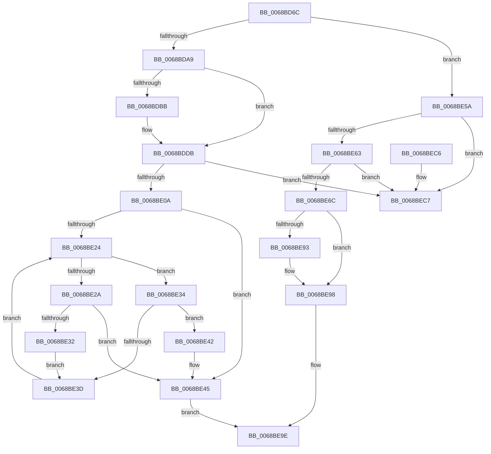

# MiCombiningInProgress

- RVA: `0x0068BD6C`–`0x0068BECE` (길이 `354` bytes)
- VA: `0x000000014068BD6C`
- 실행 섹션: `.text`
- PDB 이름 있음: `예`; PDB Function 태그: `아니요`
- unwind 정보 RVA: `0x00075210`
- 디코드: `91`개 명령, `354/354` bytes 표시
- 미해석 바이트: `0` (있으면 어셈블리에 `.byte`로 보존)

> 이 문서는 커널 이미지의 기계어와 PDB 기호를 분석해 생성했습니다. 4번과 5번은 함수 원형과 자료형을 바이너리 사용 방식에서 추정한 C 해석이며 원본 소스 복구 결과는 아닙니다.

## 1. Dependencies

- 직접 호출 지점: **6**; 고유 호출 대상: **6**
- 직접 호출자로 확인된 함수: **1**
- RIP 상대 이미지 참조: **8**

### Outgoing calls
- `0x0068BD97` → [ExAcquireSpinLockExclusive](../24/ExAcquireSpinLockExclusive_function_00248690.md) (function, `0x00248690`)
- `0x0068BDED` → [memset](../6C/memset_function_006C6C40.md) (function, `0x006C6C40`)
- `0x0068BE53` → [RtlAvlInsertNodeEx](../26/RtlAvlInsertNodeEx_function_00265790.md) (function, `0x00265790`)
- `0x0068BE7E` → [RtlAvlRemoveNode](../29/RtlAvlRemoveNode_function_00296650.md) (function, `0x00296650`)
- `0x0068BE93` → [MiFlushEntireTbDueToAttributeChange](../30/MiFlushEntireTbDueToAttributeChange_function_00308AE0.md) (function, `0x00308AE0`)
- `0x0068BEA8` → [MiReleaseSpinLockExclusive](../24/MiReleaseSpinLockExclusive_function_002482C0.md) (function, `0x002482C0`)

### Direct callers
- [MiCombineIdenticalPages](../../page/AB/MiCombineIdenticalPages_function_00AB2324.md) at `0x00AB24DC`
- [MiCombineIdenticalPages](../../page/AB/MiCombineIdenticalPages_function_00AB2324.md) at `0x00AB2623`

### Static image references
- `0x0068BD8A` → RVA `0x00E2FF00` (`.data`; read)
- `0x0068BDAD` → RVA `0x00E2FF04` (`.data`; read/write)
- `0x0068BDB3` → RVA `0x00E2FF18` (`.data`; read)
- `0x0068BDBE` → RVA `0x00E0C590` (`.data`; read/write)
- `0x0068BDCA` → RVA `0x00E2FF18` (`.data`; write)
- `0x0068BDD4` → RVA `0x00E2FF10` (`.data`; write)
- `0x0068BE18` → RVA `0x00E2FF08` (`.data`; read)
- `0x0068BE8A` → RVA `0x00E2FF04` (`.data`; read)

## 2. Other-region calls and transfers

- 다른 실행 섹션으로 향하는 call: **0**
- 별도 외부 분기/꼬리 이동을 확인하지 못했습니다.

## 3. Assembly (complete function range)

```asm
0068BD6C  48 89 5C 24 08                  mov qword ptr [rsp + 8], rbx
0068BD71  48 89 6C 24 10                  mov qword ptr [rsp + 0x10], rbp
0068BD76  48 89 74 24 18                  mov qword ptr [rsp + 0x18], rsi
0068BD7B  57                              push rdi
0068BD7C  41 56                           push r14
0068BD7E  41 57                           push r15
0068BD80  48 83 EC 20                     sub rsp, 0x20
0068BD84  48 8B 29                        mov rbp, qword ptr [rcx]
0068BD87  4C 8B F1                        mov r14, rcx
0068BD8A  48 8D 0D 6F 41 7A 00            lea rcx, [rip + 0x7a416f]
0068BD91  41 8B D8                        mov ebx, r8d
0068BD94  48 8B FA                        mov rdi, rdx
0068BD97  E8 F4 C8 BB FF                  call 0x140248690
0068BD9C  33 F6                           xor esi, esi
0068BD9E  44 8A F8                        mov r15b, al
0068BDA1  85 DB                           test ebx, ebx
0068BDA3  0F 84 B1 00 00 00               je 0x14068be5a
0068BDA9  41 FF 46 40                     inc dword ptr [r14 + 0x40]
0068BDAD  FF 05 51 41 7A 00               inc dword ptr [rip + 0x7a4151]
0068BDB3  39 35 5F 41 7A 00               cmp dword ptr [rip + 0x7a415f], esi
0068BDB9  75 20                           jne 0x14068bddb
0068BDBB  8D 4E 01                        lea ecx, [rsi + 1]
0068BDBE  F0 48 0F C1 0D C9 07 78 00      lock xadd qword ptr [rip + 0x7807c9], rcx
0068BDC7  48 FF C1                        inc rcx
0068BDCA  C7 05 44 41 7A 00 01 00 00 00   mov dword ptr [rip + 0x7a4144], 1
0068BDD4  48 89 0D 35 41 7A 00            mov qword ptr [rip + 0x7a4135], rcx
0068BDDB  65 48 8B 1C 25 88 01 00 00      mov rbx, qword ptr gs:[0x188]
0068BDE4  33 D2                           xor edx, edx
0068BDE6  48 8B CF                        mov rcx, rdi
0068BDE9  44 8D 42 50                     lea r8d, [rdx + 0x50]
0068BDED  E8 4E AE 03 00                  call 0x1406c6c40
0068BDF2  48 8D 85 60 42 00 00            lea rax, [rbp + 0x4260]
0068BDF9  48 89 5F 28                     mov qword ptr [rdi + 0x28], rbx
0068BDFD  48 8B 08                        mov rcx, qword ptr [rax]
0068BE00  48 39 41 08                     cmp qword ptr [rcx + 8], rax
0068BE04  0F 85 BD 00 00 00               jne 0x14068bec7
0068BE0A  48 89 0F                        mov qword ptr [rdi], rcx
0068BE0D  48 89 47 08                     mov qword ptr [rdi + 8], rax
0068BE11  48 89 79 08                     mov qword ptr [rcx + 8], rdi
0068BE15  48 89 38                        mov qword ptr [rax], rdi
0068BE18  48 8B 15 E9 40 7A 00            mov rdx, qword ptr [rip + 0x7a40e9]
0068BE1F  48 85 D2                        test rdx, rdx
0068BE22  74 21                           je 0x14068be45
0068BE24  48 3B 5A 18                     cmp rbx, qword ptr [rdx + 0x18]
0068BE28  73 0A                           jae 0x14068be34
0068BE2A  48 8B 02                        mov rax, qword ptr [rdx]
0068BE2D  48 85 C0                        test rax, rax
0068BE30  74 13                           je 0x14068be45
0068BE32  EB 09                           jmp 0x14068be3d
0068BE34  48 8B 42 08                     mov rax, qword ptr [rdx + 8]
0068BE38  48 85 C0                        test rax, rax
0068BE3B  74 05                           je 0x14068be42
0068BE3D  48 8B D0                        mov rdx, rax
0068BE40  EB E2                           jmp 0x14068be24
0068BE42  40 B6 01                        mov sil, 1
0068BE45  4C 8D 4F 10                     lea r9, [rdi + 0x10]
0068BE49  44 8A C6                        mov r8b, sil
0068BE4C  48 8D 0D B5 40 7A 00            lea rcx, [rip + 0x7a40b5]
0068BE53  E8 38 99 BD FF                  call 0x140265790
0068BE58  EB 44                           jmp 0x14068be9e
0068BE5A  48 8B 0F                        mov rcx, qword ptr [rdi]
0068BE5D  48 39 79 08                     cmp qword ptr [rcx + 8], rdi
0068BE61  75 64                           jne 0x14068bec7
0068BE63  48 8B 47 08                     mov rax, qword ptr [rdi + 8]
0068BE67  48 39 38                        cmp qword ptr [rax], rdi
0068BE6A  75 5B                           jne 0x14068bec7
0068BE6C  48 89 08                        mov qword ptr [rax], rcx
0068BE6F  48 8D 57 10                     lea rdx, [rdi + 0x10]
0068BE73  48 89 41 08                     mov qword ptr [rcx + 8], rax
0068BE77  48 8D 0D 8A 40 7A 00            lea rcx, [rip + 0x7a408a]
0068BE7E  E8 CD A7 C0 FF                  call 0x140296650
0068BE83  83 CB FF                        or ebx, 0xffffffff
0068BE86  41 01 5E 40                     add dword ptr [r14 + 0x40], ebx
0068BE8A  83 3D 73 40 7A 00 01            cmp dword ptr [rip + 0x7a4073], 1
0068BE91  75 05                           jne 0x14068be98
0068BE93  E8 48 CC C7 FF                  call 0x140308ae0
0068BE98  01 1D 66 40 7A 00               add dword ptr [rip + 0x7a4066], ebx
0068BE9E  41 8A D7                        mov dl, r15b
0068BEA1  48 8D 0D 58 40 7A 00            lea rcx, [rip + 0x7a4058]
0068BEA8  E8 13 C4 BB FF                  call 0x1402482c0
0068BEAD  48 8B 5C 24 40                  mov rbx, qword ptr [rsp + 0x40]
0068BEB2  48 8B 6C 24 48                  mov rbp, qword ptr [rsp + 0x48]
0068BEB7  48 8B 74 24 50                  mov rsi, qword ptr [rsp + 0x50]
0068BEBC  48 83 C4 20                     add rsp, 0x20
0068BEC0  41 5F                           pop r15
0068BEC2  41 5E                           pop r14
0068BEC4  5F                              pop rdi
0068BEC5  C3                              ret
0068BEC6  CC                              int3
0068BEC7  B9 03 00 00 00                  mov ecx, 3
0068BECC  CD 29                           int 0x29
```

## 4. C-style interpretation (structured pseudocode)

```c
__int64 __fastcall MiCombiningInProgress(__int64 a1, __int64 a2, int a3)
{
    __int64 result;
    __int64 v_rbx;
    __int64 v_rsi;
    __int64 v_rsp;
    unsigned __int64 v_stack_p10;
    unsigned __int64 v_stack_p18;
    unsigned __int64 v_stack_p8;

    v_stack_p8 = v_rbx;
    v_stack_p10 = v_rbp;
    v_stack_p18 = v_rsi;
    v_rsp = (v_rsp) - (32);
    result = ExAcquireSpinLockExclusive(v_rip + 8012143, a2, a3, a4);
    v_rsi = 0;
    if ((unsigned int)((unsigned int)(a3)) == 0) goto loc_0068BE5A;
    if ((*(unsigned int *)(v_rip + 8012127)) == 0) {
        a1 = v_rsi + 1;
        a1 = (a1) + 1;
        *(unsigned int *)(v_rip + 8012100) = 1;
        *(unsigned __int64 *)(v_rip + 8012085) = a1;
    }
    a2 = 0;
    result = memset(0, a2, a2 + 80, a4);
    *(unsigned __int64 *)(a2 + 40) = *(unsigned __int64 *)(gs_base + (0 + 392));
    if ((*(unsigned __int64 *)(*(unsigned __int64 *)(*(unsigned __int64 *)(a1) + 16992) + 8)) != (*(unsigned __int64 *)(a1) + 16992)) goto loc_0068BEC7;
    *(unsigned __int64 *)(a2) = *(unsigned __int64 *)(*(unsigned __int64 *)(a1) + 16992);
    *(unsigned __int64 *)(a2 + 8) = *(unsigned __int64 *)(a1) + 16992;
    *(unsigned __int64 *)(*(unsigned __int64 *)(*(unsigned __int64 *)(a1) + 16992) + 8) = 0;
    *(unsigned __int64 *)(*(unsigned __int64 *)(a1) + 16992) = 0;
    if (*(unsigned __int64 *)(v_rip + 8012009) == 0) goto loc_0068BE45;
loc_0068BE24:
    if ((*(unsigned __int64 *)(gs_base + (0 + 392))) >= (*(unsigned __int64 *)(*(unsigned __int64 *)(v_rip + 8012009) + 24))) goto loc_0068BE34;
    if (*(unsigned __int64 *)(*(unsigned __int64 *)(v_rip + 8012009)) == 0) goto loc_0068BE45;
    goto loc_0068BE3D;
loc_0068BE34:
    if (*(unsigned __int64 *)(*(unsigned __int64 *)(v_rip + 8012009) + 8) == 0) goto loc_0068BE42;
loc_0068BE3D:
    goto loc_0068BE24;
loc_0068BE42:
loc_0068BE45:
    result = RtlAvlInsertNodeEx(v_rip + 8011957, *(unsigned __int64 *)(*(unsigned __int64 *)(v_rip + 8012009) + 8), 1, a2 + 16);
    goto loc_0068BE9E;
loc_0068BE5A:
    if ((*(unsigned __int64 *)(*(unsigned __int64 *)(a2) + 8)) != 0) goto loc_0068BEC7;
    if ((*(unsigned __int64 *)(*(unsigned __int64 *)(a2 + 8))) != 0) goto loc_0068BEC7;
    *(unsigned __int64 *)(*(unsigned __int64 *)(a2 + 8)) = *(unsigned __int64 *)(a2);
    *(unsigned __int64 *)(*(unsigned __int64 *)(a2) + 8) = *(unsigned __int64 *)(a2 + 8);
    result = RtlAvlRemoveNode(v_rip + 8011914, a2 + 16, 1, a2 + 16);
    v_rbx = (unsigned int)((*(unsigned __int64 *)(gs_base + (0 + 392))) | (0xFFFFFFFFULL));
    if ((*(unsigned int *)(v_rip + 8011891)) == 1) {
        result = MiFlushEntireTbDueToAttributeChange(v_rip + 8011914, a2 + 16, 1, a2 + 16);
    }
loc_0068BE9E:
    result = MiReleaseSpinLockExclusive(v_rip + 8011864, (unsigned __int8)((unsigned __int8)(result)), 1, a2 + 16);
    v_rsp = (v_rsp) + (32);
    return result;
loc_0068BEC7:
    return result;
}
```

## 5. (Beta) C Style

```c
int64_t MiCombiningInProgress(void *Arg1, void *Arg2, int32_t Arg3)
{
    uint8_t *arg1 = (uint8_t *)Arg1;
    uint8_t *arg2 = (uint8_t *)Arg2;

    int64_t result;
    int64_t local_rbx;
    int64_t local_rsi;
    int64_t local_rsp;
    uint64_t v_stack_p10;
    uint64_t v_stack_p18;
    uint64_t v_stack_p8;

    v_stack_p8 = local_rbx;
    v_stack_p10 = local_rbp;
    v_stack_p18 = local_rsi;
    local_rsp = (local_rsp) - (32);
    result = ExAcquireSpinLockExclusive(v_rip + 8012143, Arg2, Arg3, a4);
    local_rsi = 0;
    if ((uint32_t)((uint32_t)(Arg3)) == 0) goto loc_0068BE5A;
    if ((*(uint32_t *)(v_rip + 0x7A415F)) == 0) {
        Arg1 = local_rsi + 1;
        Arg1 = (Arg1) + 1;
        *(uint32_t *)(v_rip + 0x7A4144) = 1;
        *(void **)(v_rip + 0x7A4135) = Arg1;
    }
    Arg2 = 0;
    result = memset(0, Arg2, Arg2 + 80, a4);
    *(uint64_t *)(arg2 + 0x28) = *(uint64_t *)(gs_base + (0 + 0x188));
    if ((*(uint64_t *)(*(uint64_t *)(*(uint64_t *)(arg1) + 0x4260) + 0x8)) != (*(uint64_t *)(arg1) + 16992)) goto loc_0068BEC7;
    *(uint64_t *)(arg2) = *(uint64_t *)(*(uint64_t *)(arg1) + 0x4260);
    *(uint64_t *)(arg2 + 0x8) = *(uint64_t *)(arg1) + 16992;
    *(uint64_t *)(*(uint64_t *)(*(uint64_t *)(arg1) + 0x4260) + 0x8) = 0;
    *(uint64_t *)(*(uint64_t *)(arg1) + 0x4260) = 0;
    if (*(uint64_t *)(v_rip + 0x7A40E9) == 0) goto loc_0068BE45;
loc_0068BE24:
    if ((*(uint64_t *)(gs_base + (0 + 0x188))) >= (*(uint64_t *)(*(uint64_t *)(v_rip + 0x7A40E9) + 0x18))) goto loc_0068BE34;
    if (*(uint64_t *)(*(uint64_t *)(v_rip + 0x7A40E9)) == 0) goto loc_0068BE45;
    goto loc_0068BE3D;
loc_0068BE34:
    if (*(uint64_t *)(*(uint64_t *)(v_rip + 0x7A40E9) + 0x8) == 0) goto loc_0068BE42;
loc_0068BE3D:
    goto loc_0068BE24;
loc_0068BE42:
loc_0068BE45:
    result = RtlAvlInsertNodeEx(v_rip + 8011957, *(uint64_t *)(*(uint64_t *)(v_rip + 0x7A40E9) + 0x8), 1, Arg2 + 16);
    goto loc_0068BE9E;
loc_0068BE5A:
    if ((*(uint64_t *)(*(uint64_t *)(arg2) + 0x8)) != 0) goto loc_0068BEC7;
    if ((*(uint64_t *)(*(uint64_t *)(arg2 + 0x8))) != 0) goto loc_0068BEC7;
    *(uint64_t *)(*(uint64_t *)(arg2 + 0x8)) = *(uint64_t *)(arg2);
    *(uint64_t *)(*(uint64_t *)(arg2) + 0x8) = *(uint64_t *)(arg2 + 0x8);
    result = RtlAvlRemoveNode(v_rip + 8011914, Arg2 + 16, 1, Arg2 + 16);
    local_rbx = (uint32_t)((*(uint64_t *)(gs_base + (0 + 0x188))) | (0xFFFFFFFFULL));
    if ((*(uint32_t *)(v_rip + 0x7A4073)) == 1) {
        result = MiFlushEntireTbDueToAttributeChange(v_rip + 8011914, Arg2 + 16, 1, Arg2 + 16);
    }
loc_0068BE9E:
    result = MiReleaseSpinLockExclusive(v_rip + 8011864, (uint8_t)((uint8_t)(result)), 1, Arg2 + 16);
    local_rsp = (local_rsp) + (32);
    return result;
loc_0068BEC7:
    return result;
}
```

### 관측된 메모리 오프셋

구조체 형식이 확인되지 않은 접근은 인자 기준의 오프셋으로만 기록했습니다.

| 기준 인자 | 오프셋 표현 | 폭 (bit) | 접근 |
|---|---:|---:|---|
| `Arg1` | `+ 0x0` | `64` | `R` |
| `Arg1` | `+ 0x40` | `32` | `R/W` |
| `Arg2` | `+ 0x0` | `64` | `R` |
| `Arg2` | `+ 0x0` | `64` | `W` |
| `Arg2` | `+ 0x8` | `64` | `R` |
| `Arg2` | `+ 0x8` | `64` | `W` |
| `Arg2` | `+ 0x10` | `64` | `R` |
| `Arg2` | `+ 0x28` | `64` | `W` |

## 6. Execution-region graph

[열기: 2D/3D 그래프와 함수 탐색 컨트롤 패널](../../../control-panel.html?section=text&rva=0x0068BD6C&view=graph)

- 2D 그래프는 위에서 아래로 흐르고, 3D 그래프는 빈 공간을 드래그해 회전합니다. Shift+드래그는 이동, 휠은 확대·축소, 함수 노드 선택은 대상 보고서 이동입니다.

### Static fallback


