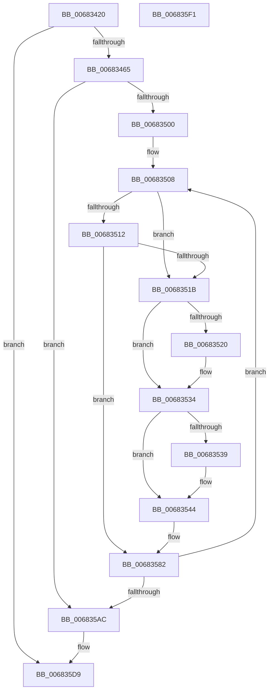

# MiCommitHotPatchTable

- RVA: `0x00683420`–`0x006835F2` (길이 `466` bytes)
- VA: `0x0000000140683420`
- 실행 섹션: `.text`
- PDB 이름 있음: `예`; PDB Function 태그: `아니요`
- unwind 정보 RVA: `0x000BBDE4`
- 디코드: `122`개 명령, `466/466` bytes 표시
- 미해석 바이트: `0` (있으면 어셈블리에 `.byte`로 보존)

> 이 문서는 커널 이미지의 기계어와 PDB 기호를 분석해 생성했습니다. 4번과 5번은 함수 원형과 자료형을 바이너리 사용 방식에서 추정한 C 해석이며 원본 소스 복구 결과는 아닙니다.

## 1. Dependencies

- 직접 호출 지점: **10**; 고유 호출 대상: **7**
- 직접 호출자로 확인된 함수: **2**
- RIP 상대 이미지 참조: **0**

### Outgoing calls
- `0x00683458` → [MiChargeFullProcessCommitment](../../page/88/MiChargeFullProcessCommitment_function_00887630.md) (function, `0x00887630`)
- `0x0068349D` → [MiMakeDemandZeroPte](../33/MiMakeDemandZeroPte_function_00337A00.md) (function, `0x00337A00`)
- `0x006834A8` → [MiMakeDemandZeroPte](../33/MiMakeDemandZeroPte_function_00337A00.md) (function, `0x00337A00`)
- `0x006834EB` → [MiLockWorkingSetShared](../27/MiLockWorkingSetShared_function_0027CBF0.md) (function, `0x0027CBF0`)
- `0x0068352C` → [MiIncreaseUsedPtes](../24/MiIncreaseUsedPtes_function_00243630.md) (function, `0x00243630`)
- `0x0068353F` → [MiUnlockPageTable](../21/MiUnlockPageTable_function_00216EC0.md) (function, `0x00216EC0`)
- `0x00683578` → [MiMakeSystemAddressValid](../27/MiMakeSystemAddressValid_function_0027FF70.md) (function, `0x0027FF70`)
- `0x006835B8` → [MiIncreaseUsedPtes](../24/MiIncreaseUsedPtes_function_00243630.md) (function, `0x00243630`)
- `0x006835C3` → [MiUnlockPageTable](../21/MiUnlockPageTable_function_00216EC0.md) (function, `0x00216EC0`)
- `0x006835D2` → [MiUnlockWorkingSetShared](../27/MiUnlockWorkingSetShared_function_0027D690.md) (function, `0x0027D690`)

### Direct callers
- [MiPrepareToHotPatchImage](../../page/80/MiPrepareToHotPatchImage_function_00806820.md) at `0x00806A96`
- [MmCommitHotPatchTable](../../page/80/MmCommitHotPatchTable_function_00807278.md) at `0x00807321`

### Static image references
- 디코드된 RIP-relative 메모리 참조가 없습니다.

## 2. Other-region calls and transfers

- 다른 실행 섹션으로 향하는 call: **1**
  - `0x00683458` → [MiChargeFullProcessCommitment](../../page/88/MiChargeFullProcessCommitment_function_00887630.md) (`.text` → `PAGE`)
- 별도 외부 분기/꼬리 이동을 확인하지 못했습니다.

## 3. Assembly (complete function range)

```asm
00683420  48 89 5C 24 08                  mov qword ptr [rsp + 8], rbx
00683425  48 89 54 24 10                  mov qword ptr [rsp + 0x10], rdx
0068342A  55                              push rbp
0068342B  56                              push rsi
0068342C  57                              push rdi
0068342D  41 54                           push r12
0068342F  41 55                           push r13
00683431  41 56                           push r14
00683433  41 57                           push r15
00683435  48 83 EC 40                     sub rsp, 0x40
00683439  65 48 8B 04 25 88 01 00 00      mov rax, qword ptr gs:[0x188]
00683442  4C 8B F2                        mov r14, rdx
00683445  48 8B D9                        mov rbx, rcx
00683448  49 8B D0                        mov rdx, r8
0068344B  4D 8B E8                        mov r13, r8
0068344E  4C 8B A0 B8 00 00 00            mov r12, qword ptr [rax + 0xb8]
00683455  49 8B CC                        mov rcx, r12
00683458  E8 D3 41 20 00                  call 0x140887630
0068345D  85 C0                           test eax, eax
0068345F  0F 88 74 01 00 00               js 0x1406835d9
00683465  8B 4B 34                        mov ecx, dword ptr [rbx + 0x34]
00683468  33 ED                           xor ebp, ebp
0068346A  0F B6 53 22                     movzx edx, byte ptr [rbx + 0x22]
0068346E  49 81 C4 00 04 00 00            add r12, 0x400
00683475  48 C1 E2 20                     shl rdx, 0x20
00683479  45 33 FF                        xor r15d, r15d
0068347C  48 0B D1                        or rdx, rcx
0068347F  4C 89 74 24 28                  mov qword ptr [rsp + 0x28], r14
00683484  49 03 D5                        add rdx, r13
00683487  8D 4D 01                        lea ecx, [rbp + 1]
0068348A  89 53 34                        mov dword ptr [rbx + 0x34], edx
0068348D  48 C1 EA 20                     shr rdx, 0x20
00683491  88 53 22                        mov byte ptr [rbx + 0x22], dl
00683494  8B 5B 30                        mov ebx, dword ptr [rbx + 0x30]
00683497  C1 EB 0C                        shr ebx, 0xc
0068349A  83 E3 7F                        and ebx, 0x7f
0068349D  E8 5E 45 CB FF                  call 0x140337a00
006834A2  8D 4D 03                        lea ecx, [rbp + 3]
006834A5  48 8B F8                        mov rdi, rax
006834A8  E8 53 45 CB FF                  call 0x140337a00
006834AD  48 8B F0                        mov rsi, rax
006834B0  49 8B CE                        mov rcx, r14
006834B3  48 B8 F8 FF FF FF 7F 00 00 00   movabs rax, 0x7ffffffff8
006834BD  48 C1 E9 09                     shr rcx, 9
006834C1  48 23 C8                        and rcx, rax
006834C4  48 B8 00 00 00 00 80 F6 FF FF   movabs rax, 0xfffff68000000000
006834CE  48 8B C0                        mov rax, rax
006834D1  48 03 C8                        add rcx, rax
006834D4  49 FF CD                        dec r13
006834D7  48 89 4C 24 20                  mov qword ptr [rsp + 0x20], rcx
006834DC  4C 8B F1                        mov r14, rcx
006834DF  4E 8D 2C E9                     lea r13, [rcx + r13*8]
006834E3  49 8B CC                        mov rcx, r12
006834E6  4C 89 6C 24 30                  mov qword ptr [rsp + 0x30], r13
006834EB  E8 00 97 BF FF                  call 0x14027cbf0
006834F0  88 84 24 98 00 00 00            mov byte ptr [rsp + 0x98], al
006834F7  4D 3B F5                        cmp r14, r13
006834FA  0F 87 AC 00 00 00               ja 0x1406835ac
00683500  4C 8B 6C 24 28                  mov r13, qword ptr [rsp + 0x28]
00683505  49 8B CE                        mov rcx, r14
00683508  4C 3B AC 24 88 00 00 00         cmp r13, qword ptr [rsp + 0x88]
00683510  74 09                           je 0x14068351b
00683512  49 F7 C6 FF 0F 00 00            test r14, 0xfff
00683519  75 67                           jne 0x140683582
0068351B  45 85 FF                        test r15d, r15d
0068351E  74 14                           je 0x140683534
00683520  41 B9 02 00 00 00               mov r9d, 2
00683526  45 8B C7                        mov r8d, r15d
00683529  48 8B D5                        mov rdx, rbp
0068352C  E8 FF 00 BC FF                  call 0x140243630
00683531  45 33 FF                        xor r15d, r15d
00683534  48 85 ED                        test rbp, rbp
00683537  74 0B                           je 0x140683544
00683539  48 8B D5                        mov rdx, rbp
0068353C  49 8B CC                        mov rcx, r12
0068353F  E8 7C 39 B9 FF                  call 0x140216ec0
00683544  48 B8 F8 FF FF FF 7F 00 00 00   movabs rax, 0x7ffffffff8
0068354E  49 8B EE                        mov rbp, r14
00683551  48 C1 ED 09                     shr rbp, 9
00683555  48 23 E8                        and rbp, rax
00683558  48 B8 00 00 00 00 80 F6 FF FF   movabs rax, 0xfffff68000000000
00683562  48 8B C0                        mov rax, rax
00683565  44 8A 84 24 98 00 00 00         mov r8b, byte ptr [rsp + 0x98]
0068356D  48 03 E8                        add rbp, rax
00683570  45 33 C9                        xor r9d, r9d
00683573  8B D3                           mov edx, ebx
00683575  49 8B CE                        mov rcx, r14
00683578  E8 F3 C9 BF FF                  call 0x14027ff70
0068357D  48 8B 4C 24 20                  mov rcx, qword ptr [rsp + 0x20]
00683582  41 8A C6                        mov al, r14b
00683585  2A C1                           sub al, cl
00683587  A8 08                           test al, 8
00683589  48 8B C7                        mov rax, rdi
0068358C  48 0F 44 C6                     cmove rax, rsi
00683590  41 FF C7                        inc r15d
00683593  49 89 06                        mov qword ptr [r14], rax
00683596  49 81 C5 00 10 00 00            add r13, 0x1000
0068359D  49 83 C6 08                     add r14, 8
006835A1  4C 3B 74 24 30                  cmp r14, qword ptr [rsp + 0x30]
006835A6  0F 86 5C FF FF FF               jbe 0x140683508
006835AC  41 B9 02 00 00 00               mov r9d, 2
006835B2  45 8B C7                        mov r8d, r15d
006835B5  48 8B D5                        mov rdx, rbp
006835B8  E8 73 00 BC FF                  call 0x140243630
006835BD  48 8B D5                        mov rdx, rbp
006835C0  49 8B CC                        mov rcx, r12
006835C3  E8 F8 38 B9 FF                  call 0x140216ec0
006835C8  8A 94 24 98 00 00 00            mov dl, byte ptr [rsp + 0x98]
006835CF  49 8B CC                        mov rcx, r12
006835D2  E8 B9 A0 BF FF                  call 0x14027d690
006835D7  33 C0                           xor eax, eax
006835D9  48 8B 9C 24 80 00 00 00         mov rbx, qword ptr [rsp + 0x80]
006835E1  48 83 C4 40                     add rsp, 0x40
006835E5  41 5F                           pop r15
006835E7  41 5E                           pop r14
006835E9  41 5D                           pop r13
006835EB  41 5C                           pop r12
006835ED  5F                              pop rdi
006835EE  5E                              pop rsi
006835EF  5D                              pop rbp
006835F0  C3                              ret
006835F1  CC                              int3
```

## 4. C-style interpretation (structured pseudocode)

```c
__int64 __fastcall MiCommitHotPatchTable(__int64 a1, __int64 a2, __int64 a3)
{
    __int64 result;
    __int64 v_r12;
    __int64 v_r13;
    __int64 v_r14;
    __int64 v_r15;
    __int64 v_rbp;
    __int64 v_rbx;
    __int64 v_rsp;
    unsigned __int64 v_stack_m48;
    unsigned __int64 v_stack_m50;
    unsigned __int64 v_stack_m58;
    unsigned __int64 v_stack_p10;
    unsigned __int8 v_stack_p20;
    unsigned __int64 v_stack_p8;

    v_stack_p8 = v_rbx;
    v_stack_p10 = a2;
    v_rsp = (v_rsp) - (64);
    result = MiChargeFullProcessCommitment(*(unsigned __int64 *)(*(unsigned __int64 *)(gs_base + (0 + 392)) + 184), a3, a3, a4);
    if (sign_flag) goto loc_006835D9;
    v_rbp = 0;
    v_r12 = (*(unsigned __int64 *)(*(unsigned __int64 *)(gs_base + (0 + 392)) + 184)) + (0x400ULL);
    a2 = (*(unsigned __int8 *)(a1 + 34)) << (32);
    v_r15 = 0;
    a2 = (a2) | ((unsigned int)(*(unsigned int *)(a1 + 52)));
    v_stack_m50 = a2;
    a2 = (a2) + (a3);
    *(unsigned int *)(a1 + 52) = (unsigned int)(a2);
    a2 = (a2) >> (32);
    *(unsigned __int8 *)(a1 + 34) = (unsigned __int8)(a2);
    v_rbx = (unsigned int)(((unsigned int)(*(unsigned int *)(a1 + 48))) >> (12));
    v_rbx = (unsigned int)((v_rbx) & (127));
    result = MiMakeDemandZeroPte(v_rbp + 1, a2, a3, a4);
    result = MiMakeDemandZeroPte(v_rbp + 3, a2, a3, a4);
    a1 = (a2) >> (9);
    a1 = (a1) & (result);
    a1 = (a1) + (result);
    v_r13 = (a3) - 1;
    v_stack_m58 = a1;
    v_stack_m48 = a1 + v_r13 * 8;
    result = MiLockWorkingSetShared(v_r12, a2, a3, a4);
    v_stack_p20 = (unsigned __int8)(result);
    if (a1 > (a1 + v_r13 * 8)) goto loc_006835AC;
loc_00683508:
    if (v_stack_m50 == v_stack_p10) goto loc_0068351B;
    if (((a1) & (0xFFFULL)) != 0) goto loc_00683582;
loc_0068351B:
    if (0 != 0) {
        a4 = 2;
        a3 = 0;
        a2 = 0;
        result = MiIncreaseUsedPtes(a1, a2, a3, a4);
        v_r15 = 0;
    }
    if (0 != 0) {
        a2 = 0;
        a1 = v_r12;
        result = MiUnlockPageTable(a1, a2, a3, a4);
    }
    v_rbp = (a1) >> (9);
    v_rbp = (v_rbp) & (result);
    v_rbp = (v_rbp) + (result);
    a4 = 0;
    result = MiMakeSystemAddressValid(a1, (unsigned int)((unsigned int)(v_rbx)), v_stack_p20, a4);
loc_00683582:
    result = (unsigned __int8)(((unsigned __int8)(a1)) - ((unsigned __int8)(v_stack_m58)));
    if ((((unsigned __int8)(result)) & (8)) == 0) { result = result; }
    v_r15 = (unsigned int)((v_r15) + 1);
    *(unsigned __int64 *)(a1) = result;
    v_r13 = (v_stack_m50) + (0x1000ULL);
    v_r14 = (a1) + (8);
    if (v_r14 <= v_stack_m48) goto loc_00683508;
loc_006835AC:
    result = MiIncreaseUsedPtes(v_stack_m58, v_rbp, (unsigned int)((unsigned int)(v_r15)), 2);
    result = MiUnlockPageTable(v_r12, v_rbp, (unsigned int)((unsigned int)(v_r15)), 2);
    result = MiUnlockWorkingSetShared(v_r12, v_stack_p20, (unsigned int)((unsigned int)(v_r15)), 2);
    result = 0;
loc_006835D9:
    v_rsp = (v_rsp) + (64);
    return result;
}
```

## 5. (Beta) C Style

```c
int64_t MiCommitHotPatchTable(void *Arg1, int64_t Arg2, int64_t Arg3)
{
    uint8_t *arg1 = (uint8_t *)Arg1;

    int64_t result;
    int64_t local_r12;
    int64_t local_r13;
    int64_t local_r14;
    int64_t local_r15;
    int64_t local_rbp;
    int64_t local_rbx;
    int64_t local_rsp;
    uint64_t v_stack_m48;
    uint64_t v_stack_m50;
    uint64_t v_stack_m58;
    uint64_t v_stack_p10;
    uint8_t v_stack_p20;
    uint64_t v_stack_p8;

    v_stack_p8 = local_rbx;
    v_stack_p10 = Arg2;
    local_rsp = (local_rsp) - (64);
    result = MiChargeFullProcessCommitment(*(uint64_t *)(*(uint64_t *)(gs_base + (0 + 0x188)) + 0xB8), Arg3, Arg3, a4);
    if (sign_flag) goto loc_006835D9;
    local_rbp = 0;
    local_r12 = (*(uint64_t *)(*(uint64_t *)(gs_base + (0 + 0x188)) + 0xB8)) + (0x400ULL);
    Arg2 = (*(uint8_t *)(arg1 + 0x22)) << (32);
    local_r15 = 0;
    Arg2 = (Arg2) | ((uint32_t)(*(uint32_t *)(arg1 + 0x34)));
    v_stack_m50 = Arg2;
    Arg2 = (Arg2) + (Arg3);
    *(uint32_t *)(arg1 + 0x34) = (uint32_t)(Arg2);
    Arg2 = (Arg2) >> (32);
    *(uint8_t *)(arg1 + 0x22) = (uint8_t)(Arg2);
    local_rbx = (uint32_t)(((uint32_t)(*(uint32_t *)(arg1 + 0x30))) >> (12));
    local_rbx = (uint32_t)((local_rbx) & (127));
    result = MiMakeDemandZeroPte(local_rbp + 1, Arg2, Arg3, a4);
    result = MiMakeDemandZeroPte(local_rbp + 3, Arg2, Arg3, a4);
    Arg1 = (Arg2) >> (9);
    Arg1 = (Arg1) & (result);
    Arg1 = (Arg1) + (result);
    local_r13 = (Arg3) - 1;
    v_stack_m58 = Arg1;
    v_stack_m48 = Arg1 + local_r13 * 8;
    result = MiLockWorkingSetShared(local_r12, Arg2, Arg3, a4);
    v_stack_p20 = (uint8_t)(result);
    if (Arg1 > (Arg1 + local_r13 * 8)) goto loc_006835AC;
loc_00683508:
    if (v_stack_m50 == v_stack_p10) goto loc_0068351B;
    if (((Arg1) & (0xFFFULL)) != 0) goto loc_00683582;
loc_0068351B:
    if (0 != 0) {
        a4 = 2;
        Arg3 = 0;
        Arg2 = 0;
        result = MiIncreaseUsedPtes(Arg1, Arg2, Arg3, a4);
        local_r15 = 0;
    }
    if (0 != 0) {
        Arg2 = 0;
        Arg1 = local_r12;
        result = MiUnlockPageTable(Arg1, Arg2, Arg3, a4);
    }
    local_rbp = (Arg1) >> (9);
    local_rbp = (local_rbp) & (result);
    local_rbp = (local_rbp) + (result);
    a4 = 0;
    result = MiMakeSystemAddressValid(Arg1, (uint32_t)((uint32_t)(local_rbx)), v_stack_p20, a4);
loc_00683582:
    result = (uint8_t)(((uint8_t)(Arg1)) - ((uint8_t)(v_stack_m58)));
    if ((((uint8_t)(result)) & (8)) == 0) { result = result; }
    local_r15 = (uint32_t)((local_r15) + 1);
    *(uint64_t *)(arg1) = result;
    local_r13 = (v_stack_m50) + (0x1000ULL);
    local_r14 = (Arg1) + (8);
    if (local_r14 <= v_stack_m48) goto loc_00683508;
loc_006835AC:
    result = MiIncreaseUsedPtes(v_stack_m58, local_rbp, (uint32_t)((uint32_t)(local_r15)), 2);
    result = MiUnlockPageTable(local_r12, local_rbp, (uint32_t)((uint32_t)(local_r15)), 2);
    result = MiUnlockWorkingSetShared(local_r12, v_stack_p20, (uint32_t)((uint32_t)(local_r15)), 2);
    result = 0;
loc_006835D9:
    local_rsp = (local_rsp) + (64);
    return result;
}
```

### 관측된 메모리 오프셋

구조체 형식이 확인되지 않은 접근은 인자 기준의 오프셋으로만 기록했습니다.

| 기준 인자 | 오프셋 표현 | 폭 (bit) | 접근 |
|---|---:|---:|---|
| `Arg1` | `+ 0x22` | `8` | `R` |
| `Arg1` | `+ 0x22` | `8` | `W` |
| `Arg1` | `+ 0x30` | `32` | `R` |
| `Arg1` | `+ 0x34` | `32` | `R` |
| `Arg1` | `+ 0x34` | `32` | `W` |

## 6. Execution-region graph

[열기: 2D/3D 그래프와 함수 탐색 컨트롤 패널](../../../control-panel.html?section=text&rva=0x00683420&view=graph)

- 2D 그래프는 위에서 아래로 흐르고, 3D 그래프는 빈 공간을 드래그해 회전합니다. Shift+드래그는 이동, 휠은 확대·축소, 함수 노드 선택은 대상 보고서 이동입니다.

### Static fallback


