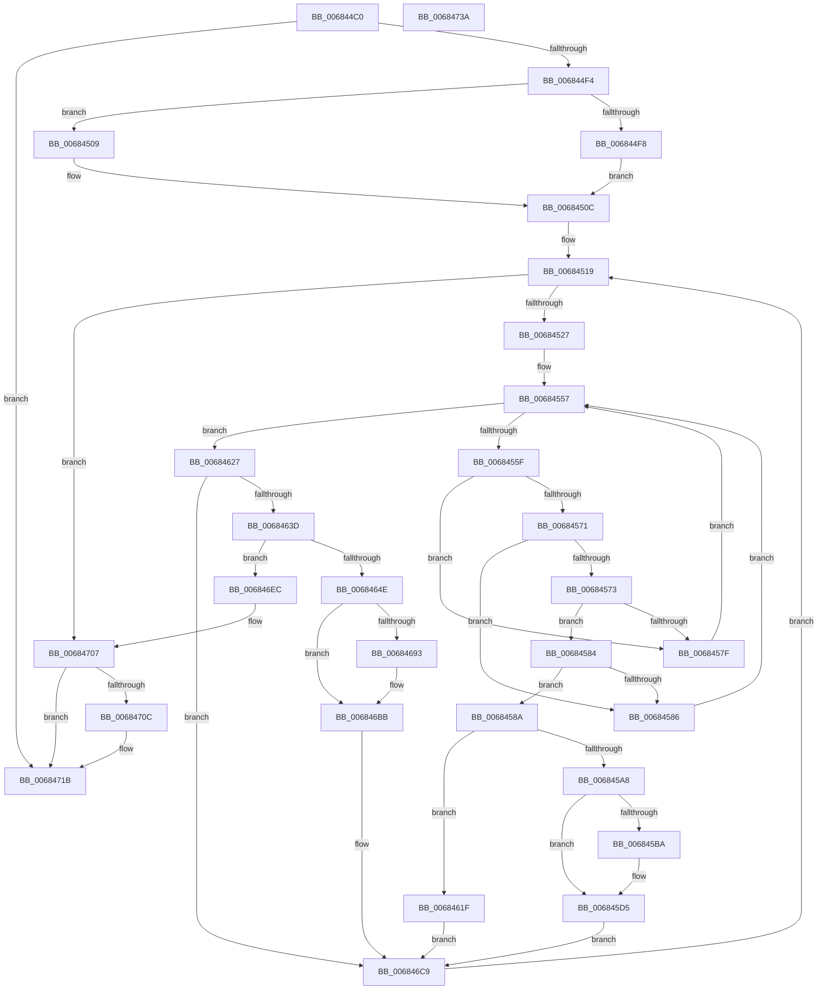

# MiCompactDebuggerPatchTable

- RVA: `0x006844C0`–`0x0068473B` (길이 `635` bytes)
- VA: `0x00000001406844C0`
- 실행 섹션: `.text`
- PDB 이름 있음: `예`; PDB Function 태그: `아니요`
- unwind 정보 RVA: `0x000847EC`
- 디코드: `153`개 명령, `635/635` bytes 표시
- 미해석 바이트: `0` (있으면 어셈블리에 `.byte`로 보존)

> 이 문서는 커널 이미지의 기계어와 PDB 기호를 분석해 생성했습니다. 4번과 5번은 함수 원형과 자료형을 바이너리 사용 방식에서 추정한 C 해석이며 원본 소스 복구 결과는 아닙니다.

## 1. Dependencies

- 직접 호출 지점: **5**; 고유 호출 대상: **4**
- 직접 호출자로 확인된 함수: **3**
- RIP 상대 이미지 참조: **11**

### Outgoing calls
- `0x006844FF` → [ExAcquireSpinLockExclusive](../24/ExAcquireSpinLockExclusive_function_00248690.md) (function, `0x00248690`)
- `0x006845D0` → [memcpy](../6C/memcpy_function_006C6840.md) (function, `0x006C6840`)
- `0x006846B6` → [memcpy](../6C/memcpy_function_006C6840.md) (function, `0x006C6840`)
- `0x00684701` → [KeBugCheckEx](../4F/KeBugCheckEx_function_004FD660.md) (function, `0x004FD660`)
- `0x00684716` → [MiReleaseSpinLockExclusive](../24/MiReleaseSpinLockExclusive_function_002482C0.md) (function, `0x002482C0`)

### Direct callers
- [MiApplyDebuggerPatches](../4F/MiApplyDebuggerPatches_function_004F7BE4.md) at `0x004F7C55`
- [MmDbgMarkPfnModifiedWorker](MmDbgMarkPfnModifiedWorker_function_00686298.md) at `0x00686335`
- [sub_006FBD3C](../6F/Unknown_function_006FBD3C.md) at `0x006FBD4D`

### Static image references
- `0x006844DD` → RVA `0x00E31BE8` (`.data`; read)
- `0x006844E6` → RVA `0x00E31BEC` (`.data`; read)
- `0x006844F8` → RVA `0x00E35BF0` (`.data`; read)
- `0x00684512` → RVA `0x00E2CB40` (`.data`; read)
- `0x0068454B` → RVA `0x00E35BF8` (`.data`; read)
- `0x006845B0` → RVA `0x00E35BF8` (`.data`; write)
- `0x006845E1` → RVA `0x00E35BF4` (`.data`; read)
- `0x006845EC` → RVA `0x00E31BF0` (`.data`; read)
- `0x00684614` → RVA `0x00E35BF4` (`.data`; write)
- `0x006846C3` → RVA `0x00E35BF8` (`.data`; read/write)
- `0x006846E1` → RVA `0x00E31BEC` (`.data`; write)

## 2. Other-region calls and transfers

- 다른 실행 섹션으로 향하는 call: **0**
- 별도 외부 분기/꼬리 이동을 확인하지 못했습니다.

## 3. Assembly (complete function range)

```asm
006844C0  48 8B C4                        mov rax, rsp
006844C3  48 89 58 08                     mov qword ptr [rax + 8], rbx
006844C7  48 89 68 10                     mov qword ptr [rax + 0x10], rbp
006844CB  48 89 70 18                     mov qword ptr [rax + 0x18], rsi
006844CF  48 89 78 20                     mov qword ptr [rax + 0x20], rdi
006844D3  41 54                           push r12
006844D5  41 56                           push r14
006844D7  41 57                           push r15
006844D9  48 83 EC 30                     sub rsp, 0x30
006844DD  8B 15 05 D7 7A 00               mov edx, dword ptr [rip + 0x7ad705]
006844E3  44 8B F1                        mov r14d, ecx
006844E6  8B 05 00 D7 7A 00               mov eax, dword ptr [rip + 0x7ad700]
006844EC  3B D0                           cmp edx, eax
006844EE  0F 84 27 02 00 00               je 0x14068471b
006844F4  85 C9                           test ecx, ecx
006844F6  75 11                           jne 0x140684509
006844F8  48 8D 0D F1 16 7B 00            lea rcx, [rip + 0x7b16f1]
006844FF  E8 8C 41 BC FF                  call 0x140248690
00684504  44 8A F8                        mov r15b, al
00684507  EB 03                           jmp 0x14068450c
00684509  41 B7 11                        mov r15b, 0x11
0068450C  8B 1D DA D6 7A 00               mov ebx, dword ptr [rip + 0x7ad6da]
00684512  4C 8D 25 27 86 7A 00            lea r12, [rip + 0x7a8627]
00684519  8B 05 C9 D6 7A 00               mov eax, dword ptr [rip + 0x7ad6c9]
0068451F  3B D8                           cmp ebx, eax
00684521  0F 84 E0 01 00 00               je 0x140684707
00684527  8B C3                           mov eax, ebx
00684529  48 8D 34 40                     lea rsi, [rax + rax*2]
0068452D  41 83 8C F4 B0 38 00 00 01      or dword ptr [r12 + rsi*8 + 0x38b0], 1
00684536  F0 83 0C 24 00                  lock or dword ptr [rsp], 0
0068453B  45 8B 84 F4 B0 38 00 00         mov r8d, dword ptr [r12 + rsi*8 + 0x38b0]
00684543  4D 8B 94 F4 A8 38 00 00         mov r10, qword ptr [r12 + rsi*8 + 0x38a8]
0068454B  8B 15 A7 16 7B 00               mov edx, dword ptr [rip + 0x7b16a7]
00684551  41 C1 E8 02                     shr r8d, 2
00684555  33 FF                           xor edi, edi
00684557  3B FA                           cmp edi, edx
00684559  0F 83 C8 00 00 00               jae 0x140684627
0068455F  8D 0C 17                        lea ecx, [rdi + rdx]
00684562  D1 E9                           shr ecx, 1
00684564  4D 8B 8C CC B0 80 00 00         mov r9, qword ptr [r12 + rcx*8 + 0x80b0]
0068456C  4D 39 11                        cmp qword ptr [r9], r10
0068456F  72 0E                           jb 0x14068457f
00684571  77 13                           ja 0x140684586
00684573  41 8B 41 08                     mov eax, dword ptr [r9 + 8]
00684577  C1 E8 02                        shr eax, 2
0068457A  41 3B C0                        cmp eax, r8d
0068457D  73 05                           jae 0x140684584
0068457F  8D 79 01                        lea edi, [rcx + 1]
00684582  EB D3                           jmp 0x140684557
00684584  76 04                           jbe 0x14068458a
00684586  8B D1                           mov edx, ecx
00684588  EB CD                           jmp 0x140684557
0068458A  41 8B 84 F4 B8 38 00 00         mov eax, dword ptr [r12 + rsi*8 + 0x38b8]
00684592  8B D1                           mov edx, ecx
00684594  49 8D 8C 24 B0 80 00 00         lea rcx, [r12 + 0x80b0]
0068459C  48 8D 0C D1                     lea rcx, [rcx + rdx*8]
006845A0  48 8B 39                        mov rdi, qword ptr [rcx]
006845A3  39 47 0C                        cmp dword ptr [rdi + 0xc], eax
006845A6  75 77                           jne 0x14068461f
006845A8  8B 05 4A 16 7B 00               mov eax, dword ptr [rip + 0x7b164a]
006845AE  FF C8                           dec eax
006845B0  89 05 42 16 7B 00               mov dword ptr [rip + 0x7b1642], eax
006845B6  3B D0                           cmp edx, eax
006845B8  73 1B                           jae 0x1406845d5
006845BA  2B C2                           sub eax, edx
006845BC  FF C2                           inc edx
006845BE  48 81 C2 16 10 00 00            add rdx, 0x1016
006845C5  44 8B C0                        mov r8d, eax
006845C8  49 C1 E0 03                     shl r8, 3
006845CC  49 8D 14 D4                     lea rdx, [r12 + rdx*8]
006845D0  E8 6B 22 04 00                  call 0x1406c6840
006845D5  8B 4F 08                        mov ecx, dword ptr [rdi + 8]
006845D8  83 C9 01                        or ecx, 1
006845DB  89 4F 08                        mov dword ptr [rdi + 8], ecx
006845DE  83 E1 03                        and ecx, 3
006845E1  8B 05 0D 16 7B 00               mov eax, dword ptr [rip + 0x7b160d]
006845E7  C1 E0 02                        shl eax, 2
006845EA  0B C8                           or ecx, eax
006845EC  48 8D 05 FD D5 7A 00            lea rax, [rip + 0x7ad5fd]
006845F3  89 4F 08                        mov dword ptr [rdi + 8], ecx
006845F6  48 2B F8                        sub rdi, rax
006845F9  48 B8 AB AA AA AA AA AA AA 2A   movabs rax, 0x2aaaaaaaaaaaaaab
00684603  48 F7 EF                        imul rdi
00684606  48 C1 FA 02                     sar rdx, 2
0068460A  48 8B C2                        mov rax, rdx
0068460D  48 C1 E8 3F                     shr rax, 0x3f
00684611  48 03 D0                        add rdx, rax
00684614  89 15 DA 15 7B 00               mov dword ptr [rip + 0x7b15da], edx
0068461A  E9 AA 00 00 00                  jmp 0x1406846c9
0068461F  89 47 10                        mov dword ptr [rdi + 0x10], eax
00684622  E9 A2 00 00 00                  jmp 0x1406846c9
00684627  41 8B 84 F4 B8 38 00 00         mov eax, dword ptr [r12 + rsi*8 + 0x38b8]
0068462F  41 39 84 F4 B4 38 00 00         cmp dword ptr [r12 + rsi*8 + 0x38b4], eax
00684637  0F 84 8C 00 00 00               je 0x1406846c9
0068463D  8B 05 B1 15 7B 00               mov eax, dword ptr [rip + 0x7b15b1]
00684643  3D 00 02 00 00                  cmp eax, 0x200
00684648  0F 84 9E 00 00 00               je 0x1406846ec
0068464E  48 8D A8 0B 05 00 00            lea rbp, [rax + 0x50b]
00684655  48 8D 2C 68                     lea rbp, [rax + rbp*2]
00684659  49 8D 2C EC                     lea rbp, [r12 + rbp*8]
0068465D  8B 45 08                        mov eax, dword ptr [rbp + 8]
00684660  C1 E8 02                        shr eax, 2
00684663  89 05 8B 15 7B 00               mov dword ptr [rip + 0x7b158b], eax
00684669  41 0F 10 84 F4 A8 38 00 00      movups xmm0, xmmword ptr [r12 + rsi*8 + 0x38a8]
00684672  0F 11 45 00                     movups xmmword ptr [rbp], xmm0
00684676  F2 41 0F 10 8C F4 B8 38 00 00   movsd xmm1, qword ptr [r12 + rsi*8 + 0x38b8]
00684680  F2 0F 11 4D 10                  movsd qword ptr [rbp + 0x10], xmm1
00684685  83 65 08 FE                     and dword ptr [rbp + 8], 0xfffffffe
00684689  8B 05 69 15 7B 00               mov eax, dword ptr [rip + 0x7b1569]
0068468F  3B F8                           cmp edi, eax
00684691  73 28                           jae 0x1406846bb
00684693  2B C7                           sub eax, edi
00684695  8D 4F 01                        lea ecx, [rdi + 1]
00684698  44 8B C0                        mov r8d, eax
0068469B  48 8D 89 16 10 00 00            lea rcx, [rcx + 0x1016]
006846A2  8B C7                           mov eax, edi
006846A4  49 8D 0C CC                     lea rcx, [r12 + rcx*8]
006846A8  48 05 16 10 00 00               add rax, 0x1016
006846AE  49 C1 E0 03                     shl r8, 3
006846B2  49 8D 14 C4                     lea rdx, [r12 + rax*8]
006846B6  E8 85 21 04 00                  call 0x1406c6840
006846BB  49 89 AC FC B0 80 00 00         mov qword ptr [r12 + rdi*8 + 0x80b0], rbp
006846C3  FF 05 2F 15 7B 00               inc dword ptr [rip + 0x7b152f]
006846C9  49 83 A4 F4 A8 38 00 00 00      and qword ptr [r12 + rsi*8 + 0x38a8], 0
006846D2  8D 4B 01                        lea ecx, [rbx + 1]
006846D5  8B C3                           mov eax, ebx
006846D7  33 DB                           xor ebx, ebx
006846D9  3D FF 00 00 00                  cmp eax, 0xff
006846DE  0F 45 D9                        cmovne ebx, ecx
006846E1  89 1D 05 D5 7A 00               mov dword ptr [rip + 0x7ad505], ebx
006846E7  E9 2D FE FF FF                  jmp 0x140684519
006846EC  48 83 64 24 20 00               and qword ptr [rsp + 0x20], 0
006846F2  45 33 C9                        xor r9d, r9d
006846F5  45 33 C0                        xor r8d, r8d
006846F8  BA 0A 32 02 00                  mov edx, 0x2320a
006846FD  41 8D 49 1A                     lea ecx, [r9 + 0x1a]
00684701  E8 5A 8F E7 FF                  call 0x1404fd660
00684706  CC                              int3
00684707  45 85 F6                        test r14d, r14d
0068470A  75 0F                           jne 0x14068471b
0068470C  41 8A D7                        mov dl, r15b
0068470F  48 8D 0D DA 14 7B 00            lea rcx, [rip + 0x7b14da]
00684716  E8 A5 3B BC FF                  call 0x1402482c0
0068471B  48 8B 5C 24 50                  mov rbx, qword ptr [rsp + 0x50]
00684720  48 8B 6C 24 58                  mov rbp, qword ptr [rsp + 0x58]
00684725  48 8B 74 24 60                  mov rsi, qword ptr [rsp + 0x60]
0068472A  48 8B 7C 24 68                  mov rdi, qword ptr [rsp + 0x68]
0068472F  48 83 C4 30                     add rsp, 0x30
00684733  41 5F                           pop r15
00684735  41 5E                           pop r14
00684737  41 5C                           pop r12
00684739  C3                              ret
0068473A  CC                              int3
```

## 4. C-style interpretation (structured pseudocode)

```c
__int64 __fastcall MiCompactDebuggerPatchTable(int a1)
{
    __int64 result;
    __int64 v_rbx;
    __int64 v_rdi;
    __int64 v_rsp;
    unsigned __int64 v_stack_m28;
    unsigned int v_stack_m48;
    unsigned __int64 v_stack_p10;
    unsigned __int64 v_stack_p18;
    unsigned __int64 v_stack_p20;
    unsigned __int64 v_stack_p8;

    *(unsigned __int64 *)(v_rsp + 8) = v_rbx;
    *(unsigned __int64 *)(v_rsp + 16) = v_rbp;
    *(unsigned __int64 *)(v_rsp + 24) = v_rsi;
    *(unsigned __int64 *)(v_rsp + 32) = v_rdi;
    v_rsp = (v_rsp) - (48);
    if (((unsigned int)((unsigned int)(*(unsigned int *)(v_rip + 8050437)))) == ((unsigned int)((unsigned int)(*(unsigned int *)(v_rip + 8050432))))) goto loc_0068471B;
    if (a1 != 0) goto loc_00684509;
    result = ExAcquireSpinLockExclusive(v_rip + 8066801, (unsigned int)(*(unsigned int *)(v_rip + 8050437)), a3, a4);
    goto loc_0068450C;
loc_00684509:
loc_0068450C:
loc_00684519:
    if (((unsigned int)((unsigned int)(*(unsigned int *)(v_rip + 8050394)))) == ((unsigned int)((unsigned int)(*(unsigned int *)(v_rip + 8050377))))) goto loc_00684707;
    a3 = (unsigned int)(((unsigned int)(*(unsigned int *)(v_rip + 8029735 + (unsigned int)((unsigned int)((unsigned int)(*(unsigned int *)(v_rip + 8050394)))) + (unsigned int)((unsigned int)((unsigned int)(*(unsigned int *)(v_rip + 8050394)))) * 2 * 8 + 14512))) >> (2));
    v_rdi = 0;
loc_00684557:
    if (0 >= ((unsigned int)((unsigned int)(*(unsigned int *)(v_rip + 8066727))))) goto loc_00684627;
    a1 = (unsigned int)((v_rdi + (unsigned int)(*(unsigned int *)(v_rip + 8066727)) * 1) >> (1));
    if ((*(unsigned __int64 *)(*(unsigned __int64 *)(v_rip + 8029735 + a1 * 8 + 32944))) < (*(unsigned __int64 *)(v_rip + 8029735 + (unsigned int)((unsigned int)((unsigned int)(*(unsigned int *)(v_rip + 8050394)))) + (unsigned int)((unsigned int)((unsigned int)(*(unsigned int *)(v_rip + 8050394)))) * 2 * 8 + 14504))) goto loc_0068457F;
    if ((*(unsigned __int64 *)(*(unsigned __int64 *)(v_rip + 8029735 + a1 * 8 + 32944))) > (*(unsigned __int64 *)(v_rip + 8029735 + (unsigned int)((unsigned int)((unsigned int)(*(unsigned int *)(v_rip + 8050394)))) + (unsigned int)((unsigned int)((unsigned int)(*(unsigned int *)(v_rip + 8050394)))) * 2 * 8 + 14504))) goto loc_00684586;
    result = (unsigned int)(((unsigned int)(*(unsigned int *)(*(unsigned __int64 *)(v_rip + 8029735 + a1 * 8 + 32944) + 8))) >> (2));
    if (((unsigned int)(result)) >= ((unsigned int)(a3))) goto loc_00684584;
loc_0068457F:
    goto loc_00684557;
loc_00684584:
    if (((unsigned int)(result)) <= ((unsigned int)(a3))) goto loc_0068458A;
loc_00684586:
    goto loc_00684557;
loc_0068458A:
    if ((*(unsigned int *)(*(unsigned __int64 *)(v_rip + 8029735 + 32944 + (unsigned int)(a1) * 8) + 12)) != ((unsigned int)((unsigned int)(*(unsigned int *)(v_rip + 8029735 + (unsigned int)((unsigned int)((unsigned int)(*(unsigned int *)(v_rip + 8050394)))) + (unsigned int)((unsigned int)((unsigned int)(*(unsigned int *)(v_rip + 8050394)))) * 2 * 8 + 14520))))) goto loc_0068461F;
    result = (unsigned int)(((unsigned int)(*(unsigned int *)(v_rip + 8066634))) - 1);
    *(unsigned int *)(v_rip + 8066626) = (unsigned int)(result);
    if (((unsigned int)((unsigned int)(a1))) < ((unsigned int)(result))) {
        result = (unsigned int)((result) - ((unsigned int)((unsigned int)(a1))));
        a2 = (unsigned int)(((unsigned int)(a1)) + 1);
        a2 = (a2) + (0x1016ULL);
        a3 = (unsigned int)(result);
        a3 = (a3) << (3);
        a2 = v_rip + 8029735 + a2 * 8;
        result = memcpy(v_rip + 8029735 + 32944 + (unsigned int)(a1) * 8, a2, a3, *(unsigned __int64 *)(v_rip + 8029735 + a1 * 8 + 32944));
    }
    a1 = (unsigned int)(((unsigned int)(*(unsigned int *)(*(unsigned __int64 *)(v_rip + 8029735 + 32944 + (unsigned int)(a1) * 8) + 8))) | (1));
    *(unsigned int *)(*(unsigned __int64 *)(v_rip + 8029735 + 32944 + (unsigned int)(a1) * 8) + 8) = a1;
    a1 = (unsigned int)((a1) & (3));
    result = (unsigned int)(((unsigned int)(*(unsigned int *)(v_rip + 8066573))) << (2));
    a1 = (unsigned int)((a1) | ((unsigned int)(result)));
    *(unsigned int *)(*(unsigned __int64 *)(v_rip + 8029735 + 32944 + (unsigned int)(a1) * 8) + 8) = a1;
    v_rdi = (*(unsigned __int64 *)(v_rip + 8029735 + 32944 + (unsigned int)(a1) * 8)) - (v_rip + 8050173);
    a2 = (a2) >> (2);
    result = (a2) >> (63);
    a2 = (a2) + (result);
    *(unsigned int *)(v_rip + 8066522) = (unsigned int)(a2);
    goto loc_006846C9;
loc_0068461F:
    *(unsigned int *)(v_rdi + 16) = (unsigned int)(result);
    goto loc_006846C9;
loc_00684627:
    if ((*(unsigned int *)(v_rip + 8029735 + (unsigned int)((unsigned int)((unsigned int)(*(unsigned int *)(v_rip + 8050394)))) + (unsigned int)((unsigned int)((unsigned int)(*(unsigned int *)(v_rip + 8050394)))) * 2 * 8 + 14516)) == ((unsigned int)((unsigned int)(*(unsigned int *)(v_rip + 8029735 + (unsigned int)((unsigned int)((unsigned int)(*(unsigned int *)(v_rip + 8050394)))) + (unsigned int)((unsigned int)((unsigned int)(*(unsigned int *)(v_rip + 8050394)))) * 2 * 8 + 14520))))) goto loc_006846C9;
    if (((unsigned int)((unsigned int)(*(unsigned int *)(v_rip + 8066481)))) == 512) goto loc_006846EC;
    result = (unsigned int)(((unsigned int)(*(unsigned int *)(v_rip + 8029735 + (unsigned int)(*(unsigned int *)(v_rip + 8066481)) + (unsigned int)(*(unsigned int *)(v_rip + 8066481)) + 1291 * 2 * 8 + 8))) >> (2));
    *(unsigned int *)(v_rip + 8066443) = (unsigned int)(result);
    *(unsigned __int64 *)(v_rip + 8029735 + (unsigned int)(*(unsigned int *)(v_rip + 8066481)) + (unsigned int)(*(unsigned int *)(v_rip + 8066481)) + 1291 * 2 * 8) = v_xmm0;
    *(unsigned __int64 *)(v_rip + 8029735 + (unsigned int)(*(unsigned int *)(v_rip + 8066481)) + (unsigned int)(*(unsigned int *)(v_rip + 8066481)) + 1291 * 2 * 8 + 16) = v_xmm1;
    result = (unsigned int)(*(unsigned int *)(v_rip + 8066409));
    if (((unsigned int)(v_rdi)) < ((unsigned int)((unsigned int)(*(unsigned int *)(v_rip + 8066409))))) {
        result = (unsigned int)(((unsigned int)(*(unsigned int *)(v_rip + 8066409))) - ((unsigned int)(v_rdi)));
        a1 = v_rdi + 1;
        a3 = (unsigned int)(result);
        a1 = a1 + 4118;
        result = (unsigned int)(v_rdi);
        a1 = v_rip + 8029735 + a1 * 8;
        result = (result) + (0x1016ULL);
        a3 = (a3) << (3);
        a2 = v_rip + 8029735 + result * 8;
        result = memcpy(a1, a2, a3, *(unsigned __int64 *)(v_rip + 8029735 + a1 * 8 + 32944));
    }
    *(unsigned __int64 *)(v_rip + 8029735 + v_rdi * 8 + 32944) = v_rip + 8029735 + (unsigned int)(*(unsigned int *)(v_rip + 8066481)) + (unsigned int)(*(unsigned int *)(v_rip + 8066481)) + 1291 * 2 * 8;
loc_006846C9:
    v_rbx = 0;
    if (((unsigned int)((unsigned int)((unsigned int)((unsigned int)(*(unsigned int *)(v_rip + 8050394)))))) != 255) { v_rbx = (unsigned int)((unsigned int)(*(unsigned int *)(v_rip + 8050394)) + 1); }
    *(unsigned int *)(v_rip + 8049925) = (unsigned int)(v_rbx);
    goto loc_00684519;
loc_006846EC:
    a4 = 0;
    a3 = 0;
    result = KeBugCheckEx(a4 + 26, (unsigned int)(0x2320AULL), a3, a4);
loc_00684707:
    if ((unsigned int)((unsigned int)(a1)) == 0) {
        a2 = 17;
        a1 = v_rip + 8066266;
        result = MiReleaseSpinLockExclusive(a1, a2, a3, a4);
    }
    v_rsp = (v_rsp) + (48);
    return result;
}
```

## 5. (Beta) C Style

```c
int64_t MiCompactDebuggerPatchTable(int32_t Arg1)
{
    int64_t result;
    int64_t local_rbx;
    int64_t local_rdi;
    int64_t local_rsp;
    uint64_t v_stack_m28;
    uint32_t v_stack_m48;
    uint64_t v_stack_p10;
    uint64_t v_stack_p18;
    uint64_t v_stack_p20;
    uint64_t v_stack_p8;

    *(uint64_t *)(local_rsp + 0x8) = local_rbx;
    *(uint64_t *)(local_rsp + 0x10) = local_rbp;
    *(uint64_t *)(local_rsp + 0x18) = local_rsi;
    *(uint64_t *)(local_rsp + 0x20) = local_rdi;
    local_rsp = (local_rsp) - (48);
    if (((uint32_t)((uint32_t)(*(uint32_t *)(v_rip + 0x7AD705)))) == ((uint32_t)((uint32_t)(*(uint32_t *)(v_rip + 0x7AD700))))) goto loc_0068471B;
    if (Arg1 != 0) goto loc_00684509;
    result = ExAcquireSpinLockExclusive(v_rip + 8066801, (uint32_t)(*(uint32_t *)(v_rip + 0x7AD705)), a3, a4);
    goto loc_0068450C;
loc_00684509:
loc_0068450C:
loc_00684519:
    if (((uint32_t)((uint32_t)(*(uint32_t *)(v_rip + 0x7AD6DA)))) == ((uint32_t)((uint32_t)(*(uint32_t *)(v_rip + 0x7AD6C9))))) goto loc_00684707;
    a3 = (uint32_t)(((uint32_t)(*(uint32_t *)(v_rip + 0x7A8627 + (uint32_t)((uint32_t)((uint32_t)(*(uint32_t *)(v_rip + 0x7AD6DA)))) + (uint32_t)((uint32_t)((uint32_t)(*(uint32_t *)(v_rip + 0x7AD6DA)))) * 2 * 8 + 0x38B0))) >> (2));
    local_rdi = 0;
loc_00684557:
    if (0 >= ((uint32_t)((uint32_t)(*(uint32_t *)(v_rip + 0x7B16A7))))) goto loc_00684627;
    Arg1 = (uint32_t)((local_rdi + (uint32_t)(*(uint32_t *)(v_rip + 0x7B16A7)) * 1) >> (1));
    if ((*(uint64_t *)(*(uint64_t *)(v_rip + 0x7A8627 + Arg1 * 8 + 0x80B0))) < (*(uint64_t *)(v_rip + 0x7A8627 + (uint32_t)((uint32_t)((uint32_t)(*(uint32_t *)(v_rip + 0x7AD6DA)))) + (uint32_t)((uint32_t)((uint32_t)(*(uint32_t *)(v_rip + 0x7AD6DA)))) * 2 * 8 + 0x38A8))) goto loc_0068457F;
    if ((*(uint64_t *)(*(uint64_t *)(v_rip + 0x7A8627 + Arg1 * 8 + 0x80B0))) > (*(uint64_t *)(v_rip + 0x7A8627 + (uint32_t)((uint32_t)((uint32_t)(*(uint32_t *)(v_rip + 0x7AD6DA)))) + (uint32_t)((uint32_t)((uint32_t)(*(uint32_t *)(v_rip + 0x7AD6DA)))) * 2 * 8 + 0x38A8))) goto loc_00684586;
    result = (uint32_t)(((uint32_t)(*(uint32_t *)(*(uint64_t *)(v_rip + 0x7A8627 + Arg1 * 8 + 0x80B0) + 0x8))) >> (2));
    if (((uint32_t)(result)) >= ((uint32_t)(a3))) goto loc_00684584;
loc_0068457F:
    goto loc_00684557;
loc_00684584:
    if (((uint32_t)(result)) <= ((uint32_t)(a3))) goto loc_0068458A;
loc_00684586:
    goto loc_00684557;
loc_0068458A:
    if ((*(uint32_t *)(*(uint64_t *)(v_rip + 0x7A8627 + 0x80B0 + (uint32_t)(Arg1) * 8) + 0xC)) != ((uint32_t)((uint32_t)(*(uint32_t *)(v_rip + 0x7A8627 + (uint32_t)((uint32_t)((uint32_t)(*(uint32_t *)(v_rip + 0x7AD6DA)))) + (uint32_t)((uint32_t)((uint32_t)(*(uint32_t *)(v_rip + 0x7AD6DA)))) * 2 * 8 + 0x38B8))))) goto loc_0068461F;
    result = (uint32_t)(((uint32_t)(*(uint32_t *)(v_rip + 0x7B164A))) - 1);
    *(uint32_t *)(v_rip + 0x7B1642) = (uint32_t)(result);
    if (((uint32_t)((uint32_t)(Arg1))) < ((uint32_t)(result))) {
        result = (uint32_t)((result) - ((uint32_t)((uint32_t)(Arg1))));
        a2 = (uint32_t)(((uint32_t)(Arg1)) + 1);
        a2 = (a2) + (0x1016ULL);
        a3 = (uint32_t)(result);
        a3 = (a3) << (3);
        a2 = v_rip + 8029735 + a2 * 8;
        result = memcpy(v_rip + 8029735 + 32944 + (uint32_t)(Arg1) * 8, a2, a3, *(uint64_t *)(v_rip + 0x7A8627 + Arg1 * 8 + 0x80B0));
    }
    Arg1 = (uint32_t)(((uint32_t)(*(uint32_t *)(*(uint64_t *)(v_rip + 0x7A8627 + 0x80B0 + (uint32_t)(Arg1) * 8) + 0x8))) | (1));
    *(uint32_t *)(*(uint64_t *)(v_rip + 0x7A8627 + 0x80B0 + (uint32_t)(Arg1) * 8) + 0x8) = Arg1;
    Arg1 = (uint32_t)((Arg1) & (3));
    result = (uint32_t)(((uint32_t)(*(uint32_t *)(v_rip + 0x7B160D))) << (2));
    Arg1 = (uint32_t)((Arg1) | ((uint32_t)(result)));
    *(uint32_t *)(*(uint64_t *)(v_rip + 0x7A8627 + 0x80B0 + (uint32_t)(Arg1) * 8) + 0x8) = Arg1;
    local_rdi = (*(uint64_t *)(v_rip + 0x7A8627 + 0x80B0 + (uint32_t)(Arg1) * 8)) - (v_rip + 8050173);
    a2 = (a2) >> (2);
    result = (a2) >> (63);
    a2 = (a2) + (result);
    *(uint32_t *)(v_rip + 0x7B15DA) = (uint32_t)(a2);
    goto loc_006846C9;
loc_0068461F:
    *(uint32_t *)(local_rdi + 0x10) = (uint32_t)(result);
    goto loc_006846C9;
loc_00684627:
    if ((*(uint32_t *)(v_rip + 0x7A8627 + (uint32_t)((uint32_t)((uint32_t)(*(uint32_t *)(v_rip + 0x7AD6DA)))) + (uint32_t)((uint32_t)((uint32_t)(*(uint32_t *)(v_rip + 0x7AD6DA)))) * 2 * 8 + 0x38B4)) == ((uint32_t)((uint32_t)(*(uint32_t *)(v_rip + 0x7A8627 + (uint32_t)((uint32_t)((uint32_t)(*(uint32_t *)(v_rip + 0x7AD6DA)))) + (uint32_t)((uint32_t)((uint32_t)(*(uint32_t *)(v_rip + 0x7AD6DA)))) * 2 * 8 + 0x38B8))))) goto loc_006846C9;
    if (((uint32_t)((uint32_t)(*(uint32_t *)(v_rip + 0x7B15B1)))) == 512) goto loc_006846EC;
    result = (uint32_t)(((uint32_t)(*(uint32_t *)(v_rip + 0x7A8627 + (uint32_t)(*(uint32_t *)(v_rip + 0x7B15B1)) + (uint32_t)(*(uint32_t *)(v_rip + 0x7B15B1)) + 0x50B * 2 * 8 + 0x8))) >> (2));
    *(uint32_t *)(v_rip + 0x7B158B) = (uint32_t)(result);
    *(uint64_t *)(v_rip + 0x7A8627 + (uint32_t)(*(uint32_t *)(v_rip + 0x7B15B1)) + (uint32_t)(*(uint32_t *)(v_rip + 0x7B15B1)) + 0x50B * 2 * 8) = v_xmm0;
    *(uint64_t *)(v_rip + 0x7A8627 + (uint32_t)(*(uint32_t *)(v_rip + 0x7B15B1)) + (uint32_t)(*(uint32_t *)(v_rip + 0x7B15B1)) + 0x50B * 2 * 8 + 0x10) = v_xmm1;
    result = (uint32_t)(*(uint32_t *)(v_rip + 0x7B1569));
    if (((uint32_t)(local_rdi)) < ((uint32_t)((uint32_t)(*(uint32_t *)(v_rip + 0x7B1569))))) {
        result = (uint32_t)(((uint32_t)(*(uint32_t *)(v_rip + 0x7B1569))) - ((uint32_t)(local_rdi)));
        Arg1 = local_rdi + 1;
        a3 = (uint32_t)(result);
        Arg1 = Arg1 + 4118;
        result = (uint32_t)(local_rdi);
        Arg1 = v_rip + 8029735 + Arg1 * 8;
        result = (result) + (0x1016ULL);
        a3 = (a3) << (3);
        a2 = v_rip + 8029735 + result * 8;
        result = memcpy(Arg1, a2, a3, *(uint64_t *)(v_rip + 0x7A8627 + Arg1 * 8 + 0x80B0));
    }
    *(uint64_t *)(v_rip + 0x7A8627 + local_rdi * 8 + 0x80B0) = v_rip + 8029735 + (uint32_t)(*(uint32_t *)(v_rip + 0x7B15B1)) + (uint32_t)(*(uint32_t *)(v_rip + 0x7B15B1)) + 1291 * 2 * 8;
loc_006846C9:
    local_rbx = 0;
    if (((uint32_t)((uint32_t)((uint32_t)((uint32_t)(*(uint32_t *)(v_rip + 0x7AD6DA)))))) != 255) { local_rbx = (uint32_t)((uint32_t)(*(uint32_t *)(v_rip + 0x7AD6DA)) + 1); }
    *(uint32_t *)(v_rip + 0x7AD505) = (uint32_t)(local_rbx);
    goto loc_00684519;
loc_006846EC:
    a4 = 0;
    a3 = 0;
    result = KeBugCheckEx(a4 + 26, (uint32_t)(0x2320AULL), a3, a4);
loc_00684707:
    if ((uint32_t)((uint32_t)(Arg1)) == 0) {
        a2 = 17;
        Arg1 = v_rip + 8066266;
        result = MiReleaseSpinLockExclusive(Arg1, a2, a3, a4);
    }
    local_rsp = (local_rsp) + (48);
    return result;
}
```

## 6. Execution-region graph

[열기: 2D/3D 그래프와 함수 탐색 컨트롤 패널](../../../control-panel.html?section=text&rva=0x006844C0&view=graph)

- 2D 그래프는 위에서 아래로 흐르고, 3D 그래프는 빈 공간을 드래그해 회전합니다. Shift+드래그는 이동, 휠은 확대·축소, 함수 노드 선택은 대상 보고서 이동입니다.

### Static fallback


