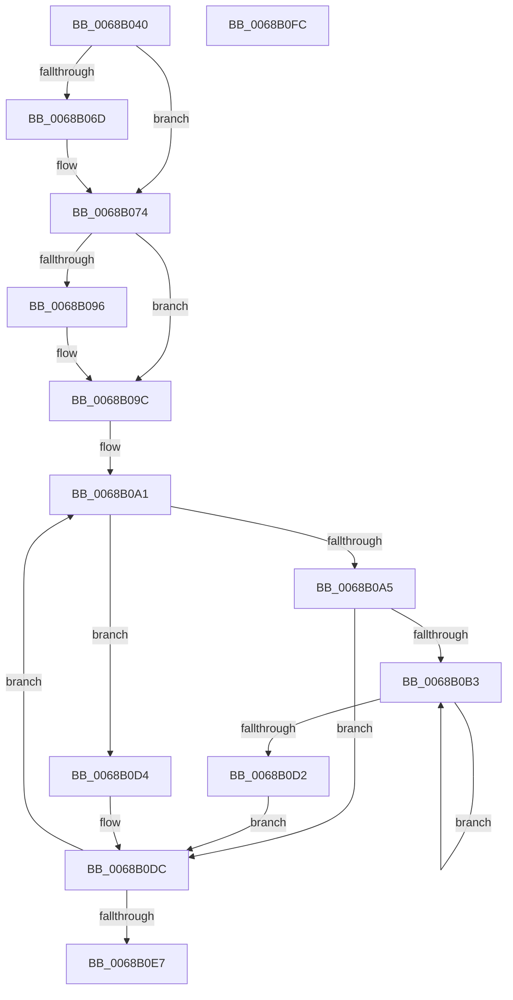

# MiConvertWorkingSetLockExclusiveToShared

- RVA: `0x0068B040`–`0x0068B0FD` (길이 `189` bytes)
- VA: `0x000000014068B040`
- 실행 섹션: `.text`
- PDB 이름 있음: `예`; PDB Function 태그: `아니요`
- unwind 정보 RVA: `0x0005C954`
- 디코드: `51`개 명령, `189/189` bytes 표시
- 미해석 바이트: `0` (있으면 어셈블리에 `.byte`로 보존)

> 이 문서는 커널 이미지의 기계어와 PDB 기호를 분석해 생성했습니다. 4번과 5번은 함수 원형과 자료형을 바이너리 사용 방식에서 추정한 C 해석이며 원본 소스 복구 결과는 아닙니다.

## 1. Dependencies

- 직접 호출 지점: **1**; 고유 호출 대상: **1**
- 직접 호출자로 확인된 함수: **1**
- RIP 상대 이미지 참조: **1**

### Outgoing calls
- `0x0068B0D7` → [ExReleaseSpinLockExclusiveFromDpcLevel](../24/ExReleaseSpinLockExclusiveFromDpcLevel_function_002497E0.md) (function, `0x002497E0`)

### Direct callers
- [MiInsertLargeVadMapping](../3F/MiInsertLargeVadMapping_function_003F0498.md) at `0x003F05D7`

### Static image references
- `0x0068B05A` → RVA `0x00E38840` (`.data`; read)

## 2. Other-region calls and transfers

- 다른 실행 섹션으로 향하는 call: **0**
- 별도 외부 분기/꼬리 이동을 확인하지 못했습니다.

## 3. Assembly (complete function range)

```asm
0068B040  48 89 5C 24 08                  mov qword ptr [rsp + 8], rbx
0068B045  48 89 6C 24 10                  mov qword ptr [rsp + 0x10], rbp
0068B04A  48 89 74 24 18                  mov qword ptr [rsp + 0x18], rsi
0068B04F  57                              push rdi
0068B050  48 83 EC 20                     sub rsp, 0x20
0068B054  8B 81 B8 00 00 00               mov eax, dword ptr [rcx + 0xb8]
0068B05A  48 8D 3D DF D7 7A 00            lea rdi, [rip + 0x7ad7df]
0068B061  24 0F                           and al, 0xf
0068B063  BD 01 00 00 00                  mov ebp, 1
0068B068  40 3A C5                        cmp al, bpl
0068B06B  74 07                           je 0x14068b074
0068B06D  48 8D B9 C0 00 00 00            lea rdi, [rcx + 0xc0]
0068B074  65 8B 1C 25 A4 01 00 00         mov ebx, dword ptr gs:[0x1a4]
0068B07C  65 48 8B 04 25 20 00 00 00      mov rax, qword ptr gs:[0x20]
0068B085  D1 EB                           shr ebx, 1
0068B087  83 E3 03                        and ebx, 3
0068B08A  48 8B 88 38 88 00 00            mov rcx, qword ptr [rax + 0x8838]
0068B091  48 85 C9                        test rcx, rcx
0068B094  74 06                           je 0x14068b09c
0068B096  89 99 44 01 00 00               mov dword ptr [rcx + 0x144], ebx
0068B09C  48 8B 3F                        mov rdi, qword ptr [rdi]
0068B09F  33 F6                           xor esi, esi
0068B0A1  3B F3                           cmp esi, ebx
0068B0A3  75 2F                           jne 0x14068b0d4
0068B0A5  44 8B C5                        mov r8d, ebp
0068B0A8  B8 00 00 00 80                  mov eax, 0x80000000
0068B0AD  F0 0F B1 2F                     lock cmpxchg dword ptr [rdi], ebp
0068B0B1  74 29                           je 0x14068b0dc
0068B0B3  41 8B C8                        mov ecx, r8d
0068B0B6  41 0F BA E8 1E                  bts r8d, 0x1e
0068B0BB  0F BA F1 1E                     btr ecx, 0x1e
0068B0BF  0F BA E0 1E                     bt eax, 0x1e
0068B0C3  44 0F 43 C1                     cmovae r8d, ecx
0068B0C7  8B C8                           mov ecx, eax
0068B0C9  F0 44 0F B1 07                  lock cmpxchg dword ptr [rdi], r8d
0068B0CE  3B C1                           cmp eax, ecx
0068B0D0  75 E1                           jne 0x14068b0b3
0068B0D2  EB 08                           jmp 0x14068b0dc
0068B0D4  48 8B CF                        mov rcx, rdi
0068B0D7  E8 04 E7 BB FF                  call 0x1402497e0
0068B0DC  03 F5                           add esi, ebp
0068B0DE  48 83 C7 40                     add rdi, 0x40
0068B0E2  83 FE 04                        cmp esi, 4
0068B0E5  72 BA                           jb 0x14068b0a1
0068B0E7  48 8B 5C 24 30                  mov rbx, qword ptr [rsp + 0x30]
0068B0EC  48 8B 6C 24 38                  mov rbp, qword ptr [rsp + 0x38]
0068B0F1  48 8B 74 24 40                  mov rsi, qword ptr [rsp + 0x40]
0068B0F6  48 83 C4 20                     add rsp, 0x20
0068B0FA  5F                              pop rdi
0068B0FB  C3                              ret
0068B0FC  CC                              int3
```

## 4. C-style interpretation (structured pseudocode)

```c
__int64 __fastcall MiConvertWorkingSetLockExclusiveToShared(__int64 a1)
{
    __int64 result;
    __int64 v_rbx;
    __int64 v_rdi;
    __int64 v_rsi;
    __int64 v_rsp;
    unsigned __int64 v_stack_p10;
    unsigned __int64 v_stack_p18;
    unsigned __int64 v_stack_p8;

    v_stack_p8 = v_rbx;
    v_stack_p10 = v_rbp;
    v_stack_p18 = v_rsi;
    v_rsp = (v_rsp) - (32);
    result = (unsigned __int8)(((unsigned int)(*(unsigned int *)(a1 + 184))) & (15));
    v_rdi = v_rip + 8050655;
    if (((unsigned __int8)(result)) != 1) {
        v_rdi = a1 + 192;
    }
    v_rbx = (unsigned int)(((unsigned int)(*(unsigned int *)(gs_base + (0 + 420)))) >> (1));
    v_rbx = (unsigned int)((v_rbx) & (3));
    if (*(unsigned __int64 *)(*(unsigned __int64 *)(gs_base + (0 + 32)) + 34872) != 0) {
        *(unsigned int *)(*(unsigned __int64 *)(*(unsigned __int64 *)(gs_base + (0 + 32)) + 34872) + 324) = (unsigned int)(v_rbx);
    }
    v_rsi = 0;
loc_0068B0A1:
    if (0 != ((unsigned int)(v_rbx))) goto loc_0068B0D4;
    if (0 == ((unsigned int)(v_rbx))) goto loc_0068B0DC;
loc_0068B0B3:
    a3 = 1;
    if (0 >= ((unsigned int)(v_rbx))) { a3 = 1; }
    if (((unsigned int)((unsigned int)(0x80000000ULL))) != ((unsigned int)((unsigned int)((unsigned int)((unsigned int)(0x80000000ULL)))))) goto loc_0068B0B3;
    goto loc_0068B0DC;
loc_0068B0D4:
    result = ExReleaseSpinLockExclusiveFromDpcLevel(*(unsigned __int64 *)(v_rdi), a2, a3, a4);
loc_0068B0DC:
    v_rsi = (unsigned int)((v_rsi) + (1));
    v_rdi = (*(unsigned __int64 *)(v_rdi)) + (64);
    if (((unsigned int)(v_rsi)) < 4) goto loc_0068B0A1;
    v_rsp = (v_rsp) + (32);
    return result;
}
```

## 5. (Beta) C Style

```c
int64_t MiConvertWorkingSetLockExclusiveToShared(void *Arg1)
{
    uint8_t *arg1 = (uint8_t *)Arg1;

    int64_t result;
    int64_t local_rbx;
    int64_t local_rdi;
    int64_t local_rsi;
    int64_t local_rsp;
    uint64_t v_stack_p10;
    uint64_t v_stack_p18;
    uint64_t v_stack_p8;

    v_stack_p8 = local_rbx;
    v_stack_p10 = local_rbp;
    v_stack_p18 = local_rsi;
    local_rsp = (local_rsp) - (32);
    result = (uint8_t)(((uint32_t)(*(uint32_t *)(arg1 + 0xB8))) & (15));
    local_rdi = v_rip + 8050655;
    if (((uint8_t)(result)) != 1) {
        local_rdi = Arg1 + 192;
    }
    local_rbx = (uint32_t)(((uint32_t)(*(uint32_t *)(gs_base + (0 + 0x1A4)))) >> (1));
    local_rbx = (uint32_t)((local_rbx) & (3));
    if (*(uint64_t *)(*(uint64_t *)(gs_base + (0 + 0x20)) + 0x8838) != 0) {
        *(uint32_t *)(*(uint64_t *)(*(uint64_t *)(gs_base + (0 + 0x20)) + 0x8838) + 0x144) = (uint32_t)(local_rbx);
    }
    local_rsi = 0;
loc_0068B0A1:
    if (0 != ((uint32_t)(local_rbx))) goto loc_0068B0D4;
    if (0 == ((uint32_t)(local_rbx))) goto loc_0068B0DC;
loc_0068B0B3:
    a3 = 1;
    if (0 >= ((uint32_t)(local_rbx))) { a3 = 1; }
    if (((uint32_t)((uint32_t)(0x80000000ULL))) != ((uint32_t)((uint32_t)((uint32_t)((uint32_t)(0x80000000ULL)))))) goto loc_0068B0B3;
    goto loc_0068B0DC;
loc_0068B0D4:
    result = ExReleaseSpinLockExclusiveFromDpcLevel(*(uint64_t *)(local_rdi), a2, a3, a4);
loc_0068B0DC:
    local_rsi = (uint32_t)((local_rsi) + (1));
    local_rdi = (*(uint64_t *)(local_rdi)) + (64);
    if (((uint32_t)(local_rsi)) < 4) goto loc_0068B0A1;
    local_rsp = (local_rsp) + (32);
    return result;
}
```

### 관측된 메모리 오프셋

구조체 형식이 확인되지 않은 접근은 인자 기준의 오프셋으로만 기록했습니다.

| 기준 인자 | 오프셋 표현 | 폭 (bit) | 접근 |
|---|---:|---:|---|
| `Arg1` | `+ 0xB8` | `32` | `R` |
| `Arg1` | `+ 0xC0` | `64` | `R` |

## 6. Execution-region graph

[열기: 2D/3D 그래프와 함수 탐색 컨트롤 패널](../../../control-panel.html?section=text&rva=0x0068B040&view=graph)

- 2D 그래프는 위에서 아래로 흐르고, 3D 그래프는 빈 공간을 드래그해 회전합니다. Shift+드래그는 이동, 휠은 확대·축소, 함수 노드 선택은 대상 보고서 이동입니다.

### Static fallback


