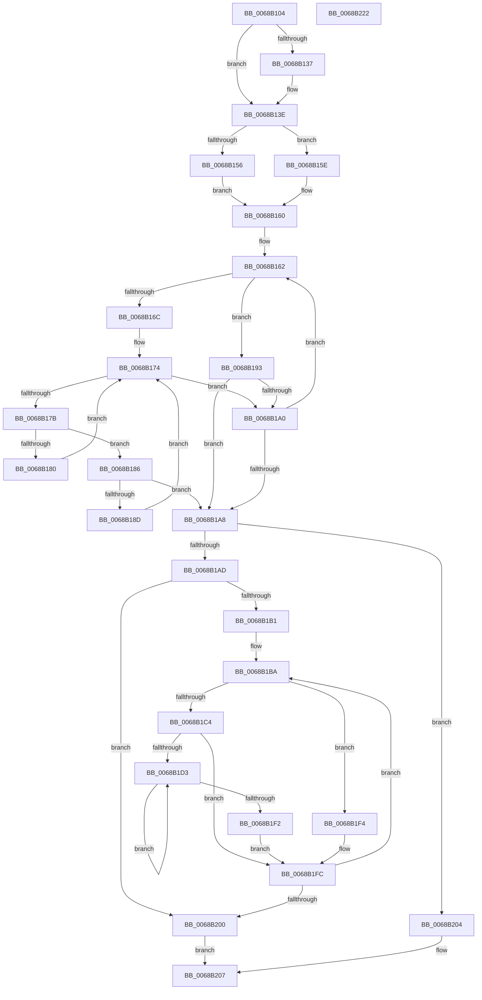

# MiConvertWorkingSetLockSharedToExclusive

- RVA: `0x0068B104`–`0x0068B223` (길이 `287` bytes)
- VA: `0x000000014068B104`
- 실행 섹션: `.text`
- PDB 이름 있음: `예`; PDB Function 태그: `아니요`
- unwind 정보 RVA: `0x0005E6B4`
- 디코드: `86`개 명령, `287/287` bytes 표시
- 미해석 바이트: `0` (있으면 어셈블리에 `.byte`로 보존)

> 이 문서는 커널 이미지의 기계어와 PDB 기호를 분석해 생성했습니다. 4번과 5번은 함수 원형과 자료형을 바이너리 사용 방식에서 추정한 C 해석이며 원본 소스 복구 결과는 아닙니다.

## 1. Dependencies

- 직접 호출 지점: **2**; 고유 호출 대상: **2**
- 직접 호출자로 확인된 함수: **1**
- RIP 상대 이미지 참조: **1**

### Outgoing calls
- `0x0068B197` → [ExTryAcquireSpinLockExclusiveAtDpcLevel](../2B/ExTryAcquireSpinLockExclusiveAtDpcLevel_function_002BB800.md) (function, `0x002BB800`)
- `0x0068B1F7` → [ExReleaseSpinLockExclusiveFromDpcLevel](../24/ExReleaseSpinLockExclusiveFromDpcLevel_function_002497E0.md) (function, `0x002497E0`)

### Direct callers
- [MiInsertLargeVadMapping](../3F/MiInsertLargeVadMapping_function_003F0498.md) at `0x003F0551`

### Static image references
- `0x0068B12E` → RVA `0x00E38840` (`.data`; read)

## 2. Other-region calls and transfers

- 다른 실행 섹션으로 향하는 call: **0**
- 별도 외부 분기/꼬리 이동을 확인하지 못했습니다.

## 3. Assembly (complete function range)

```asm
0068B104  48 8B C4                        mov rax, rsp
0068B107  48 89 58 08                     mov qword ptr [rax + 8], rbx
0068B10B  48 89 68 10                     mov qword ptr [rax + 0x10], rbp
0068B10F  48 89 70 18                     mov qword ptr [rax + 0x18], rsi
0068B113  48 89 78 20                     mov qword ptr [rax + 0x20], rdi
0068B117  41 56                           push r14
0068B119  48 83 EC 20                     sub rsp, 0x20
0068B11D  8B 81 B8 00 00 00               mov eax, dword ptr [rcx + 0xb8]
0068B123  41 BE 01 00 00 00               mov r14d, 1
0068B129  24 0F                           and al, 0xf
0068B12B  41 3A C6                        cmp al, r14b
0068B12E  48 8D 05 0B D7 7A 00            lea rax, [rip + 0x7ad70b]
0068B135  74 07                           je 0x14068b13e
0068B137  48 8D 81 C0 00 00 00            lea rax, [rcx + 0xc0]
0068B13E  48 8B 30                        mov rsi, qword ptr [rax]
0068B141  65 48 8B 04 25 20 00 00 00      mov rax, qword ptr gs:[0x20]
0068B14A  48 8B 88 38 88 00 00            mov rcx, qword ptr [rax + 0x8838]
0068B151  48 85 C9                        test rcx, rcx
0068B154  74 08                           je 0x14068b15e
0068B156  8B A9 44 01 00 00               mov ebp, dword ptr [rcx + 0x144]
0068B15C  EB 02                           jmp 0x14068b160
0068B15E  33 ED                           xor ebp, ebp
0068B160  33 DB                           xor ebx, ebx
0068B162  8B D3                           mov edx, ebx
0068B164  48 C1 E2 06                     shl rdx, 6
0068B168  3B DD                           cmp ebx, ebp
0068B16A  75 27                           jne 0x14068b193
0068B16C  41 8B C6                        mov eax, r14d
0068B16F  B9 00 00 00 80                  mov ecx, 0x80000000
0068B174  F0 0F B1 0C 32                  lock cmpxchg dword ptr [rdx + rsi], ecx
0068B179  74 25                           je 0x14068b1a0
0068B17B  41 3B C6                        cmp eax, r14d
0068B17E  75 06                           jne 0x14068b186
0068B180  0F BA F1 1E                     btr ecx, 0x1e
0068B184  EB EE                           jmp 0x14068b174
0068B186  3D 01 00 00 40                  cmp eax, 0x40000001
0068B18B  75 1B                           jne 0x14068b1a8
0068B18D  0F BA E9 1E                     bts ecx, 0x1e
0068B191  EB E1                           jmp 0x14068b174
0068B193  48 8D 0C 32                     lea rcx, [rdx + rsi]
0068B197  E8 64 06 C3 FF                  call 0x1402bb800
0068B19C  85 C0                           test eax, eax
0068B19E  74 08                           je 0x14068b1a8
0068B1A0  41 03 DE                        add ebx, r14d
0068B1A3  83 FB 04                        cmp ebx, 4
0068B1A6  72 BA                           jb 0x14068b162
0068B1A8  83 FB 04                        cmp ebx, 4
0068B1AB  74 57                           je 0x14068b204
0068B1AD  85 DB                           test ebx, ebx
0068B1AF  74 4F                           je 0x14068b200
0068B1B1  8B FB                           mov edi, ebx
0068B1B3  48 C1 E7 06                     shl rdi, 6
0068B1B7  48 03 FE                        add rdi, rsi
0068B1BA  FF CB                           dec ebx
0068B1BC  48 83 EF 40                     sub rdi, 0x40
0068B1C0  3B DD                           cmp ebx, ebp
0068B1C2  75 30                           jne 0x14068b1f4
0068B1C4  45 8B C6                        mov r8d, r14d
0068B1C7  B8 00 00 00 80                  mov eax, 0x80000000
0068B1CC  F0 44 0F B1 37                  lock cmpxchg dword ptr [rdi], r14d
0068B1D1  74 29                           je 0x14068b1fc
0068B1D3  41 8B C8                        mov ecx, r8d
0068B1D6  41 0F BA E8 1E                  bts r8d, 0x1e
0068B1DB  0F BA F1 1E                     btr ecx, 0x1e
0068B1DF  0F BA E0 1E                     bt eax, 0x1e
0068B1E3  44 0F 43 C1                     cmovae r8d, ecx
0068B1E7  8B C8                           mov ecx, eax
0068B1E9  F0 44 0F B1 07                  lock cmpxchg dword ptr [rdi], r8d
0068B1EE  3B C1                           cmp eax, ecx
0068B1F0  75 E1                           jne 0x14068b1d3
0068B1F2  EB 08                           jmp 0x14068b1fc
0068B1F4  48 8B CF                        mov rcx, rdi
0068B1F7  E8 E4 E5 BB FF                  call 0x1402497e0
0068B1FC  85 DB                           test ebx, ebx
0068B1FE  75 BA                           jne 0x14068b1ba
0068B200  33 C0                           xor eax, eax
0068B202  EB 03                           jmp 0x14068b207
0068B204  41 8B C6                        mov eax, r14d
0068B207  48 8B 5C 24 30                  mov rbx, qword ptr [rsp + 0x30]
0068B20C  48 8B 6C 24 38                  mov rbp, qword ptr [rsp + 0x38]
0068B211  48 8B 74 24 40                  mov rsi, qword ptr [rsp + 0x40]
0068B216  48 8B 7C 24 48                  mov rdi, qword ptr [rsp + 0x48]
0068B21B  48 83 C4 20                     add rsp, 0x20
0068B21F  41 5E                           pop r14
0068B221  C3                              ret
0068B222  CC                              int3
```

## 4. C-style interpretation (structured pseudocode)

```c
__int64 __fastcall MiConvertWorkingSetLockSharedToExclusive(__int64 a1)
{
    __int64 result;
    __int64 v_rbp;
    __int64 v_rbx;
    __int64 v_rdi;
    __int64 v_rsp;
    unsigned __int64 v_stack_p10;
    unsigned __int64 v_stack_p18;
    unsigned __int64 v_stack_p20;
    unsigned __int64 v_stack_p8;

    *(unsigned __int64 *)(v_rsp + 8) = v_rbx;
    *(unsigned __int64 *)(v_rsp + 16) = v_rbp;
    *(unsigned __int64 *)(v_rsp + 24) = v_rsi;
    *(unsigned __int64 *)(v_rsp + 32) = v_rdi;
    v_rsp = (v_rsp) - (32);
    result = (unsigned __int8)(((unsigned int)(*(unsigned int *)(a1 + 184))) & (15));
    result = v_rip + 8050443;
    if (((unsigned __int8)(result)) != 1) {
        result = a1 + 192;
    }
    if (*(unsigned __int64 *)(*(unsigned __int64 *)(gs_base + (0 + 32)) + 34872) == 0) goto loc_0068B15E;
    goto loc_0068B160;
loc_0068B15E:
    v_rbp = 0;
loc_0068B160:
    v_rbx = 0;
loc_0068B162:
    a2 = (0) << (6);
    if (0 != 0) goto loc_0068B193;
loc_0068B174:
    if (0 == 0) goto loc_0068B1A0;
    if (1 != 1) goto loc_0068B186;
    goto loc_0068B174;
loc_0068B186:
    if (1 != 0x40000001ULL) goto loc_0068B1A8;
    goto loc_0068B174;
loc_0068B193:
    result = ExTryAcquireSpinLockExclusiveAtDpcLevel(a2 + *(unsigned __int64 *)(result) * 1, a2, a3, a4);
    if ((unsigned int)(result) == 0) goto loc_0068B1A8;
loc_0068B1A0:
    v_rbx = (unsigned int)((v_rbx) + (1));
    if (((unsigned int)(v_rbx)) < 4) goto loc_0068B162;
loc_0068B1A8:
    if (((unsigned int)(v_rbx)) == 4) goto loc_0068B204;
    if ((unsigned int)(v_rbx) == 0) goto loc_0068B200;
    v_rdi = ((unsigned int)((unsigned int)(v_rbx))) << (6);
    v_rdi = (v_rdi) + (*(unsigned __int64 *)(result));
loc_0068B1BA:
    v_rbx = (unsigned int)((v_rbx) - 1);
    v_rdi = (v_rdi) - (64);
    if (((unsigned int)(v_rbx)) != 0) goto loc_0068B1F4;
    if (((unsigned int)(v_rbx)) == 0) goto loc_0068B1FC;
loc_0068B1D3:
    a3 = 1;
    if (((unsigned int)(v_rbx)) >= 0) { a3 = 1; }
    if (((unsigned int)((unsigned int)(0x80000000ULL))) != ((unsigned int)((unsigned int)((unsigned int)((unsigned int)(0x80000000ULL)))))) goto loc_0068B1D3;
    goto loc_0068B1FC;
loc_0068B1F4:
    result = ExReleaseSpinLockExclusiveFromDpcLevel(v_rdi, a2, a3, a4);
loc_0068B1FC:
    if ((unsigned int)(v_rbx) != 0) goto loc_0068B1BA;
loc_0068B200:
    result = 0;
    goto loc_0068B207;
loc_0068B204:
loc_0068B207:
    v_rsp = (v_rsp) + (32);
    return 1;
}
```

## 5. (Beta) C Style

```c
int64_t MiConvertWorkingSetLockSharedToExclusive(void *Arg1)
{
    uint8_t *arg1 = (uint8_t *)Arg1;

    int64_t result;
    int64_t local_rbp;
    int64_t local_rbx;
    int64_t local_rdi;
    int64_t local_rsp;
    uint64_t v_stack_p10;
    uint64_t v_stack_p18;
    uint64_t v_stack_p20;
    uint64_t v_stack_p8;

    *(uint64_t *)(local_rsp + 0x8) = local_rbx;
    *(uint64_t *)(local_rsp + 0x10) = local_rbp;
    *(uint64_t *)(local_rsp + 0x18) = local_rsi;
    *(uint64_t *)(local_rsp + 0x20) = local_rdi;
    local_rsp = (local_rsp) - (32);
    result = (uint8_t)(((uint32_t)(*(uint32_t *)(arg1 + 0xB8))) & (15));
    result = v_rip + 8050443;
    if (((uint8_t)(result)) != 1) {
        result = Arg1 + 192;
    }
    if (*(uint64_t *)(*(uint64_t *)(gs_base + (0 + 0x20)) + 0x8838) == 0) goto loc_0068B15E;
    goto loc_0068B160;
loc_0068B15E:
    local_rbp = 0;
loc_0068B160:
    local_rbx = 0;
loc_0068B162:
    a2 = (0) << (6);
    if (0 != 0) goto loc_0068B193;
loc_0068B174:
    if (0 == 0) goto loc_0068B1A0;
    if (1 != 1) goto loc_0068B186;
    goto loc_0068B174;
loc_0068B186:
    if (1 != 0x40000001ULL) goto loc_0068B1A8;
    goto loc_0068B174;
loc_0068B193:
    result = ExTryAcquireSpinLockExclusiveAtDpcLevel(a2 + *(uint64_t *)(result) * 1, a2, a3, a4);
    if ((uint32_t)(result) == 0) goto loc_0068B1A8;
loc_0068B1A0:
    local_rbx = (uint32_t)((local_rbx) + (1));
    if (((uint32_t)(local_rbx)) < 4) goto loc_0068B162;
loc_0068B1A8:
    if (((uint32_t)(local_rbx)) == 4) goto loc_0068B204;
    if ((uint32_t)(local_rbx) == 0) goto loc_0068B200;
    local_rdi = ((uint32_t)((uint32_t)(local_rbx))) << (6);
    local_rdi = (local_rdi) + (*(uint64_t *)(result));
loc_0068B1BA:
    local_rbx = (uint32_t)((local_rbx) - 1);
    local_rdi = (local_rdi) - (64);
    if (((uint32_t)(local_rbx)) != 0) goto loc_0068B1F4;
    if (((uint32_t)(local_rbx)) == 0) goto loc_0068B1FC;
loc_0068B1D3:
    a3 = 1;
    if (((uint32_t)(local_rbx)) >= 0) { a3 = 1; }
    if (((uint32_t)((uint32_t)(0x80000000ULL))) != ((uint32_t)((uint32_t)((uint32_t)((uint32_t)(0x80000000ULL)))))) goto loc_0068B1D3;
    goto loc_0068B1FC;
loc_0068B1F4:
    result = ExReleaseSpinLockExclusiveFromDpcLevel(local_rdi, a2, a3, a4);
loc_0068B1FC:
    if ((uint32_t)(local_rbx) != 0) goto loc_0068B1BA;
loc_0068B200:
    result = 0;
    goto loc_0068B207;
loc_0068B204:
loc_0068B207:
    local_rsp = (local_rsp) + (32);
    return 1;
}
```

### 관측된 메모리 오프셋

구조체 형식이 확인되지 않은 접근은 인자 기준의 오프셋으로만 기록했습니다.

| 기준 인자 | 오프셋 표현 | 폭 (bit) | 접근 |
|---|---:|---:|---|
| `Arg1` | `+ 0xB8` | `32` | `R` |
| `Arg1` | `+ 0xC0` | `64` | `R` |

## 6. Execution-region graph

[열기: 2D/3D 그래프와 함수 탐색 컨트롤 패널](../../../control-panel.html?section=text&rva=0x0068B104&view=graph)

- 2D 그래프는 위에서 아래로 흐르고, 3D 그래프는 빈 공간을 드래그해 회전합니다. Shift+드래그는 이동, 휠은 확대·축소, 함수 노드 선택은 대상 보고서 이동입니다.

### Static fallback


