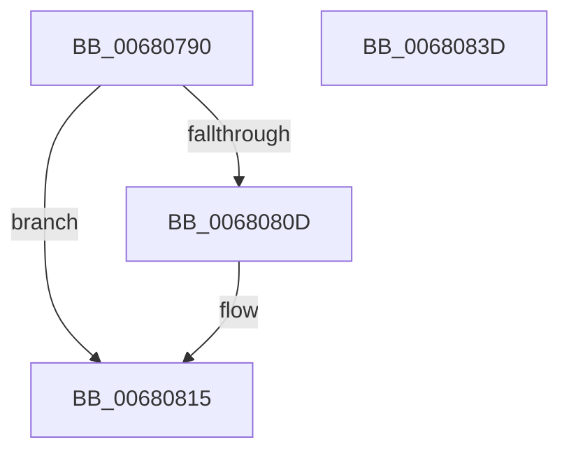

# MiCopyFilePage

- RVA: `0x00680790`–`0x0068083E` (길이 `174` bytes)
- VA: `0x0000000140680790`
- 실행 섹션: `.text`
- PDB 이름 있음: `예`; PDB Function 태그: `아니요`
- unwind 정보 RVA: `0x000718AC`
- 디코드: `46`개 명령, `174/174` bytes 표시
- 미해석 바이트: `0` (있으면 어셈블리에 `.byte`로 보존)

> 이 문서는 커널 이미지의 기계어와 PDB 기호를 분석해 생성했습니다. 4번과 5번은 함수 원형과 자료형을 바이너리 사용 방식에서 추정한 C 해석이며 원본 소스 복구 결과는 아닙니다.

## 1. Dependencies

- 직접 호출 지점: **5**; 고유 호출 대상: **5**
- 직접 호출자로 확인된 함수: **1**
- RIP 상대 이미지 참조: **1**

### Outgoing calls
- `0x006807C0` → [MiGetPteMappingSet](../32/MiGetPteMappingSet_function_00322EB0.md) (function, `0x00322EB0`)
- `0x006807D0` → [MiGetPteFromCopyList](../2B/MiGetPteFromCopyList_function_002B20E0.md) (function, `0x002B20E0`)
- `0x00680804` → [KeCopyPage](../6B/KeCopyPage_function_006BA0F0.md) (function, `0x006BA0F0`)
- `0x00680810` → [MiPersistVa](MiPersistVa_function_00681AB8.md) (function, `0x00681AB8`)
- `0x00680828` → [MiReturnPteMappingSet](../2B/MiReturnPteMappingSet_function_002B2600.md) (function, `0x002B2600`)

### Direct callers
- [MiTransferFileExtent](../4C/MiTransferFileExtent_function_004CAADC.md) at `0x004CABCF`

### Static image references
- `0x00680815` → RVA `0x00010880` (`.rdata`; read)

## 2. Other-region calls and transfers

- 다른 실행 섹션으로 향하는 call: **0**
- 별도 외부 분기/꼬리 이동을 확인하지 못했습니다.

## 3. Assembly (complete function range)

```asm
00680790  4C 8B DC                        mov r11, rsp
00680793  49 89 5B 08                     mov qword ptr [r11 + 8], rbx
00680797  49 89 73 10                     mov qword ptr [r11 + 0x10], rsi
0068079B  57                              push rdi
0068079C  48 83 EC 40                     sub rsp, 0x40
006807A0  33 C0                           xor eax, eax
006807A2  0F 57 C0                        xorps xmm0, xmm0
006807A5  41 8B F0                        mov esi, r8d
006807A8  48 8B DA                        mov rbx, rdx
006807AB  48 8B F9                        mov rdi, rcx
006807AE  4D 8D 43 D8                     lea r8, [r11 - 0x28]
006807B2  0F 11 44 24 20                  movups xmmword ptr [rsp + 0x20], xmm0
006807B7  8D 50 02                        lea edx, [rax + 2]
006807BA  49 89 43 E8                     mov qword ptr [r11 - 0x18], rax
006807BE  33 C9                           xor ecx, ecx
006807C0  E8 EB 26 CA FF                  call 0x140322eb0
006807C5  4C 8B C3                        mov r8, rbx
006807C8  48 8D 4C 24 20                  lea rcx, [rsp + 0x20]
006807CD  48 8B D7                        mov rdx, rdi
006807D0  E8 0B 19 C3 FF                  call 0x1402b20e0
006807D5  48 8B D8                        mov rbx, rax
006807D8  48 8B F8                        mov rdi, rax
006807DB  48 C1 E3 19                     shl rbx, 0x19
006807DF  48 BA 00 00 00 00 80 F6 FF FF   movabs rdx, 0xfffff68000000000
006807E9  48 C1 E2 19                     shl rdx, 0x19
006807ED  41 B8 01 00 00 00               mov r8d, 1
006807F3  48 2B DA                        sub rbx, rdx
006807F6  48 C1 FB 10                     sar rbx, 0x10
006807FA  48 8B CB                        mov rcx, rbx
006807FD  48 8D 93 00 10 00 00            lea rdx, [rbx + 0x1000]
00680804  E8 E7 98 03 00                  call 0x1406ba0f0
00680809  85 F6                           test esi, esi
0068080B  74 08                           je 0x140680815
0068080D  48 8B CB                        mov rcx, rbx
00680810  E8 A3 12 00 00                  call 0x140681ab8
00680815  48 8B 05 64 00 99 FF            mov rax, qword ptr [rip - 0x66ff9c]
0068081C  48 8D 4C 24 20                  lea rcx, [rsp + 0x20]
00680821  48 89 07                        mov qword ptr [rdi], rax
00680824  48 89 47 08                     mov qword ptr [rdi + 8], rax
00680828  E8 D3 1D C3 FF                  call 0x1402b2600
0068082D  48 8B 5C 24 50                  mov rbx, qword ptr [rsp + 0x50]
00680832  48 8B 74 24 58                  mov rsi, qword ptr [rsp + 0x58]
00680837  48 83 C4 40                     add rsp, 0x40
0068083B  5F                              pop rdi
0068083C  C3                              ret
0068083D  CC                              int3
```

## 4. C-style interpretation (structured pseudocode)

```c
__int64 __fastcall MiCopyFilePage(__int64 a1, __int64 a2, int a3)
{
    __int64 result;
    __int64 v_rbx;
    __int64 v_rsp;
    unsigned __int64 v_stack_m28;
    unsigned __int64 v_stack_p10;
    unsigned __int64 v_stack_p8;

    *(unsigned __int64 *)(v_rsp + 8) = v_rbx;
    *(unsigned __int64 *)(v_rsp + 16) = v_rsi;
    v_rsp = (v_rsp) - (64);
    result = 0;
    v_stack_m28 = v_xmm0;
    *(unsigned __int64 *)(v_rsp - 24) = 0;
    a1 = 0;
    result = MiGetPteMappingSet(a1, result + 2, v_rsp - 40, a4);
    result = MiGetPteFromCopyList(v_stack_m28, 0, a2, a4);
    v_rbx = (result) << (25);
    a2 = (0) << (25);
    v_rbx = (v_rbx) - (a2);
    v_rbx = (v_rbx) >> (16);
    result = KeCopyPage(v_rbx, v_rbx + 4096, 1, a4);
    if ((unsigned int)((unsigned int)(a3)) != 0) {
        a1 = v_rbx;
        result = MiPersistVa(a1, v_rbx + 4096, 1, a4);
    }
    *(unsigned __int64 *)(result) = *(unsigned __int64 *)(v_rip - 6750108);
    *(unsigned __int64 *)(result + 8) = *(unsigned __int64 *)(v_rip - 6750108);
    result = MiReturnPteMappingSet(v_stack_m28, v_rbx + 4096, 1, a4);
    v_rsp = (v_rsp) + (64);
    return result;
}
```

## 5. (Beta) C Style

```c
int64_t MiCopyFilePage(int64_t Arg1, int64_t Arg2, int32_t Arg3)
{
    int64_t result;
    int64_t local_rbx;
    int64_t local_rsp;
    uint64_t v_stack_m28;
    uint64_t v_stack_p10;
    uint64_t v_stack_p8;

    *(uint64_t *)(local_rsp + 0x8) = local_rbx;
    *(uint64_t *)(local_rsp + 0x10) = local_rsi;
    local_rsp = (local_rsp) - (64);
    result = 0;
    v_stack_m28 = v_xmm0;
    *(uint64_t *)(local_rsp - 0x18) = 0;
    Arg1 = 0;
    result = MiGetPteMappingSet(Arg1, result + 2, local_rsp - 40, a4);
    result = MiGetPteFromCopyList(v_stack_m28, 0, Arg2, a4);
    local_rbx = (result) << (25);
    Arg2 = (0) << (25);
    local_rbx = (local_rbx) - (Arg2);
    local_rbx = (local_rbx) >> (16);
    result = KeCopyPage(local_rbx, local_rbx + 4096, 1, a4);
    if ((uint32_t)((uint32_t)(Arg3)) != 0) {
        Arg1 = local_rbx;
        result = MiPersistVa(Arg1, local_rbx + 4096, 1, a4);
    }
    *(uint64_t *)(result) = *(uint64_t *)(v_rip - 0x66FF9C);
    *(uint64_t *)(result + 0x8) = *(uint64_t *)(v_rip - 0x66FF9C);
    result = MiReturnPteMappingSet(v_stack_m28, local_rbx + 4096, 1, a4);
    local_rsp = (local_rsp) + (64);
    return result;
}
```

## 6. Execution-region graph

[열기: 2D/3D 그래프와 함수 탐색 컨트롤 패널](../../../control-panel.html?section=text&rva=0x00680790&view=graph)

- 2D 그래프는 위에서 아래로 흐르고, 3D 그래프는 빈 공간을 드래그해 회전합니다. Shift+드래그는 이동, 휠은 확대·축소, 함수 노드 선택은 대상 보고서 이동입니다.

### Static fallback


