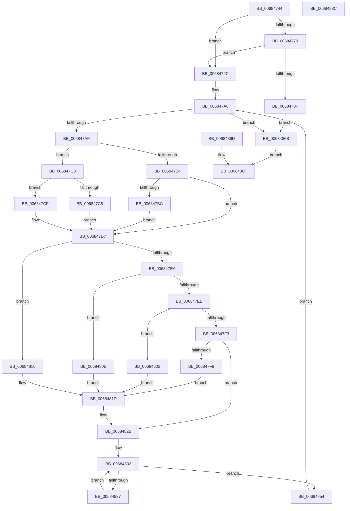

# MiCopyFromUntrustedMemory

- RVA: `0x00684744`–`0x0068488D` (길이 `329` bytes)
- VA: `0x0000000140684744`
- 실행 섹션: `.text`
- PDB 이름 있음: `예`; PDB Function 태그: `아니요`
- unwind 정보 RVA: `0x000D87E0`
- 디코드: `100`개 명령, `329/329` bytes 표시
- 미해석 바이트: `0` (있으면 어셈블리에 `.byte`로 보존)

> 이 문서는 커널 이미지의 기계어와 PDB 기호를 분석해 생성했습니다. 4번과 5번은 함수 원형과 자료형을 바이너리 사용 방식에서 추정한 C 해석이며 원본 소스 복구 결과는 아닙니다.

## 1. Dependencies

- 직접 호출 지점: **2**; 고유 호출 대상: **2**
- 직접 호출자로 확인된 함수: **2**
- RIP 상대 이미지 참조: **1**

### Outgoing calls
- `0x00684792` → [memcpy](../6C/memcpy_function_006C6840.md) (function, `0x006C6840`)
- `0x00684879` → [_security_check_cookie](../6A/_security_check_cookie_function_006AC640.md) (function, `0x006AC640`)

### Direct callers
- [MiDbgCopyMemory](MiDbgCopyMemory_function_00684A18.md) at `0x00684DF5`
- [MiDbgCopyMemoryTarget](MiDbgCopyMemoryTarget_function_00684E70.md) at `0x00684FA9`

### Static image references
- `0x0068474E` → RVA `0x00E0A740` (`.data`; read)

## 2. Other-region calls and transfers

- 다른 실행 섹션으로 향하는 call: **0**
- 별도 외부 분기/꼬리 이동을 확인하지 못했습니다.

## 3. Assembly (complete function range)

```asm
00684744  48 89 5C 24 20                  mov qword ptr [rsp + 0x20], rbx
00684749  57                              push rdi
0068474A  48 83 EC 60                     sub rsp, 0x60
0068474E  48 8B 05 EB 5F 78 00            mov rax, qword ptr [rip + 0x785feb]
00684755  48 33 C4                        xor rax, rsp
00684758  48 89 44 24 50                  mov qword ptr [rsp + 0x50], rax
0068475D  45 8B D0                        mov r10d, r8d
00684760  4C 8B DA                        mov r11, rdx
00684763  48 89 54 24 30                  mov qword ptr [rsp + 0x30], rdx
00684768  44 89 54 24 20                  mov dword ptr [rsp + 0x20], r10d
0068476D  33 DB                           xor ebx, ebx
0068476F  48 89 5C 24 48                  mov qword ptr [rsp + 0x48], rbx
00684774  45 85 C9                        test r9d, r9d
00684777  75 23                           jne 0x14068479c
00684779  8A C2                           mov al, dl
0068477B  0A C1                           or al, cl
0068477D  A8 07                           test al, 7
0068477F  41 0F 94 C0                     sete r8b
00684783  41 F6 C2 07                     test r10b, 7
00684787  0F 94 C0                        sete al
0068478A  44 84 C0                        test al, r8b
0068478D  74 0D                           je 0x14068479c
0068478F  45 8B C2                        mov r8d, r10d
00684792  E8 A9 20 04 00                  call 0x1406c6840
00684797  E9 CF 00 00 00                  jmp 0x14068486b
0068479C  48 89 4C 24 40                  mov qword ptr [rsp + 0x40], rcx
006847A1  BF 01 00 00 00                  mov edi, 1
006847A6  45 85 D2                        test r10d, r10d
006847A9  0F 84 BC 00 00 00               je 0x14068486b
006847AF  45 85 C9                        test r9d, r9d
006847B2  74 0C                           je 0x1406847c0
006847B4  41 8B D1                        mov edx, r9d
006847B7  45 3B CA                        cmp r9d, r10d
006847BA  76 1B                           jbe 0x1406847d7
006847BC  8B D7                           mov edx, edi
006847BE  EB 17                           jmp 0x1406847d7
006847C0  41 8B D2                        mov edx, r10d
006847C3  83 E2 07                        and edx, 7
006847C6  75 07                           jne 0x1406847cf
006847C8  BA 08 00 00 00                  mov edx, 8
006847CD  EB 08                           jmp 0x1406847d7
006847CF  8D 42 FF                        lea eax, [rdx - 1]
006847D2  85 C2                           test edx, eax
006847D4  0F 45 D7                        cmovne edx, edi
006847D7  8D 4A FF                        lea ecx, [rdx - 1]
006847DA  49 85 CB                        test r11, rcx
006847DD  0F 45 D7                        cmovne edx, edi
006847E0  89 54 24 28                     mov dword ptr [rsp + 0x28], edx
006847E4  8B C2                           mov eax, edx
006847E6  2B C7                           sub eax, edi
006847E8  74 2C                           je 0x140684816
006847EA  2B C7                           sub eax, edi
006847EC  74 1D                           je 0x14068480b
006847EE  83 E8 02                        sub eax, 2
006847F1  74 0F                           je 0x140684802
006847F3  83 F8 04                        cmp eax, 4
006847F6  75 33                           jne 0x14068482b
006847F8  49 8B 03                        mov rax, qword ptr [r11]
006847FB  48 89 44 24 48                  mov qword ptr [rsp + 0x48], rax
00684800  EB 1B                           jmp 0x14068481d
00684802  41 8B 03                        mov eax, dword ptr [r11]
00684805  89 44 24 48                     mov dword ptr [rsp + 0x48], eax
00684809  EB 12                           jmp 0x14068481d
0068480B  41 0F B7 03                     movzx eax, word ptr [r11]
0068480F  66 89 44 24 48                  mov word ptr [rsp + 0x48], ax
00684814  EB 07                           jmp 0x14068481d
00684816  41 8A 03                        mov al, byte ptr [r11]
00684819  88 44 24 48                     mov byte ptr [rsp + 0x48], al
0068481D  44 8B 54 24 20                  mov r10d, dword ptr [rsp + 0x20]
00684822  4C 8B 5C 24 30                  mov r11, qword ptr [rsp + 0x30]
00684827  8B 54 24 28                     mov edx, dword ptr [rsp + 0x28]
0068482B  44 8B C3                        mov r8d, ebx
0068482E  89 5C 24 38                     mov dword ptr [rsp + 0x38], ebx
00684832  44 3B C2                        cmp r8d, edx
00684835  73 1D                           jae 0x140684854
00684837  41 8B C0                        mov eax, r8d
0068483A  8A 4C 04 48                     mov cl, byte ptr [rsp + rax + 0x48]
0068483E  48 8B 44 24 40                  mov rax, qword ptr [rsp + 0x40]
00684843  88 08                           mov byte ptr [rax], cl
00684845  48 01 7C 24 40                  add qword ptr [rsp + 0x40], rdi
0068484A  44 03 C7                        add r8d, edi
0068484D  44 89 44 24 38                  mov dword ptr [rsp + 0x38], r8d
00684852  EB DE                           jmp 0x140684832
00684854  44 2B D2                        sub r10d, edx
00684857  44 89 54 24 20                  mov dword ptr [rsp + 0x20], r10d
0068485C  8B C2                           mov eax, edx
0068485E  4C 03 D8                        add r11, rax
00684861  4C 89 5C 24 30                  mov qword ptr [rsp + 0x30], r11
00684866  E9 3B FF FF FF                  jmp 0x1406847a6
0068486B  EB 02                           jmp 0x14068486f
0068486D  8B D8                           mov ebx, eax
0068486F  8B C3                           mov eax, ebx
00684871  48 8B 4C 24 50                  mov rcx, qword ptr [rsp + 0x50]
00684876  48 33 CC                        xor rcx, rsp
00684879  E8 C2 7D 02 00                  call 0x1406ac640
0068487E  48 8B 9C 24 88 00 00 00         mov rbx, qword ptr [rsp + 0x88]
00684886  48 83 C4 60                     add rsp, 0x60
0068488A  5F                              pop rdi
0068488B  C3                              ret
0068488C  CC                              int3
```

## 4. C-style interpretation (structured pseudocode)

```c
__int64 __fastcall MiCopyFromUntrustedMemory(__int64 a1, __int64 a2, int a3, int a4)
{
    __int64 result;
    __int64 v_r10;
    __int64 v_r11;
    __int64 v_rbx;
    __int64 v_rsp;
    unsigned __int64 v_stack_m18;
    unsigned __int64 v_stack_m20;
    unsigned __int64 v_stack_m28;
    unsigned int v_stack_m30;
    unsigned __int64 v_stack_m38;
    unsigned int v_stack_m40;
    unsigned int v_stack_m48;
    unsigned __int64 v_stack_p20;

    v_stack_p20 = v_rbx;
    v_rsp = (v_rsp) - (96);
    result = (*(unsigned __int64 *)(v_rip + 7888875)) ^ (v_rsp);
    v_stack_m18 = result;
    v_stack_m38 = a2;
    v_stack_m48 = (unsigned int)((unsigned int)(a3));
    v_rbx = 0;
    v_stack_m20 = 0;
    if (a4 != 0) goto loc_0068479C;
    result = (unsigned __int8)(((unsigned __int8)(a2)) | ((unsigned __int8)(a1)));
    a3 = ((((unsigned __int8)(result)) & (7)) == 0) ? 1 : 0;
    result = ((((unsigned __int8)((unsigned int)(a3))) & (7)) == 0) ? 1 : 0;
    if ((((unsigned __int8)(result)) & ((unsigned __int8)(a3))) == 0) goto loc_0068479C;
    result = memcpy(a1, a2, (unsigned int)((unsigned int)((unsigned int)(a3))), a4);
    goto loc_0068486B;
loc_0068479C:
    v_stack_m28 = a1;
loc_006847A6:
    if ((unsigned int)((unsigned int)(a3)) == 0) goto loc_0068486B;
    if (a4 == 0) goto loc_006847C0;
    if (a4 <= ((unsigned int)((unsigned int)(a3)))) goto loc_006847D7;
    goto loc_006847D7;
loc_006847C0:
    a2 = (unsigned int)(((unsigned int)((unsigned int)((unsigned int)(a3)))) & (7));
    if (condition_is_not_equal) goto loc_006847CF;
    goto loc_006847D7;
loc_006847CF:
    a2 = 8;
    if (((8) & ((unsigned int)(8 - 1))) != 0) { a2 = 1; }
loc_006847D7:
    if (((a2) & (a2 - 1)) != 0) { a2 = 1; }
    v_stack_m40 = (unsigned int)(a2);
    result = (unsigned int)(((unsigned int)((unsigned int)(a2))) - (1));
    if (condition_is_equal) goto loc_00684816;
    result = (unsigned int)((result) - (1));
    if (condition_is_equal) goto loc_0068480B;
    result = (unsigned int)((result) - (2));
    if (condition_is_equal) goto loc_00684802;
    if (((unsigned int)(result)) != 4) goto loc_0068482B;
    v_stack_m20 = *(unsigned __int64 *)(a2);
    goto loc_0068481D;
loc_00684802:
    v_stack_m20 = (unsigned int)((unsigned int)(*(unsigned int *)(a2)));
    goto loc_0068481D;
loc_0068480B:
    v_stack_m20 = (unsigned __int16)(*(unsigned __int16 *)(a2));
    goto loc_0068481D;
loc_00684816:
    v_stack_m20 = (unsigned __int8)(*(unsigned __int8 *)(a2));
loc_0068481D:
loc_0068482B:
    v_stack_m30 = 0;
loc_00684832:
    if (0 >= ((unsigned int)((unsigned int)(v_stack_m40)))) goto loc_00684854;
    *(unsigned __int8 *)(v_stack_m28) = (unsigned __int8)(*(unsigned __int8 *)(v_rsp + 0 * 1 + 72));
    a3 = (unsigned int)((0) + (1));
    v_stack_m30 = a3;
    goto loc_00684832;
loc_00684854:
    v_r10 = (unsigned int)(((unsigned int)(v_stack_m48)) - ((unsigned int)((unsigned int)(v_stack_m40))));
    v_stack_m48 = (unsigned int)(v_r10);
    v_r11 = (v_stack_m38) + ((unsigned int)((unsigned int)((unsigned int)(v_stack_m40))));
    v_stack_m38 = v_r11;
    goto loc_006847A6;
loc_0068486B:
    goto loc_0068486F;
loc_0068486F:
    a1 = (v_stack_m18) ^ (v_rsp);
    result = _security_check_cookie(a1, (unsigned int)(v_stack_m40), a3, a4);
    v_rsp = (v_rsp) + (96);
    return result;
}
```

## 5. (Beta) C Style

```c
int64_t MiCopyFromUntrustedMemory(int64_t Arg1, int64_t Arg2, int32_t Arg3, int32_t Arg4)
{
    int64_t result;
    int64_t local_r10;
    int64_t local_r11;
    int64_t local_rbx;
    int64_t local_rsp;
    uint64_t v_stack_m18;
    uint64_t v_stack_m20;
    uint64_t v_stack_m28;
    uint32_t v_stack_m30;
    uint64_t v_stack_m38;
    uint32_t v_stack_m40;
    uint32_t v_stack_m48;
    uint64_t v_stack_p20;

    v_stack_p20 = local_rbx;
    local_rsp = (local_rsp) - (96);
    result = (*(uint64_t *)(v_rip + 0x785FEB)) ^ (local_rsp);
    v_stack_m18 = result;
    v_stack_m38 = Arg2;
    v_stack_m48 = (uint32_t)((uint32_t)(Arg3));
    local_rbx = 0;
    v_stack_m20 = 0;
    if (Arg4 != 0) goto loc_0068479C;
    result = (uint8_t)(((uint8_t)(Arg2)) | ((uint8_t)(Arg1)));
    Arg3 = ((((uint8_t)(result)) & (7)) == 0) ? 1 : 0;
    result = ((((uint8_t)((uint32_t)(Arg3))) & (7)) == 0) ? 1 : 0;
    if ((((uint8_t)(result)) & ((uint8_t)(Arg3))) == 0) goto loc_0068479C;
    result = memcpy(Arg1, Arg2, (uint32_t)((uint32_t)((uint32_t)(Arg3))), Arg4);
    goto loc_0068486B;
loc_0068479C:
    v_stack_m28 = Arg1;
loc_006847A6:
    if ((uint32_t)((uint32_t)(Arg3)) == 0) goto loc_0068486B;
    if (Arg4 == 0) goto loc_006847C0;
    if (Arg4 <= ((uint32_t)((uint32_t)(Arg3)))) goto loc_006847D7;
    goto loc_006847D7;
loc_006847C0:
    Arg2 = (uint32_t)(((uint32_t)((uint32_t)((uint32_t)(Arg3)))) & (7));
    if (condition_is_not_equal) goto loc_006847CF;
    goto loc_006847D7;
loc_006847CF:
    Arg2 = 8;
    if (((8) & ((uint32_t)(8 - 1))) != 0) { Arg2 = 1; }
loc_006847D7:
    if (((Arg2) & (Arg2 - 1)) != 0) { Arg2 = 1; }
    v_stack_m40 = (uint32_t)(Arg2);
    result = (uint32_t)(((uint32_t)((uint32_t)(Arg2))) - (1));
    if (condition_is_equal) goto loc_00684816;
    result = (uint32_t)((result) - (1));
    if (condition_is_equal) goto loc_0068480B;
    result = (uint32_t)((result) - (2));
    if (condition_is_equal) goto loc_00684802;
    if (((uint32_t)(result)) != 4) goto loc_0068482B;
    v_stack_m20 = *(uint64_t *)(Arg2);
    goto loc_0068481D;
loc_00684802:
    v_stack_m20 = (uint32_t)((uint32_t)(*(uint32_t *)(Arg2)));
    goto loc_0068481D;
loc_0068480B:
    v_stack_m20 = (uint16_t)(*(uint16_t *)(Arg2));
    goto loc_0068481D;
loc_00684816:
    v_stack_m20 = (uint8_t)(*(uint8_t *)(Arg2));
loc_0068481D:
loc_0068482B:
    v_stack_m30 = 0;
loc_00684832:
    if (0 >= ((uint32_t)((uint32_t)(v_stack_m40)))) goto loc_00684854;
    *(uint8_t *)(v_stack_m28) = (uint8_t)(*(uint8_t *)(local_rsp + 0x0 * 1 + 0x48));
    Arg3 = (uint32_t)((0) + (1));
    v_stack_m30 = Arg3;
    goto loc_00684832;
loc_00684854:
    local_r10 = (uint32_t)(((uint32_t)(v_stack_m48)) - ((uint32_t)((uint32_t)(v_stack_m40))));
    v_stack_m48 = (uint32_t)(local_r10);
    local_r11 = (v_stack_m38) + ((uint32_t)((uint32_t)((uint32_t)(v_stack_m40))));
    v_stack_m38 = local_r11;
    goto loc_006847A6;
loc_0068486B:
    goto loc_0068486F;
loc_0068486F:
    Arg1 = (v_stack_m18) ^ (local_rsp);
    result = _security_check_cookie(Arg1, (uint32_t)(v_stack_m40), Arg3, Arg4);
    local_rsp = (local_rsp) + (96);
    return result;
}
```

## 6. Execution-region graph

[열기: 2D/3D 그래프와 함수 탐색 컨트롤 패널](../../../control-panel.html?section=text&rva=0x00684744&view=graph)

- 2D 그래프는 위에서 아래로 흐르고, 3D 그래프는 빈 공간을 드래그해 회전합니다. Shift+드래그는 이동, 휠은 확대·축소, 함수 노드 선택은 대상 보고서 이동입니다.

### Static fallback


