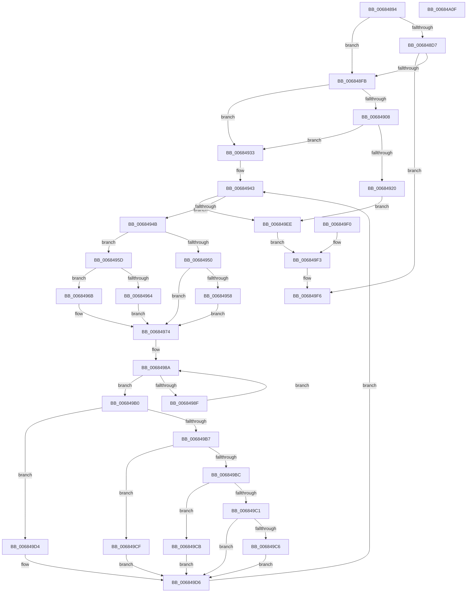

# MiCopyToUntrustedMemory

- RVA: `0x00684894`–`0x00684A10` (길이 `380` bytes)
- VA: `0x0000000140684894`
- 실행 섹션: `.text`
- PDB 이름 있음: `예`; PDB Function 태그: `아니요`
- unwind 정보 RVA: `0x000D87B0`
- 디코드: `116`개 명령, `380/380` bytes 표시
- 미해석 바이트: `0` (있으면 어셈블리에 `.byte`로 보존)

> 이 문서는 커널 이미지의 기계어와 PDB 기호를 분석해 생성했습니다. 4번과 5번은 함수 원형과 자료형을 바이너리 사용 방식에서 추정한 C 해석이며 원본 소스 복구 결과는 아닙니다.

## 1. Dependencies

- 직접 호출 지점: **3**; 고유 호출 대상: **3**
- 직접 호출자로 확인된 함수: **2**
- RIP 상대 이미지 참조: **1**

### Outgoing calls
- `0x006848EB` → [MiDbgCopyPrivilegedData](MiDbgCopyPrivilegedData_function_00685198.md) (function, `0x00685198`)
- `0x00684929` → [memcpy](../6C/memcpy_function_006C6840.md) (function, `0x006C6840`)
- `0x006849FE` → [_security_check_cookie](../6A/_security_check_cookie_function_006AC640.md) (function, `0x006AC640`)

### Direct callers
- [MiDbgCopyMemory](MiDbgCopyMemory_function_00684A18.md) at `0x00684DAC`
- [MiDbgCopyMemoryTarget](MiDbgCopyMemoryTarget_function_00684E70.md) at `0x00684F9D`

### Static image references
- `0x006848A0` → RVA `0x00E0A740` (`.data`; read)

## 2. Other-region calls and transfers

- 다른 실행 섹션으로 향하는 call: **0**
- 별도 외부 분기/꼬리 이동을 확인하지 못했습니다.

## 3. Assembly (complete function range)

```asm
00684894  40 53                           push rbx
00684896  56                              push rsi
00684897  57                              push rdi
00684898  41 56                           push r14
0068489A  41 57                           push r15
0068489C  48 83 EC 60                     sub rsp, 0x60
006848A0  48 8B 05 99 5E 78 00            mov rax, qword ptr [rip + 0x785e99]
006848A7  48 33 C4                        xor rax, rsp
006848AA  48 89 44 24 50                  mov qword ptr [rsp + 0x50], rax
006848AF  4D 8B F9                        mov r15, r9
006848B2  4D 8B D0                        mov r10, r8
006848B5  48 8B C2                        mov rax, rdx
006848B8  48 8B F9                        mov rdi, rcx
006848BB  45 33 F6                        xor r14d, r14d
006848BE  41 8B DE                        mov ebx, r14d
006848C1  48 89 5C 24 48                  mov qword ptr [rsp + 0x48], rbx
006848C6  8B B4 24 B0 00 00 00            mov esi, dword ptr [rsp + 0xb0]
006848CD  83 BC 24 C8 00 00 00 02         cmp dword ptr [rsp + 0xc8], 2
006848D5  75 24                           jne 0x1406848fb
006848D7  44 8B C7                        mov r8d, edi
006848DA  41 81 E0 FF 0F 00 00            and r8d, 0xfff
006848E1  89 74 24 20                     mov dword ptr [rsp + 0x20], esi
006848E5  49 8B D2                        mov rdx, r10
006848E8  48 8B C8                        mov rcx, rax
006848EB  E8 A8 08 00 00                  call 0x140685198
006848F0  3D 16 00 00 C0                  cmp eax, 0xc0000016
006848F5  0F 85 FB 00 00 00               jne 0x1406849f6
006848FB  44 8B 8C 24 B8 00 00 00         mov r9d, dword ptr [rsp + 0xb8]
00684903  45 85 C9                        test r9d, r9d
00684906  75 2B                           jne 0x140684933
00684908  41 8A C7                        mov al, r15b
0068490B  40 0A C7                        or al, dil
0068490E  A8 07                           test al, 7
00684910  41 0F 94 C0                     sete r8b
00684914  40 F6 C6 07                     test sil, 7
00684918  0F 94 C0                        sete al
0068491B  44 84 C0                        test al, r8b
0068491E  74 13                           je 0x140684933
00684920  44 8B C6                        mov r8d, esi
00684923  49 8B D7                        mov rdx, r15
00684926  48 8B CF                        mov rcx, rdi
00684929  E8 12 1F 04 00                  call 0x1406c6840
0068492E  E9 BB 00 00 00                  jmp 0x1406849ee
00684933  4C 89 7C 24 38                  mov qword ptr [rsp + 0x38], r15
00684938  48 89 7C 24 40                  mov qword ptr [rsp + 0x40], rdi
0068493D  41 BA 01 00 00 00               mov r10d, 1
00684943  85 F6                           test esi, esi
00684945  0F 84 A3 00 00 00               je 0x1406849ee
0068494B  45 85 C9                        test r9d, r9d
0068494E  74 0D                           je 0x14068495d
00684950  41 8B D1                        mov edx, r9d
00684953  44 3B CE                        cmp r9d, esi
00684956  76 1C                           jbe 0x140684974
00684958  41 8B D2                        mov edx, r10d
0068495B  EB 17                           jmp 0x140684974
0068495D  8B D6                           mov edx, esi
0068495F  83 E2 07                        and edx, 7
00684962  75 07                           jne 0x14068496b
00684964  BA 08 00 00 00                  mov edx, 8
00684969  EB 09                           jmp 0x140684974
0068496B  8D 42 FF                        lea eax, [rdx - 1]
0068496E  85 C2                           test edx, eax
00684970  41 0F 45 D2                     cmovne edx, r10d
00684974  8D 4A FF                        lea ecx, [rdx - 1]
00684977  48 85 CF                        test rdi, rcx
0068497A  41 0F 45 D2                     cmovne edx, r10d
0068497E  89 54 24 34                     mov dword ptr [rsp + 0x34], edx
00684982  45 8B C6                        mov r8d, r14d
00684985  44 89 74 24 30                  mov dword ptr [rsp + 0x30], r14d
0068498A  44 3B C2                        cmp r8d, edx
0068498D  73 21                           jae 0x1406849b0
0068498F  41 8A 0F                        mov cl, byte ptr [r15]
00684992  41 8B C0                        mov eax, r8d
00684995  88 4C 04 48                     mov byte ptr [rsp + rax + 0x48], cl
00684999  4D 03 FA                        add r15, r10
0068499C  4C 89 7C 24 38                  mov qword ptr [rsp + 0x38], r15
006849A1  45 03 C2                        add r8d, r10d
006849A4  44 89 44 24 30                  mov dword ptr [rsp + 0x30], r8d
006849A9  48 8B 5C 24 48                  mov rbx, qword ptr [rsp + 0x48]
006849AE  EB DA                           jmp 0x14068498a
006849B0  8B C2                           mov eax, edx
006849B2  41 2B C2                        sub eax, r10d
006849B5  74 1D                           je 0x1406849d4
006849B7  41 2B C2                        sub eax, r10d
006849BA  74 13                           je 0x1406849cf
006849BC  83 E8 02                        sub eax, 2
006849BF  74 0A                           je 0x1406849cb
006849C1  83 F8 04                        cmp eax, 4
006849C4  75 10                           jne 0x1406849d6
006849C6  48 89 1F                        mov qword ptr [rdi], rbx
006849C9  EB 0B                           jmp 0x1406849d6
006849CB  89 1F                           mov dword ptr [rdi], ebx
006849CD  EB 07                           jmp 0x1406849d6
006849CF  66 89 1F                        mov word ptr [rdi], bx
006849D2  EB 02                           jmp 0x1406849d6
006849D4  88 1F                           mov byte ptr [rdi], bl
006849D6  2B F2                           sub esi, edx
006849D8  89 B4 24 B0 00 00 00            mov dword ptr [rsp + 0xb0], esi
006849DF  8B C2                           mov eax, edx
006849E1  48 03 F8                        add rdi, rax
006849E4  48 89 7C 24 40                  mov qword ptr [rsp + 0x40], rdi
006849E9  E9 55 FF FF FF                  jmp 0x140684943
006849EE  EB 03                           jmp 0x1406849f3
006849F0  44 8B F0                        mov r14d, eax
006849F3  41 8B C6                        mov eax, r14d
006849F6  48 8B 4C 24 50                  mov rcx, qword ptr [rsp + 0x50]
006849FB  48 33 CC                        xor rcx, rsp
006849FE  E8 3D 7C 02 00                  call 0x1406ac640
00684A03  48 83 C4 60                     add rsp, 0x60
00684A07  41 5F                           pop r15
00684A09  41 5E                           pop r14
00684A0B  5F                              pop rdi
00684A0C  5E                              pop rsi
00684A0D  5B                              pop rbx
00684A0E  C3                              ret
00684A0F  CC                              int3
```

## 4. C-style interpretation (structured pseudocode)

```c
__int64 __fastcall MiCopyToUntrustedMemory(__int64 a1, __int64 a2, __int64 a3, __int64 a4, unsigned int a5, unsigned int a6, __int64 a7, unsigned int a8)
{
    __int64 result;
    __int64 v_r14;
    __int64 v_r15;
    __int64 v_rdi;
    __int64 v_rsi;
    __int64 v_rsp;
    unsigned __int64 v_stack_m38;
    unsigned __int64 v_stack_m40;
    unsigned __int64 v_stack_m48;
    unsigned __int64 v_stack_m50;
    unsigned int v_stack_m54;
    unsigned int v_stack_m58;
    unsigned int v_stack_m68;
    unsigned int v_stack_p28;

    v_rsp = (v_rsp) - (96);
    result = (*(unsigned __int64 *)(v_rip + 7888537)) ^ (v_rsp);
    v_stack_m38 = result;
    v_r14 = 0;
    v_stack_m40 = 0;
    if (a8 != 2) goto loc_006848FB;
    a3 = (unsigned int)(((unsigned int)((unsigned int)(a1))) & (0xFFFULL));
    v_stack_m68 = (unsigned int)((unsigned int)(a5));
    result = MiDbgCopyPrivilegedData(a2, a3, a3, a4);
    if (((unsigned int)(result)) != 0xC0000016ULL) goto loc_006849F6;
loc_006848FB:
    if ((unsigned int)((unsigned int)(a6)) != 0) goto loc_00684933;
    result = (unsigned __int8)(((unsigned __int8)(a4)) | ((unsigned __int8)(a1)));
    a3 = ((((unsigned __int8)(result)) & (7)) == 0) ? 1 : 0;
    result = ((((unsigned __int8)((unsigned int)(a5))) & (7)) == 0) ? 1 : 0;
    if ((((unsigned __int8)(result)) & ((unsigned __int8)(a3))) == 0) goto loc_00684933;
    result = memcpy(a1, a4, (unsigned int)((unsigned int)((unsigned int)(a5))), (unsigned int)(a6));
    goto loc_006849EE;
loc_00684933:
    v_stack_m50 = a4;
    v_stack_m48 = a1;
loc_00684943:
    if ((unsigned int)((unsigned int)(a5)) == 0) goto loc_006849EE;
    if ((unsigned int)((unsigned int)(a6)) == 0) goto loc_0068495D;
    if (((unsigned int)((unsigned int)(a6))) <= ((unsigned int)((unsigned int)(a5)))) goto loc_00684974;
    goto loc_00684974;
loc_0068495D:
    a2 = (unsigned int)(((unsigned int)((unsigned int)((unsigned int)(a5)))) & (7));
    if (condition_is_not_equal) goto loc_0068496B;
    goto loc_00684974;
loc_0068496B:
    a2 = 8;
    if (((8) & ((unsigned int)(8 - 1))) != 0) { a2 = 1; }
loc_00684974:
    if (((a1) & (a2 - 1)) != 0) { a2 = 1; }
    v_stack_m54 = (unsigned int)(a2);
    v_stack_m58 = 0;
loc_0068498A:
    if (0 >= ((unsigned int)(a2))) goto loc_006849B0;
    *(unsigned __int8 *)(v_rsp + 0 * 1 + 72) = (unsigned __int8)(*(unsigned __int8 *)(a4));
    v_r15 = (a4) + (1);
    v_stack_m50 = v_r15;
    a3 = (unsigned int)((0) + (1));
    v_stack_m58 = (unsigned int)(a3);
    goto loc_0068498A;
loc_006849B0:
    result = (unsigned int)(((unsigned int)((unsigned int)(a2))) - (1));
    if (condition_is_equal) goto loc_006849D4;
    result = (unsigned int)((result) - (1));
    if (condition_is_equal) goto loc_006849CF;
    result = (unsigned int)((result) - (2));
    if (condition_is_equal) goto loc_006849CB;
    if (((unsigned int)(result)) != 4) goto loc_006849D6;
    *(unsigned __int64 *)(a1) = v_stack_m40;
    goto loc_006849D6;
loc_006849CB:
    *(unsigned int *)(a1) = (unsigned int)(v_stack_m40);
    goto loc_006849D6;
loc_006849CF:
    *(unsigned __int16 *)(a1) = (unsigned __int16)(v_stack_m40);
    goto loc_006849D6;
loc_006849D4:
    *(unsigned __int8 *)(a1) = (unsigned __int8)(v_stack_m40);
loc_006849D6:
    v_rsi = (unsigned int)(((unsigned int)(a5)) - ((unsigned int)(a2)));
    v_stack_p28 = (unsigned int)(v_rsi);
    v_rdi = (a1) + ((unsigned int)((unsigned int)(a2)));
    v_stack_m48 = v_rdi;
    goto loc_00684943;
loc_006849EE:
    goto loc_006849F3;
loc_006849F3:
loc_006849F6:
    a1 = (v_stack_m38) ^ (v_rsp);
    result = _security_check_cookie(a1, a2, a3, (unsigned int)(a6));
    v_rsp = (v_rsp) + (96);
    return result;
}
```

## 5. (Beta) C Style

```c
int64_t MiCopyToUntrustedMemory(int64_t Arg1, int64_t Arg2, int64_t Arg3, void *Arg4, uint32_t Arg5, uint32_t Arg6, uint64_t Arg7, uint32_t Arg8)
{
    uint8_t *arg4 = (uint8_t *)Arg4;

    int64_t result;
    int64_t local_r14;
    int64_t local_r15;
    int64_t local_rdi;
    int64_t local_rsi;
    int64_t local_rsp;
    uint64_t v_stack_m38;
    uint64_t v_stack_m40;
    uint64_t v_stack_m48;
    uint64_t v_stack_m50;
    uint32_t v_stack_m54;
    uint32_t v_stack_m58;
    uint32_t v_stack_m68;
    uint32_t v_stack_p28;

    local_rsp = (local_rsp) - (96);
    result = (*(uint64_t *)(v_rip + 0x785E99)) ^ (local_rsp);
    v_stack_m38 = result;
    local_r14 = 0;
    v_stack_m40 = 0;
    if (Arg8 != 2) goto loc_006848FB;
    Arg3 = (uint32_t)(((uint32_t)((uint32_t)(Arg1))) & (0xFFFULL));
    v_stack_m68 = (uint32_t)((uint32_t)(Arg5));
    result = MiDbgCopyPrivilegedData(Arg2, Arg3, Arg3, Arg4);
    if (((uint32_t)(result)) != 0xC0000016ULL) goto loc_006849F6;
loc_006848FB:
    if ((uint32_t)((uint32_t)(Arg6)) != 0) goto loc_00684933;
    result = (uint8_t)(((uint8_t)(Arg4)) | ((uint8_t)(Arg1)));
    Arg3 = ((((uint8_t)(result)) & (7)) == 0) ? 1 : 0;
    result = ((((uint8_t)((uint32_t)(Arg5))) & (7)) == 0) ? 1 : 0;
    if ((((uint8_t)(result)) & ((uint8_t)(Arg3))) == 0) goto loc_00684933;
    result = memcpy(Arg1, Arg4, (uint32_t)((uint32_t)((uint32_t)(Arg5))), (uint32_t)(Arg6));
    goto loc_006849EE;
loc_00684933:
    v_stack_m50 = Arg4;
    v_stack_m48 = Arg1;
loc_00684943:
    if ((uint32_t)((uint32_t)(Arg5)) == 0) goto loc_006849EE;
    if ((uint32_t)((uint32_t)(Arg6)) == 0) goto loc_0068495D;
    if (((uint32_t)((uint32_t)(Arg6))) <= ((uint32_t)((uint32_t)(Arg5)))) goto loc_00684974;
    goto loc_00684974;
loc_0068495D:
    Arg2 = (uint32_t)(((uint32_t)((uint32_t)((uint32_t)(Arg5)))) & (7));
    if (condition_is_not_equal) goto loc_0068496B;
    goto loc_00684974;
loc_0068496B:
    Arg2 = 8;
    if (((8) & ((uint32_t)(8 - 1))) != 0) { Arg2 = 1; }
loc_00684974:
    if (((Arg1) & (Arg2 - 1)) != 0) { Arg2 = 1; }
    v_stack_m54 = (uint32_t)(Arg2);
    v_stack_m58 = 0;
loc_0068498A:
    if (0 >= ((uint32_t)(Arg2))) goto loc_006849B0;
    *(uint8_t *)(local_rsp + 0x0 * 1 + 0x48) = (uint8_t)(*(uint8_t *)(arg4));
    local_r15 = (Arg4) + (1);
    v_stack_m50 = local_r15;
    Arg3 = (uint32_t)((0) + (1));
    v_stack_m58 = (uint32_t)(Arg3);
    goto loc_0068498A;
loc_006849B0:
    result = (uint32_t)(((uint32_t)((uint32_t)(Arg2))) - (1));
    if (condition_is_equal) goto loc_006849D4;
    result = (uint32_t)((result) - (1));
    if (condition_is_equal) goto loc_006849CF;
    result = (uint32_t)((result) - (2));
    if (condition_is_equal) goto loc_006849CB;
    if (((uint32_t)(result)) != 4) goto loc_006849D6;
    *(uint64_t *)(Arg1) = v_stack_m40;
    goto loc_006849D6;
loc_006849CB:
    *(uint32_t *)(Arg1) = (uint32_t)(v_stack_m40);
    goto loc_006849D6;
loc_006849CF:
    *(uint16_t *)(Arg1) = (uint16_t)(v_stack_m40);
    goto loc_006849D6;
loc_006849D4:
    *(uint8_t *)(Arg1) = (uint8_t)(v_stack_m40);
loc_006849D6:
    local_rsi = (uint32_t)(((uint32_t)(Arg5)) - ((uint32_t)(Arg2)));
    v_stack_p28 = (uint32_t)(local_rsi);
    local_rdi = (Arg1) + ((uint32_t)((uint32_t)(Arg2)));
    v_stack_m48 = local_rdi;
    goto loc_00684943;
loc_006849EE:
    goto loc_006849F3;
loc_006849F3:
loc_006849F6:
    Arg1 = (v_stack_m38) ^ (local_rsp);
    result = _security_check_cookie(Arg1, Arg2, Arg3, (uint32_t)(Arg6));
    local_rsp = (local_rsp) + (96);
    return result;
}
```

### 관측된 메모리 오프셋

구조체 형식이 확인되지 않은 접근은 인자 기준의 오프셋으로만 기록했습니다.

| 기준 인자 | 오프셋 표현 | 폭 (bit) | 접근 |
|---|---:|---:|---|
| `Arg4` | `+ 0x0` | `8` | `R` |

## 6. Execution-region graph

[열기: 2D/3D 그래프와 함수 탐색 컨트롤 패널](../../../control-panel.html?section=text&rva=0x00684894&view=graph)

- 2D 그래프는 위에서 아래로 흐르고, 3D 그래프는 빈 공간을 드래그해 회전합니다. Shift+드래그는 이동, 휠은 확대·축소, 함수 노드 선택은 대상 보고서 이동입니다.

### Static fallback


