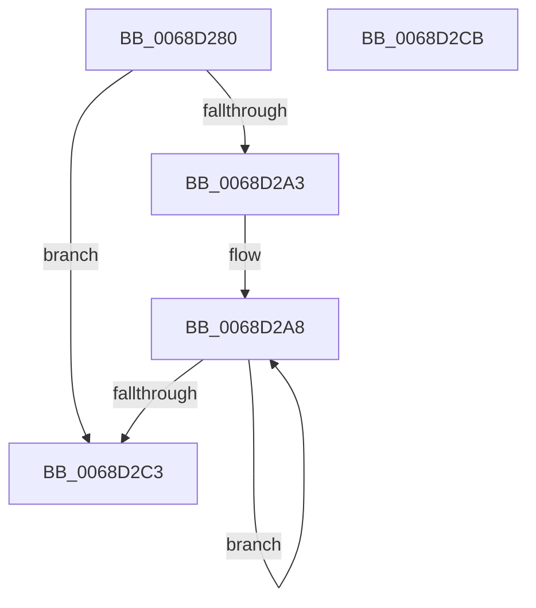

# MiCountSlabContextFreePagesByIdentity

- RVA: `0x0068D280`–`0x0068D2CC` (길이 `76` bytes)
- VA: `0x000000014068D280`
- 실행 섹션: `.text`
- PDB 이름 있음: `예`; PDB Function 태그: `아니요`
- unwind 정보 RVA: `0x00071750`
- 디코드: `23`개 명령, `76/76` bytes 표시
- 미해석 바이트: `0` (있으면 어셈블리에 `.byte`로 보존)

> 이 문서는 커널 이미지의 기계어와 PDB 기호를 분석해 생성했습니다. 4번과 5번은 함수 원형과 자료형을 바이너리 사용 방식에서 추정한 C 해석이며 원본 소스 복구 결과는 아닙니다.

## 1. Dependencies

- 직접 호출 지점: **0**; 고유 호출 대상: **0**
- 직접 호출자로 확인된 함수: **0**
- RIP 상대 이미지 참조: **0**

### Outgoing calls
- 직접 디코드된 call 명령이 없습니다.

### Direct callers
- 이 함수 시작 RVA로 연결되는 직접 call은 확인되지 않았습니다. 간접 호출은 완전히 역산할 수 없습니다.

### Static image references
- 디코드된 RIP-relative 메모리 참조가 없습니다.

## 2. Other-region calls and transfers

- 다른 실행 섹션으로 향하는 call: **0**
- 별도 외부 분기/꼬리 이동을 확인하지 못했습니다.

## 3. Assembly (complete function range)

```asm
0068D280  48 89 5C 24 08                  mov qword ptr [rsp + 8], rbx
0068D285  45 0F B6 50 58                  movzx r10d, byte ptr [r8 + 0x58]
0068D28A  48 8B DA                        mov rbx, rdx
0068D28D  48 8B 4A 58                     mov rcx, qword ptr [rdx + 0x58]
0068D291  45 8B DA                        mov r11d, r10d
0068D294  49 C1 E3 04                     shl r11, 4
0068D298  49 03 CB                        add rcx, r11
0068D29B  4C 8B 09                        mov r9, qword ptr [rcx]
0068D29E  4C 3B C9                        cmp r9, rcx
0068D2A1  74 20                           je 0x14068d2c3
0068D2A3  4B 8B 54 D0 60                  mov rdx, qword ptr [r8 + r10*8 + 0x60]
0068D2A8  41 8B 41 3C                     mov eax, dword ptr [r9 + 0x3c]
0068D2AC  48 03 D0                        add rdx, rax
0068D2AF  4B 89 54 D0 60                  mov qword ptr [r8 + r10*8 + 0x60], rdx
0068D2B4  48 8B 4B 58                     mov rcx, qword ptr [rbx + 0x58]
0068D2B8  4D 8B 09                        mov r9, qword ptr [r9]
0068D2BB  49 03 CB                        add rcx, r11
0068D2BE  4C 3B C9                        cmp r9, rcx
0068D2C1  75 E5                           jne 0x14068d2a8
0068D2C3  48 8B 5C 24 08                  mov rbx, qword ptr [rsp + 8]
0068D2C8  33 C0                           xor eax, eax
0068D2CA  C3                              ret
0068D2CB  CC                              int3
```

## 4. C-style interpretation (structured pseudocode)

```c
__int64 __fastcall MiCountSlabContextFreePagesByIdentity(__int64 a1, __int64 a2, __int64 a3)
{
    __int64 result;
    __int64 v_r11;
    unsigned __int64 v_stack_p8;

    v_stack_p8 = v_rbx;
    v_r11 = ((unsigned int)((unsigned int)(*(unsigned __int8 *)(a3 + 88)))) << (4);
    a1 = (*(unsigned __int64 *)(a2 + 88)) + (v_r11);
    if ((*(unsigned __int64 *)(a1)) == a1) goto loc_0068D2C3;
loc_0068D2A8:
    a2 = (*(unsigned __int64 *)(a3 + *(unsigned __int8 *)(a3 + 88) * 8 + 96)) + ((unsigned int)(*(unsigned int *)(*(unsigned __int64 *)(a1) + 60)));
    *(unsigned __int64 *)(a3 + *(unsigned __int8 *)(a3 + 88) * 8 + 96) = a2;
    a1 = (*(unsigned __int64 *)(a2 + 88)) + (v_r11);
    if ((*(unsigned __int64 *)(*(unsigned __int64 *)(a1))) != a1) goto loc_0068D2A8;
loc_0068D2C3:
    result = 0;
    return result;
}
```

## 5. (Beta) C Style

```c
int64_t MiCountSlabContextFreePagesByIdentity(int64_t Arg1, void *Arg2, void *Arg3)
{
    uint8_t *arg2 = (uint8_t *)Arg2;
    uint8_t *arg3 = (uint8_t *)Arg3;

    int64_t result;
    int64_t local_r11;
    uint64_t v_stack_p8;

    v_stack_p8 = local_rbx;
    local_r11 = ((uint32_t)((uint32_t)(*(uint8_t *)(arg3 + 0x58)))) << (4);
    Arg1 = (*(uint64_t *)(arg2 + 0x58)) + (local_r11);
    if ((*(uint64_t *)(Arg1)) == Arg1) goto loc_0068D2C3;
loc_0068D2A8:
    Arg2 = (*(uint64_t *)(arg3 + *(uint8_t *)(arg3 + 0x58) * 8 + 0x60)) + ((uint32_t)(*(uint32_t *)(*(uint64_t *)(Arg1) + 0x3C)));
    *(void **)(arg3 + *(uint8_t *)(arg3 + 0x58) * 8 + 0x60) = Arg2;
    Arg1 = (*(uint64_t *)(arg2 + 0x58)) + (local_r11);
    if ((*(uint64_t *)(*(uint64_t *)(Arg1))) != Arg1) goto loc_0068D2A8;
loc_0068D2C3:
    result = 0;
    return result;
}
```

### 관측된 메모리 오프셋

구조체 형식이 확인되지 않은 접근은 인자 기준의 오프셋으로만 기록했습니다.

| 기준 인자 | 오프셋 표현 | 폭 (bit) | 접근 |
|---|---:|---:|---|
| `Arg2` | `+ 0x58` | `64` | `R` |
| `Arg3` | `+ 0x58` | `8` | `R` |
| `Arg3` | `+ 0x60 + r10*8` | `64` | `R` |
| `Arg3` | `+ 0x60 + r10*8` | `64` | `W` |

## 6. Execution-region graph

[열기: 2D/3D 그래프와 함수 탐색 컨트롤 패널](../../../control-panel.html?section=text&rva=0x0068D280&view=graph)

- 2D 그래프는 위에서 아래로 흐르고, 3D 그래프는 빈 공간을 드래그해 회전합니다. Shift+드래그는 이동, 휠은 확대·축소, 함수 노드 선택은 대상 보고서 이동입니다.

### Static fallback


