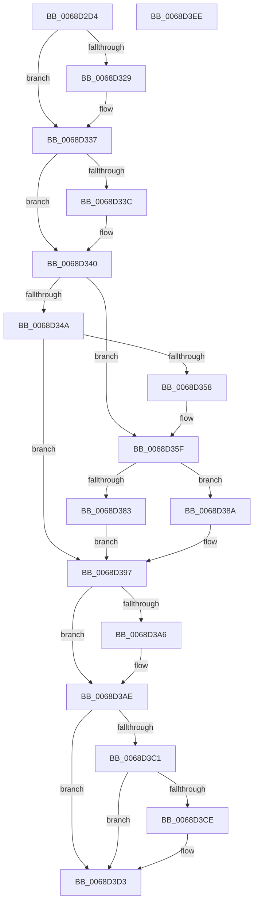

# MiCreateSlabIdentity

- RVA: `0x0068D2D4`–`0x0068D3EF` (길이 `283` bytes)
- VA: `0x000000014068D2D4`
- 실행 섹션: `.text`
- PDB 이름 있음: `예`; PDB Function 태그: `아니요`
- unwind 정보 RVA: `0x00060300`
- 디코드: `79`개 명령, `283/283` bytes 표시
- 미해석 바이트: `0` (있으면 어셈블리에 `.byte`로 보존)

> 이 문서는 커널 이미지의 기계어와 PDB 기호를 분석해 생성했습니다. 4번과 5번은 함수 원형과 자료형을 바이너리 사용 방식에서 추정한 C 해석이며 원본 소스 복구 결과는 아닙니다.

## 1. Dependencies

- 직접 호출 지점: **8**; 고유 호출 대상: **8**
- 직접 호출자로 확인된 함수: **1**
- RIP 상대 이미지 참조: **0**

### Outgoing calls
- `0x0068D319` → [KeAbPreAcquire](../21/KeAbPreAcquire_function_00210230.md) (function, `0x00210230`)
- `0x0068D332` → [ExfAcquirePushLockExclusiveEx](../20/ExfAcquirePushLockExclusiveEx_function_0020FC90.md) (function, `0x0020FC90`)
- `0x0068D34D` → [MiInitializeSlabIdentities](MiInitializeSlabIdentities_function_0068EBD8.md) (function, `0x0068EBD8`)
- `0x0068D365` → [MiDeletePendingSlabIdentities](MiDeletePendingSlabIdentities_function_0068DA3C.md) (function, `0x0068DA3C`)
- `0x0068D377` → [RtlFindClearBitsAndSet](../3E/RtlFindClearBitsAndSet_function_003E0CD0.md) (function, `0x003E0CD0`)
- `0x0068D3A9` → [ExfTryToWakePushLock](../26/ExfTryToWakePushLock_function_00265DD0.md) (function, `0x00265DD0`)
- `0x0068D3B1` → [KeAbPostRelease](../2E/KeAbPostRelease_function_002E1600.md) (function, `0x002E1600`)
- `0x0068D3CE` → [KiCheckForKernelApcDelivery](../2E/KiCheckForKernelApcDelivery_function_002E2C80.md) (function, `0x002E2C80`)

### Direct callers
- [MmCreateProcessAddressSpace](../../page/A5/MmCreateProcessAddressSpace_function_00A5EE5C.md) at `0x00A5EEEC`

### Static image references
- 디코드된 RIP-relative 메모리 참조가 없습니다.

## 2. Other-region calls and transfers

- 다른 실행 섹션으로 향하는 call: **0**
- 별도 외부 분기/꼬리 이동을 확인하지 못했습니다.

## 3. Assembly (complete function range)

```asm
0068D2D4  48 89 5C 24 08                  mov qword ptr [rsp + 8], rbx
0068D2D9  48 89 6C 24 10                  mov qword ptr [rsp + 0x10], rbp
0068D2DE  48 89 74 24 18                  mov qword ptr [rsp + 0x18], rsi
0068D2E3  57                              push rdi
0068D2E4  41 56                           push r14
0068D2E6  41 57                           push r15
0068D2E8  48 83 EC 20                     sub rsp, 0x20
0068D2EC  65 48 8B 2C 25 88 01 00 00      mov rbp, qword ptr gs:[0x188]
0068D2F5  48 8D 99 78 47 00 00            lea rbx, [rcx + 0x4778]
0068D2FC  4C 8B F2                        mov r14, rdx
0068D2FF  48 8B F9                        mov rdi, rcx
0068D302  41 BF 01 00 00 00               mov r15d, 1
0068D308  45 33 C0                        xor r8d, r8d
0068D30B  33 D2                           xor edx, edx
0068D30D  48 8B CB                        mov rcx, rbx
0068D310  66 44 29 BD E6 01 00 00         sub word ptr [rbp + 0x1e6], r15w
0068D318  90                              nop
0068D319  E8 12 2F B8 FF                  call 0x140210230
0068D31E  F0 48 0F BA 2B 00               lock bts qword ptr [rbx], 0
0068D324  48 8B F0                        mov rsi, rax
0068D327  73 0E                           jae 0x14068d337
0068D329  4C 8B C3                        mov r8, rbx
0068D32C  48 8B D0                        mov rdx, rax
0068D32F  48 8B CB                        mov rcx, rbx
0068D332  E8 59 29 B8 FF                  call 0x14020fc90
0068D337  48 85 F6                        test rsi, rsi
0068D33A  74 04                           je 0x14068d340
0068D33C  44 88 7E 0A                     mov byte ptr [rsi + 0xa], r15b
0068D340  8B 87 70 47 00 00               mov eax, dword ptr [rdi + 0x4770]
0068D346  85 C0                           test eax, eax
0068D348  75 15                           jne 0x14068d35f
0068D34A  48 8B CF                        mov rcx, rdi
0068D34D  E8 86 18 00 00                  call 0x14068ebd8
0068D352  8B F0                           mov esi, eax
0068D354  85 C0                           test eax, eax
0068D356  78 3F                           js 0x14068d397
0068D358  44 89 BF 70 47 00 00            mov dword ptr [rdi + 0x4770], r15d
0068D35F  41 8B D7                        mov edx, r15d
0068D362  48 8B CF                        mov rcx, rdi
0068D365  E8 D2 06 00 00                  call 0x14068da3c
0068D36A  48 8D 8F 58 47 00 00            lea rcx, [rdi + 0x4758]
0068D371  45 33 C0                        xor r8d, r8d
0068D374  41 8B D7                        mov edx, r15d
0068D377  E8 54 39 D5 FF                  call 0x1403e0cd0
0068D37C  8B C8                           mov ecx, eax
0068D37E  83 F8 FF                        cmp eax, -1
0068D381  75 07                           jne 0x14068d38a
0068D383  BE 0E 02 00 C0                  mov esi, 0xc000020e
0068D388  EB 0D                           jmp 0x14068d397
0068D38A  4C 89 BC CF 58 45 00 00         mov qword ptr [rdi + rcx*8 + 0x4558], r15
0068D392  33 F6                           xor esi, esi
0068D394  41 88 0E                        mov byte ptr [r14], cl
0068D397  48 83 C8 FF                     or rax, 0xffffffffffffffff
0068D39B  F0 48 0F C1 03                  lock xadd qword ptr [rbx], rax
0068D3A0  24 06                           and al, 6
0068D3A2  3C 02                           cmp al, 2
0068D3A4  75 08                           jne 0x14068d3ae
0068D3A6  48 8B CB                        mov rcx, rbx
0068D3A9  E8 22 8A BD FF                  call 0x140265dd0
0068D3AE  48 8B CB                        mov rcx, rbx
0068D3B1  E8 4A 42 C5 FF                  call 0x1402e1600
0068D3B6  90                              nop
0068D3B7  66 44 01 BD E6 01 00 00         add word ptr [rbp + 0x1e6], r15w
0068D3BF  75 12                           jne 0x14068d3d3
0068D3C1  48 8D 85 98 00 00 00            lea rax, [rbp + 0x98]
0068D3C8  90                              nop
0068D3C9  48 39 00                        cmp qword ptr [rax], rax
0068D3CC  74 05                           je 0x14068d3d3
0068D3CE  E8 AD 58 C5 FF                  call 0x1402e2c80
0068D3D3  48 8B 5C 24 40                  mov rbx, qword ptr [rsp + 0x40]
0068D3D8  8B C6                           mov eax, esi
0068D3DA  48 8B 74 24 50                  mov rsi, qword ptr [rsp + 0x50]
0068D3DF  48 8B 6C 24 48                  mov rbp, qword ptr [rsp + 0x48]
0068D3E4  48 83 C4 20                     add rsp, 0x20
0068D3E8  41 5F                           pop r15
0068D3EA  41 5E                           pop r14
0068D3EC  5F                              pop rdi
0068D3ED  C3                              ret
0068D3EE  CC                              int3
```

## 4. C-style interpretation (structured pseudocode)

```c
__int64 __fastcall MiCreateSlabIdentity(__int64 a1, __int64 a2, int a3)
{
    __int64 result;
    __int64 v_rsi;
    __int64 v_rsp;
    unsigned __int64 v_stack_p10;
    unsigned __int64 v_stack_p18;
    unsigned __int64 v_stack_p8;

    v_stack_p8 = v_rbx;
    v_stack_p10 = v_rbp;
    v_stack_p18 = v_rsi;
    v_rsp = (v_rsp) - (32);
    a3 = 0;
    a2 = 0;
    result = KeAbPreAcquire(a1 + 18296, a2, a3, a4);
    if (!(condition_is_above_or_equal)) {
        a3 = a1 + 18296;
        a2 = result;
        a1 = a1 + 18296;
        result = ExfAcquirePushLockExclusiveEx(a1, a2, a3, a4);
    }
    if (result != 0) {
        *(unsigned __int8 *)(result + 10) = 1;
    }
    if ((unsigned int)((unsigned int)(*(unsigned int *)(a1 + 18288))) != 0) goto loc_0068D35F;
    result = MiInitializeSlabIdentities(a1, a2, a3, a4);
    if (sign_flag) goto loc_0068D397;
    *(unsigned int *)(a1 + 18288) = 1;
loc_0068D35F:
    result = MiDeletePendingSlabIdentities(a1, 1, a3, a4);
    a3 = 0;
    result = RtlFindClearBitsAndSet(a1 + 18264, 1, a3, a4);
    if (((unsigned int)(result)) != -1) goto loc_0068D38A;
    goto loc_0068D397;
loc_0068D38A:
    *(unsigned __int64 *)(a1 + (unsigned int)((unsigned int)(result)) * 8 + 17752) = 1;
    v_rsi = 0;
    *(unsigned __int8 *)(a2) = (unsigned __int8)((unsigned int)((unsigned int)(result)));
loc_0068D397:
    result = (result) | (-1);
    result = (unsigned __int8)((result) & (6));
    if (((unsigned __int8)(result)) == 2) {
        a1 = a1 + 18296;
        result = ExfTryToWakePushLock(a1, 1, a3, a4);
    }
    result = KeAbPostRelease(a1 + 18296, 1, a3, a4);
    if (((unsigned __int8)(result)) != 2) goto loc_0068D3D3;
    result = *(unsigned __int64 *)(gs_base + (0 + 392)) + 152;
    if ((*(unsigned __int64 *)(*(unsigned __int64 *)(gs_base + (0 + 392)) + 152)) != (*(unsigned __int64 *)(gs_base + (0 + 392)) + 152)) {
        result = KiCheckForKernelApcDelivery(a1 + 18296, 1, a3, a4);
    }
    v_rsp = (v_rsp) + (32);
    return 0;
}
```

## 5. (Beta) C Style

```c
int64_t MiCreateSlabIdentity(void *Arg1, void *Arg2, int32_t Arg3)
{
    uint8_t *arg1 = (uint8_t *)Arg1;
    uint8_t *arg2 = (uint8_t *)Arg2;

    int64_t result;
    int64_t local_rsi;
    int64_t local_rsp;
    uint64_t v_stack_p10;
    uint64_t v_stack_p18;
    uint64_t v_stack_p8;

    v_stack_p8 = local_rbx;
    v_stack_p10 = local_rbp;
    v_stack_p18 = local_rsi;
    local_rsp = (local_rsp) - (32);
    Arg3 = 0;
    Arg2 = 0;
    result = KeAbPreAcquire(Arg1 + 18296, Arg2, Arg3, a4);
    if (!(condition_is_above_or_equal)) {
        Arg3 = Arg1 + 18296;
        Arg2 = result;
        Arg1 = Arg1 + 18296;
        result = ExfAcquirePushLockExclusiveEx(Arg1, Arg2, Arg3, a4);
    }
    if (result != 0) {
        *(uint8_t *)(result + 0xA) = 1;
    }
    if ((uint32_t)((uint32_t)(*(uint32_t *)(arg1 + 0x4770))) != 0) goto loc_0068D35F;
    result = MiInitializeSlabIdentities(Arg1, Arg2, Arg3, a4);
    if (sign_flag) goto loc_0068D397;
    *(uint32_t *)(arg1 + 0x4770) = 1;
loc_0068D35F:
    result = MiDeletePendingSlabIdentities(Arg1, 1, Arg3, a4);
    Arg3 = 0;
    result = RtlFindClearBitsAndSet(Arg1 + 18264, 1, Arg3, a4);
    if (((uint32_t)(result)) != -1) goto loc_0068D38A;
    goto loc_0068D397;
loc_0068D38A:
    *(uint64_t *)(arg1 + (uint32_t)((uint32_t)(result)) * 8 + 0x4558) = 1;
    local_rsi = 0;
    *(uint8_t *)(arg2) = (uint8_t)((uint32_t)((uint32_t)(result)));
loc_0068D397:
    result = (result) | (-1);
    result = (uint8_t)((result) & (6));
    if (((uint8_t)(result)) == 2) {
        Arg1 = Arg1 + 18296;
        result = ExfTryToWakePushLock(Arg1, 1, Arg3, a4);
    }
    result = KeAbPostRelease(Arg1 + 18296, 1, Arg3, a4);
    if (((uint8_t)(result)) != 2) goto loc_0068D3D3;
    result = *(uint64_t *)(gs_base + (0 + 0x188)) + 152;
    if ((*(uint64_t *)(*(uint64_t *)(gs_base + (0 + 0x188)) + 0x98)) != (*(uint64_t *)(gs_base + (0 + 0x188)) + 152)) {
        result = KiCheckForKernelApcDelivery(Arg1 + 18296, 1, Arg3, a4);
    }
    local_rsp = (local_rsp) + (32);
    return 0;
}
```

### 관측된 메모리 오프셋

구조체 형식이 확인되지 않은 접근은 인자 기준의 오프셋으로만 기록했습니다.

| 기준 인자 | 오프셋 표현 | 폭 (bit) | 접근 |
|---|---:|---:|---|
| `Arg1` | `+ 0x0` | `64` | `R/W` |
| `Arg1` | `+ 0x4558 + rcx*8` | `64` | `W` |
| `Arg1` | `+ 0x4758` | `64` | `R` |
| `Arg1` | `+ 0x4770` | `32` | `R` |
| `Arg1` | `+ 0x4770` | `32` | `W` |
| `Arg1` | `+ 0x4778` | `64` | `R` |
| `Arg2` | `+ 0x0` | `8` | `W` |

## 6. Execution-region graph

[열기: 2D/3D 그래프와 함수 탐색 컨트롤 패널](../../../control-panel.html?section=text&rva=0x0068D2D4&view=graph)

- 2D 그래프는 위에서 아래로 흐르고, 3D 그래프는 빈 공간을 드래그해 회전합니다. Shift+드래그는 이동, 휠은 확대·축소, 함수 노드 선택은 대상 보고서 이동입니다.

### Static fallback


