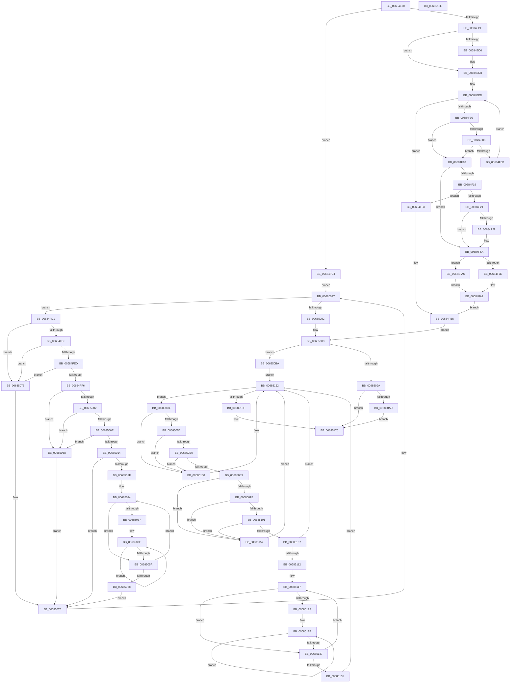

# MiDbgCopyMemoryTarget

- RVA: `0x00684E70`–`0x0068518F` (길이 `799` bytes)
- VA: `0x0000000140684E70`
- 실행 섹션: `.text`
- PDB 이름 있음: `예`; PDB Function 태그: `아니요`
- unwind 정보 RVA: `0x000D8794`
- 디코드: `240`개 명령, `799/799` bytes 표시
- 미해석 바이트: `0` (있으면 어셈블리에 `.byte`로 보존)

> 이 문서는 커널 이미지의 기계어와 PDB 기호를 분석해 생성했습니다. 4번과 5번은 함수 원형과 자료형을 바이너리 사용 방식에서 추정한 C 해석이며 원본 소스 복구 결과는 아닙니다.

## 1. Dependencies

- 직접 호출 지점: **19**; 고유 호출 대상: **14**
- 직접 호출자로 확인된 함수: **0**
- RIP 상대 이미지 참조: **3**

### Outgoing calls
- `0x00684ED3` → [KeWakeAddressAll](../21/KeWakeAddressAll_function_00217C20.md) (function, `0x00217C20`)
- `0x00684EE3` → [MiFillPteHierarchy](../3F/MiFillPteHierarchy_function_003F7F90.md) (function, `0x003F7F90`)
- `0x00684EF5` → [MI_READ_PTE_LOCK_FREE](../28/MI_READ_PTE_LOCK_FREE_function_002828A0.md) (function, `0x002828A0`)
- `0x00684F32` → [MiWriteValidPteNewProtection](../28/MiWriteValidPteNewProtection_function_00281810.md) (function, `0x00281810`)
- `0x00684F3A` → [MiGetLeafVa](../27/MiGetLeafVa_function_0027C0A0.md) (function, `0x0027C0A0`)
- `0x00684F45` → [MiGetSystemRegionType](../28/MiGetSystemRegionType_function_0028EC80.md) (function, `0x0028EC80`)
- `0x00684F51` → [MiRealVaToFlushType](MiRealVaToFlushType_function_0068619C.md) (function, `0x0068619C`)
- `0x00684F65` → [KeFlushSingleTb](../5B/KeFlushSingleTb_function_005BDE84.md) (function, `0x005BDE84`)
- `0x00684F9D` → [MiCopyToUntrustedMemory](MiCopyToUntrustedMemory_function_00684894.md) (function, `0x00684894`)
- `0x00684FA9` → [MiCopyFromUntrustedMemory](MiCopyFromUntrustedMemory_function_00684744.md) (function, `0x00684744`)
- `0x00684FED` → [KiCheckVpBackingLongSpinWaitHypercall](../30/KiCheckVpBackingLongSpinWaitHypercall_function_0030F490.md) (function, `0x0030F490`)
- `0x00684FF9` → [KeCanUseHaltOnAddress](../4F/KeCanUseHaltOnAddress_function_004FC22C.md) (function, `0x004FC22C`)
- `0x0068504F` → [KiHaltOnAddress](../4F/KiHaltOnAddress_function_004FBA3C.md) (function, `0x004FBA3C`)
- `0x0068506C` → [HvlNotifyLongSpinWait](../30/HvlNotifyLongSpinWait_function_0030F460.md) (function, `0x0030F460`)
- `0x006850B0` → [KeWakeAddressAll](../21/KeWakeAddressAll_function_00217C20.md) (function, `0x00217C20`)
- `0x006850E0` → [KiCheckVpBackingLongSpinWaitHypercall](../30/KiCheckVpBackingLongSpinWaitHypercall_function_0030F490.md) (function, `0x0030F490`)
- `0x006850EC` → [KeCanUseHaltOnAddress](../4F/KeCanUseHaltOnAddress_function_004FC22C.md) (function, `0x004FC22C`)
- `0x0068513C` → [KiHaltOnAddress](../4F/KiHaltOnAddress_function_004FBA3C.md) (function, `0x004FBA3C`)
- `0x00685159` → [HvlNotifyLongSpinWait](../30/HvlNotifyLongSpinWait_function_0030F460.md) (function, `0x0030F460`)

### Direct callers
- 이 함수 시작 RVA로 연결되는 직접 call은 확인되지 않았습니다. 간접 호출은 완전히 역산할 수 없습니다.

### Static image references
- `0x00684FD3` → RVA `0x00FC52AC` (`ALMOSTRO`; reference)
- `0x00684FDF` → RVA `0x00FC6AB8` (`ALMOSTRO`; read)
- `0x00685002` → RVA `0x00FC6B38` (`ALMOSTRO`; read)

## 2. Other-region calls and transfers

- 다른 실행 섹션으로 향하는 call: **0**
- 별도 외부 분기/꼬리 이동을 확인하지 못했습니다.

## 3. Assembly (complete function range)

```asm
00684E70  4C 8B DC                        mov r11, rsp
00684E73  49 89 5B 08                     mov qword ptr [r11 + 8], rbx
00684E77  49 89 6B 10                     mov qword ptr [r11 + 0x10], rbp
00684E7B  56                              push rsi
00684E7C  57                              push rdi
00684E7D  41 55                           push r13
00684E7F  41 56                           push r14
00684E81  41 57                           push r15
00684E83  48 83 EC 70                     sub rsp, 0x70
00684E87  0F 57 C0                        xorps xmm0, xmm0
00684E8A  49 8B F9                        mov rdi, r9
00684E8D  0F 11 44 24 48                  movups xmmword ptr [rsp + 0x48], xmm0
00684E92  4D 8B E8                        mov r13, r8
00684E95  4C 8B F2                        mov r14, rdx
00684E98  0F 11 44 24 58                  movups xmmword ptr [rsp + 0x58], xmm0
00684E9D  83 C8 FF                        or eax, 0xffffffff
00684EA0  F0 41 0F C1 01                  lock xadd dword ptr [r9], eax
00684EA5  FF C8                           dec eax
00684EA7  41 BF 00 00 00 80               mov r15d, 0x80000000
00684EAD  8B D8                           mov ebx, eax
00684EAF  F7 D3                           not ebx
00684EB1  41 23 DF                        and ebx, r15d
00684EB4  A9 FF FF FF 3F                  test eax, 0x3fffffff
00684EB9  0F 85 05 01 00 00               jne 0x140684fc4
00684EBF  41 0B 59 04                     or ebx, dword ptr [r9 + 4]
00684EC3  41 87 19                        xchg dword ptr [r9], ebx
00684EC6  41 89 5B 20                     mov dword ptr [r11 + 0x20], ebx
00684ECA  0F BA E3 1E                     bt ebx, 0x1e
00684ECE  73 08                           jae 0x140684ed8
00684ED0  49 8B C9                        mov rcx, r9
00684ED3  E8 48 2D B9 FF                  call 0x140217c20
00684ED8  49 8B 2E                        mov rbp, qword ptr [r14]
00684EDB  48 8D 54 24 48                  lea rdx, [rsp + 0x48]
00684EE0  48 8B CD                        mov rcx, rbp
00684EE3  E8 A8 30 D7 FF                  call 0x1403f7f90
00684EE8  BB 03 00 00 00                  mov ebx, 3
00684EED  4C 8B 7C DC 48                  mov r15, qword ptr [rsp + rbx*8 + 0x48]
00684EF2  49 8B CF                        mov rcx, r15
00684EF5  E8 A6 D9 BF FF                  call 0x1402828a0
00684EFA  A8 01                           test al, 1
00684EFC  0F 84 AE 00 00 00               je 0x140684fb0
00684F02  84 C0                           test al, al
00684F04  78 0A                           js 0x140684f10
00684F06  48 85 DB                        test rbx, rbx
00684F09  74 05                           je 0x140684f10
00684F0B  48 FF CB                        dec rbx
00684F0E  EB DD                           jmp 0x140684eed
00684F10  41 8B 4E 18                     mov ecx, dword ptr [r14 + 0x18]
00684F14  F6 C1 01                        test cl, 1
00684F17  74 51                           je 0x140684f6a
00684F19  48 0F BA E0 0B                  bt rax, 0xb
00684F1E  0F 83 8C 00 00 00               jae 0x140684fb0
00684F24  A8 42                           test al, 0x42
00684F26  75 42                           jne 0x140684f6a
00684F28  48 83 C8 42                     or rax, 0x42
00684F2C  49 8B CF                        mov rcx, r15
00684F2F  48 8B D0                        mov rdx, rax
00684F32  E8 D9 C8 BF FF                  call 0x140281810
00684F37  48 8B CD                        mov rcx, rbp
00684F3A  E8 61 71 BF FF                  call 0x14027c0a0
00684F3F  48 8B C8                        mov rcx, rax
00684F42  48 8B D8                        mov rbx, rax
00684F45  E8 36 9D C0 FF                  call 0x14028ec80
00684F4A  48 8B CB                        mov rcx, rbx
00684F4D  44 8D 58 FF                     lea r11d, [rax - 1]
00684F51  E8 46 12 00 00                  call 0x14068619c
00684F56  41 F7 DB                        neg r11d
00684F59  8B D0                           mov edx, eax
00684F5B  48 8B CD                        mov rcx, rbp
00684F5E  45 1B C0                        sbb r8d, r8d
00684F61  41 83 E0 02                     and r8d, 2
00684F65  E8 1A 8F F3 FF                  call 0x1405bde84
00684F6A  41 8B 46 18                     mov eax, dword ptr [r14 + 0x18]
00684F6E  45 8B 4E 14                     mov r9d, dword ptr [r14 + 0x14]
00684F72  45 8B 46 10                     mov r8d, dword ptr [r14 + 0x10]
00684F76  49 8B 4E 08                     mov rcx, qword ptr [r14 + 8]
00684F7A  A8 01                           test al, 1
00684F7C  74 28                           je 0x140684fa6
00684F7E  C7 44 24 38 01 00 00 00         mov dword ptr [rsp + 0x38], 1
00684F86  48 83 CA FF                     or rdx, 0xffffffffffffffff
00684F8A  44 89 4C 24 28                  mov dword ptr [rsp + 0x28], r9d
00684F8F  4C 8B C9                        mov r9, rcx
00684F92  44 89 44 24 20                  mov dword ptr [rsp + 0x20], r8d
00684F97  48 8B CD                        mov rcx, rbp
00684F9A  45 33 C0                        xor r8d, r8d
00684F9D  E8 F2 F8 FF FF                  call 0x140684894
00684FA2  8B F0                           mov esi, eax
00684FA4  EB 0F                           jmp 0x140684fb5
00684FA6  48 8B D5                        mov rdx, rbp
00684FA9  E8 96 F7 FF FF                  call 0x140684744
00684FAE  EB F2                           jmp 0x140684fa2
00684FB0  BE 05 00 00 C0                  mov esi, 0xc0000005
00684FB5  41 89 76 1C                     mov dword ptr [r14 + 0x1c], esi
00684FB9  41 BF 00 00 00 80               mov r15d, 0x80000000
00684FBF  E9 BF 00 00 00                  jmp 0x140685083
00684FC4  41 8B 01                        mov eax, dword ptr [r9]
00684FC7  33 F6                           xor esi, esi
00684FC9  45 33 F6                        xor r14d, r14d
00684FCC  E9 A6 00 00 00                  jmp 0x140685077
00684FD1  FF C6                           inc esi
00684FD3  85 35 D3 02 94 00               test dword ptr [rip + 0x9402d3], esi
00684FD9  0F 85 94 00 00 00               jne 0x140685073
00684FDF  8B 05 D3 1A 94 00               mov eax, dword ptr [rip + 0x941ad3]
00684FE5  A8 40                           test al, 0x40
00684FE7  0F 84 86 00 00 00               je 0x140685073
00684FED  E8 9E A4 C8 FF                  call 0x14030f490
00684FF2  84 C0                           test al, al
00684FF4  74 7D                           je 0x140685073
00684FF6  41 FF C6                        inc r14d
00684FF9  E8 2E 72 E7 FF                  call 0x1404fc22c
00684FFE  84 C0                           test al, al
00685000  74 68                           je 0x14068506a
00685002  F7 05 2C 1B 94 00 00 00 02 00   test dword ptr [rip + 0x941b2c], 0x20000
0068500C  74 5C                           je 0x14068506a
0068500E  41 F6 C6 07                     test r14b, 7
00685012  75 56                           jne 0x14068506a
00685014  8B 0F                           mov ecx, dword ptr [rdi]
00685016  8B C1                           mov eax, ecx
00685018  41 23 C7                        and eax, r15d
0068501B  3B C3                           cmp eax, ebx
0068501D  74 56                           je 0x140685075
0068501F  8B D1                           mov edx, ecx
00685021  44 8B C1                        mov r8d, ecx
00685024  0F BA E9 1E                     bts ecx, 0x1e
00685028  8B C2                           mov eax, edx
0068502A  8B E9                           mov ebp, ecx
0068502C  F0 0F B1 2F                     lock cmpxchg dword ptr [rdi], ebp
00685030  8B C8                           mov ecx, eax
00685032  41 3B C0                        cmp eax, r8d
00685035  75 23                           jne 0x14068505a
00685037  89 AC 24 B8 00 00 00            mov dword ptr [rsp + 0xb8], ebp
0068503E  41 B8 04 00 00 00               mov r8d, 4
00685044  48 8D 94 24 B8 00 00 00         lea rdx, [rsp + 0xb8]
0068504C  48 8B CF                        mov rcx, rdi
0068504F  E8 E8 69 E7 FF                  call 0x1404fba3c
00685054  8B 0F                           mov ecx, dword ptr [rdi]
00685056  3B CD                           cmp ecx, ebp
00685058  74 E4                           je 0x14068503e
0068505A  8B C1                           mov eax, ecx
0068505C  8B D1                           mov edx, ecx
0068505E  41 23 C7                        and eax, r15d
00685061  44 8B C1                        mov r8d, ecx
00685064  3B C3                           cmp eax, ebx
00685066  75 BC                           jne 0x140685024
00685068  EB 0B                           jmp 0x140685075
0068506A  8B CE                           mov ecx, esi
0068506C  E8 EF A3 C8 FF                  call 0x14030f460
00685071  EB 02                           jmp 0x140685075
00685073  F3 90                           pause
00685075  8B 07                           mov eax, dword ptr [rdi]
00685077  41 23 C7                        and eax, r15d
0068507A  3B C3                           cmp eax, ebx
0068507C  0F 85 4F FF FF FF               jne 0x140684fd1
00685082  90                              nop
00685083  83 C8 FF                        or eax, 0xffffffff
00685086  F0 0F C1 07                     lock xadd dword ptr [rdi], eax
0068508A  FF C8                           dec eax
0068508C  8B D8                           mov ebx, eax
0068508E  F7 D3                           not ebx
00685090  41 23 DF                        and ebx, r15d
00685093  A9 FF FF FF 3F                  test eax, 0x3fffffff
00685098  75 20                           jne 0x1406850ba
0068509A  0B 5F 04                        or ebx, dword ptr [rdi + 4]
0068509D  87 1F                           xchg dword ptr [rdi], ebx
0068509F  89 5C 24 40                     mov dword ptr [rsp + 0x40], ebx
006850A3  0F BA E3 1E                     bt ebx, 0x1e
006850A7  0F 83 C3 00 00 00               jae 0x140685170
006850AD  48 8B CF                        mov rcx, rdi
006850B0  E8 6B 2B B9 FF                  call 0x140217c20
006850B5  E9 B6 00 00 00                  jmp 0x140685170
006850BA  33 F6                           xor esi, esi
006850BC  45 33 F6                        xor r14d, r14d
006850BF  E9 9E 00 00 00                  jmp 0x140685162
006850C4  FF C6                           inc esi
006850C6  85 35 E0 01 94 00               test dword ptr [rip + 0x9401e0], esi
006850CC  0F 85 8E 00 00 00               jne 0x140685160
006850D2  8B 05 E0 19 94 00               mov eax, dword ptr [rip + 0x9419e0]
006850D8  A8 40                           test al, 0x40
006850DA  0F 84 80 00 00 00               je 0x140685160
006850E0  E8 AB A3 C8 FF                  call 0x14030f490
006850E5  84 C0                           test al, al
006850E7  74 77                           je 0x140685160
006850E9  41 FF C6                        inc r14d
006850EC  E8 3B 71 E7 FF                  call 0x1404fc22c
006850F1  84 C0                           test al, al
006850F3  74 62                           je 0x140685157
006850F5  F7 05 39 1A 94 00 00 00 02 00   test dword ptr [rip + 0x941a39], 0x20000
006850FF  74 56                           je 0x140685157
00685101  41 F6 C6 07                     test r14b, 7
00685105  75 50                           jne 0x140685157
00685107  8B 0F                           mov ecx, dword ptr [rdi]
00685109  8B C1                           mov eax, ecx
0068510B  41 23 C7                        and eax, r15d
0068510E  3B C3                           cmp eax, ebx
00685110  74 50                           je 0x140685162
00685112  8B D1                           mov edx, ecx
00685114  44 8B C1                        mov r8d, ecx
00685117  0F BA E9 1E                     bts ecx, 0x1e
0068511B  8B C2                           mov eax, edx
0068511D  8B E9                           mov ebp, ecx
0068511F  F0 0F B1 2F                     lock cmpxchg dword ptr [rdi], ebp
00685123  8B C8                           mov ecx, eax
00685125  41 3B C0                        cmp eax, r8d
00685128  75 1D                           jne 0x140685147
0068512A  89 6C 24 40                     mov dword ptr [rsp + 0x40], ebp
0068512E  41 B8 04 00 00 00               mov r8d, 4
00685134  48 8D 54 24 40                  lea rdx, [rsp + 0x40]
00685139  48 8B CF                        mov rcx, rdi
0068513C  E8 FB 68 E7 FF                  call 0x1404fba3c
00685141  8B 0F                           mov ecx, dword ptr [rdi]
00685143  3B CD                           cmp ecx, ebp
00685145  74 E7                           je 0x14068512e
00685147  8B C1                           mov eax, ecx
00685149  8B D1                           mov edx, ecx
0068514B  41 23 C7                        and eax, r15d
0068514E  44 8B C1                        mov r8d, ecx
00685151  3B C3                           cmp eax, ebx
00685153  75 C2                           jne 0x140685117
00685155  EB 0B                           jmp 0x140685162
00685157  8B CE                           mov ecx, esi
00685159  E8 02 A3 C8 FF                  call 0x14030f460
0068515E  EB 02                           jmp 0x140685162
00685160  F3 90                           pause
00685162  8B 07                           mov eax, dword ptr [rdi]
00685164  41 23 C7                        and eax, r15d
00685167  3B C3                           cmp eax, ebx
00685169  0F 85 55 FF FF FF               jne 0x1406850c4
0068516F  90                              nop
00685170  F0 41 FF 4D 00                  lock dec dword ptr [r13]
00685175  4C 8D 5C 24 70                  lea r11, [rsp + 0x70]
0068517A  49 8B 5B 30                     mov rbx, qword ptr [r11 + 0x30]
0068517E  49 8B 6B 38                     mov rbp, qword ptr [r11 + 0x38]
00685182  49 8B E3                        mov rsp, r11
00685185  41 5F                           pop r15
00685187  41 5E                           pop r14
00685189  41 5D                           pop r13
0068518B  5F                              pop rdi
0068518C  5E                              pop rsi
0068518D  C3                              ret
0068518E  CC                              int3
```

## 4. C-style interpretation (structured pseudocode)

```c
__int64 __fastcall MiDbgCopyMemoryTarget(__int64 a1, __int64 a2, __int64 a3, __int64 a4)
{
    __int64 result;
    __int64 v_r11;
    __int64 v_r14;
    __int64 v_rbx;
    __int64 v_rsi;
    __int64 v_rsp;
    unsigned __int64 v_stack_m28;
    unsigned __int64 v_stack_m40;
    unsigned __int64 v_stack_m50;
    unsigned int v_stack_m58;
    unsigned int v_stack_m60;
    unsigned int v_stack_m70;
    unsigned int v_stack_m78;
    unsigned int v_stack_p20;

    *(unsigned __int64 *)(v_rsp + 8) = v_rbx;
    *(unsigned __int64 *)(v_rsp + 16) = v_rbp;
    v_rsp = (v_rsp) - (112);
    v_stack_m50 = v_xmm0;
    v_stack_m40 = v_xmm0;
    result = (unsigned int)((result) | (0xFFFFFFFFULL));
    result = (unsigned int)((result) - 1);
    v_rbx = (unsigned int)(~((unsigned int)((unsigned int)(result))));
    v_rbx = (unsigned int)((v_rbx) & ((unsigned int)((unsigned int)(0x80000000ULL))));
    if ((((unsigned int)(result)) & (0x3FFFFFFFULL)) != 0) goto loc_00684FC4;
    v_rbx = (unsigned int)((v_rbx) | (*(unsigned int *)(a4 + 4)));
    *(unsigned int *)(v_rsp + 32) = (unsigned int)(v_rbx);
    if (!(condition_is_above_or_equal)) {
        a1 = a4;
        result = KeWakeAddressAll(a1, a2, a3, a4);
    }
    result = MiFillPteHierarchy(*(unsigned __int64 *)(a2), v_stack_m50, a3, a4);
loc_00684EED:
    result = MI_READ_PTE_LOCK_FREE(*(unsigned __int64 *)(v_rsp + 3 * 8 + 72), v_stack_m50, a3, a4);
    if ((((unsigned __int8)(result)) & (1)) == 0) goto loc_00684FB0;
    if (sign_flag) goto loc_00684F10;
    if (3 == 0) goto loc_00684F10;
    v_rbx = (3) - 1;
    goto loc_00684EED;
loc_00684F10:
    if ((((unsigned __int8)((unsigned int)(*(unsigned int *)(a2 + 24)))) & (1)) == 0) goto loc_00684F6A;
    if (condition_is_above_or_equal) goto loc_00684FB0;
    v_r11 = v_rsp;
    if ((((unsigned __int8)(result)) & (66)) == 0) {
        result = (result) | (66);
        a1 = *(unsigned __int64 *)(v_rsp + 3 * 8 + 72);
        a2 = result;
        result = MiWriteValidPteNewProtection(a1, a2, a3, a4);
        a1 = *(unsigned __int64 *)(a2);
        result = MiGetLeafVa(a1, a2, a3, a4);
        a1 = result;
        v_rbx = result;
        result = MiGetSystemRegionType(a1, a2, a3, a4);
        a1 = v_rbx;
        v_r11 = result - 1;
        result = MiRealVaToFlushType(a1, a2, a3, a4);
        v_r11 = (unsigned int)(-(v_r11));
        a2 = (unsigned int)(result);
        a1 = *(unsigned __int64 *)(a2);
        a3 = (unsigned int)((a3) & (2));
        result = KeFlushSingleTb(a1, a2, a3, a4);
    }
    if ((((unsigned __int8)((unsigned int)(*(unsigned int *)(a2 + 24)))) & (1)) == 0) goto loc_00684FA6;
    v_stack_m60 = 1;
    a2 = (a2) | (-1);
    v_stack_m70 = (unsigned int)((unsigned int)(*(unsigned int *)(a2 + 20)));
    v_stack_m78 = (unsigned int)((unsigned int)(*(unsigned int *)(a2 + 16)));
    a3 = 0;
    result = MiCopyToUntrustedMemory(*(unsigned __int64 *)(a2), a2, a3, *(unsigned __int64 *)(a2 + 8));
loc_00684FA2:
    goto loc_00684FB5;
loc_00684FA6:
    result = MiCopyFromUntrustedMemory(*(unsigned __int64 *)(a2), *(unsigned __int64 *)(a2), a3, *(unsigned __int64 *)(a2 + 8));
    goto loc_00684FA2;
loc_00684FB0:
loc_00684FB5:
    *(unsigned int *)(a2 + 28) = (unsigned int)((unsigned int)(0xC0000005ULL));
    goto loc_00685083;
loc_00684FC4:
    v_rsi = 0;
    v_r14 = 0;
    goto loc_00685077;
loc_00684FD1:
    v_rsi = (unsigned int)((v_rsi) + 1);
    if (((*(unsigned int *)(v_rip + 9700051)) & ((unsigned int)(v_rsi))) != 0) goto loc_00685073;
    if ((((unsigned __int8)((unsigned int)(*(unsigned int *)(v_rip + 9706195)))) & (64)) == 0) goto loc_00685073;
    result = KiCheckVpBackingLongSpinWaitHypercall(*(unsigned __int64 *)(a2), *(unsigned __int64 *)(a2), a3, *(unsigned __int64 *)(a2 + 8));
    if ((unsigned __int8)(result) == 0) goto loc_00685073;
    v_r14 = (unsigned int)((v_r14) + 1);
    result = KeCanUseHaltOnAddress(*(unsigned __int64 *)(a2), *(unsigned __int64 *)(a2), a3, *(unsigned __int64 *)(a2 + 8));
    if ((unsigned __int8)(result) == 0) goto loc_0068506A;
    if (((*(unsigned int *)(v_rip + 9706284)) & (0x20000ULL)) == 0) goto loc_0068506A;
    if ((((unsigned __int8)(v_r14)) & (7)) != 0) goto loc_0068506A;
    result = (unsigned int)(((unsigned int)((unsigned int)((unsigned int)(*(unsigned int *)(a4))))) & ((unsigned int)((unsigned int)(0x80000000ULL))));
    if (((unsigned int)(result)) == ((unsigned int)(v_rbx))) goto loc_00685075;
loc_00685024:
    if (((unsigned int)((unsigned int)((unsigned int)((unsigned int)((unsigned int)((unsigned int)(*(unsigned int *)(a4)))))))) != ((unsigned int)((unsigned int)((unsigned int)((unsigned int)(*(unsigned int *)(a4))))))) goto loc_0068505A;
    v_stack_p20 = (unsigned int)((unsigned int)((unsigned int)((unsigned int)(*(unsigned int *)(a4)))));
loc_0068503E:
    result = KiHaltOnAddress(a4, v_stack_p20, 4, *(unsigned __int64 *)(a2 + 8));
    if (((unsigned int)((unsigned int)(*(unsigned int *)(a4)))) == ((unsigned int)((unsigned int)((unsigned int)((unsigned int)(*(unsigned int *)(a4))))))) goto loc_0068503E;
loc_0068505A:
    result = (unsigned int)(((unsigned int)((unsigned int)((unsigned int)(*(unsigned int *)(a4))))) & ((unsigned int)((unsigned int)(0x80000000ULL))));
    if (((unsigned int)(result)) != ((unsigned int)(v_rbx))) goto loc_00685024;
    goto loc_00685075;
loc_0068506A:
    result = HvlNotifyLongSpinWait((unsigned int)((unsigned int)(v_rsi)), (unsigned int)((unsigned int)((unsigned int)(*(unsigned int *)(a4)))), (unsigned int)((unsigned int)((unsigned int)(*(unsigned int *)(a4)))), *(unsigned __int64 *)(a2 + 8));
    goto loc_00685075;
loc_00685073:
loc_00685075:
loc_00685077:
    result = (unsigned int)(((unsigned int)(*(unsigned int *)(a4))) & ((unsigned int)((unsigned int)(0x80000000ULL))));
    if (((unsigned int)(result)) != ((unsigned int)(v_rbx))) goto loc_00684FD1;
loc_00685083:
    result = (unsigned int)((result) | (0xFFFFFFFFULL));
    result = (unsigned int)((result) - 1);
    v_rbx = (unsigned int)(~((unsigned int)((unsigned int)(result))));
    v_rbx = (unsigned int)((v_rbx) & ((unsigned int)((unsigned int)(0x80000000ULL))));
    if ((((unsigned int)(result)) & (0x3FFFFFFFULL)) != 0) goto loc_006850BA;
    v_rbx = (unsigned int)((v_rbx) | (*(unsigned int *)(a4 + 4)));
    v_stack_m58 = (unsigned int)(v_rbx);
    if (condition_is_above_or_equal) goto loc_00685170;
    result = KeWakeAddressAll(a4, (unsigned int)((unsigned int)((unsigned int)(*(unsigned int *)(a4)))), (unsigned int)((unsigned int)((unsigned int)(*(unsigned int *)(a4)))), *(unsigned __int64 *)(a2 + 8));
    goto loc_00685170;
loc_006850BA:
    v_rsi = 0;
    v_r14 = 0;
    goto loc_00685162;
loc_006850C4:
    v_rsi = (unsigned int)((v_rsi) + 1);
    if (((*(unsigned int *)(v_rip + 9699808)) & ((unsigned int)(v_rsi))) != 0) goto loc_00685160;
    if ((((unsigned __int8)((unsigned int)(*(unsigned int *)(v_rip + 9705952)))) & (64)) == 0) goto loc_00685160;
    result = KiCheckVpBackingLongSpinWaitHypercall(a4, (unsigned int)((unsigned int)((unsigned int)(*(unsigned int *)(a4)))), (unsigned int)((unsigned int)((unsigned int)(*(unsigned int *)(a4)))), *(unsigned __int64 *)(a2 + 8));
    if ((unsigned __int8)(result) == 0) goto loc_00685160;
    v_r14 = (unsigned int)((v_r14) + 1);
    result = KeCanUseHaltOnAddress(a4, (unsigned int)((unsigned int)((unsigned int)(*(unsigned int *)(a4)))), (unsigned int)((unsigned int)((unsigned int)(*(unsigned int *)(a4)))), *(unsigned __int64 *)(a2 + 8));
    if ((unsigned __int8)(result) == 0) goto loc_00685157;
    if (((*(unsigned int *)(v_rip + 9706041)) & (0x20000ULL)) == 0) goto loc_00685157;
    if ((((unsigned __int8)(v_r14)) & (7)) != 0) goto loc_00685157;
    result = (unsigned int)(((unsigned int)((unsigned int)((unsigned int)(*(unsigned int *)(a4))))) & ((unsigned int)((unsigned int)(0x80000000ULL))));
    if (((unsigned int)(result)) == ((unsigned int)(v_rbx))) goto loc_00685162;
loc_00685117:
    if (((unsigned int)((unsigned int)((unsigned int)((unsigned int)((unsigned int)((unsigned int)(*(unsigned int *)(a4)))))))) != ((unsigned int)((unsigned int)((unsigned int)((unsigned int)(*(unsigned int *)(a4))))))) goto loc_00685147;
    v_stack_m58 = (unsigned int)((unsigned int)((unsigned int)((unsigned int)(*(unsigned int *)(a4)))));
loc_0068512E:
    result = KiHaltOnAddress(a4, v_stack_m58, 4, *(unsigned __int64 *)(a2 + 8));
    if (((unsigned int)((unsigned int)(*(unsigned int *)(a4)))) == ((unsigned int)((unsigned int)((unsigned int)((unsigned int)(*(unsigned int *)(a4))))))) goto loc_0068512E;
loc_00685147:
    result = (unsigned int)(((unsigned int)((unsigned int)((unsigned int)(*(unsigned int *)(a4))))) & ((unsigned int)((unsigned int)(0x80000000ULL))));
    if (((unsigned int)(result)) != ((unsigned int)(v_rbx))) goto loc_00685117;
    goto loc_00685162;
loc_00685157:
    result = HvlNotifyLongSpinWait((unsigned int)((unsigned int)(v_rsi)), (unsigned int)((unsigned int)((unsigned int)(*(unsigned int *)(a4)))), (unsigned int)((unsigned int)((unsigned int)(*(unsigned int *)(a4)))), *(unsigned __int64 *)(a2 + 8));
    goto loc_00685162;
loc_00685160:
loc_00685162:
    result = (unsigned int)(((unsigned int)(*(unsigned int *)(a4))) & ((unsigned int)((unsigned int)(0x80000000ULL))));
    if (((unsigned int)(result)) != ((unsigned int)(v_rbx))) goto loc_006850C4;
loc_00685170:
    return result;
}
```

## 5. (Beta) C Style

```c
int64_t MiDbgCopyMemoryTarget(int64_t Arg1, void *Arg2, void *Arg3, void *Arg4)
{
    uint8_t *arg2 = (uint8_t *)Arg2;
    uint8_t *arg3 = (uint8_t *)Arg3;
    uint8_t *arg4 = (uint8_t *)Arg4;

    int64_t result;
    int64_t local_r11;
    int64_t local_r14;
    int64_t local_rbx;
    int64_t local_rsi;
    int64_t local_rsp;
    uint64_t v_stack_m28;
    uint64_t v_stack_m40;
    uint64_t v_stack_m50;
    uint32_t v_stack_m58;
    uint32_t v_stack_m60;
    uint32_t v_stack_m70;
    uint32_t v_stack_m78;
    uint32_t v_stack_p20;

    *(uint64_t *)(local_rsp + 0x8) = local_rbx;
    *(uint64_t *)(local_rsp + 0x10) = local_rbp;
    local_rsp = (local_rsp) - (112);
    v_stack_m50 = v_xmm0;
    v_stack_m40 = v_xmm0;
    result = (uint32_t)((result) | (0xFFFFFFFFULL));
    result = (uint32_t)((result) - 1);
    local_rbx = (uint32_t)(~((uint32_t)((uint32_t)(result))));
    local_rbx = (uint32_t)((local_rbx) & ((uint32_t)((uint32_t)(0x80000000ULL))));
    if ((((uint32_t)(result)) & (0x3FFFFFFFULL)) != 0) goto loc_00684FC4;
    local_rbx = (uint32_t)((local_rbx) | (*(uint32_t *)(arg4 + 0x4)));
    *(uint32_t *)(local_rsp + 0x20) = (uint32_t)(local_rbx);
    if (!(condition_is_above_or_equal)) {
        Arg1 = Arg4;
        result = KeWakeAddressAll(Arg1, Arg2, Arg3, Arg4);
    }
    result = MiFillPteHierarchy(*(uint64_t *)(arg2), v_stack_m50, Arg3, Arg4);
loc_00684EED:
    result = MI_READ_PTE_LOCK_FREE(*(uint64_t *)(local_rsp + 0x3 * 8 + 0x48), v_stack_m50, Arg3, Arg4);
    if ((((uint8_t)(result)) & (1)) == 0) goto loc_00684FB0;
    if (sign_flag) goto loc_00684F10;
    if (3 == 0) goto loc_00684F10;
    local_rbx = (3) - 1;
    goto loc_00684EED;
loc_00684F10:
    if ((((uint8_t)((uint32_t)(*(uint32_t *)(arg2 + 0x18)))) & (1)) == 0) goto loc_00684F6A;
    if (condition_is_above_or_equal) goto loc_00684FB0;
    local_r11 = local_rsp;
    if ((((uint8_t)(result)) & (66)) == 0) {
        result = (result) | (66);
        Arg1 = *(uint64_t *)(local_rsp + 0x3 * 8 + 0x48);
        Arg2 = result;
        result = MiWriteValidPteNewProtection(Arg1, Arg2, Arg3, Arg4);
        Arg1 = *(uint64_t *)(arg2);
        result = MiGetLeafVa(Arg1, Arg2, Arg3, Arg4);
        Arg1 = result;
        local_rbx = result;
        result = MiGetSystemRegionType(Arg1, Arg2, Arg3, Arg4);
        Arg1 = local_rbx;
        local_r11 = result - 1;
        result = MiRealVaToFlushType(Arg1, Arg2, Arg3, Arg4);
        local_r11 = (uint32_t)(-(local_r11));
        Arg2 = (uint32_t)(result);
        Arg1 = *(uint64_t *)(arg2);
        Arg3 = (uint32_t)((Arg3) & (2));
        result = KeFlushSingleTb(Arg1, Arg2, Arg3, Arg4);
    }
    if ((((uint8_t)((uint32_t)(*(uint32_t *)(arg2 + 0x18)))) & (1)) == 0) goto loc_00684FA6;
    v_stack_m60 = 1;
    Arg2 = (Arg2) | (-1);
    v_stack_m70 = (uint32_t)((uint32_t)(*(uint32_t *)(arg2 + 0x14)));
    v_stack_m78 = (uint32_t)((uint32_t)(*(uint32_t *)(arg2 + 0x10)));
    Arg3 = 0;
    result = MiCopyToUntrustedMemory(*(uint64_t *)(arg2), Arg2, Arg3, *(uint64_t *)(arg2 + 0x8));
loc_00684FA2:
    goto loc_00684FB5;
loc_00684FA6:
    result = MiCopyFromUntrustedMemory(*(uint64_t *)(arg2), *(uint64_t *)(arg2), Arg3, *(uint64_t *)(arg2 + 0x8));
    goto loc_00684FA2;
loc_00684FB0:
loc_00684FB5:
    *(uint32_t *)(arg2 + 0x1C) = (uint32_t)((uint32_t)(0xC0000005ULL));
    goto loc_00685083;
loc_00684FC4:
    local_rsi = 0;
    local_r14 = 0;
    goto loc_00685077;
loc_00684FD1:
    local_rsi = (uint32_t)((local_rsi) + 1);
    if (((*(uint32_t *)(v_rip + 0x9402D3)) & ((uint32_t)(local_rsi))) != 0) goto loc_00685073;
    if ((((uint8_t)((uint32_t)(*(uint32_t *)(v_rip + 0x941AD3)))) & (64)) == 0) goto loc_00685073;
    result = KiCheckVpBackingLongSpinWaitHypercall(*(uint64_t *)(arg2), *(uint64_t *)(arg2), Arg3, *(uint64_t *)(arg2 + 0x8));
    if ((uint8_t)(result) == 0) goto loc_00685073;
    local_r14 = (uint32_t)((local_r14) + 1);
    result = KeCanUseHaltOnAddress(*(uint64_t *)(arg2), *(uint64_t *)(arg2), Arg3, *(uint64_t *)(arg2 + 0x8));
    if ((uint8_t)(result) == 0) goto loc_0068506A;
    if (((*(uint32_t *)(v_rip + 0x941B2C)) & (0x20000ULL)) == 0) goto loc_0068506A;
    if ((((uint8_t)(local_r14)) & (7)) != 0) goto loc_0068506A;
    result = (uint32_t)(((uint32_t)((uint32_t)((uint32_t)(*(uint32_t *)(arg4))))) & ((uint32_t)((uint32_t)(0x80000000ULL))));
    if (((uint32_t)(result)) == ((uint32_t)(local_rbx))) goto loc_00685075;
loc_00685024:
    if (((uint32_t)((uint32_t)((uint32_t)((uint32_t)((uint32_t)((uint32_t)(*(uint32_t *)(arg4)))))))) != ((uint32_t)((uint32_t)((uint32_t)((uint32_t)(*(uint32_t *)(arg4))))))) goto loc_0068505A;
    v_stack_p20 = (uint32_t)((uint32_t)((uint32_t)((uint32_t)(*(uint32_t *)(arg4)))));
loc_0068503E:
    result = KiHaltOnAddress(Arg4, v_stack_p20, 4, *(uint64_t *)(arg2 + 0x8));
    if (((uint32_t)((uint32_t)(*(uint32_t *)(arg4)))) == ((uint32_t)((uint32_t)((uint32_t)((uint32_t)(*(uint32_t *)(arg4))))))) goto loc_0068503E;
loc_0068505A:
    result = (uint32_t)(((uint32_t)((uint32_t)((uint32_t)(*(uint32_t *)(arg4))))) & ((uint32_t)((uint32_t)(0x80000000ULL))));
    if (((uint32_t)(result)) != ((uint32_t)(local_rbx))) goto loc_00685024;
    goto loc_00685075;
loc_0068506A:
    result = HvlNotifyLongSpinWait((uint32_t)((uint32_t)(local_rsi)), (uint32_t)((uint32_t)((uint32_t)(*(uint32_t *)(arg4)))), (uint32_t)((uint32_t)((uint32_t)(*(uint32_t *)(arg4)))), *(uint64_t *)(arg2 + 0x8));
    goto loc_00685075;
loc_00685073:
loc_00685075:
loc_00685077:
    result = (uint32_t)(((uint32_t)(*(uint32_t *)(arg4))) & ((uint32_t)((uint32_t)(0x80000000ULL))));
    if (((uint32_t)(result)) != ((uint32_t)(local_rbx))) goto loc_00684FD1;
loc_00685083:
    result = (uint32_t)((result) | (0xFFFFFFFFULL));
    result = (uint32_t)((result) - 1);
    local_rbx = (uint32_t)(~((uint32_t)((uint32_t)(result))));
    local_rbx = (uint32_t)((local_rbx) & ((uint32_t)((uint32_t)(0x80000000ULL))));
    if ((((uint32_t)(result)) & (0x3FFFFFFFULL)) != 0) goto loc_006850BA;
    local_rbx = (uint32_t)((local_rbx) | (*(uint32_t *)(arg4 + 0x4)));
    v_stack_m58 = (uint32_t)(local_rbx);
    if (condition_is_above_or_equal) goto loc_00685170;
    result = KeWakeAddressAll(Arg4, (uint32_t)((uint32_t)((uint32_t)(*(uint32_t *)(arg4)))), (uint32_t)((uint32_t)((uint32_t)(*(uint32_t *)(arg4)))), *(uint64_t *)(arg2 + 0x8));
    goto loc_00685170;
loc_006850BA:
    local_rsi = 0;
    local_r14 = 0;
    goto loc_00685162;
loc_006850C4:
    local_rsi = (uint32_t)((local_rsi) + 1);
    if (((*(uint32_t *)(v_rip + 0x9401E0)) & ((uint32_t)(local_rsi))) != 0) goto loc_00685160;
    if ((((uint8_t)((uint32_t)(*(uint32_t *)(v_rip + 0x9419E0)))) & (64)) == 0) goto loc_00685160;
    result = KiCheckVpBackingLongSpinWaitHypercall(Arg4, (uint32_t)((uint32_t)((uint32_t)(*(uint32_t *)(arg4)))), (uint32_t)((uint32_t)((uint32_t)(*(uint32_t *)(arg4)))), *(uint64_t *)(arg2 + 0x8));
    if ((uint8_t)(result) == 0) goto loc_00685160;
    local_r14 = (uint32_t)((local_r14) + 1);
    result = KeCanUseHaltOnAddress(Arg4, (uint32_t)((uint32_t)((uint32_t)(*(uint32_t *)(arg4)))), (uint32_t)((uint32_t)((uint32_t)(*(uint32_t *)(arg4)))), *(uint64_t *)(arg2 + 0x8));
    if ((uint8_t)(result) == 0) goto loc_00685157;
    if (((*(uint32_t *)(v_rip + 0x941A39)) & (0x20000ULL)) == 0) goto loc_00685157;
    if ((((uint8_t)(local_r14)) & (7)) != 0) goto loc_00685157;
    result = (uint32_t)(((uint32_t)((uint32_t)((uint32_t)(*(uint32_t *)(arg4))))) & ((uint32_t)((uint32_t)(0x80000000ULL))));
    if (((uint32_t)(result)) == ((uint32_t)(local_rbx))) goto loc_00685162;
loc_00685117:
    if (((uint32_t)((uint32_t)((uint32_t)((uint32_t)((uint32_t)((uint32_t)(*(uint32_t *)(arg4)))))))) != ((uint32_t)((uint32_t)((uint32_t)((uint32_t)(*(uint32_t *)(arg4))))))) goto loc_00685147;
    v_stack_m58 = (uint32_t)((uint32_t)((uint32_t)((uint32_t)(*(uint32_t *)(arg4)))));
loc_0068512E:
    result = KiHaltOnAddress(Arg4, v_stack_m58, 4, *(uint64_t *)(arg2 + 0x8));
    if (((uint32_t)((uint32_t)(*(uint32_t *)(arg4)))) == ((uint32_t)((uint32_t)((uint32_t)((uint32_t)(*(uint32_t *)(arg4))))))) goto loc_0068512E;
loc_00685147:
    result = (uint32_t)(((uint32_t)((uint32_t)((uint32_t)(*(uint32_t *)(arg4))))) & ((uint32_t)((uint32_t)(0x80000000ULL))));
    if (((uint32_t)(result)) != ((uint32_t)(local_rbx))) goto loc_00685117;
    goto loc_00685162;
loc_00685157:
    result = HvlNotifyLongSpinWait((uint32_t)((uint32_t)(local_rsi)), (uint32_t)((uint32_t)((uint32_t)(*(uint32_t *)(arg4)))), (uint32_t)((uint32_t)((uint32_t)(*(uint32_t *)(arg4)))), *(uint64_t *)(arg2 + 0x8));
    goto loc_00685162;
loc_00685160:
loc_00685162:
    result = (uint32_t)(((uint32_t)(*(uint32_t *)(arg4))) & ((uint32_t)((uint32_t)(0x80000000ULL))));
    if (((uint32_t)(result)) != ((uint32_t)(local_rbx))) goto loc_006850C4;
loc_00685170:
    return result;
}
```

### 관측된 메모리 오프셋

구조체 형식이 확인되지 않은 접근은 인자 기준의 오프셋으로만 기록했습니다.

| 기준 인자 | 오프셋 표현 | 폭 (bit) | 접근 |
|---|---:|---:|---|
| `Arg2` | `+ 0x0` | `64` | `R` |
| `Arg2` | `+ 0x8` | `64` | `R` |
| `Arg2` | `+ 0x10` | `32` | `R` |
| `Arg2` | `+ 0x14` | `32` | `R` |
| `Arg2` | `+ 0x18` | `32` | `R` |
| `Arg2` | `+ 0x1C` | `32` | `W` |
| `Arg3` | `+ 0x0` | `32` | `R/W` |
| `Arg4` | `+ 0x0` | `32` | `R` |
| `Arg4` | `+ 0x0` | `32` | `R/W` |
| `Arg4` | `+ 0x4` | `32` | `R` |

## 6. Execution-region graph

[열기: 2D/3D 그래프와 함수 탐색 컨트롤 패널](../../../control-panel.html?section=text&rva=0x00684E70&view=graph)

- 2D 그래프는 위에서 아래로 흐르고, 3D 그래프는 빈 공간을 드래그해 회전합니다. Shift+드래그는 이동, 휠은 확대·축소, 함수 노드 선택은 대상 보고서 이동입니다.

### Static fallback


