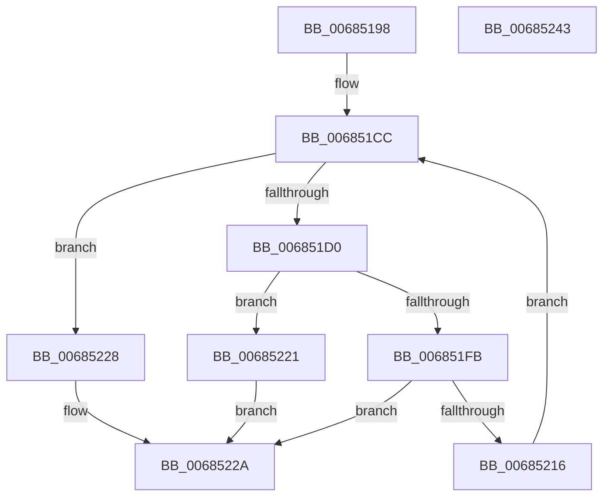

# MiDbgCopyPrivilegedData

- RVA: `0x00685198`–`0x00685244` (길이 `172` bytes)
- VA: `0x0000000140685198`
- 실행 섹션: `.text`
- PDB 이름 있음: `예`; PDB Function 태그: `아니요`
- unwind 정보 RVA: `0x00093E28`
- 디코드: `55`개 명령, `172/172` bytes 표시
- 미해석 바이트: `0` (있으면 어셈블리에 `.byte`로 보존)

> 이 문서는 커널 이미지의 기계어와 PDB 기호를 분석해 생성했습니다. 4번과 5번은 함수 원형과 자료형을 바이너리 사용 방식에서 추정한 C 해석이며 원본 소스 복구 결과는 아닙니다.

## 1. Dependencies

- 직접 호출 지점: **2**; 고유 호출 대상: **2**
- 직접 호출자로 확인된 함수: **2**
- RIP 상대 이미지 참조: **0**

### Outgoing calls
- `0x006851F2` → [MiGetPhysicalAddress](../23/MiGetPhysicalAddress_function_0023B120.md) (function, `0x0023B120`)
- `0x0068520D` → [VslWriteProtectedPage](../58/VslWriteProtectedPage_function_0058F99C.md) (function, `0x0058F99C`)

### Direct callers
- [MiApplyDebuggerPatches](../4F/MiApplyDebuggerPatches_function_004F7BE4.md) at `0x004F7D04`
- [MiCopyToUntrustedMemory](MiCopyToUntrustedMemory_function_00684894.md) at `0x006848EB`

### Static image references
- 디코드된 RIP-relative 메모리 참조가 없습니다.

## 2. Other-region calls and transfers

- 다른 실행 섹션으로 향하는 call: **0**
- 별도 외부 분기/꼬리 이동을 확인하지 못했습니다.

## 3. Assembly (complete function range)

```asm
00685198  48 8B C4                        mov rax, rsp
0068519B  48 89 58 08                     mov qword ptr [rax + 8], rbx
0068519F  48 89 68 10                     mov qword ptr [rax + 0x10], rbp
006851A3  48 89 70 18                     mov qword ptr [rax + 0x18], rsi
006851A7  57                              push rdi
006851A8  41 56                           push r14
006851AA  41 57                           push r15
006851AC  48 83 EC 40                     sub rsp, 0x40
006851B0  48 83 60 E0 00                  and qword ptr [rax - 0x20], 0
006851B5  49 8B F1                        mov rsi, r9
006851B8  83 60 D8 00                     and dword ptr [rax - 0x28], 0
006851BC  41 8B E8                        mov ebp, r8d
006851BF  8B 9C 24 80 00 00 00            mov ebx, dword ptr [rsp + 0x80]
006851C6  4C 8B F2                        mov r14, rdx
006851C9  4C 8B F9                        mov r15, rcx
006851CC  85 DB                           test ebx, ebx
006851CE  74 58                           je 0x140685228
006851D0  8B C6                           mov eax, esi
006851D2  4C 8D 44 24 30                  lea r8, [rsp + 0x30]
006851D7  25 FF 0F 00 00                  and eax, 0xfff
006851DC  BA 00 10 00 00                  mov edx, 0x1000
006851E1  2B D0                           sub edx, eax
006851E3  8B FB                           mov edi, ebx
006851E5  3B D3                           cmp edx, ebx
006851E7  48 8B CE                        mov rcx, rsi
006851EA  0F 46 FA                        cmovbe edi, edx
006851ED  48 8D 54 24 38                  lea rdx, [rsp + 0x38]
006851F2  E8 29 5F BB FF                  call 0x14023b120
006851F7  85 C0                           test eax, eax
006851F9  74 26                           je 0x140685221
006851FB  4C 8B 4C 24 38                  mov r9, qword ptr [rsp + 0x38]
00685200  44 8B C5                        mov r8d, ebp
00685203  49 8B D6                        mov rdx, r14
00685206  89 5C 24 20                     mov dword ptr [rsp + 0x20], ebx
0068520A  49 8B CF                        mov rcx, r15
0068520D  E8 8A A7 F0 FF                  call 0x14058f99c
00685212  85 C0                           test eax, eax
00685214  78 14                           js 0x14068522a
00685216  8B C7                           mov eax, edi
00685218  2B DF                           sub ebx, edi
0068521A  48 03 F0                        add rsi, rax
0068521D  03 EF                           add ebp, edi
0068521F  EB AB                           jmp 0x1406851cc
00685221  B8 05 00 00 C0                  mov eax, 0xc0000005
00685226  EB 02                           jmp 0x14068522a
00685228  33 C0                           xor eax, eax
0068522A  48 8B 5C 24 60                  mov rbx, qword ptr [rsp + 0x60]
0068522F  48 8B 6C 24 68                  mov rbp, qword ptr [rsp + 0x68]
00685234  48 8B 74 24 70                  mov rsi, qword ptr [rsp + 0x70]
00685239  48 83 C4 40                     add rsp, 0x40
0068523D  41 5F                           pop r15
0068523F  41 5E                           pop r14
00685241  5F                              pop rdi
00685242  C3                              ret
00685243  CC                              int3
```

## 4. C-style interpretation (structured pseudocode)

```c
__int64 __fastcall MiDbgCopyPrivilegedData(__int64 a1, __int64 a2, int a3, __int64 a4, unsigned int a5)
{
    __int64 result;
    __int64 v_rbp;
    __int64 v_rbx;
    __int64 v_rdi;
    __int64 v_rsi;
    __int64 v_rsp;
    unsigned __int64 v_stack_m20;
    unsigned __int64 v_stack_m28;
    unsigned int v_stack_m38;
    unsigned __int64 v_stack_p10;
    unsigned __int64 v_stack_p18;
    unsigned __int64 v_stack_p8;

    *(unsigned __int64 *)(v_rsp + 8) = v_rbx;
    *(unsigned __int64 *)(v_rsp + 16) = v_rbp;
    *(unsigned __int64 *)(v_rsp + 24) = v_rsi;
    v_rsp = (v_rsp) - (64);
loc_006851CC:
    if ((unsigned int)((unsigned int)(a5)) == 0) goto loc_00685228;
    result = (unsigned int)(((unsigned int)((unsigned int)(a4))) & (0xFFFULL));
    a2 = (unsigned int)(((unsigned int)(0x1000ULL)) - ((unsigned int)(result)));
    v_rdi = (unsigned int)((unsigned int)((unsigned int)(a5)));
    if (((unsigned int)(a2)) <= ((unsigned int)((unsigned int)(a5)))) { v_rdi = (unsigned int)(a2); }
    result = MiGetPhysicalAddress(a4, v_stack_m20, v_stack_m28, a4);
    if ((unsigned int)(result) == 0) goto loc_00685221;
    v_stack_m38 = (unsigned int)((unsigned int)(a5));
    result = VslWriteProtectedPage(a1, a2, (unsigned int)((unsigned int)((unsigned int)(a3))), v_stack_m20);
    if (sign_flag) goto loc_0068522A;
    v_rbx = (unsigned int)(((unsigned int)(a5)) - ((unsigned int)(v_rdi)));
    v_rsi = (a4) + ((unsigned int)((unsigned int)(v_rdi)));
    v_rbp = (unsigned int)(((unsigned int)(a3)) + ((unsigned int)(v_rdi)));
    goto loc_006851CC;
loc_00685221:
    goto loc_0068522A;
loc_00685228:
    result = 0;
loc_0068522A:
    v_rsp = (v_rsp) + (64);
    return result;
}
```

## 5. (Beta) C Style

```c
int64_t MiDbgCopyPrivilegedData(int64_t Arg1, int64_t Arg2, int32_t Arg3, int64_t Arg4, uint32_t Arg5)
{
    int64_t result;
    int64_t local_rbp;
    int64_t local_rbx;
    int64_t local_rdi;
    int64_t local_rsi;
    int64_t local_rsp;
    uint64_t v_stack_m20;
    uint64_t v_stack_m28;
    uint32_t v_stack_m38;
    uint64_t v_stack_p10;
    uint64_t v_stack_p18;
    uint64_t v_stack_p8;

    *(uint64_t *)(local_rsp + 0x8) = local_rbx;
    *(uint64_t *)(local_rsp + 0x10) = local_rbp;
    *(uint64_t *)(local_rsp + 0x18) = local_rsi;
    local_rsp = (local_rsp) - (64);
loc_006851CC:
    if ((uint32_t)((uint32_t)(Arg5)) == 0) goto loc_00685228;
    result = (uint32_t)(((uint32_t)((uint32_t)(Arg4))) & (0xFFFULL));
    Arg2 = (uint32_t)(((uint32_t)(0x1000ULL)) - ((uint32_t)(result)));
    local_rdi = (uint32_t)((uint32_t)((uint32_t)(Arg5)));
    if (((uint32_t)(Arg2)) <= ((uint32_t)((uint32_t)(Arg5)))) { local_rdi = (uint32_t)(Arg2); }
    result = MiGetPhysicalAddress(Arg4, v_stack_m20, v_stack_m28, Arg4);
    if ((uint32_t)(result) == 0) goto loc_00685221;
    v_stack_m38 = (uint32_t)((uint32_t)(Arg5));
    result = VslWriteProtectedPage(Arg1, Arg2, (uint32_t)((uint32_t)((uint32_t)(Arg3))), v_stack_m20);
    if (sign_flag) goto loc_0068522A;
    local_rbx = (uint32_t)(((uint32_t)(Arg5)) - ((uint32_t)(local_rdi)));
    local_rsi = (Arg4) + ((uint32_t)((uint32_t)(local_rdi)));
    local_rbp = (uint32_t)(((uint32_t)(Arg3)) + ((uint32_t)(local_rdi)));
    goto loc_006851CC;
loc_00685221:
    goto loc_0068522A;
loc_00685228:
    result = 0;
loc_0068522A:
    local_rsp = (local_rsp) + (64);
    return result;
}
```

## 6. Execution-region graph

[열기: 2D/3D 그래프와 함수 탐색 컨트롤 패널](../../../control-panel.html?section=text&rva=0x00685198&view=graph)

- 2D 그래프는 위에서 아래로 흐르고, 3D 그래프는 빈 공간을 드래그해 회전합니다. Shift+드래그는 이동, 휠은 확대·축소, 함수 노드 선택은 대상 보고서 이동입니다.

### Static fallback


