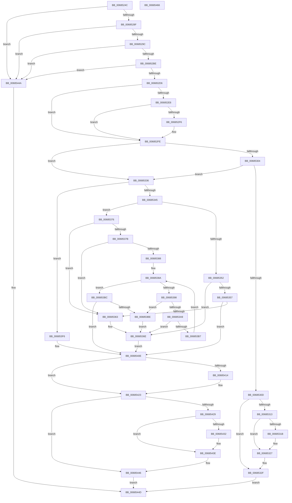

# MiDbgMarkPfnModified

- RVA: `0x0068524C`–`0x00685467` (길이 `539` bytes)
- VA: `0x000000014068524C`
- 실행 섹션: `.text`
- PDB 이름 있음: `예`; PDB Function 태그: `아니요`
- unwind 정보 RVA: `0x0006B074`
- 디코드: `134`개 명령, `539/539` bytes 표시
- 미해석 바이트: `0` (있으면 어셈블리에 `.byte`로 보존)

> 이 문서는 커널 이미지의 기계어와 PDB 기호를 분석해 생성했습니다. 4번과 5번은 함수 원형과 자료형을 바이너리 사용 방식에서 추정한 C 해석이며 원본 소스 복구 결과는 아닙니다.

## 1. Dependencies

- 직접 호출 지점: **6**; 고유 호출 대상: **5**
- 직접 호출자로 확인된 함수: **1**
- RIP 상대 이미지 참조: **5**

### Outgoing calls
- `0x006852F9` → [KiRaiseIrqlProcessIrqlFlags](../4F/KiRaiseIrqlProcessIrqlFlags_function_004F56FC.md) (function, `0x004F56FC`)
- `0x00685322` → [KiLowerIrqlProcessIrqlFlags](../4F/KiLowerIrqlProcessIrqlFlags_function_004F5698.md) (function, `0x004F5698`)
- `0x00685369` → [MiSetPfnModified](../36/MiSetPfnModified_function_00362960.md) (function, `0x00362960`)
- `0x0068537F` → [MiGetPagingFileOffset](../36/MiGetPagingFileOffset_function_0036F530.md) (function, `0x0036F530`)
- `0x006853D1` → [MiAddLockedPageCharge](../28/MiAddLockedPageCharge_function_0028B550.md) (function, `0x0028B550`)
- `0x00685439` → [KiLowerIrqlProcessIrqlFlags](../4F/KiLowerIrqlProcessIrqlFlags_function_004F5698.md) (function, `0x004F5698`)

### Direct callers
- [MiDbgWriteCheck](MiDbgWriteCheck_function_00685BE4.md) at `0x00685E5A`

### Static image references
- `0x00685278` → RVA `0x00FC6A88` (`ALMOSTRO`; read)
- `0x0068528F` → RVA `0x00E2DCE0` (`.data`; read)
- `0x006852EE` → RVA `0x00FC6D20` (`ALMOSTRO`; read)
- `0x0068538C` → RVA `0x00E2CB40` (`.data`; read)
- `0x006853E8` → RVA `0x00E0EBC8` (`.data`; read)

## 2. Other-region calls and transfers

- 다른 실행 섹션으로 향하는 call: **0**
- 별도 외부 분기/꼬리 이동을 확인하지 못했습니다.

## 3. Assembly (complete function range)

```asm
0068524C  48 89 5C 24 10                  mov qword ptr [rsp + 0x10], rbx
00685251  48 89 6C 24 18                  mov qword ptr [rsp + 0x18], rbp
00685256  48 89 74 24 20                  mov qword ptr [rsp + 0x20], rsi
0068525B  57                              push rdi
0068525C  41 56                           push r14
0068525E  41 57                           push r15
00685260  48 83 EC 20                     sub rsp, 0x20
00685264  48 C1 E9 0C                     shr rcx, 0xc
00685268  48 BD FF FF FF FF FF 00 00 00   movabs rbp, 0xffffffffff
00685272  48 23 CD                        and rcx, rbp
00685275  44 8B F2                        mov r14d, edx
00685278  48 F7 05 05 18 94 00 00 00 00 10  test qword ptr [rip + 0x941805], 0x10000000
00685283  41 BF 01 00 00 00               mov r15d, 1
00685289  0F 84 BB 01 00 00               je 0x14068544a
0068528F  48 3B 0D 4A 8A 7A 00            cmp rcx, qword ptr [rip + 0x7a8a4a]
00685296  0F 87 AE 01 00 00               ja 0x14068544a
0068529C  48 8D 14 49                     lea rdx, [rcx + rcx*2]
006852A0  48 03 D2                        add rdx, rdx
006852A3  48 B8 28 00 00 00 00 DE FF FF   movabs rax, 0xffffde0000000028
006852AD  48 8B 04 D0                     mov rax, qword ptr [rax + rdx*8]
006852B1  48 C1 E8 36                     shr rax, 0x36
006852B5  41 85 C7                        test r15d, eax
006852B8  0F 84 8C 01 00 00               je 0x14068544a
006852BE  48 B8 00 00 00 00 00 DE FF FF   movabs rax, 0xffffde0000000000
006852C8  48 8D 1C D0                     lea rbx, [rax + rdx*8]
006852CC  F6 43 22 10                     test byte ptr [rbx + 0x22], 0x10
006852D0  0F 85 74 01 00 00               jne 0x14068544a
006852D6  33 F6                           xor esi, esi
006852D8  40 B7 11                        mov dil, 0x11
006852DB  44 0F 20 C0                     mov rax, cr8
006852DF  8D 56 02                        lea edx, [rsi + 2]
006852E2  3A C2                           cmp al, dl
006852E4  73 18                           jae 0x1406852fe
006852E6  44 0F 20 C7                     mov rdi, cr8
006852EA  44 0F 22 C2                     mov cr8, rdx
006852EE  39 35 2C 1A 94 00               cmp dword ptr [rip + 0x941a2c], esi
006852F4  74 08                           je 0x1406852fe
006852F6  40 8A CF                        mov cl, dil
006852F9  E8 FE 03 E7 FF                  call 0x1404f56fc
006852FE  41 F6 C6 03                     test r14b, 3
00685302  75 32                           jne 0x140685336
00685304  F0 48 0F BA 6B 18 3F            lock bts qword ptr [rbx + 0x18], 0x3f
0068530B  73 29                           jae 0x140685336
0068530D  40 80 FF 11                     cmp dil, 0x11
00685311  74 1C                           je 0x14068532f
00685313  39 35 07 1A 94 00               cmp dword ptr [rip + 0x941a07], esi
00685319  74 0C                           je 0x140685327
0068531B  44 0F 20 C1                     mov rcx, cr8
0068531F  40 8A D7                        mov dl, dil
00685322  E8 71 03 E7 FF                  call 0x1404f5698
00685327  40 0F B6 C7                     movzx eax, dil
0068532B  44 0F 22 C0                     mov cr8, rax
0068532F  33 C0                           xor eax, eax
00685331  E9 17 01 00 00                  jmp 0x14068544d
00685336  48 8B 43 18                     mov rax, qword ptr [rbx + 0x18]
0068533A  48 0F BA E0 3E                  bt rax, 0x3e
0068533F  0F 82 B1 00 00 00               jb 0x1406853f6
00685345  8B 43 10                        mov eax, dword ptr [rbx + 0x10]
00685348  8A 4B 22                        mov cl, byte ptr [rbx + 0x22]
0068534B  48 0F BA E0 0A                  bt rax, 0xa
00685350  73 24                           jae 0x140685376
00685352  F6 C1 10                        test cl, 0x10
00685355  75 17                           jne 0x14068536e
00685357  48 0F BA 63 28 35               bt qword ptr [rbx + 0x28], 0x35
0068535D  0F 82 AB 00 00 00               jb 0x14068540e
00685363  41 8B D7                        mov edx, r15d
00685366  48 8B CB                        mov rcx, rbx
00685369  E8 F2 D5 CD FF                  call 0x140362960
0068536E  41 8B F7                        mov esi, r15d
00685371  E9 98 00 00 00                  jmp 0x14068540e
00685376  F6 C1 08                        test cl, 8
00685379  75 E8                           jne 0x140685363
0068537B  48 8B 4B 10                     mov rcx, qword ptr [rbx + 0x10]
0068537F  E8 AC A1 CE FF                  call 0x14036f530
00685384  85 C0                           test eax, eax
00685386  74 DB                           je 0x140685363
00685388  33 C9                           xor ecx, ecx
0068538A  8B E9                           mov ebp, ecx
0068538C  48 8D 15 AD 77 7A 00            lea rdx, [rip + 0x7a77ad]
00685393  83 F9 20                        cmp ecx, 0x20
00685396  73 24                           jae 0x1406853bc
00685398  33 C0                           xor eax, eax
0068539A  F0 48 0F B1 9C CA A8 37 00 00   lock cmpxchg qword ptr [rdx + rcx*8 + 0x37a8], rbx
006853A4  48 8B D0                        mov rdx, rax
006853A7  74 15                           je 0x1406853be
006853A9  48 8B C3                        mov rax, rbx
006853AC  49 0B D7                        or rdx, r15
006853AF  49 0B C7                        or rax, r15
006853B2  48 3B D0                        cmp rdx, rax
006853B5  74 B7                           je 0x14068536e
006853B7  41 03 CF                        add ecx, r15d
006853BA  EB CE                           jmp 0x14068538a
006853BC  74 50                           je 0x14068540e
006853BE  8B 43 20                        mov eax, dword ptr [rbx + 0x20]
006853C1  40 80 FF 11                     cmp dil, 0x11
006853C5  BA 05 00 00 00                  mov edx, 5
006853CA  48 8B CB                        mov rcx, rbx
006853CD  41 0F 45 D7                     cmovne edx, r15d
006853D1  E8 7A 61 C0 FF                  call 0x14028b550
006853D6  48 8D 05 63 77 7A 00            lea rax, [rip + 0x7a7763]
006853DD  F0 4C 01 BC E8 A8 37 00 00      lock add qword ptr [rax + rbp*8 + 0x37a8], r15
006853E6  33 C0                           xor eax, eax
006853E8  F0 44 0F B1 3D D7 97 78 00      lock cmpxchg dword ptr [rip + 0x7897d7], r15d
006853F1  E9 78 FF FF FF                  jmp 0x14068536e
006853F6  48 8B 43 28                     mov rax, qword ptr [rbx + 0x28]
006853FA  48 B9 FE FF FF FF 3F 00 00 00   movabs rcx, 0x3ffffffffe
00685404  48 23 C5                        and rax, rbp
00685407  48 3B C1                        cmp rax, rcx
0068540A  40 0F 94 C6                     sete sil
0068540E  41 F6 C6 03                     test r14b, 3
00685412  75 0F                           jne 0x140685423
00685414  48 B8 FF FF FF FF FF FF FF 7F   movabs rax, 0x7fffffffffffffff
0068541E  F0 48 21 43 18                  lock and qword ptr [rbx + 0x18], rax
00685423  40 80 FF 11                     cmp dil, 0x11
00685427  74 1D                           je 0x140685446
00685429  83 3D F0 18 94 00 00            cmp dword ptr [rip + 0x9418f0], 0
00685430  74 0C                           je 0x14068543e
00685432  44 0F 20 C1                     mov rcx, cr8
00685436  40 8A D7                        mov dl, dil
00685439  E8 5A 02 E7 FF                  call 0x1404f5698
0068543E  40 0F B6 C7                     movzx eax, dil
00685442  44 0F 22 C0                     mov cr8, rax
00685446  8B C6                           mov eax, esi
00685448  EB 03                           jmp 0x14068544d
0068544A  41 8B C7                        mov eax, r15d
0068544D  48 8B 5C 24 48                  mov rbx, qword ptr [rsp + 0x48]
00685452  48 8B 6C 24 50                  mov rbp, qword ptr [rsp + 0x50]
00685457  48 8B 74 24 58                  mov rsi, qword ptr [rsp + 0x58]
0068545C  48 83 C4 20                     add rsp, 0x20
00685460  41 5F                           pop r15
00685462  41 5E                           pop r14
00685464  5F                              pop rdi
00685465  C3                              ret
00685466  CC                              int3
```

## 4. C-style interpretation (structured pseudocode)

```c
__int64 __fastcall MiDbgMarkPfnModified(__int64 a1, int a2)
{
    __int64 result;
    __int64 v_rsi;
    __int64 v_rsp;
    unsigned __int64 v_stack_p10;
    unsigned __int64 v_stack_p18;
    unsigned __int64 v_stack_p20;

    v_stack_p10 = v_rbx;
    v_stack_p18 = v_rbp;
    v_stack_p20 = v_rsi;
    v_rsp = (v_rsp) - (32);
    a1 = (a1) >> (12);
    a1 = (a1) & (v_rbp);
    if (((*(unsigned __int64 *)(v_rip + 9705477)) & (0x10000000ULL)) == 0) goto loc_0068544A;
    if (a1 > (*(unsigned __int64 *)(v_rip + 8030794))) goto loc_0068544A;
    a2 = (a1 + a1 * 2) + (a1 + a1 * 2);
    result = (*(unsigned __int64 *)(result + a2 * 8)) >> (54);
    if (((1) & ((unsigned int)(result))) == 0) goto loc_0068544A;
    if (((*(unsigned __int8 *)(result + a2 * 8 + 34)) & (16)) != 0) goto loc_0068544A;
    v_rsi = 0;
    if (((unsigned __int8)(v_cr8)) >= ((unsigned __int8)(v_rsi + 2))) goto loc_006852FE;
    result = v_cr8;
    if ((*(unsigned int *)(v_rip + 9706028)) != 0) {
        a1 = (unsigned __int8)(v_cr8);
        result = KiRaiseIrqlProcessIrqlFlags(a1, v_rsi + 2, a3, a4);
    }
    if ((((unsigned __int8)((unsigned int)(a2))) & (3)) != 0) goto loc_00685336;
    if (condition_is_above_or_equal) goto loc_00685336;
    if (((unsigned __int8)(v_cr8)) == 17) goto loc_0068532F;
    if ((*(unsigned int *)(v_rip + 9705991)) != 0) {
        a1 = v_rsi + 2;
        a2 = (unsigned __int8)(v_cr8);
        result = KiLowerIrqlProcessIrqlFlags(a1, a2, a3, a4);
    }
loc_0068532F:
    result = 0;
    goto loc_0068544D;
loc_00685336:
    if (condition_is_below) goto loc_006853F6;
    if (condition_is_above_or_equal) goto loc_00685376;
    if ((((unsigned __int8)(*(unsigned __int8 *)(result + a2 * 8 + 34))) & (16)) != 0) goto loc_0068536E;
    if (condition_is_below) goto loc_0068540E;
loc_00685363:
    result = MiSetPfnModified(result + a2 * 8, 1, a3, a4);
loc_0068536E:
    goto loc_0068540E;
loc_00685376:
    if ((((unsigned __int8)(result + a2 * 8)) & (8)) != 0) goto loc_00685363;
    result = MiGetPagingFileOffset(*(unsigned __int64 *)(result + a2 * 8 + 16), 1, a3, a4);
    if ((unsigned int)(result) == 0) goto loc_00685363;
    a1 = 0;
loc_0068538A:
    if (0 >= 32) goto loc_006853BC;
    result = 0;
    if (condition_is_equal) goto loc_006853BE;
    a2 = (0) | (1);
    result = (result + a2 * 8) | (1);
    if (a2 == result) goto loc_0068536E;
    a1 = (unsigned int)((a1) + (1));
    goto loc_0068538A;
loc_006853BC:
    if (condition_is_equal) goto loc_0068540E;
loc_006853BE:
    a2 = 5;
    if (((unsigned __int8)(v_cr8)) != 17) { a2 = 1; }
    result = MiAddLockedPageCharge(result + a2 * 8, a2, a3, a4);
    result = 0;
    goto loc_0068536E;
loc_006853F6:
    result = (*(unsigned __int64 *)(result + a2 * 8 + 40)) & (0);
    v_rsi = (result == (result + a2 * 8)) ? 1 : 0;
loc_0068540E:
    if ((((unsigned __int8)((unsigned int)(a2))) & (3)) == 0) {
    }
    if (((unsigned __int8)(v_cr8)) == 17) goto loc_00685446;
    if ((*(unsigned int *)(v_rip + 9705712)) != 0) {
        a1 = (unsigned __int8)(v_cr8);
        a2 = (unsigned __int8)(v_cr8);
        result = KiLowerIrqlProcessIrqlFlags(a1, a2, a3, a4);
    }
loc_00685446:
    goto loc_0068544D;
loc_0068544A:
loc_0068544D:
    v_rsp = (v_rsp) + (32);
    return 1;
}
```

## 5. (Beta) C Style

```c
int64_t MiDbgMarkPfnModified(int64_t Arg1, int32_t Arg2)
{
    int64_t result;
    int64_t local_rsi;
    int64_t local_rsp;
    uint64_t v_stack_p10;
    uint64_t v_stack_p18;
    uint64_t v_stack_p20;

    v_stack_p10 = local_rbx;
    v_stack_p18 = local_rbp;
    v_stack_p20 = local_rsi;
    local_rsp = (local_rsp) - (32);
    Arg1 = (Arg1) >> (12);
    Arg1 = (Arg1) & (local_rbp);
    if (((*(uint64_t *)(v_rip + 0x941805)) & (0x10000000ULL)) == 0) goto loc_0068544A;
    if (Arg1 > (*(uint64_t *)(v_rip + 0x7A8A4A))) goto loc_0068544A;
    Arg2 = (Arg1 + Arg1 * 2) + (Arg1 + Arg1 * 2);
    result = (*(uint64_t *)(result + Arg2 * 8)) >> (54);
    if (((1) & ((uint32_t)(result))) == 0) goto loc_0068544A;
    if (((*(uint8_t *)(result + Arg2 * 8 + 0x22)) & (16)) != 0) goto loc_0068544A;
    local_rsi = 0;
    if (((uint8_t)(v_cr8)) >= ((uint8_t)(local_rsi + 2))) goto loc_006852FE;
    result = v_cr8;
    if ((*(uint32_t *)(v_rip + 0x941A2C)) != 0) {
        Arg1 = (uint8_t)(v_cr8);
        result = KiRaiseIrqlProcessIrqlFlags(Arg1, local_rsi + 2, a3, a4);
    }
    if ((((uint8_t)((uint32_t)(Arg2))) & (3)) != 0) goto loc_00685336;
    if (condition_is_above_or_equal) goto loc_00685336;
    if (((uint8_t)(v_cr8)) == 17) goto loc_0068532F;
    if ((*(uint32_t *)(v_rip + 0x941A07)) != 0) {
        Arg1 = local_rsi + 2;
        Arg2 = (uint8_t)(v_cr8);
        result = KiLowerIrqlProcessIrqlFlags(Arg1, Arg2, a3, a4);
    }
loc_0068532F:
    result = 0;
    goto loc_0068544D;
loc_00685336:
    if (condition_is_below) goto loc_006853F6;
    if (condition_is_above_or_equal) goto loc_00685376;
    if ((((uint8_t)(*(uint8_t *)(result + Arg2 * 8 + 0x22))) & (16)) != 0) goto loc_0068536E;
    if (condition_is_below) goto loc_0068540E;
loc_00685363:
    result = MiSetPfnModified(result + Arg2 * 8, 1, a3, a4);
loc_0068536E:
    goto loc_0068540E;
loc_00685376:
    if ((((uint8_t)(result + Arg2 * 8)) & (8)) != 0) goto loc_00685363;
    result = MiGetPagingFileOffset(*(uint64_t *)(result + Arg2 * 8 + 0x10), 1, a3, a4);
    if ((uint32_t)(result) == 0) goto loc_00685363;
    Arg1 = 0;
loc_0068538A:
    if (0 >= 32) goto loc_006853BC;
    result = 0;
    if (condition_is_equal) goto loc_006853BE;
    Arg2 = (0) | (1);
    result = (result + Arg2 * 8) | (1);
    if (Arg2 == result) goto loc_0068536E;
    Arg1 = (uint32_t)((Arg1) + (1));
    goto loc_0068538A;
loc_006853BC:
    if (condition_is_equal) goto loc_0068540E;
loc_006853BE:
    Arg2 = 5;
    if (((uint8_t)(v_cr8)) != 17) { Arg2 = 1; }
    result = MiAddLockedPageCharge(result + Arg2 * 8, Arg2, a3, a4);
    result = 0;
    goto loc_0068536E;
loc_006853F6:
    result = (*(uint64_t *)(result + Arg2 * 8 + 0x28)) & (0);
    local_rsi = (result == (result + Arg2 * 8)) ? 1 : 0;
loc_0068540E:
    if ((((uint8_t)((uint32_t)(Arg2))) & (3)) == 0) {
    }
    if (((uint8_t)(v_cr8)) == 17) goto loc_00685446;
    if ((*(uint32_t *)(v_rip + 0x9418F0)) != 0) {
        Arg1 = (uint8_t)(v_cr8);
        Arg2 = (uint8_t)(v_cr8);
        result = KiLowerIrqlProcessIrqlFlags(Arg1, Arg2, a3, a4);
    }
loc_00685446:
    goto loc_0068544D;
loc_0068544A:
loc_0068544D:
    local_rsp = (local_rsp) + (32);
    return 1;
}
```

## 6. Execution-region graph

[열기: 2D/3D 그래프와 함수 탐색 컨트롤 패널](../../../control-panel.html?section=text&rva=0x0068524C&view=graph)

- 2D 그래프는 위에서 아래로 흐르고, 3D 그래프는 빈 공간을 드래그해 회전합니다. Shift+드래그는 이동, 휠은 확대·축소, 함수 노드 선택은 대상 보고서 이동입니다.

### Static fallback


