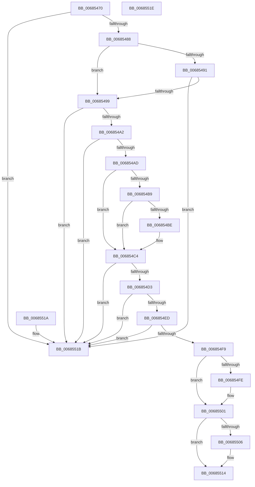

# MiDbgPatchIdentity

- RVA: `0x00685470`–`0x0068551F` (길이 `175` bytes)
- VA: `0x0000000140685470`
- 실행 섹션: `.text`
- PDB 이름 있음: `예`; PDB Function 태그: `아니요`
- unwind 정보 RVA: `0x000DB714`
- 디코드: `54`개 명령, `175/175` bytes 표시
- 미해석 바이트: `0` (있으면 어셈블리에 `.byte`로 보존)

> 이 문서는 커널 이미지의 기계어와 PDB 기호를 분석해 생성했습니다. 4번과 5번은 함수 원형과 자료형을 바이너리 사용 방식에서 추정한 C 해석이며 원본 소스 복구 결과는 아닙니다.

## 1. Dependencies

- 직접 호출 지점: **0**; 고유 호출 대상: **0**
- 직접 호출자로 확인된 함수: **2**
- RIP 상대 이미지 참조: **1**

### Outgoing calls
- 직접 디코드된 call 명령이 없습니다.

### Direct callers
- [MiDbgCopyMemory](MiDbgCopyMemory_function_00684A18.md) at `0x00684C7D`
- [MiDbgTranslatePhysicalAddress](MiDbgTranslatePhysicalAddress_function_00685760.md) at `0x006858E0`

### Static image references
- `0x006854AD` → RVA `0x00E2DC80` (`.data`; read)

## 2. Other-region calls and transfers

- 다른 실행 섹션으로 향하는 call: **0**
- 별도 외부 분기/꼬리 이동을 확인하지 못했습니다.

## 3. Assembly (complete function range)

```asm
00685470  48 8B 41 18                     mov rax, qword ptr [rcx + 0x18]
00685474  4C 8B CA                        mov r9, rdx
00685477  48 0F BA E0 3E                  bt rax, 0x3e
0068547C  4D 8B D0                        mov r10, r8
0068547F  48 8B D1                        mov rdx, rcx
00685482  0F 82 93 00 00 00               jb 0x14068551b
00685488  8A 41 22                        mov al, byte ptr [rcx + 0x22]
0068548B  24 07                           and al, 7
0068548D  A8 FA                           test al, 0xfa
0068548F  75 08                           jne 0x140685499
00685491  3C 04                           cmp al, 4
00685493  0F 85 82 00 00 00               jne 0x14068551b
00685499  48 8B 41 28                     mov rax, qword ptr [rcx + 0x28]
0068549D  48 85 C0                        test rax, rax
006854A0  79 79                           jns 0x14068551b
006854A2  48 8B 49 10                     mov rcx, qword ptr [rcx + 0x10]
006854A6  48 0F BA E1 0A                  bt rcx, 0xa
006854AB  73 6E                           jae 0x14068551b
006854AD  48 8B 05 CC 87 7A 00            mov rax, qword ptr [rip + 0x7a87cc]
006854B4  48 85 C0                        test rax, rax
006854B7  74 0B                           je 0x1406854c4
006854B9  F6 C1 10                        test cl, 0x10
006854BC  75 06                           jne 0x1406854c4
006854BE  48 F7 D0                        not rax
006854C1  48 23 C8                        and rcx, rax
006854C4  48 C1 F9 10                     sar rcx, 0x10
006854C8  4C 8B 01                        mov r8, qword ptr [rcx]
006854CB  41 8B 40 38                     mov eax, dword ptr [r8 + 0x38]
006854CF  A8 20                           test al, 0x20
006854D1  74 48                           je 0x14068551b
006854D3  48 8B 52 08                     mov rdx, qword ptr [rdx + 8]
006854D7  48 B8 00 00 00 00 00 00 00 80   movabs rax, 0x8000000000000000
006854E1  4C 8B 59 08                     mov r11, qword ptr [rcx + 8]
006854E5  48 0B D0                        or rdx, rax
006854E8  49 3B D3                        cmp rdx, r11
006854EB  72 2E                           jb 0x14068551b
006854ED  8B 41 2C                        mov eax, dword ptr [rcx + 0x2c]
006854F0  49 8D 0C C3                     lea rcx, [r11 + rax*8]
006854F4  48 3B D1                        cmp rdx, rcx
006854F7  73 22                           jae 0x14068551b
006854F9  4D 85 C9                        test r9, r9
006854FC  74 03                           je 0x140685501
006854FE  4D 89 01                        mov qword ptr [r9], r8
00685501  4D 85 D2                        test r10, r10
00685504  74 0E                           je 0x140685514
00685506  49 2B 90 88 00 00 00            sub rdx, qword ptr [r8 + 0x88]
0068550D  48 C1 FA 03                     sar rdx, 3
00685511  41 89 12                        mov dword ptr [r10], edx
00685514  B8 01 00 00 00                  mov eax, 1
00685519  C3                              ret
0068551A  CC                              int3
0068551B  33 C0                           xor eax, eax
0068551D  C3                              ret
0068551E  CC                              int3
```

## 4. C-style interpretation (structured pseudocode)

```c
__int64 __fastcall MiDbgPatchIdentity(__int64 a1, __int64 a2, __int64 a3)
{
    __int64 result;

    if (condition_is_below) goto loc_0068551B;
    result = (unsigned __int8)((*(unsigned __int8 *)(a1 + 34)) & (7));
    if ((((unsigned __int8)(result)) & (250)) != 0) goto loc_00685499;
    if (((unsigned __int8)(result)) != 4) goto loc_0068551B;
loc_00685499:
    if (!sign_flag) goto loc_0068551B;
    if (condition_is_above_or_equal) goto loc_0068551B;
    if (*(unsigned __int64 *)(v_rip + 8030156) == 0) goto loc_006854C4;
    result = *(unsigned __int64 *)(v_rip + 8030156);
    if ((((unsigned __int8)(*(unsigned __int64 *)(a1 + 16))) & (16)) == 0) {
        result = ~(*(unsigned __int64 *)(v_rip + 8030156));
        a1 = (*(unsigned __int64 *)(a1 + 16)) & (result);
    }
    a1 = (a1) >> (16);
    if ((((unsigned __int8)((unsigned int)(*(unsigned int *)(*(unsigned __int64 *)(a1) + 56)))) & (32)) == 0) goto loc_0068551B;
    a2 = (*(unsigned __int64 *)(a1 + 8)) | ((unsigned int)(*(unsigned int *)(*(unsigned __int64 *)(a1) + 56)));
    if (a2 < (*(unsigned __int64 *)(a1 + 8))) goto loc_0068551B;
    if (a2 >= (*(unsigned __int64 *)(a1 + 8) + (unsigned int)(*(unsigned int *)(a1 + 44)) * 8)) goto loc_0068551B;
    if (a2 != 0) {
        *(unsigned __int64 *)(a2) = *(unsigned __int64 *)(a1);
    }
    if (a3 != 0) {
        a2 = (a2) - (*(unsigned __int64 *)(*(unsigned __int64 *)(a1) + 136));
        a2 = (a2) >> (3);
        *(unsigned int *)(a3) = (unsigned int)(a2);
    }
    return 1;
loc_0068551B:
    result = 0;
    return result;
}
```

## 5. (Beta) C Style

```c
int64_t MiDbgPatchIdentity(void *Arg1, int64_t Arg2, int64_t Arg3)
{
    uint8_t *arg1 = (uint8_t *)Arg1;

    int64_t result;

    if (condition_is_below) goto loc_0068551B;
    result = (uint8_t)((*(uint8_t *)(arg1 + 0x22)) & (7));
    if ((((uint8_t)(result)) & (250)) != 0) goto loc_00685499;
    if (((uint8_t)(result)) != 4) goto loc_0068551B;
loc_00685499:
    if (!sign_flag) goto loc_0068551B;
    if (condition_is_above_or_equal) goto loc_0068551B;
    if (*(uint64_t *)(v_rip + 0x7A87CC) == 0) goto loc_006854C4;
    result = *(uint64_t *)(v_rip + 0x7A87CC);
    if ((((uint8_t)(*(uint64_t *)(arg1 + 0x10))) & (16)) == 0) {
        result = ~(*(uint64_t *)(v_rip + 0x7A87CC));
        Arg1 = (*(uint64_t *)(arg1 + 0x10)) & (result);
    }
    Arg1 = (Arg1) >> (16);
    if ((((uint8_t)((uint32_t)(*(uint32_t *)(*(uint64_t *)(arg1) + 0x38)))) & (32)) == 0) goto loc_0068551B;
    Arg2 = (*(uint64_t *)(arg1 + 0x8)) | ((uint32_t)(*(uint32_t *)(*(uint64_t *)(arg1) + 0x38)));
    if (Arg2 < (*(uint64_t *)(arg1 + 0x8))) goto loc_0068551B;
    if (Arg2 >= (*(uint64_t *)(arg1 + 0x8) + (uint32_t)(*(uint32_t *)(arg1 + 0x2C)) * 8)) goto loc_0068551B;
    if (Arg2 != 0) {
        *(uint64_t *)(Arg2) = *(uint64_t *)(arg1);
    }
    if (Arg3 != 0) {
        Arg2 = (Arg2) - (*(uint64_t *)(*(uint64_t *)(arg1) + 0x88));
        Arg2 = (Arg2) >> (3);
        *(uint32_t *)(Arg3) = (uint32_t)(Arg2);
    }
    return 1;
loc_0068551B:
    result = 0;
    return result;
}
```

### 관측된 메모리 오프셋

구조체 형식이 확인되지 않은 접근은 인자 기준의 오프셋으로만 기록했습니다.

| 기준 인자 | 오프셋 표현 | 폭 (bit) | 접근 |
|---|---:|---:|---|
| `Arg1` | `+ 0x8` | `64` | `R` |
| `Arg1` | `+ 0x10` | `64` | `R` |
| `Arg1` | `+ 0x18` | `64` | `R` |
| `Arg1` | `+ 0x22` | `8` | `R` |
| `Arg1` | `+ 0x28` | `64` | `R` |

## 6. Execution-region graph

[열기: 2D/3D 그래프와 함수 탐색 컨트롤 패널](../../../control-panel.html?section=text&rva=0x00685470&view=graph)

- 2D 그래프는 위에서 아래로 흐르고, 3D 그래프는 빈 공간을 드래그해 회전합니다. Shift+드래그는 이동, 휠은 확대·축소, 함수 노드 선택은 대상 보고서 이동입니다.

### Static fallback


