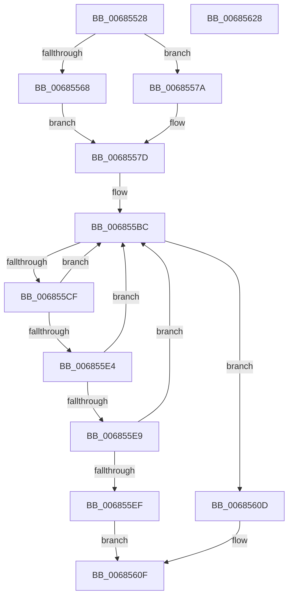

# MiDbgPteWriteInProgress

- RVA: `0x00685528`–`0x00685629` (길이 `257` bytes)
- VA: `0x0000000140685528`
- 실행 섹션: `.text`
- PDB 이름 있음: `예`; PDB Function 태그: `아니요`
- unwind 정보 RVA: `0x000BDE04`
- 디코드: `65`개 명령, `257/257` bytes 표시
- 미해석 바이트: `0` (있으면 어셈블리에 `.byte`로 보존)

> 이 문서는 커널 이미지의 기계어와 PDB 기호를 분석해 생성했습니다. 4번과 5번은 함수 원형과 자료형을 바이너리 사용 방식에서 추정한 C 해석이며 원본 소스 복구 결과는 아닙니다.

## 1. Dependencies

- 직접 호출 지점: **3**; 고유 호출 대상: **3**
- 직접 호출자로 확인된 함수: **1**
- RIP 상대 이미지 참조: **2**

### Outgoing calls
- `0x006855C6` → [KeEnumerateNextProcessor](../41/KeEnumerateNextProcessor_function_00415480.md) (function, `0x00415480`)
- `0x006855D3` → [KeGetPrcb](../2D/KeGetPrcb_function_002D85D0.md) (function, `0x002D85D0`)
- `0x00685606` → [MiDbgTranslatePhysicalAddress](MiDbgTranslatePhysicalAddress_function_00685760.md) (function, `0x00685760`)

### Direct callers
- [MiDbgCopyMemory](MiDbgCopyMemory_function_00684A18.md) at `0x00684BFE`

### Static image references
- `0x006855A4` → RVA `0x00FC7128` (`ALMOSTRO`; read)
- `0x006855B0` → RVA `0x00FC7120` (`ALMOSTRO`; read)

## 2. Other-region calls and transfers

- 다른 실행 섹션으로 향하는 call: **0**
- 별도 외부 분기/꼬리 이동을 확인하지 못했습니다.

## 3. Assembly (complete function range)

```asm
00685528  48 8B C4                        mov rax, rsp
0068552B  48 89 58 10                     mov qword ptr [rax + 0x10], rbx
0068552F  48 89 68 18                     mov qword ptr [rax + 0x18], rbp
00685533  48 89 70 20                     mov qword ptr [rax + 0x20], rsi
00685537  57                              push rdi
00685538  41 56                           push r14
0068553A  41 57                           push r15
0068553C  48 83 EC 40                     sub rsp, 0x40
00685540  45 33 FF                        xor r15d, r15d
00685543  49 8B E8                        mov rbp, r8
00685546  44 89 78 DA                     mov dword ptr [rax - 0x26], r15d
0068554A  44 8B F2                        mov r14d, edx
0068554D  66 44 89 78 DE                  mov word ptr [rax - 0x22], r15w
00685552  48 8B D9                        mov rbx, rcx
00685555  44 89 78 08                     mov dword ptr [rax + 8], r15d
00685559  48 B8 00 00 00 00 00 80 FF FF   movabs rax, 0xffff800000000000
00685563  48 3B C8                        cmp rcx, rax
00685566  73 12                           jae 0x14068557a
00685568  65 48 8B 04 25 88 01 00 00      mov rax, qword ptr gs:[0x188]
00685571  48 8B B0 B8 00 00 00            mov rsi, qword ptr [rax + 0xb8]
00685578  EB 03                           jmp 0x14068557d
0068557A  49 8B F7                        mov rsi, r15
0068557D  48 8B FB                        mov rdi, rbx
00685580  48 B8 F8 FF FF FF 7F 00 00 00   movabs rax, 0x7ffffffff8
0068558A  48 C1 EF 09                     shr rdi, 9
0068558E  48 23 F8                        and rdi, rax
00685591  48 B8 00 00 00 00 80 F6 FF FF   movabs rax, 0xfffff68000000000
0068559B  48 03 F8                        add rdi, rax
0068559E  66 44 89 7C 24 30               mov word ptr [rsp + 0x30], r15w
006855A4  48 8B 05 7D 1B 94 00            mov rax, qword ptr [rip + 0x941b7d]
006855AB  48 89 44 24 28                  mov qword ptr [rsp + 0x28], rax
006855B0  48 8D 05 69 1B 94 00            lea rax, [rip + 0x941b69]
006855B7  48 89 44 24 20                  mov qword ptr [rsp + 0x20], rax
006855BC  48 8D 54 24 20                  lea rdx, [rsp + 0x20]
006855C1  48 8D 4C 24 60                  lea rcx, [rsp + 0x60]
006855C6  E8 B5 FE D8 FF                  call 0x140415480
006855CB  85 C0                           test eax, eax
006855CD  75 3E                           jne 0x14068560d
006855CF  8B 4C 24 60                     mov ecx, dword ptr [rsp + 0x60]
006855D3  E8 F8 2F C5 FF                  call 0x1402d85d0
006855D8  48 8B 80 08 9C 00 00            mov rax, qword ptr [rax + 0x9c08]
006855DF  48 85 C0                        test rax, rax
006855E2  74 D8                           je 0x1406855bc
006855E4  48 39 30                        cmp qword ptr [rax], rsi
006855E7  75 D3                           jne 0x1406855bc
006855E9  48 39 78 08                     cmp qword ptr [rax + 8], rdi
006855ED  75 CD                           jne 0x1406855bc
006855EF  48 8B 48 10                     mov rcx, qword ptr [rax + 0x10]
006855F3  81 E3 FF 0F 00 00               and ebx, 0xfff
006855F9  48 C1 E1 0C                     shl rcx, 0xc
006855FD  4C 8B C5                        mov r8, rbp
00685600  48 03 CB                        add rcx, rbx
00685603  41 8B D6                        mov edx, r14d
00685606  E8 55 01 00 00                  call 0x140685760
0068560B  EB 02                           jmp 0x14068560f
0068560D  33 C0                           xor eax, eax
0068560F  48 8B 5C 24 68                  mov rbx, qword ptr [rsp + 0x68]
00685614  48 8B 6C 24 70                  mov rbp, qword ptr [rsp + 0x70]
00685619  48 8B 74 24 78                  mov rsi, qword ptr [rsp + 0x78]
0068561E  48 83 C4 40                     add rsp, 0x40
00685622  41 5F                           pop r15
00685624  41 5E                           pop r14
00685626  5F                              pop rdi
00685627  C3                              ret
00685628  CC                              int3
```

## 4. C-style interpretation (structured pseudocode)

```c
__int64 __fastcall MiDbgPteWriteInProgress(__int64 a1, int a2, __int64 a3)
{
    __int64 result;
    __int64 v_r15;
    __int64 v_rbx;
    __int64 v_rdi;
    __int64 v_rsp;
    unsigned __int16 v_stack_m28;
    unsigned __int64 v_stack_m30;
    unsigned __int64 v_stack_m38;
    unsigned __int64 v_stack_p10;
    unsigned __int64 v_stack_p18;
    unsigned __int64 v_stack_p20;
    unsigned __int64 v_stack_p8;

    *(unsigned __int64 *)(v_rsp + 16) = v_rbx;
    *(unsigned __int64 *)(v_rsp + 24) = v_rbp;
    *(unsigned __int64 *)(v_rsp + 32) = v_rsi;
    v_rsp = (v_rsp) - (64);
    v_r15 = 0;
    *(unsigned int *)(v_rsp - 38) = 0;
    *(unsigned __int16 *)(v_rsp - 34) = 0;
    *(unsigned int *)(v_rsp + 8) = 0;
    if (a1 >= v_rsp) goto loc_0068557A;
    goto loc_0068557D;
loc_0068557A:
loc_0068557D:
    v_rdi = (a1) >> (9);
    v_rdi = (v_rdi) & (*(unsigned __int64 *)(gs_base + (0 + 392)));
    v_rdi = (v_rdi) + (*(unsigned __int64 *)(gs_base + (0 + 392)));
    v_stack_m28 = 0;
    v_stack_m30 = *(unsigned __int64 *)(v_rip + 9706365);
    v_stack_m38 = v_rip + 9706345;
loc_006855BC:
    result = KeEnumerateNextProcessor(v_stack_p8, v_stack_m38, a3, a4);
    if ((unsigned int)(result) != 0) goto loc_0068560D;
    result = KeGetPrcb((unsigned int)(v_stack_p8), v_stack_m38, a3, a4);
    if (*(unsigned __int64 *)(result + 39944) == 0) goto loc_006855BC;
    if ((*(unsigned __int64 *)(*(unsigned __int64 *)(result + 39944))) != 0) goto loc_006855BC;
    if ((*(unsigned __int64 *)(*(unsigned __int64 *)(result + 39944) + 8)) != v_rdi) goto loc_006855BC;
    v_rbx = (unsigned int)((a1) & (0xFFFULL));
    a1 = (*(unsigned __int64 *)(*(unsigned __int64 *)(result + 39944) + 16)) << (12);
    a1 = (a1) + (v_rbx);
    result = MiDbgTranslatePhysicalAddress(a1, (unsigned int)((unsigned int)((unsigned int)(a2))), a3, a4);
    goto loc_0068560F;
loc_0068560D:
    result = 0;
loc_0068560F:
    v_rsp = (v_rsp) + (64);
    return result;
}
```

## 5. (Beta) C Style

```c
int64_t MiDbgPteWriteInProgress(int64_t Arg1, int32_t Arg2, int64_t Arg3)
{
    int64_t result;
    int64_t local_r15;
    int64_t local_rbx;
    int64_t local_rdi;
    int64_t local_rsp;
    uint16_t v_stack_m28;
    uint64_t v_stack_m30;
    uint64_t v_stack_m38;
    uint64_t v_stack_p10;
    uint64_t v_stack_p18;
    uint64_t v_stack_p20;
    uint64_t v_stack_p8;

    *(uint64_t *)(local_rsp + 0x10) = local_rbx;
    *(uint64_t *)(local_rsp + 0x18) = local_rbp;
    *(uint64_t *)(local_rsp + 0x20) = local_rsi;
    local_rsp = (local_rsp) - (64);
    local_r15 = 0;
    *(uint32_t *)(local_rsp - 0x26) = 0;
    *(uint16_t *)(local_rsp - 0x22) = 0;
    *(uint32_t *)(local_rsp + 0x8) = 0;
    if (Arg1 >= local_rsp) goto loc_0068557A;
    goto loc_0068557D;
loc_0068557A:
loc_0068557D:
    local_rdi = (Arg1) >> (9);
    local_rdi = (local_rdi) & (*(uint64_t *)(gs_base + (0 + 0x188)));
    local_rdi = (local_rdi) + (*(uint64_t *)(gs_base + (0 + 0x188)));
    v_stack_m28 = 0;
    v_stack_m30 = *(uint64_t *)(v_rip + 0x941B7D);
    v_stack_m38 = v_rip + 9706345;
loc_006855BC:
    result = KeEnumerateNextProcessor(v_stack_p8, v_stack_m38, Arg3, a4);
    if ((uint32_t)(result) != 0) goto loc_0068560D;
    result = KeGetPrcb((uint32_t)(v_stack_p8), v_stack_m38, Arg3, a4);
    if (*(uint64_t *)(result + 0x9C08) == 0) goto loc_006855BC;
    if ((*(uint64_t *)(*(uint64_t *)(result + 0x9C08))) != 0) goto loc_006855BC;
    if ((*(uint64_t *)(*(uint64_t *)(result + 0x9C08) + 0x8)) != local_rdi) goto loc_006855BC;
    local_rbx = (uint32_t)((Arg1) & (0xFFFULL));
    Arg1 = (*(uint64_t *)(*(uint64_t *)(result + 0x9C08) + 0x10)) << (12);
    Arg1 = (Arg1) + (local_rbx);
    result = MiDbgTranslatePhysicalAddress(Arg1, (uint32_t)((uint32_t)((uint32_t)(Arg2))), Arg3, a4);
    goto loc_0068560F;
loc_0068560D:
    result = 0;
loc_0068560F:
    local_rsp = (local_rsp) + (64);
    return result;
}
```

## 6. Execution-region graph

[열기: 2D/3D 그래프와 함수 탐색 컨트롤 패널](../../../control-panel.html?section=text&rva=0x00685528&view=graph)

- 2D 그래프는 위에서 아래로 흐르고, 3D 그래프는 빈 공간을 드래그해 회전합니다. Shift+드래그는 이동, 휠은 확대·축소, 함수 노드 선택은 대상 보고서 이동입니다.

### Static fallback


