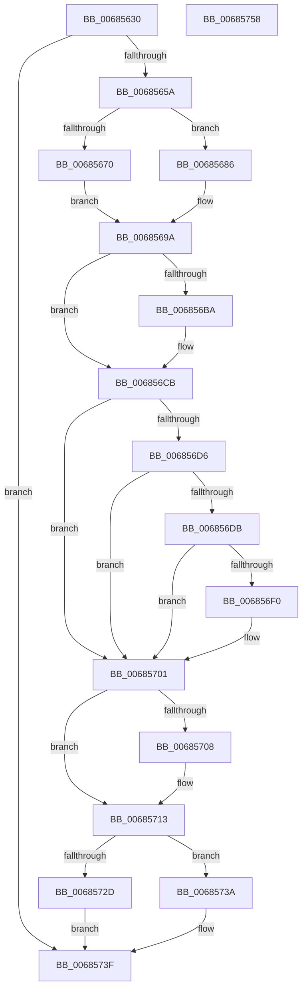

# MiDbgReleaseAddress

- RVA: `0x00685630`–`0x00685759` (길이 `297` bytes)
- VA: `0x0000000140685630`
- 실행 섹션: `.text`
- PDB 이름 있음: `예`; PDB Function 태그: `아니요`
- unwind 정보 RVA: `0x00095AD0`
- 디코드: `77`개 명령, `297/297` bytes 표시
- 미해석 바이트: `0` (있으면 어셈블리에 `.byte`로 보존)

> 이 문서는 커널 이미지의 기계어와 PDB 기호를 분석해 생성했습니다. 4번과 5번은 함수 원형과 자료형을 바이너리 사용 방식에서 추정한 C 해석이며 원본 소스 복구 결과는 아닙니다.

## 1. Dependencies

- 직접 호출 지점: **8**; 고유 호출 대상: **8**
- 직접 호출자로 확인된 함수: **1**
- RIP 상대 이미지 참조: **2**

### Outgoing calls
- `0x0068565A` → [MI_IS_PHYSICAL_ADDRESS](../23/MI_IS_PHYSICAL_ADDRESS_function_0023B3A0.md) (function, `0x0023B3A0`)
- `0x006856B1` → [MiPteInShadowRange](../23/MiPteInShadowRange_function_0023FB00.md) (function, `0x0023FB00`)
- `0x006856BF` → [MiSanitizeShadowPxe](../29/MiSanitizeShadowPxe_function_00294B68.md) (function, `0x00294B68`)
- `0x006856FC` → [MiCheckLinearProtectedPteAccessedBit](../29/MiCheckLinearProtectedPteAccessedBit_function_00292D80.md) (function, `0x00292D80`)
- `0x0068570E` → [MiWritePteShadow](../29/MiWritePteShadow_function_00294EAC.md) (function, `0x00294EAC`)
- `0x0068571D` → [MiRealVaToFlushType](MiRealVaToFlushType_function_0068619C.md) (function, `0x0068619C`)
- `0x00685733` → [KeFlushSingleTb](../5B/KeFlushSingleTb_function_005BDE84.md) (function, `0x005BDE84`)
- `0x0068573A` → [KeFlushSingleCurrentTb](../5B/KeFlushSingleCurrentTb_function_005BDC9C.md) (function, `0x005BDC9C`)

### Direct callers
- [MiDbgCopyMemory](MiDbgCopyMemory_function_00684A18.md) at `0x00684E25`

### Static image references
- `0x006856A0` → RVA `0x00E302E4` (`.data`; read/write)
- `0x006856CB` → RVA `0x00FC6A88` (`ALMOSTRO`; read)

## 2. Other-region calls and transfers

- 다른 실행 섹션으로 향하는 call: **0**
- 별도 외부 분기/꼬리 이동을 확인하지 못했습니다.

## 3. Assembly (complete function range)

```asm
00685630  48 89 5C 24 08                  mov qword ptr [rsp + 8], rbx
00685635  48 89 6C 24 18                  mov qword ptr [rsp + 0x18], rbp
0068563A  48 89 74 24 20                  mov qword ptr [rsp + 0x20], rsi
0068563F  57                              push rdi
00685640  41 56                           push r14
00685642  41 57                           push r15
00685644  48 83 EC 20                     sub rsp, 0x20
00685648  48 8B 1A                        mov rbx, qword ptr [rdx]
0068564B  45 8B F0                        mov r14d, r8d
0068564E  48 8B F1                        mov rsi, rcx
00685651  48 85 DB                        test rbx, rbx
00685654  0F 84 E5 00 00 00               je 0x14068573f
0068565A  E8 41 5D BB FF                  call 0x14023b3a0
0068565F  49 BF 00 00 00 00 80 F6 FF FF   movabs r15, 0xfffff68000000000
00685669  48 8B FE                        mov rdi, rsi
0068566C  85 C0                           test eax, eax
0068566E  74 16                           je 0x140685686
00685670  48 C1 EF 12                     shr rdi, 0x12
00685674  81 E7 F8 FF FF 3F               and edi, 0x3ffffff8
0068567A  48 B8 00 00 00 40 FB F6 FF FF   movabs rax, 0xfffff6fb40000000
00685684  EB 14                           jmp 0x14068569a
00685686  48 C1 EF 09                     shr rdi, 9
0068568A  48 B8 F8 FF FF FF 7F 00 00 00   movabs rax, 0x7ffffffff8
00685694  48 23 F8                        and rdi, rax
00685697  49 8B C7                        mov rax, r15
0068569A  48 03 F8                        add rdi, rax
0068569D  48 8B 07                        mov rax, qword ptr [rdi]
006856A0  F0 FF 05 3D AC 7A 00            lock inc dword ptr [rip + 0x7aac3d]
006856A7  48 8B CF                        mov rcx, rdi
006856AA  48 89 5C 24 48                  mov qword ptr [rsp + 0x48], rbx
006856AF  33 ED                           xor ebp, ebp
006856B1  E8 4A A4 BB FF                  call 0x14023fb00
006856B6  85 C0                           test eax, eax
006856B8  74 11                           je 0x1406856cb
006856BA  48 8D 54 24 48                  lea rdx, [rsp + 0x48]
006856BF  E8 A4 F4 C0 FF                  call 0x140294b68
006856C4  48 8B 5C 24 48                  mov rbx, qword ptr [rsp + 0x48]
006856C9  8B E8                           mov ebp, eax
006856CB  48 0F BA 25 B4 13 94 00 24      bt qword ptr [rip + 0x9413b4], 0x24
006856D4  73 2B                           jae 0x140685701
006856D6  F6 C3 20                        test bl, 0x20
006856D9  75 26                           jne 0x140685701
006856DB  49 8B D7                        mov rdx, r15
006856DE  48 B8 00 00 00 00 40 00 00 00   movabs rax, 0x4000000000
006856E8  48 03 D0                        add rdx, rax
006856EB  48 3B FA                        cmp rdi, rdx
006856EE  72 11                           jb 0x140685701
006856F0  41 B8 80 00 00 00               mov r8d, 0x80
006856F6  48 8B D3                        mov rdx, rbx
006856F9  48 8B CF                        mov rcx, rdi
006856FC  E8 7F D6 C0 FF                  call 0x140292d80
00685701  48 89 1F                        mov qword ptr [rdi], rbx
00685704  85 ED                           test ebp, ebp
00685706  74 0B                           je 0x140685713
00685708  48 8B D3                        mov rdx, rbx
0068570B  48 8B CF                        mov rcx, rdi
0068570E  E8 99 F7 C0 FF                  call 0x140294eac
00685713  F0 FF 0D CA AB 7A 00            lock dec dword ptr [rip + 0x7aabca]
0068571A  48 8B CE                        mov rcx, rsi
0068571D  E8 7A 0A 00 00                  call 0x14068619c
00685722  8B D0                           mov edx, eax
00685724  48 8B CE                        mov rcx, rsi
00685727  41 F6 C6 04                     test r14b, 4
0068572B  75 0D                           jne 0x14068573a
0068572D  41 B8 02 00 00 00               mov r8d, 2
00685733  E8 4C 87 F3 FF                  call 0x1405bde84
00685738  EB 05                           jmp 0x14068573f
0068573A  E8 5D 85 F3 FF                  call 0x1405bdc9c
0068573F  48 8B 5C 24 40                  mov rbx, qword ptr [rsp + 0x40]
00685744  48 8B 6C 24 50                  mov rbp, qword ptr [rsp + 0x50]
00685749  48 8B 74 24 58                  mov rsi, qword ptr [rsp + 0x58]
0068574E  48 83 C4 20                     add rsp, 0x20
00685752  41 5F                           pop r15
00685754  41 5E                           pop r14
00685756  5F                              pop rdi
00685757  C3                              ret
00685758  CC                              int3
```

## 4. C-style interpretation (structured pseudocode)

```c
__int64 __fastcall MiDbgReleaseAddress(__int64 a1, __int64 a2, int a3)
{
    __int64 result;
    __int64 v_rbp;
    __int64 v_rbx;
    __int64 v_rdi;
    __int64 v_rsp;
    unsigned __int64 v_stack_p10;
    unsigned __int64 v_stack_p18;
    unsigned __int64 v_stack_p20;
    unsigned __int64 v_stack_p8;

    v_stack_p8 = v_rbx;
    v_stack_p18 = v_rbp;
    v_stack_p20 = v_rsi;
    v_rsp = (v_rsp) - (32);
    if (*(unsigned __int64 *)(a2) == 0) goto loc_0068573F;
    result = MI_IS_PHYSICAL_ADDRESS(a1, a2, a3, a4);
    if ((unsigned int)(result) == 0) goto loc_00685686;
    v_rdi = (a1) >> (18);
    v_rdi = (unsigned int)((v_rdi) & (0x3FFFFFF8ULL));
    goto loc_0068569A;
loc_00685686:
    v_rdi = (v_rdi) >> (9);
    v_rdi = (v_rdi) & (result);
loc_0068569A:
    v_rdi = (v_rdi) + (v_r15);
    v_stack_p10 = *(unsigned __int64 *)(a2);
    v_rbp = 0;
    result = MiPteInShadowRange(v_rdi, a2, a3, a4);
    v_rbx = *(unsigned __int64 *)(a2);
    if ((unsigned int)(result) != 0) {
        a2 = v_stack_p10;
        result = MiSanitizeShadowPxe(v_rdi, a2, a3, a4);
        v_rbx = v_stack_p10;
        v_rbp = (unsigned int)(result);
    }
    if (condition_is_above_or_equal) goto loc_00685701;
    if ((((unsigned __int8)(v_rbx)) & (32)) != 0) goto loc_00685701;
    a2 = (v_r15) + (result);
    if (v_rdi >= a2) {
        a3 = 128;
        a2 = v_rbx;
        a1 = v_rdi;
        result = MiCheckLinearProtectedPteAccessedBit(a1, a2, a3, a4);
    }
    *(unsigned __int64 *)(v_rdi) = v_rbx;
    if ((unsigned int)(v_rbp) != 0) {
        a2 = v_rbx;
        a1 = v_rdi;
        result = MiWritePteShadow(a1, a2, a3, a4);
    }
    result = MiRealVaToFlushType(a1, a2, a3, a4);
    if ((((unsigned __int8)((unsigned int)(a3))) & (4)) != 0) goto loc_0068573A;
    result = KeFlushSingleTb(a1, (unsigned int)((unsigned int)(result)), 2, a4);
    goto loc_0068573F;
loc_0068573A:
    result = KeFlushSingleCurrentTb(a1, (unsigned int)((unsigned int)(result)), 2, a4);
loc_0068573F:
    v_rsp = (v_rsp) + (32);
    return result;
}
```

## 5. (Beta) C Style

```c
int64_t MiDbgReleaseAddress(int64_t Arg1, void *Arg2, int32_t Arg3)
{
    uint8_t *arg2 = (uint8_t *)Arg2;

    int64_t result;
    int64_t local_rbp;
    int64_t local_rbx;
    int64_t local_rdi;
    int64_t local_rsp;
    uint64_t v_stack_p10;
    uint64_t v_stack_p18;
    uint64_t v_stack_p20;
    uint64_t v_stack_p8;

    v_stack_p8 = local_rbx;
    v_stack_p18 = local_rbp;
    v_stack_p20 = local_rsi;
    local_rsp = (local_rsp) - (32);
    if (*(uint64_t *)(arg2) == 0) goto loc_0068573F;
    result = MI_IS_PHYSICAL_ADDRESS(Arg1, Arg2, Arg3, a4);
    if ((uint32_t)(result) == 0) goto loc_00685686;
    local_rdi = (Arg1) >> (18);
    local_rdi = (uint32_t)((local_rdi) & (0x3FFFFFF8ULL));
    goto loc_0068569A;
loc_00685686:
    local_rdi = (local_rdi) >> (9);
    local_rdi = (local_rdi) & (result);
loc_0068569A:
    local_rdi = (local_rdi) + (local_r15);
    v_stack_p10 = *(uint64_t *)(arg2);
    local_rbp = 0;
    result = MiPteInShadowRange(local_rdi, Arg2, Arg3, a4);
    local_rbx = *(uint64_t *)(arg2);
    if ((uint32_t)(result) != 0) {
        Arg2 = v_stack_p10;
        result = MiSanitizeShadowPxe(local_rdi, Arg2, Arg3, a4);
        local_rbx = v_stack_p10;
        local_rbp = (uint32_t)(result);
    }
    if (condition_is_above_or_equal) goto loc_00685701;
    if ((((uint8_t)(local_rbx)) & (32)) != 0) goto loc_00685701;
    Arg2 = (local_r15) + (result);
    if (local_rdi >= Arg2) {
        Arg3 = 128;
        Arg2 = local_rbx;
        Arg1 = local_rdi;
        result = MiCheckLinearProtectedPteAccessedBit(Arg1, Arg2, Arg3, a4);
    }
    *(uint64_t *)(local_rdi) = local_rbx;
    if ((uint32_t)(local_rbp) != 0) {
        Arg2 = local_rbx;
        Arg1 = local_rdi;
        result = MiWritePteShadow(Arg1, Arg2, Arg3, a4);
    }
    result = MiRealVaToFlushType(Arg1, Arg2, Arg3, a4);
    if ((((uint8_t)((uint32_t)(Arg3))) & (4)) != 0) goto loc_0068573A;
    result = KeFlushSingleTb(Arg1, (uint32_t)((uint32_t)(result)), 2, a4);
    goto loc_0068573F;
loc_0068573A:
    result = KeFlushSingleCurrentTb(Arg1, (uint32_t)((uint32_t)(result)), 2, a4);
loc_0068573F:
    local_rsp = (local_rsp) + (32);
    return result;
}
```

### 관측된 메모리 오프셋

구조체 형식이 확인되지 않은 접근은 인자 기준의 오프셋으로만 기록했습니다.

| 기준 인자 | 오프셋 표현 | 폭 (bit) | 접근 |
|---|---:|---:|---|
| `Arg2` | `+ 0x0` | `64` | `R` |

## 6. Execution-region graph

[열기: 2D/3D 그래프와 함수 탐색 컨트롤 패널](../../../control-panel.html?section=text&rva=0x00685630&view=graph)

- 2D 그래프는 위에서 아래로 흐르고, 3D 그래프는 빈 공간을 드래그해 회전합니다. Shift+드래그는 이동, 휠은 확대·축소, 함수 노드 선택은 대상 보고서 이동입니다.

### Static fallback


