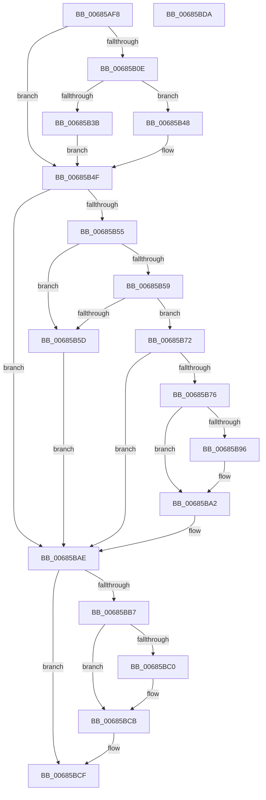

# MiDbgUnTranslatePhysicalAddress

- RVA: `0x00685AF8`–`0x00685BDB` (길이 `227` bytes)
- VA: `0x0000000140685AF8`
- 실행 섹션: `.text`
- PDB 이름 있음: `예`; PDB Function 태그: `아니요`
- unwind 정보 RVA: `0x0005CAAC`
- 디코드: `61`개 명령, `227/227` bytes 표시
- 미해석 바이트: `0` (있으면 어셈블리에 `.byte`로 보존)

> 이 문서는 커널 이미지의 기계어와 PDB 기호를 분석해 생성했습니다. 4번과 5번은 함수 원형과 자료형을 바이너리 사용 방식에서 추정한 C 해석이며 원본 소스 복구 결과는 아닙니다.

## 1. Dependencies

- 직접 호출 지점: **5**; 고유 호출 대상: **5**
- 직접 호출자로 확인된 함수: **2**
- RIP 상대 이미지 참조: **2**

### Outgoing calls
- `0x00685B41` → [KeFlushSingleTb](../5B/KeFlushSingleTb_function_005BDE84.md) (function, `0x005BDE84`)
- `0x00685B4A` → [KeFlushSingleCurrentTb](../5B/KeFlushSingleCurrentTb_function_005BDC9C.md) (function, `0x005BDC9C`)
- `0x00685B9D` → [ExReleaseSpinLockExclusiveFromDpcLevel](../24/ExReleaseSpinLockExclusiveFromDpcLevel_function_002497E0.md) (function, `0x002497E0`)
- `0x00685BA9` → [ExReleaseSpinLockSharedFromDpcLevel](../24/ExReleaseSpinLockSharedFromDpcLevel_function_0024A590.md) (function, `0x0024A590`)
- `0x00685BC6` → [KiLowerIrqlProcessIrqlFlags](../4F/KiLowerIrqlProcessIrqlFlags_function_004F5698.md) (function, `0x004F5698`)

### Direct callers
- [MiDbgCopyMemory](MiDbgCopyMemory_function_00684A18.md) at `0x00684E38`
- [MiDbgTranslatePhysicalAddress](MiDbgTranslatePhysicalAddress_function_00685760.md) at `0x00685AD2`

### Static image references
- `0x00685B26` → RVA `0x00010880` (`.rdata`; read)
- `0x00685BB7` → RVA `0x00FC6D20` (`ALMOSTRO`; read)

## 2. Other-region calls and transfers

- 다른 실행 섹션으로 향하는 call: **0**
- 별도 외부 분기/꼬리 이동을 확인하지 못했습니다.

## 3. Assembly (complete function range)

```asm
00685AF8  48 89 5C 24 08                  mov qword ptr [rsp + 8], rbx
00685AFD  57                              push rdi
00685AFE  48 83 EC 20                     sub rsp, 0x20
00685B02  48 8B 51 08                     mov rdx, qword ptr [rcx + 8]
00685B06  48 8B D9                        mov rbx, rcx
00685B09  48 85 D2                        test rdx, rdx
00685B0C  74 41                           je 0x140685b4f
00685B0E  48 8B CA                        mov rcx, rdx
00685B11  48 C1 E1 19                     shl rcx, 0x19
00685B15  48 B8 00 00 00 00 80 F6 FF FF   movabs rax, 0xfffff68000000000
00685B1F  48 C1 E0 19                     shl rax, 0x19
00685B23  48 2B C8                        sub rcx, rax
00685B26  48 8B 05 53 AD 98 FF            mov rax, qword ptr [rip - 0x6752ad]
00685B2D  48 87 02                        xchg qword ptr [rdx], rax
00685B30  8B 13                           mov edx, dword ptr [rbx]
00685B32  48 C1 F9 10                     sar rcx, 0x10
00685B36  F6 C2 12                        test dl, 0x12
00685B39  74 0D                           je 0x140685b48
00685B3B  33 D2                           xor edx, edx
00685B3D  44 8D 42 02                     lea r8d, [rdx + 2]
00685B41  E8 3E 83 F3 FF                  call 0x1405bde84
00685B46  EB 07                           jmp 0x140685b4f
00685B48  33 D2                           xor edx, edx
00685B4A  E8 4D 81 F3 FF                  call 0x1405bdc9c
00685B4F  8B 03                           mov eax, dword ptr [rbx]
00685B51  A8 04                           test al, 4
00685B53  75 59                           jne 0x140685bae
00685B55  A8 01                           test al, 1
00685B57  75 04                           jne 0x140685b5d
00685B59  A8 02                           test al, 2
00685B5B  74 15                           je 0x140685b72
00685B5D  48 8B 43 10                     mov rax, qword ptr [rbx + 0x10]
00685B61  48 B9 FF FF FF FF FF FF FF 7F   movabs rcx, 0x7fffffffffffffff
00685B6B  F0 48 21 48 18                  lock and qword ptr [rax + 0x18], rcx
00685B70  EB 3C                           jmp 0x140685bae
00685B72  A8 18                           test al, 0x18
00685B74  74 38                           je 0x140685bae
00685B76  65 48 8B 04 25 20 00 00 00      mov rax, qword ptr gs:[0x20]
00685B7F  48 8B 88 38 88 00 00            mov rcx, qword ptr [rax + 0x8838]
00685B86  48 8B B9 48 01 00 00            mov rdi, qword ptr [rcx + 0x148]
00685B8D  48 8B 4B 18                     mov rcx, qword ptr [rbx + 0x18]
00685B91  48 85 C9                        test rcx, rcx
00685B94  74 0C                           je 0x140685ba2
00685B96  48 81 C1 AC 00 00 00            add rcx, 0xac
00685B9D  E8 3E 3C BC FF                  call 0x1402497e0
00685BA2  48 8D 8F 80 02 00 00            lea rcx, [rdi + 0x280]
00685BA9  E8 E2 49 BC FF                  call 0x14024a590
00685BAE  0F B6 5B 04                     movzx ebx, byte ptr [rbx + 4]
00685BB2  80 FB 11                        cmp bl, 0x11
00685BB5  74 18                           je 0x140685bcf
00685BB7  83 3D 62 11 94 00 00            cmp dword ptr [rip + 0x941162], 0
00685BBE  74 0B                           je 0x140685bcb
00685BC0  44 0F 20 C1                     mov rcx, cr8
00685BC4  8A D3                           mov dl, bl
00685BC6  E8 CD FA E6 FF                  call 0x1404f5698
00685BCB  44 0F 22 C3                     mov cr8, rbx
00685BCF  48 8B 5C 24 30                  mov rbx, qword ptr [rsp + 0x30]
00685BD4  48 83 C4 20                     add rsp, 0x20
00685BD8  5F                              pop rdi
00685BD9  C3                              ret
00685BDA  CC                              int3
```

## 4. C-style interpretation (structured pseudocode)

```c
__int64 __fastcall MiDbgUnTranslatePhysicalAddress(__int64 a1)
{
    __int64 result;
    __int64 v_rsp;
    unsigned __int64 v_stack_p8;

    v_stack_p8 = v_rbx;
    v_rsp = (v_rsp) - (32);
    if (*(unsigned __int64 *)(a1 + 8) == 0) goto loc_00685B4F;
    a1 = (*(unsigned __int64 *)(a1 + 8)) << (25);
    result = (result) << (25);
    a1 = (a1) - (result);
    a1 = (a1) >> (16);
    if ((((unsigned __int8)((unsigned int)(*(unsigned int *)(a1)))) & (18)) == 0) goto loc_00685B48;
    a2 = 0;
    result = KeFlushSingleTb(a1, a2, a2 + 2, a4);
    goto loc_00685B4F;
loc_00685B48:
    a2 = 0;
    result = KeFlushSingleCurrentTb(a1, a2, a2 + 2, a4);
loc_00685B4F:
    if ((((unsigned __int8)((unsigned int)(*(unsigned int *)(a1)))) & (4)) != 0) goto loc_00685BAE;
    if ((((unsigned __int8)((unsigned int)(*(unsigned int *)(a1)))) & (1)) != 0) goto loc_00685B5D;
    if ((((unsigned __int8)((unsigned int)(*(unsigned int *)(a1)))) & (2)) == 0) goto loc_00685B72;
loc_00685B5D:
    goto loc_00685BAE;
loc_00685B72:
    if ((((unsigned __int8)(*(unsigned __int64 *)(a1 + 16))) & (24)) == 0) goto loc_00685BAE;
    result = *(unsigned __int64 *)(gs_base + (0 + 32));
    if (*(unsigned __int64 *)(a1 + 24) != 0) {
        a1 = (*(unsigned __int64 *)(a1 + 24)) + (172);
        result = ExReleaseSpinLockExclusiveFromDpcLevel(a1, a2, a2 + 2, a4);
    }
    result = ExReleaseSpinLockSharedFromDpcLevel(*(unsigned __int64 *)(*(unsigned __int64 *)(*(unsigned __int64 *)(gs_base + (0 + 32)) + 34872) + 328) + 640, a2, a2 + 2, a4);
loc_00685BAE:
    if (((unsigned __int8)(*(unsigned __int8 *)(a1 + 4))) == 17) goto loc_00685BCF;
    if ((*(unsigned int *)(v_rip + 9703778)) != 0) {
        a1 = v_cr8;
        a2 = (unsigned __int8)(*(unsigned __int8 *)(a1 + 4));
        result = KiLowerIrqlProcessIrqlFlags(a1, a2, a2 + 2, a4);
    }
loc_00685BCF:
    v_rsp = (v_rsp) + (32);
    return result;
}
```

## 5. (Beta) C Style

```c
int64_t MiDbgUnTranslatePhysicalAddress(void *Arg1)
{
    uint8_t *arg1 = (uint8_t *)Arg1;

    int64_t result;
    int64_t local_rsp;
    uint64_t v_stack_p8;

    v_stack_p8 = local_rbx;
    local_rsp = (local_rsp) - (32);
    if (*(uint64_t *)(arg1 + 0x8) == 0) goto loc_00685B4F;
    Arg1 = (*(uint64_t *)(arg1 + 0x8)) << (25);
    result = (result) << (25);
    Arg1 = (Arg1) - (result);
    Arg1 = (Arg1) >> (16);
    if ((((uint8_t)((uint32_t)(*(uint32_t *)(arg1)))) & (18)) == 0) goto loc_00685B48;
    a2 = 0;
    result = KeFlushSingleTb(Arg1, a2, a2 + 2, a4);
    goto loc_00685B4F;
loc_00685B48:
    a2 = 0;
    result = KeFlushSingleCurrentTb(Arg1, a2, a2 + 2, a4);
loc_00685B4F:
    if ((((uint8_t)((uint32_t)(*(uint32_t *)(arg1)))) & (4)) != 0) goto loc_00685BAE;
    if ((((uint8_t)((uint32_t)(*(uint32_t *)(arg1)))) & (1)) != 0) goto loc_00685B5D;
    if ((((uint8_t)((uint32_t)(*(uint32_t *)(arg1)))) & (2)) == 0) goto loc_00685B72;
loc_00685B5D:
    goto loc_00685BAE;
loc_00685B72:
    if ((((uint8_t)(*(uint64_t *)(arg1 + 0x10))) & (24)) == 0) goto loc_00685BAE;
    result = *(uint64_t *)(gs_base + (0 + 0x20));
    if (*(uint64_t *)(arg1 + 0x18) != 0) {
        Arg1 = (*(uint64_t *)(arg1 + 0x18)) + (172);
        result = ExReleaseSpinLockExclusiveFromDpcLevel(Arg1, a2, a2 + 2, a4);
    }
    result = ExReleaseSpinLockSharedFromDpcLevel(*(uint64_t *)(*(uint64_t *)(*(uint64_t *)(gs_base + (0 + 0x20)) + 0x8838) + 0x148) + 640, a2, a2 + 2, a4);
loc_00685BAE:
    if (((uint8_t)(*(uint8_t *)(arg1 + 0x4))) == 17) goto loc_00685BCF;
    if ((*(uint32_t *)(v_rip + 0x941162)) != 0) {
        Arg1 = v_cr8;
        a2 = (uint8_t)(*(uint8_t *)(arg1 + 0x4));
        result = KiLowerIrqlProcessIrqlFlags(Arg1, a2, a2 + 2, a4);
    }
loc_00685BCF:
    local_rsp = (local_rsp) + (32);
    return result;
}
```

### 관측된 메모리 오프셋

구조체 형식이 확인되지 않은 접근은 인자 기준의 오프셋으로만 기록했습니다.

| 기준 인자 | 오프셋 표현 | 폭 (bit) | 접근 |
|---|---:|---:|---|
| `Arg1` | `+ 0x0` | `32` | `R` |
| `Arg1` | `+ 0x4` | `8` | `R` |
| `Arg1` | `+ 0x8` | `64` | `R` |
| `Arg1` | `+ 0x10` | `64` | `R` |
| `Arg1` | `+ 0x18` | `64` | `R` |

## 6. Execution-region graph

[열기: 2D/3D 그래프와 함수 탐색 컨트롤 패널](../../../control-panel.html?section=text&rva=0x00685AF8&view=graph)

- 2D 그래프는 위에서 아래로 흐르고, 3D 그래프는 빈 공간을 드래그해 회전합니다. Shift+드래그는 이동, 휠은 확대·축소, 함수 노드 선택은 대상 보고서 이동입니다.

### Static fallback


