# MiDbgWriteCheck

- RVA: `0x00685BE4`–`0x00685F36` (길이 `850` bytes)
- VA: `0x0000000140685BE4`
- 실행 섹션: `.text`
- PDB 이름 있음: `예`; PDB Function 태그: `아니요`
- unwind 정보 RVA: `0x000D1090`
- 디코드: `213`개 명령, `850/850` bytes 표시
- 미해석 바이트: `0` (있으면 어셈블리에 `.byte`로 보존)

> 이 문서는 커널 이미지의 기계어와 PDB 기호를 분석해 생성했습니다. 4번과 5번은 함수 원형과 자료형을 바이너리 사용 방식에서 추정한 C 해석이며 원본 소스 복구 결과는 아닙니다.

## 1. Dependencies

- 직접 호출 지점: **10**; 고유 호출 대상: **10**
- 직접 호출자로 확인된 함수: **1**
- RIP 상대 이미지 참조: **7**

### Outgoing calls
- `0x00685C21` → [MmIsAddressValidEx](../27/MmIsAddressValidEx_function_0027FDD0.md) (function, `0x0027FDD0`)
- `0x00685C37` → [MI_IS_PHYSICAL_ADDRESS](../23/MI_IS_PHYSICAL_ADDRESS_function_0023B3A0.md) (function, `0x0023B3A0`)
- `0x00685DAE` → [MiGetPagePrivilege](../28/MiGetPagePrivilege_function_00285420.md) (function, `0x00285420`)
- `0x00685E5A` → [MiDbgMarkPfnModified](MiDbgMarkPfnModified_function_0068524C.md) (function, `0x0068524C`)
- `0x00685E87` → [MiPteInShadowRange](../23/MiPteInShadowRange_function_0023FB00.md) (function, `0x0023FB00`)
- `0x00685E95` → [MiSanitizeShadowPxe](../29/MiSanitizeShadowPxe_function_00294B68.md) (function, `0x00294B68`)
- `0x00685EDC` → [MiCheckLinearProtectedPteAccessedBit](../29/MiCheckLinearProtectedPteAccessedBit_function_00292D80.md) (function, `0x00292D80`)
- `0x00685EEE` → [MiWritePteShadow](../29/MiWritePteShadow_function_00294EAC.md) (function, `0x00294EAC`)
- `0x00685F0A` → [MiRealVaToFlushType](MiRealVaToFlushType_function_0068619C.md) (function, `0x0068619C`)
- `0x00685F14` → [KeFlushSingleCurrentTb](../5B/KeFlushSingleCurrentTb_function_005BDC9C.md) (function, `0x005BDC9C`)

### Direct callers
- [MiDbgCopyMemory](MiDbgCopyMemory_function_00684A18.md) at `0x00684D1F`

### Static image references
- `0x00685C59` → RVA `0x00FC6B28` (`ALMOSTRO`; read)
- `0x00685C65` → RVA `0x00FC6B98` (`ALMOSTRO`; read)
- `0x00685C76` → RVA `0x00FC6CB0` (`ALMOSTRO`; read)
- `0x00685C84` → RVA `0x00FC6D90` (`ALMOSTRO`; read)
- `0x00685D0F` → RVA `0x00FC6A88` (`ALMOSTRO`; read)
- `0x00685D38` → RVA `0x00E2DCE0` (`.data`; read)
- `0x00685E6F` → RVA `0x00E302E4` (`.data`; read/write)

## 2. Other-region calls and transfers

- 다른 실행 섹션으로 향하는 call: **0**
- 별도 외부 분기/꼬리 이동을 확인하지 못했습니다.

## 3. Assembly (complete function range)

```asm
00685BE4  48 8B C4                        mov rax, rsp
00685BE7  48 89 58 08                     mov qword ptr [rax + 8], rbx
00685BEB  44 89 48 20                     mov dword ptr [rax + 0x20], r9d
00685BEF  44 89 40 18                     mov dword ptr [rax + 0x18], r8d
00685BF3  48 89 50 10                     mov qword ptr [rax + 0x10], rdx
00685BF7  55                              push rbp
00685BF8  56                              push rsi
00685BF9  57                              push rdi
00685BFA  41 54                           push r12
00685BFC  41 55                           push r13
00685BFE  41 56                           push r14
00685C00  41 57                           push r15
00685C02  48 83 EC 20                     sub rsp, 0x20
00685C06  4C 8B BC 24 80 00 00 00         mov r15, qword ptr [rsp + 0x80]
00685C0E  45 8B E1                        mov r12d, r9d
00685C11  41 8B E8                        mov ebp, r8d
00685C14  48 8B F9                        mov rdi, rcx
00685C17  49 83 0F FF                     or qword ptr [r15], 0xffffffffffffffff
00685C1B  48 83 22 00                     and qword ptr [rdx], 0
00685C1F  33 D2                           xor edx, edx
00685C21  E8 AA A1 BF FF                  call 0x14027fdd0
00685C26  84 C0                           test al, al
00685C28  0F 84 F0 02 00 00               je 0x140685f1e
00685C2E  48 8B CF                        mov rcx, rdi
00685C31  41 BE 01 00 00 00               mov r14d, 1
00685C37  E8 64 57 BB FF                  call 0x14023b3a0
00685C3C  48 B9 00 00 00 00 80 F6 FF FF   movabs rcx, 0xfffff68000000000
00685C46  44 8B E8                        mov r13d, eax
00685C49  85 C0                           test eax, eax
00685C4B  0F 84 87 00 00 00               je 0x140685cd8
00685C51  45 8B C6                        mov r8d, r14d
00685C54  41 3B C6                        cmp eax, r14d
00685C57  75 77                           jne 0x140685cd0
00685C59  48 8B 0D C8 0E 94 00            mov rcx, qword ptr [rip + 0x940ec8]
00685C60  48 85 C9                        test rcx, rcx
00685C63  74 28                           je 0x140685c8d
00685C65  48 8B 15 2C 0F 94 00            mov rdx, qword ptr [rip + 0x940f2c]
00685C6C  48 85 D2                        test rdx, rdx
00685C6F  74 1C                           je 0x140685c8d
00685C71  48 3B F9                        cmp rdi, rcx
00685C74  72 09                           jb 0x140685c7f
00685C76  48 3B 3D 33 10 94 00            cmp rdi, qword ptr [rip + 0x941033]
00685C7D  72 0E                           jb 0x140685c8d
00685C7F  48 3B FA                        cmp rdi, rdx
00685C82  72 4C                           jb 0x140685cd0
00685C84  48 3B 3D 05 11 94 00            cmp rdi, qword ptr [rip + 0x941105]
00685C8B  73 43                           jae 0x140685cd0
00685C8D  48 8B F7                        mov rsi, rdi
00685C90  48 C1 EE 12                     shr rsi, 0x12
00685C94  81 E6 F8 FF FF 3F               and esi, 0x3ffffff8
00685C9A  48 B8 00 00 00 40 FB F6 FF FF   movabs rax, 0xfffff6fb40000000
00685CA4  48 03 F0                        add rsi, rax
00685CA7  48 8B CF                        mov rcx, rdi
00685CAA  48 C1 E9 0C                     shr rcx, 0xc
00685CAE  48 BA FF FF FF FF FF 00 00 00   movabs rdx, 0xffffffffff
00685CB8  81 E1 FF 01 00 00               and ecx, 0x1ff
00685CBE  48 8B 1E                        mov rbx, qword ptr [rsi]
00685CC1  48 8B C3                        mov rax, rbx
00685CC4  48 C1 E8 0C                     shr rax, 0xc
00685CC8  48 23 C2                        and rax, rdx
00685CCB  48 03 C8                        add rcx, rax
00685CCE  EB 3C                           jmp 0x140685d0c
00685CD0  41 8B C0                        mov eax, r8d
00685CD3  E9 48 02 00 00                  jmp 0x140685f20
00685CD8  48 8B F7                        mov rsi, rdi
00685CDB  48 B8 F8 FF FF FF 7F 00 00 00   movabs rax, 0x7ffffffff8
00685CE5  48 C1 EE 09                     shr rsi, 9
00685CE9  48 23 F0                        and rsi, rax
00685CEC  48 8B C1                        mov rax, rcx
00685CEF  48 03 F0                        add rsi, rax
00685CF2  48 BA FF FF FF FF FF 00 00 00   movabs rdx, 0xffffffffff
00685CFC  45 8B C6                        mov r8d, r14d
00685CFF  48 8B 1E                        mov rbx, qword ptr [rsi]
00685D02  48 8B CB                        mov rcx, rbx
00685D05  48 C1 E9 0C                     shr rcx, 0xc
00685D09  48 23 CA                        and rcx, rdx
00685D0C  49 89 0F                        mov qword ptr [r15], rcx
00685D0F  48 8B 05 72 0D 94 00            mov rax, qword ptr [rip + 0x940d72]
00685D16  48 0F BA E0 0E                  bt rax, 0xe
00685D1B  72 0B                           jb 0x140685d28
00685D1D  48 0F BA E0 0F                  bt rax, 0xf
00685D22  0F 83 0F 01 00 00               jae 0x140685e37
00685D28  45 33 E4                        xor r12d, r12d
00685D2B  33 ED                           xor ebp, ebp
00685D2D  48 0F BA E0 0B                  bt rax, 0xb
00685D32  0F 83 B8 00 00 00               jae 0x140685df0
00685D38  48 3B 0D A1 7F 7A 00            cmp rcx, qword ptr [rip + 0x7a7fa1]
00685D3F  0F 87 E9 00 00 00               ja 0x140685e2e
00685D45  48 8D 14 49                     lea rdx, [rcx + rcx*2]
00685D49  48 03 D2                        add rdx, rdx
00685D4C  48 B8 28 00 00 00 00 DE FF FF   movabs rax, 0xffffde0000000028
00685D56  48 8B 04 D0                     mov rax, qword ptr [rax + rdx*8]
00685D5A  48 C1 E8 36                     shr rax, 0x36
00685D5E  41 85 C0                        test r8d, eax
00685D61  0F 84 C7 00 00 00               je 0x140685e2e
00685D67  48 B8 00 00 00 00 00 DE FF FF   movabs rax, 0xffffde0000000000
00685D71  F6 44 24 78 03                  test byte ptr [rsp + 0x78], 3
00685D76  48 8D 2C D0                     lea rbp, [rax + rdx*8]
00685D7A  75 1A                           jne 0x140685d96
00685D7C  F7 44 24 70 00 00 00 40         test dword ptr [rsp + 0x70], 0x40000000
00685D84  75 15                           jne 0x140685d9b
00685D86  F0 48 0F BA 6D 18 3F            lock bts qword ptr [rbp + 0x18], 0x3f
00685D8D  0F 82 8B 01 00 00               jb 0x140685f1e
00685D93  45 8B E0                        mov r12d, r8d
00685D96  41 8B D0                        mov edx, r8d
00685D99  EB 05                           jmp 0x140685da0
00685D9B  BA 04 00 00 00                  mov edx, 4
00685DA0  4C 8B BC 24 88 00 00 00         mov r15, qword ptr [rsp + 0x88]
00685DA8  48 8B CD                        mov rcx, rbp
00685DAB  4D 8B C7                        mov r8, r15
00685DAE  E8 6D F6 BF FF                  call 0x140285420
00685DB3  85 C0                           test eax, eax
00685DB5  74 5A                           je 0x140685e11
00685DB7  48 F7 05 C6 0C 94 00 00 40 00 00  test qword ptr [rip + 0x940cc6], 0x4000
00685DC2  74 40                           je 0x140685e04
00685DC4  48 8B 45 28                     mov rax, qword ptr [rbp + 0x28]
00685DC8  48 85 C0                        test rax, rax
00685DCB  79 37                           jns 0x140685e04
00685DCD  8B 45 10                        mov eax, dword ptr [rbp + 0x10]
00685DD0  48 0F BA E0 0A                  bt rax, 0xa
00685DD5  72 2D                           jb 0x140685e04
00685DD7  48 B8 00 00 00 00 00 80 FF FF   movabs rax, 0xffff800000000000
00685DE1  48 3B F8                        cmp rdi, rax
00685DE4  72 1E                           jb 0x140685e04
00685DE6  4D 85 FF                        test r15, r15
00685DE9  74 19                           je 0x140685e04
00685DEB  49 89 3F                        mov qword ptr [r15], rdi
00685DEE  EB 14                           jmp 0x140685e04
00685DF0  48 8B 84 24 88 00 00 00         mov rax, qword ptr [rsp + 0x88]
00685DF8  48 85 C0                        test rax, rax
00685DFB  74 07                           je 0x140685e04
00685DFD  48 21 68 08                     and qword ptr [rax + 8], rbp
00685E01  48 89 38                        mov qword ptr [rax], rdi
00685E04  44 0F B6 74 24 70               movzx r14d, byte ptr [rsp + 0x70]
00685E0A  41 D1 EE                        shr r14d, 1
00685E0D  41 83 E6 02                     and r14d, 2
00685E11  45 85 E4                        test r12d, r12d
00685E14  74 0F                           je 0x140685e25
00685E16  48 B8 FF FF FF FF FF FF FF 7F   movabs rax, 0x7fffffffffffffff
00685E20  F0 48 21 45 18                  lock and qword ptr [rbp + 0x18], rax
00685E25  45 85 F6                        test r14d, r14d
00685E28  0F 84 F0 00 00 00               je 0x140685f1e
00685E2E  8B 6C 24 70                     mov ebp, dword ptr [rsp + 0x70]
00685E32  44 8B 64 24 78                  mov r12d, dword ptr [rsp + 0x78]
00685E37  48 0F BA E3 0B                  bt rbx, 0xb
00685E3C  73 09                           jae 0x140685e47
00685E3E  F6 C3 42                        test bl, 0x42
00685E41  0F 85 B3 00 00 00               jne 0x140685efa
00685E47  45 85 ED                        test r13d, r13d
00685E4A  75 1B                           jne 0x140685e67
00685E4C  85 ED                           test ebp, ebp
00685E4E  0F 89 CA 00 00 00               jns 0x140685f1e
00685E54  41 8B D4                        mov edx, r12d
00685E57  48 8B CB                        mov rcx, rbx
00685E5A  E8 ED F3 FF FF                  call 0x14068524c
00685E5F  85 C0                           test eax, eax
00685E61  0F 84 B7 00 00 00               je 0x140685f1e
00685E67  48 8B 44 24 68                  mov rax, qword ptr [rsp + 0x68]
00685E6C  48 89 18                        mov qword ptr [rax], rbx
00685E6F  F0 FF 05 6E A4 7A 00            lock inc dword ptr [rip + 0x7aa46e]
00685E76  48 81 CB 62 08 00 00            or rbx, 0x862
00685E7D  48 8B CE                        mov rcx, rsi
00685E80  48 89 5C 24 68                  mov qword ptr [rsp + 0x68], rbx
00685E85  33 ED                           xor ebp, ebp
00685E87  E8 74 9C BB FF                  call 0x14023fb00
00685E8C  85 C0                           test eax, eax
00685E8E  74 11                           je 0x140685ea1
00685E90  48 8D 54 24 68                  lea rdx, [rsp + 0x68]
00685E95  E8 CE EC C0 FF                  call 0x140294b68
00685E9A  48 8B 5C 24 68                  mov rbx, qword ptr [rsp + 0x68]
00685E9F  8B E8                           mov ebp, eax
00685EA1  48 0F BA 25 DE 0B 94 00 24      bt qword ptr [rip + 0x940bde], 0x24
00685EAA  73 35                           jae 0x140685ee1
00685EAC  F6 C3 20                        test bl, 0x20
00685EAF  75 30                           jne 0x140685ee1
00685EB1  48 B8 00 00 00 00 80 F6 FF FF   movabs rax, 0xfffff68000000000
00685EBB  48 8B D0                        mov rdx, rax
00685EBE  48 B8 00 00 00 00 40 00 00 00   movabs rax, 0x4000000000
00685EC8  48 03 D0                        add rdx, rax
00685ECB  48 3B F2                        cmp rsi, rdx
00685ECE  72 11                           jb 0x140685ee1
00685ED0  41 B8 80 00 00 00               mov r8d, 0x80
00685ED6  48 8B D3                        mov rdx, rbx
00685ED9  48 8B CE                        mov rcx, rsi
00685EDC  E8 9F CE C0 FF                  call 0x140292d80
00685EE1  48 89 1E                        mov qword ptr [rsi], rbx
00685EE4  85 ED                           test ebp, ebp
00685EE6  74 0B                           je 0x140685ef3
00685EE8  48 8B D3                        mov rdx, rbx
00685EEB  48 8B CE                        mov rcx, rsi
00685EEE  E8 B9 EF C0 FF                  call 0x140294eac
00685EF3  F0 FF 0D EA A3 7A 00            lock dec dword ptr [rip + 0x7aa3ea]
00685EFA  48 F7 05 83 0B 94 00 00 01 00 00  test qword ptr [rip + 0x940b83], 0x100
00685F05  75 12                           jne 0x140685f19
00685F07  48 8B CF                        mov rcx, rdi
00685F0A  E8 8D 02 00 00                  call 0x14068619c
00685F0F  8B D0                           mov edx, eax
00685F11  48 8B CF                        mov rcx, rdi
00685F14  E8 83 7D F3 FF                  call 0x1405bdc9c
00685F19  41 8B C6                        mov eax, r14d
00685F1C  EB 02                           jmp 0x140685f20
00685F1E  33 C0                           xor eax, eax
00685F20  48 8B 5C 24 60                  mov rbx, qword ptr [rsp + 0x60]
00685F25  48 83 C4 20                     add rsp, 0x20
00685F29  41 5F                           pop r15
00685F2B  41 5E                           pop r14
00685F2D  41 5D                           pop r13
00685F2F  41 5C                           pop r12
00685F31  5F                              pop rdi
00685F32  5E                              pop rsi
00685F33  5D                              pop rbp
00685F34  C3                              ret
00685F35  CC                              int3
```

## 4. C-style interpretation (structured pseudocode)

```c
__int64 __fastcall MiDbgWriteCheck(__int64 a1, __int64 a2, int a3, int a4, __int64 a5, __int64 a6)
{
    __int64 result;
    __int64 v_r12;
    __int64 v_r14;
    __int64 v_rbp;
    __int64 v_rbx;
    __int64 v_rsi;
    __int64 v_rsp;
    unsigned __int64 v_stack_p10;
    unsigned int v_stack_p18;
    unsigned __int8 v_stack_p20;
    unsigned __int64 v_stack_p8;

    *(unsigned __int64 *)(v_rsp + 8) = v_rbx;
    *(unsigned int *)(v_rsp + 32) = a4;
    *(unsigned int *)(v_rsp + 24) = a3;
    *(unsigned __int64 *)(v_rsp + 16) = a2;
    v_rsp = (v_rsp) - (32);
    a2 = 0;
    result = MmIsAddressValidEx(a1, a2, a3, a4);
    if ((unsigned __int8)(result) == 0) goto loc_00685F1E;
    result = MI_IS_PHYSICAL_ADDRESS(a1, a2, a3, a4);
    if ((unsigned int)(result) == 0) goto loc_00685CD8;
    if (((unsigned int)(result)) != 1) goto loc_00685CD0;
    if (*(unsigned __int64 *)(v_rip + 9703112) == 0) goto loc_00685C8D;
    if (*(unsigned __int64 *)(v_rip + 9703212) == 0) goto loc_00685C8D;
    if (a1 < (*(unsigned __int64 *)(v_rip + 9703112))) goto loc_00685C7F;
    if (a1 < (*(unsigned __int64 *)(v_rip + 9703475))) goto loc_00685C8D;
loc_00685C7F:
    if (a1 < (*(unsigned __int64 *)(v_rip + 9703212))) goto loc_00685CD0;
    if (a1 >= (*(unsigned __int64 *)(v_rip + 9703685))) goto loc_00685CD0;
loc_00685C8D:
    v_rsi = (a1) >> (18);
    v_rsi = (unsigned int)((v_rsi) & (0x3FFFFFF8ULL));
    v_rsi = (v_rsi) + (result);
    a1 = (a1) >> (12);
    a1 = (unsigned int)((a1) & (511));
    result = (*(unsigned __int64 *)(v_rsi)) >> (12);
    result = (result) & (*(unsigned __int64 *)(v_rip + 9703212));
    a1 = (a1) + (result);
    goto loc_00685D0C;
loc_00685CD0:
    goto loc_00685F20;
loc_00685CD8:
    v_rsi = (a1) >> (9);
    v_rsi = (v_rsi) & (1);
    v_rsi = (v_rsi) + (a1);
    a1 = (*(unsigned __int64 *)(v_rsi)) >> (12);
    a1 = (a1) & (*(unsigned __int64 *)(v_rip + 9703212));
loc_00685D0C:
    *(unsigned __int64 *)(a5) = a1;
    if (condition_is_below) goto loc_00685D28;
    if (condition_is_above_or_equal) goto loc_00685E37;
loc_00685D28:
    v_r12 = 0;
    v_rbp = 0;
    if (condition_is_above_or_equal) goto loc_00685DF0;
    if (a1 > (*(unsigned __int64 *)(v_rip + 8028065))) goto loc_00685E2E;
    a2 = (a1 + a1 * 2) + (a1 + a1 * 2);
    result = (*(unsigned __int64 *)(*(unsigned __int64 *)(v_rip + 9702770) + a2 * 8)) >> (54);
    if (((1) & ((unsigned int)(result))) == 0) goto loc_00685E2E;
    if (((v_stack_p20) & (3)) != 0) goto loc_00685D96;
    if (((v_stack_p18) & (0x40000000ULL)) != 0) goto loc_00685D9B;
    if (condition_is_below) goto loc_00685F1E;
loc_00685D96:
    goto loc_00685DA0;
loc_00685D9B:
loc_00685DA0:
    result = MiGetPagePrivilege(result + a2 * 8, 4, a6, a4);
    if ((unsigned int)(result) == 0) goto loc_00685E11;
    if (((*(unsigned __int64 *)(v_rip + 9702598)) & (0x4000ULL)) == 0) goto loc_00685E04;
    if (!sign_flag) goto loc_00685E04;
    if (condition_is_below) goto loc_00685E04;
    if (a1 < ((unsigned int)(*(unsigned int *)(result + a2 * 8 + 16)))) goto loc_00685E04;
    if (a6 == 0) goto loc_00685E04;
    *(unsigned __int64 *)(a6) = a1;
    goto loc_00685E04;
loc_00685DF0:
    if (a6 != 0) {
        *(unsigned __int64 *)(a6) = a1;
    }
    v_r14 = (unsigned int)((v_stack_p18) >> (1));
    v_r14 = (unsigned int)((v_r14) & (2));
loc_00685E11:
    if (1 != 0) {
    }
    if ((unsigned int)(v_r14) == 0) goto loc_00685F1E;
loc_00685E2E:
loc_00685E37:
    if (condition_is_above_or_equal) goto loc_00685E47;
    if ((((unsigned __int8)(*(unsigned __int64 *)(v_rsi))) & (66)) != 0) goto loc_00685EFA;
loc_00685E47:
    if ((unsigned int)((unsigned int)((unsigned int)(result))) != 0) goto loc_00685E67;
    if (!sign_flag) goto loc_00685F1E;
    result = MiDbgMarkPfnModified(*(unsigned __int64 *)(v_rsi), (unsigned int)((unsigned int)((unsigned int)(v_stack_p20))), a6, a4);
    if ((unsigned int)(result) == 0) goto loc_00685F1E;
loc_00685E67:
    *(unsigned __int64 *)(v_stack_p10) = *(unsigned __int64 *)(v_rsi);
    v_rbx = (*(unsigned __int64 *)(v_rsi)) | (0x862ULL);
    v_stack_p10 = v_rbx;
    v_rbp = 0;
    result = MiPteInShadowRange(v_rsi, (unsigned int)((unsigned int)((unsigned int)(v_stack_p20))), a6, a4);
    if ((unsigned int)(result) != 0) {
        a2 = v_stack_p10;
        result = MiSanitizeShadowPxe(v_rsi, a2, a6, a4);
        v_rbx = v_stack_p10;
        v_rbp = (unsigned int)(result);
    }
    if (condition_is_above_or_equal) goto loc_00685EE1;
    if ((((unsigned __int8)(v_rbx)) & (32)) != 0) goto loc_00685EE1;
    a2 = (result) + (result);
    if (v_rsi >= a2) {
        a3 = 128;
        a2 = v_rbx;
        a1 = v_rsi;
        result = MiCheckLinearProtectedPteAccessedBit(a1, a2, a3, a4);
    }
    *(unsigned __int64 *)(v_rsi) = v_rbx;
    if ((unsigned int)(v_rbp) != 0) {
        a2 = v_rbx;
        a1 = v_rsi;
        result = MiWritePteShadow(a1, a2, a3, a4);
    }
loc_00685EFA:
    if (((*(unsigned __int64 *)(v_rip + 9702275)) & (256)) == 0) {
        a1 = a1;
        result = MiRealVaToFlushType(a1, a2, a3, a4);
        a2 = (unsigned int)(result);
        a1 = a1;
        result = KeFlushSingleCurrentTb(a1, a2, a3, a4);
    }
    goto loc_00685F20;
loc_00685F1E:
    result = 0;
loc_00685F20:
    v_rsp = (v_rsp) + (32);
    return result;
}
```

## 5. (Beta) C Style

```c
int64_t MiDbgWriteCheck(int64_t Arg1, void *Arg2, int32_t Arg3, int32_t Arg4, void *Arg5, int64_t Arg6)
{
    uint8_t *arg2 = (uint8_t *)Arg2;
    uint8_t *arg5 = (uint8_t *)Arg5;

    int64_t result;
    int64_t local_r12;
    int64_t local_r14;
    int64_t local_rbp;
    int64_t local_rbx;
    int64_t local_rsi;
    int64_t local_rsp;
    uint64_t v_stack_p10;
    uint32_t v_stack_p18;
    uint8_t v_stack_p20;
    uint64_t v_stack_p8;

    *(uint64_t *)(local_rsp + 0x8) = local_rbx;
    *(uint32_t *)(local_rsp + 0x20) = Arg4;
    *(uint32_t *)(local_rsp + 0x18) = Arg3;
    *(void **)(local_rsp + 0x10) = Arg2;
    local_rsp = (local_rsp) - (32);
    Arg2 = 0;
    result = MmIsAddressValidEx(Arg1, Arg2, Arg3, Arg4);
    if ((uint8_t)(result) == 0) goto loc_00685F1E;
    result = MI_IS_PHYSICAL_ADDRESS(Arg1, Arg2, Arg3, Arg4);
    if ((uint32_t)(result) == 0) goto loc_00685CD8;
    if (((uint32_t)(result)) != 1) goto loc_00685CD0;
    if (*(uint64_t *)(v_rip + 0x940EC8) == 0) goto loc_00685C8D;
    if (*(uint64_t *)(v_rip + 0x940F2C) == 0) goto loc_00685C8D;
    if (Arg1 < (*(uint64_t *)(v_rip + 0x940EC8))) goto loc_00685C7F;
    if (Arg1 < (*(uint64_t *)(v_rip + 0x941033))) goto loc_00685C8D;
loc_00685C7F:
    if (Arg1 < (*(uint64_t *)(v_rip + 0x940F2C))) goto loc_00685CD0;
    if (Arg1 >= (*(uint64_t *)(v_rip + 0x941105))) goto loc_00685CD0;
loc_00685C8D:
    local_rsi = (Arg1) >> (18);
    local_rsi = (uint32_t)((local_rsi) & (0x3FFFFFF8ULL));
    local_rsi = (local_rsi) + (result);
    Arg1 = (Arg1) >> (12);
    Arg1 = (uint32_t)((Arg1) & (511));
    result = (*(uint64_t *)(local_rsi)) >> (12);
    result = (result) & (*(uint64_t *)(v_rip + 0x940F2C));
    Arg1 = (Arg1) + (result);
    goto loc_00685D0C;
loc_00685CD0:
    goto loc_00685F20;
loc_00685CD8:
    local_rsi = (Arg1) >> (9);
    local_rsi = (local_rsi) & (1);
    local_rsi = (local_rsi) + (Arg1);
    Arg1 = (*(uint64_t *)(local_rsi)) >> (12);
    Arg1 = (Arg1) & (*(uint64_t *)(v_rip + 0x940F2C));
loc_00685D0C:
    *(uint64_t *)(arg5) = Arg1;
    if (condition_is_below) goto loc_00685D28;
    if (condition_is_above_or_equal) goto loc_00685E37;
loc_00685D28:
    local_r12 = 0;
    local_rbp = 0;
    if (condition_is_above_or_equal) goto loc_00685DF0;
    if (Arg1 > (*(uint64_t *)(v_rip + 0x7A7FA1))) goto loc_00685E2E;
    Arg2 = (Arg1 + Arg1 * 2) + (Arg1 + Arg1 * 2);
    result = (*(uint64_t *)(*(uint64_t *)(v_rip + 0x940D72) + arg2 * 8)) >> (54);
    if (((1) & ((uint32_t)(result))) == 0) goto loc_00685E2E;
    if (((v_stack_p20) & (3)) != 0) goto loc_00685D96;
    if (((v_stack_p18) & (0x40000000ULL)) != 0) goto loc_00685D9B;
    if (condition_is_below) goto loc_00685F1E;
loc_00685D96:
    goto loc_00685DA0;
loc_00685D9B:
loc_00685DA0:
    result = MiGetPagePrivilege(result + Arg2 * 8, 4, Arg6, Arg4);
    if ((uint32_t)(result) == 0) goto loc_00685E11;
    if (((*(uint64_t *)(v_rip + 0x940CC6)) & (0x4000ULL)) == 0) goto loc_00685E04;
    if (!sign_flag) goto loc_00685E04;
    if (condition_is_below) goto loc_00685E04;
    if (Arg1 < ((uint32_t)(*(uint32_t *)(result + arg2 * 8 + 0x10)))) goto loc_00685E04;
    if (Arg6 == 0) goto loc_00685E04;
    *(uint64_t *)(Arg6) = Arg1;
    goto loc_00685E04;
loc_00685DF0:
    if (Arg6 != 0) {
        *(uint64_t *)(Arg6) = Arg1;
    }
    local_r14 = (uint32_t)((v_stack_p18) >> (1));
    local_r14 = (uint32_t)((local_r14) & (2));
loc_00685E11:
    if (1 != 0) {
    }
    if ((uint32_t)(local_r14) == 0) goto loc_00685F1E;
loc_00685E2E:
loc_00685E37:
    if (condition_is_above_or_equal) goto loc_00685E47;
    if ((((uint8_t)(*(uint64_t *)(local_rsi))) & (66)) != 0) goto loc_00685EFA;
loc_00685E47:
    if ((uint32_t)((uint32_t)((uint32_t)(result))) != 0) goto loc_00685E67;
    if (!sign_flag) goto loc_00685F1E;
    result = MiDbgMarkPfnModified(*(uint64_t *)(local_rsi), (uint32_t)((uint32_t)((uint32_t)(v_stack_p20))), Arg6, Arg4);
    if ((uint32_t)(result) == 0) goto loc_00685F1E;
loc_00685E67:
    *(uint64_t *)(v_stack_p10) = *(uint64_t *)(local_rsi);
    local_rbx = (*(uint64_t *)(local_rsi)) | (0x862ULL);
    v_stack_p10 = local_rbx;
    local_rbp = 0;
    result = MiPteInShadowRange(local_rsi, (uint32_t)((uint32_t)((uint32_t)(v_stack_p20))), Arg6, Arg4);
    if ((uint32_t)(result) != 0) {
        Arg2 = v_stack_p10;
        result = MiSanitizeShadowPxe(local_rsi, Arg2, Arg6, Arg4);
        local_rbx = v_stack_p10;
        local_rbp = (uint32_t)(result);
    }
    if (condition_is_above_or_equal) goto loc_00685EE1;
    if ((((uint8_t)(local_rbx)) & (32)) != 0) goto loc_00685EE1;
    Arg2 = (result) + (result);
    if (local_rsi >= Arg2) {
        Arg3 = 128;
        Arg2 = local_rbx;
        Arg1 = local_rsi;
        result = MiCheckLinearProtectedPteAccessedBit(Arg1, Arg2, Arg3, Arg4);
    }
    *(uint64_t *)(local_rsi) = local_rbx;
    if ((uint32_t)(local_rbp) != 0) {
        Arg2 = local_rbx;
        Arg1 = local_rsi;
        result = MiWritePteShadow(Arg1, Arg2, Arg3, Arg4);
    }
loc_00685EFA:
    if (((*(uint64_t *)(v_rip + 0x940B83)) & (256)) == 0) {
        Arg1 = Arg1;
        result = MiRealVaToFlushType(Arg1, Arg2, Arg3, Arg4);
        Arg2 = (uint32_t)(result);
        Arg1 = Arg1;
        result = KeFlushSingleCurrentTb(Arg1, Arg2, Arg3, Arg4);
    }
    goto loc_00685F20;
loc_00685F1E:
    result = 0;
loc_00685F20:
    local_rsp = (local_rsp) + (32);
    return result;
}
```

### 관측된 메모리 오프셋

구조체 형식이 확인되지 않은 접근은 인자 기준의 오프셋으로만 기록했습니다.

| 기준 인자 | 오프셋 표현 | 폭 (bit) | 접근 |
|---|---:|---:|---|
| `Arg2` | `+ 0x0` | `64` | `R/W` |
| `Arg5` | `+ 0x0` | `64` | `R/W` |
| `Arg5` | `+ 0x0` | `64` | `W` |

## 6. Execution-region graph

[열기: 2D/3D 그래프와 함수 탐색 컨트롤 패널](../../../control-panel.html?section=text&rva=0x00685BE4&view=graph)

- 2D 그래프는 위에서 아래로 흐르고, 3D 그래프는 빈 공간을 드래그해 회전합니다. Shift+드래그는 이동, 휠은 확대·축소, 함수 노드 선택은 대상 보고서 이동입니다.

### Static fallback

```mermaid
flowchart TD
  bb_00685BE4[BB_00685BE4]
  bb_00685C2E[BB_00685C2E]
  bb_00685C51[BB_00685C51]
  bb_00685C59[BB_00685C59]
  bb_00685C65[BB_00685C65]
  bb_00685C71[BB_00685C71]
  bb_00685C76[BB_00685C76]
  bb_00685C7F[BB_00685C7F]
  bb_00685C84[BB_00685C84]
  bb_00685C8D[BB_00685C8D]
  bb_00685CD0[BB_00685CD0]
  bb_00685CD8[BB_00685CD8]
  bb_00685D0C[BB_00685D0C]
  bb_00685D1D[BB_00685D1D]
  bb_00685D28[BB_00685D28]
  bb_00685D38[BB_00685D38]
  bb_00685D45[BB_00685D45]
  bb_00685D67[BB_00685D67]
  bb_00685D7C[BB_00685D7C]
  bb_00685D86[BB_00685D86]
  bb_00685D93[BB_00685D93]
  bb_00685D96[BB_00685D96]
  bb_00685D9B[BB_00685D9B]
  bb_00685DA0[BB_00685DA0]
  bb_00685DB7[BB_00685DB7]
  bb_00685DC4[BB_00685DC4]
  bb_00685DCD[BB_00685DCD]
  bb_00685DD7[BB_00685DD7]
  bb_00685DE6[BB_00685DE6]
  bb_00685DEB[BB_00685DEB]
  bb_00685DF0[BB_00685DF0]
  bb_00685DFD[BB_00685DFD]
  bb_00685E04[BB_00685E04]
  bb_00685E11[BB_00685E11]
  bb_00685E16[BB_00685E16]
  bb_00685E25[BB_00685E25]
  bb_00685E2E[BB_00685E2E]
  bb_00685E37[BB_00685E37]
  bb_00685E3E[BB_00685E3E]
  bb_00685E47[BB_00685E47]
  bb_00685E4C[BB_00685E4C]
  bb_00685E54[BB_00685E54]
  bb_00685E67[BB_00685E67]
  bb_00685E90[BB_00685E90]
  bb_00685EA1[BB_00685EA1]
  bb_00685EAC[BB_00685EAC]
  bb_00685EB1[BB_00685EB1]
  bb_00685ED0[BB_00685ED0]
  bb_00685EE1[BB_00685EE1]
  bb_00685EE8[BB_00685EE8]
  bb_00685EF3[BB_00685EF3]
  bb_00685EFA[BB_00685EFA]
  bb_00685F07[BB_00685F07]
  bb_00685F19[BB_00685F19]
  bb_00685F1E[BB_00685F1E]
  bb_00685F20[BB_00685F20]
  bb_00685F35[BB_00685F35]
  bb_00685BE4 -->|branch| bb_00685F1E
  bb_00685BE4 -->|fallthrough| bb_00685C2E
  bb_00685C2E -->|branch| bb_00685CD8
  bb_00685C2E -->|fallthrough| bb_00685C51
  bb_00685C51 -->|branch| bb_00685CD0
  bb_00685C51 -->|fallthrough| bb_00685C59
  bb_00685C59 -->|branch| bb_00685C8D
  bb_00685C59 -->|fallthrough| bb_00685C65
  bb_00685C65 -->|branch| bb_00685C8D
  bb_00685C65 -->|fallthrough| bb_00685C71
  bb_00685C71 -->|branch| bb_00685C7F
  bb_00685C71 -->|fallthrough| bb_00685C76
  bb_00685C76 -->|branch| bb_00685C8D
  bb_00685C76 -->|fallthrough| bb_00685C7F
  bb_00685C7F -->|branch| bb_00685CD0
  bb_00685C7F -->|fallthrough| bb_00685C84
  bb_00685C84 -->|branch| bb_00685CD0
  bb_00685C84 -->|fallthrough| bb_00685C8D
  bb_00685C8D -->|branch| bb_00685D0C
  bb_00685CD0 -->|branch| bb_00685F20
  bb_00685CD8 -->|flow| bb_00685D0C
  bb_00685D0C -->|branch| bb_00685D28
  bb_00685D0C -->|fallthrough| bb_00685D1D
  bb_00685D1D -->|branch| bb_00685E37
  bb_00685D1D -->|fallthrough| bb_00685D28
  bb_00685D28 -->|branch| bb_00685DF0
  bb_00685D28 -->|fallthrough| bb_00685D38
  bb_00685D38 -->|branch| bb_00685E2E
  bb_00685D38 -->|fallthrough| bb_00685D45
  bb_00685D45 -->|branch| bb_00685E2E
  bb_00685D45 -->|fallthrough| bb_00685D67
  bb_00685D67 -->|branch| bb_00685D96
  bb_00685D67 -->|fallthrough| bb_00685D7C
  bb_00685D7C -->|branch| bb_00685D9B
  bb_00685D7C -->|fallthrough| bb_00685D86
  bb_00685D86 -->|branch| bb_00685F1E
  bb_00685D86 -->|fallthrough| bb_00685D93
  bb_00685D93 -->|flow| bb_00685D96
  bb_00685D96 -->|branch| bb_00685DA0
  bb_00685D9B -->|flow| bb_00685DA0
  bb_00685DA0 -->|branch| bb_00685E11
  bb_00685DA0 -->|fallthrough| bb_00685DB7
  bb_00685DB7 -->|branch| bb_00685E04
  bb_00685DB7 -->|fallthrough| bb_00685DC4
  bb_00685DC4 -->|branch| bb_00685E04
  bb_00685DC4 -->|fallthrough| bb_00685DCD
  bb_00685DCD -->|branch| bb_00685E04
  bb_00685DCD -->|fallthrough| bb_00685DD7
  bb_00685DD7 -->|branch| bb_00685E04
  bb_00685DD7 -->|fallthrough| bb_00685DE6
  bb_00685DE6 -->|branch| bb_00685E04
  bb_00685DE6 -->|fallthrough| bb_00685DEB
  bb_00685DEB -->|branch| bb_00685E04
  bb_00685DF0 -->|branch| bb_00685E04
  bb_00685DF0 -->|fallthrough| bb_00685DFD
  bb_00685DFD -->|flow| bb_00685E04
  bb_00685E04 -->|flow| bb_00685E11
  bb_00685E11 -->|branch| bb_00685E25
  bb_00685E11 -->|fallthrough| bb_00685E16
  bb_00685E16 -->|flow| bb_00685E25
  bb_00685E25 -->|branch| bb_00685F1E
  bb_00685E25 -->|fallthrough| bb_00685E2E
  bb_00685E2E -->|flow| bb_00685E37
  bb_00685E37 -->|branch| bb_00685E47
  bb_00685E37 -->|fallthrough| bb_00685E3E
  bb_00685E3E -->|branch| bb_00685EFA
  bb_00685E3E -->|fallthrough| bb_00685E47
  bb_00685E47 -->|branch| bb_00685E67
  bb_00685E47 -->|fallthrough| bb_00685E4C
  bb_00685E4C -->|branch| bb_00685F1E
  bb_00685E4C -->|fallthrough| bb_00685E54
  bb_00685E54 -->|branch| bb_00685F1E
  bb_00685E54 -->|fallthrough| bb_00685E67
  bb_00685E67 -->|branch| bb_00685EA1
  bb_00685E67 -->|fallthrough| bb_00685E90
  bb_00685E90 -->|flow| bb_00685EA1
  bb_00685EA1 -->|branch| bb_00685EE1
  bb_00685EA1 -->|fallthrough| bb_00685EAC
  bb_00685EAC -->|branch| bb_00685EE1
  bb_00685EAC -->|fallthrough| bb_00685EB1
  bb_00685EB1 -->|branch| bb_00685EE1
  bb_00685EB1 -->|fallthrough| bb_00685ED0
  bb_00685ED0 -->|flow| bb_00685EE1
  bb_00685EE1 -->|branch| bb_00685EF3
  bb_00685EE1 -->|fallthrough| bb_00685EE8
  bb_00685EE8 -->|flow| bb_00685EF3
  bb_00685EF3 -->|flow| bb_00685EFA
  bb_00685EFA -->|branch| bb_00685F19
  bb_00685EFA -->|fallthrough| bb_00685F07
  bb_00685F07 -->|flow| bb_00685F19
  bb_00685F19 -->|branch| bb_00685F20
  bb_00685F1E -->|flow| bb_00685F20
```


