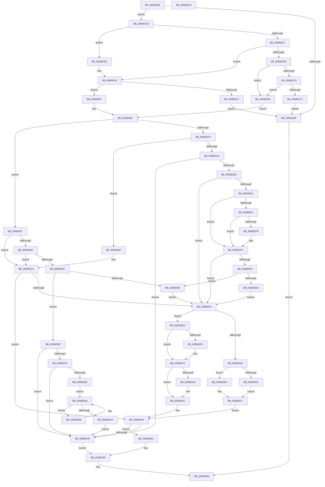

# MiDecrementAweMapCount

- RVA: `0x00688158`–`0x006884A1` (길이 `841` bytes)
- VA: `0x0000000140688158`
- 실행 섹션: `.text`
- PDB 이름 있음: `예`; PDB Function 태그: `아니요`
- unwind 정보 RVA: `0x000BEDC8`
- 디코드: `235`개 명령, `841/841` bytes 표시
- 미해석 바이트: `0` (있으면 어셈블리에 `.byte`로 보존)

> 이 문서는 커널 이미지의 기계어와 PDB 기호를 분석해 생성했습니다. 4번과 5번은 함수 원형과 자료형을 바이너리 사용 방식에서 추정한 C 해석이며 원본 소스 복구 결과는 아닙니다.

## 1. Dependencies

- 직접 호출 지점: **4**; 고유 호출 대상: **4**
- 직접 호출자로 확인된 함수: **4**
- RIP 상대 이미지 참조: **4**

### Outgoing calls
- `0x006881B6` → [MiValidateAndLockAweMapCountPage](../4B/MiValidateAndLockAweMapCountPage_function_004BD8F4.md) (function, `0x004BD8F4`)
- `0x00688304` → [MiCompareTbFlushTimeStamp](../31/MiCompareTbFlushTimeStamp_function_0031ADE4.md) (function, `0x0031ADE4`)
- `0x00688392` → [MI_FLUSH_ENTIRE_TB](../31/MI_FLUSH_ENTIRE_TB_function_00314110.md) (function, `0x00314110`)
- `0x006883AE` → [MiSetPteTimeStamp](../45/MiSetPteTimeStamp_function_00456C90.md) (function, `0x00456C90`)

### Direct callers
- [MiWriteAwePtes](../4C/MiWriteAwePtes_function_004C51E0.md) at `0x004C59A0`
- [MiWriteAwePtes](../4C/MiWriteAwePtes_function_004C51E0.md) at `0x004C59D0`
- [MiBuildPhysicalPageFreeChain](MiBuildPhysicalPageFreeChain_function_00687C80.md) at `0x00687DA4`
- [MiReferenceIncomingPhysicalPages](MiReferenceIncomingPhysicalPages_function_006892C0.md) at `0x006895CC`
- [MiReferenceIncomingPhysicalPages](MiReferenceIncomingPhysicalPages_function_006892C0.md) at `0x00689606`
- [MiUnmapLegacyAwePage](MiUnmapLegacyAwePage_function_0068993C.md) at `0x00689A2C`

### Static image references
- `0x00688257` → RVA `0x00E300C0` (`.data`; read)
- `0x0068825E` → RVA `0x00E300C8` (`.data`; read)
- `0x006882E1` → RVA `0x00E2DC80` (`.data`; read)
- `0x0068839C` → RVA `0x00FCF080` (`CACHEALI`; read)

## 2. Other-region calls and transfers

- 다른 실행 섹션으로 향하는 call: **0**
- 별도 외부 분기/꼬리 이동을 확인하지 못했습니다.

## 3. Assembly (complete function range)

```asm
00688158  48 89 5C 24 20                  mov qword ptr [rsp + 0x20], rbx
0068815D  55                              push rbp
0068815E  56                              push rsi
0068815F  57                              push rdi
00688160  41 54                           push r12
00688162  41 55                           push r13
00688164  41 56                           push r14
00688166  41 57                           push r15
00688168  48 83 EC 30                     sub rsp, 0x30
0068816C  4C 8B D2                        mov r10, rdx
0068816F  4C 8B E9                        mov r13, rcx
00688172  48 8B 49 10                     mov rcx, qword ptr [rcx + 0x10]
00688176  33 D2                           xor edx, edx
00688178  49 8B C2                        mov rax, r10
0068817B  48 89 4C 24 78                  mov qword ptr [rsp + 0x78], rcx
00688180  48 F7 F1                        div rcx
00688183  45 8B F8                        mov r15d, r8d
00688186  4D 8B F1                        mov r14, r9
00688189  41 D1 E8                        shr r8d, 1
0068818C  4C 8D 4C 24 20                  lea r9, [rsp + 0x20]
00688191  4C 8B E0                        mov r12, rax
00688194  41 F7 D0                        not r8d
00688197  49 8B 45 20                     mov rax, qword ptr [r13 + 0x20]
0068819B  0F 57 C0                        xorps xmm0, xmm0
0068819E  33 DB                           xor ebx, ebx
006881A0  48 89 44 24 70                  mov qword ptr [rsp + 0x70], rax
006881A5  49 8B D2                        mov rdx, r10
006881A8  49 8B CD                        mov rcx, r13
006881AB  0F 11 44 24 20                  movups xmmword ptr [rsp + 0x20], xmm0
006881B0  8D 73 01                        lea esi, [rbx + 1]
006881B3  44 23 C6                        and r8d, esi
006881B6  E8 39 57 E3 FF                  call 0x1404bd8f4
006881BB  85 C0                           test eax, eax
006881BD  75 09                           jne 0x1406881c8
006881BF  48 83 C8 FF                     or rax, 0xffffffffffffffff
006881C3  E9 C0 02 00 00                  jmp 0x140688488
006881C8  49 B9 FF FF 01 00 80 FF FF FF   movabs r9, 0xffffff800001ffff
006881D2  49 B8 00 00 00 00 00 00 00 40   movabs r8, 0x4000000000000000
006881DC  39 5C 24 28                     cmp dword ptr [rsp + 0x28], ebx
006881E0  74 5B                           je 0x14068823d
006881E2  48 8B 5C 24 20                  mov rbx, qword ptr [rsp + 0x20]
006881E7  33 FF                           xor edi, edi
006881E9  48 85 DB                        test rbx, rbx
006881EC  74 54                           je 0x140688242
006881EE  44 23 FE                        and r15d, esi
006881F1  74 1A                           je 0x14068820d
006881F3  48 8B 43 18                     mov rax, qword ptr [rbx + 0x18]
006881F7  49 85 C0                        test r8, rax
006881FA  74 11                           je 0x14068820d
006881FC  48 B8 FF FF FF FF FF FF FF 7F   movabs rax, 0x7fffffffffffffff
00688206  F0 48 21 43 18                  lock and qword ptr [rbx + 0x18], rax
0068820B  EB B2                           jmp 0x1406881bf
0068820D  48 8B 43 18                     mov rax, qword ptr [rbx + 0x18]
00688211  48 B9 FF FF FF FF FF FF FF 3F   movabs rcx, 0x3fffffffffffffff
0068821B  48 8B E8                        mov rbp, rax
0068821E  48 23 E9                        and rbp, rcx
00688221  48 B9 00 00 00 00 00 00 00 C0   movabs rcx, 0xc000000000000000
0068822B  48 2B EE                        sub rbp, rsi
0068822E  48 33 C5                        xor rax, rbp
00688231  48 23 C1                        and rax, rcx
00688234  48 33 C5                        xor rax, rbp
00688237  48 89 43 18                     mov qword ptr [rbx + 0x18], rax
0068823B  EB 7A                           jmp 0x1406882b7
0068823D  48 8B 7C 24 20                  mov rdi, qword ptr [rsp + 0x20]
00688242  48 8B 07                        mov rax, qword ptr [rdi]
00688245  48 0F BA E0 0F                  bt rax, 0xf
0068824A  0F 92 C2                        setb dl
0068824D  44 84 FE                        test sil, r15b
00688250  0F 95 C1                        setne cl
00688253  84 D1                           test cl, dl
00688255  74 30                           je 0x140688287
00688257  48 2B 3D 62 7E 7A 00            sub rdi, qword ptr [rip + 0x7a7e62]
0068825E  48 8B 05 63 7E 7A 00            mov rax, qword ptr [rip + 0x7a7e63]
00688265  48 C1 FF 03                     sar rdi, 3
00688269  81 E7 FF FF 3F 00               and edi, 0x3fffff
0068826F  8B CF                           mov ecx, edi
00688271  83 E1 1F                        and ecx, 0x1f
00688274  D3 E6                           shl esi, cl
00688276  8B CF                           mov ecx, edi
00688278  F7 D6                           not esi
0068827A  48 C1 E9 05                     shr rcx, 5
0068827E  F0 21 34 88                     lock and dword ptr [rax + rcx*4], esi
00688282  E9 38 FF FF FF                  jmp 0x1406881bf
00688287  48 8B C8                        mov rcx, rax
0068828A  48 81 E1 00 00 FE FF            and rcx, 0xfffffffffffe0000
00688291  48 81 C1 00 00 FE FF            add rcx, -0x20000
00688298  48 8B D1                        mov rdx, rcx
0068829B  48 33 D0                        xor rdx, rax
0068829E  49 23 D1                        and rdx, r9
006882A1  48 33 D1                        xor rdx, rcx
006882A4  48 8B EA                        mov rbp, rdx
006882A7  48 89 17                        mov qword ptr [rdi], rdx
006882AA  48 C1 ED 11                     shr rbp, 0x11
006882AE  81 E5 FF FF 3F 00               and ebp, 0x3fffff
006882B4  44 23 FE                        and r15d, esi
006882B7  45 85 FF                        test r15d, r15d
006882BA  0F 84 97 00 00 00               je 0x140688357
006882C0  48 85 DB                        test rbx, rbx
006882C3  74 4A                           je 0x14068830f
006882C5  48 8B 43 18                     mov rax, qword ptr [rbx + 0x18]
006882C9  49 0B C0                        or rax, r8
006882CC  48 89 43 18                     mov qword ptr [rbx + 0x18], rax
006882D0  48 85 ED                        test rbp, rbp
006882D3  0F 85 70 01 00 00               jne 0x140688449
006882D9  41 8B 45 08                     mov eax, dword ptr [r13 + 8]
006882DD  A8 10                           test al, 0x10
006882DF  74 42                           je 0x140688323
006882E1  48 8B 05 98 59 7A 00            mov rax, qword ptr [rip + 0x7a5998]
006882E8  48 8B 4B 10                     mov rcx, qword ptr [rbx + 0x10]
006882EC  48 85 C0                        test rax, rax
006882EF  74 0B                           je 0x1406882fc
006882F1  F6 C1 10                        test cl, 0x10
006882F4  75 06                           jne 0x1406882fc
006882F6  48 F7 D0                        not rax
006882F9  48 23 C8                        and rcx, rax
006882FC  48 C1 E9 20                     shr rcx, 0x20
00688300  85 C9                           test ecx, ecx
00688302  74 1F                           je 0x140688323
00688304  E8 DB 2A C9 FF                  call 0x14031ade4
00688309  84 C0                           test al, al
0068830B  75 5C                           jne 0x140688369
0068830D  EB 14                           jmp 0x140688323
0068830F  48 8B 07                        mov rax, qword ptr [rdi]
00688312  48 0F BA E8 0F                  bts rax, 0xf
00688317  48 89 07                        mov qword ptr [rdi], rax
0068831A  48 85 ED                        test rbp, rbp
0068831D  0F 85 21 01 00 00               jne 0x140688444
00688323  41 8A CC                        mov cl, r12b
00688326  8B C6                           mov eax, esi
00688328  80 E1 1F                        and cl, 0x1f
0068832B  D3 E0                           shl eax, cl
0068832D  48 8B 4C 24 70                  mov rcx, qword ptr [rsp + 0x70]
00688332  F7 D0                           not eax
00688334  49 C1 EC 05                     shr r12, 5
00688338  F0 42 21 04 A1                  lock and dword ptr [rcx + r12*4], eax
0068833D  41 8B 45 08                     mov eax, dword ptr [r13 + 8]
00688341  A8 08                           test al, 8
00688343  0F 84 A3 00 00 00               je 0x1406883ec
00688349  49 8B 0E                        mov rcx, qword ptr [r14]
0068834C  48 85 C9                        test rcx, rcx
0068834F  75 6B                           jne 0x1406883bc
00688351  49 89 7E 08                     mov qword ptr [r14 + 8], rdi
00688355  EB 70                           jmp 0x1406883c7
00688357  48 85 DB                        test rbx, rbx
0068835A  74 BE                           je 0x14068831a
0068835C  41 8B 45 08                     mov eax, dword ptr [r13 + 8]
00688360  A8 10                           test al, 0x10
00688362  74 B6                           je 0x14068831a
00688364  48 85 ED                        test rbp, rbp
00688367  75 06                           jne 0x14068836f
00688369  41 88 76 14                     mov byte ptr [r14 + 0x14], sil
0068836D  EB B4                           jmp 0x140688323
0068836F  48 3B EE                        cmp rbp, rsi
00688372  0F 85 D1 00 00 00               jne 0x140688449
00688378  48 8B 43 18                     mov rax, qword ptr [rbx + 0x18]
0068837C  49 85 C0                        test r8, rax
0068837F  0F 85 C4 00 00 00               jne 0x140688449
00688385  41 8B 46 10                     mov eax, dword ptr [r14 + 0x10]
00688389  EB 1B                           jmp 0x1406883a6
0068838B  8B D6                           mov edx, esi
0068838D  B9 02 00 00 00                  mov ecx, 2
00688392  E8 79 BD C8 FF                  call 0x140314110
00688397  F0 83 0C 24 00                  lock or dword ptr [rsp], 0
0068839C  8B 05 DE 6C 94 00               mov eax, dword ptr [rip + 0x946cde]
006883A2  41 89 46 10                     mov dword ptr [r14 + 0x10], eax
006883A6  85 C0                           test eax, eax
006883A8  74 E1                           je 0x14068838b
006883AA  8B D0                           mov edx, eax
006883AC  33 C9                           xor ecx, ecx
006883AE  E8 DD E8 DC FF                  call 0x140456c90
006883B3  48 89 43 10                     mov qword ptr [rbx + 0x10], rax
006883B7  E9 8D 00 00 00                  jmp 0x140688449
006883BC  48 2B 0D FD 7C 7A 00            sub rcx, qword ptr [rip + 0x7a7cfd]
006883C3  48 C1 F9 03                     sar rcx, 3
006883C7  48 8B 07                        mov rax, qword ptr [rdi]
006883CA  48 C1 E1 11                     shl rcx, 0x11
006883CE  48 8B D1                        mov rdx, rcx
006883D1  48 33 D0                        xor rdx, rax
006883D4  48 B8 FF FF 01 00 80 FF FF FF   movabs rax, 0xffffff800001ffff
006883DE  48 23 D0                        and rdx, rax
006883E1  48 33 D1                        xor rdx, rcx
006883E4  48 89 17                        mov qword ptr [rdi], rdx
006883E7  49 89 3E                        mov qword ptr [r14], rdi
006883EA  EB 58                           jmp 0x140688444
006883EC  48 39 74 24 78                  cmp qword ptr [rsp + 0x78], rsi
006883F1  74 22                           je 0x140688415
006883F3  8B 43 20                        mov eax, dword ptr [rbx + 0x20]
006883F6  89 84 24 80 00 00 00            mov dword ptr [rsp + 0x80], eax
006883FD  C1 E8 10                        shr eax, 0x10
00688400  24 FD                           and al, 0xfd
00688402  0C 05                           or al, 5
00688404  88 84 24 82 00 00 00            mov byte ptr [rsp + 0x82], al
0068840B  8B 84 24 80 00 00 00            mov eax, dword ptr [rsp + 0x80]
00688412  89 43 20                        mov dword ptr [rbx + 0x20], eax
00688415  49 8B 16                        mov rdx, qword ptr [r14]
00688418  48 85 D2                        test rdx, rdx
0068841B  75 04                           jne 0x140688421
0068841D  49 89 5E 08                     mov qword ptr [r14 + 8], rbx
00688421  48 8B 03                        mov rax, qword ptr [rbx]
00688424  48 C1 EA 03                     shr rdx, 3
00688428  48 8B CA                        mov rcx, rdx
0068842B  48 33 C8                        xor rcx, rax
0068842E  48 B8 01 00 00 00 00 F0 FF FF   movabs rax, 0xfffff00000000001
00688438  48 23 C8                        and rcx, rax
0068843B  48 33 CA                        xor rcx, rdx
0068843E  48 89 0B                        mov qword ptr [rbx], rcx
00688441  49 89 1E                        mov qword ptr [r14], rbx
00688444  48 85 DB                        test rbx, rbx
00688447  74 11                           je 0x14068845a
00688449  48 B8 FF FF FF FF FF FF FF 7F   movabs rax, 0x7fffffffffffffff
00688453  F0 48 21 43 18                  lock and qword ptr [rbx + 0x18], rax
00688458  EB 2B                           jmp 0x140688485
0068845A  48 2B 3D 5F 7C 7A 00            sub rdi, qword ptr [rip + 0x7a7c5f]
00688461  48 C1 FF 03                     sar rdi, 3
00688465  81 E7 FF FF 3F 00               and edi, 0x3fffff
0068846B  8B CF                           mov ecx, edi
0068846D  8B D7                           mov edx, edi
0068846F  83 E1 1F                        and ecx, 0x1f
00688472  D3 E6                           shl esi, cl
00688474  48 8B 0D 4D 7C 7A 00            mov rcx, qword ptr [rip + 0x7a7c4d]
0068847B  F7 D6                           not esi
0068847D  48 C1 EA 05                     shr rdx, 5
00688481  F0 21 34 91                     lock and dword ptr [rcx + rdx*4], esi
00688485  48 8B C5                        mov rax, rbp
00688488  48 8B 9C 24 88 00 00 00         mov rbx, qword ptr [rsp + 0x88]
00688490  48 83 C4 30                     add rsp, 0x30
00688494  41 5F                           pop r15
00688496  41 5E                           pop r14
00688498  41 5D                           pop r13
0068849A  41 5C                           pop r12
0068849C  5F                              pop rdi
0068849D  5E                              pop rsi
0068849E  5D                              pop rbp
0068849F  C3                              ret
006884A0  CC                              int3
```

## 4. C-style interpretation (structured pseudocode)

```c
__int64 __fastcall MiDecrementAweMapCount(__int64 a1, __int64 a2, int a3, __int64 a4)
{
    __int64 result;
    __int64 v_r12;
    __int64 v_r15;
    __int64 v_rbp;
    __int64 v_rbx;
    __int64 v_rdi;
    __int64 v_rsi;
    __int64 v_rsp;
    unsigned int v_stack_m40;
    unsigned __int64 v_stack_m48;
    unsigned int v_stack_m68;
    unsigned __int64 v_stack_p10;
    unsigned int v_stack_p18;
    unsigned __int8 v_stack_p1A;
    unsigned __int64 v_stack_p20;
    unsigned __int64 v_stack_p8;

    v_stack_p20 = v_rbx;
    v_rsp = (v_rsp) - (48);
    a2 = 0;
    v_stack_p10 = *(unsigned __int64 *)(a1 + 16);
    a3 = (unsigned int)((a3) >> (1));
    a3 = (unsigned int)(~(a3));
    v_rbx = 0;
    v_stack_p8 = *(unsigned __int64 *)(a1 + 32);
    v_stack_m48 = v_xmm0;
    a3 = (unsigned int)((a3) & ((unsigned int)(v_rbx + 1)));
    result = MiValidateAndLockAweMapCountPage(a1, 0, a3, v_stack_m48);
    if ((unsigned int)(result) != 0) goto loc_006881C8;
loc_006881BF:
    result = (result) | (-1);
    goto loc_00688488;
loc_006881C8:
    if (v_stack_m40 == 0) goto loc_0068823D;
    v_rdi = 0;
    if (v_stack_m48 == 0) goto loc_00688242;
    v_r15 = (unsigned int)(((unsigned int)(a3)) & ((unsigned int)(v_rbx + 1)));
    if (condition_is_equal) goto loc_0068820D;
    if (((a3) & (*(unsigned __int64 *)(v_stack_m48 + 24))) == 0) goto loc_0068820D;
    goto loc_006881BF;
loc_0068820D:
    v_rbp = (*(unsigned __int64 *)(v_stack_m48 + 24)) & (a1);
    v_rbp = (v_rbp) - (v_rbx + 1);
    result = (*(unsigned __int64 *)(v_stack_m48 + 24)) ^ (v_rbp);
    result = (result) & (a1);
    result = (result) ^ (v_rbp);
    *(unsigned __int64 *)(v_stack_m48 + 24) = result;
    goto loc_006882B7;
loc_0068823D:
loc_00688242:
    a2 = (condition_is_below) ? 1 : 0;
    a1 = ((((unsigned __int8)(v_rbx + 1)) & ((unsigned __int8)(v_r15))) != 0) ? 1 : 0;
    if ((((unsigned __int8)(a1)) & ((unsigned __int8)(a2))) == 0) goto loc_00688287;
    v_rdi = (v_stack_m48) - (*(unsigned __int64 *)(v_rip + 8027746));
    v_rdi = (v_rdi) >> (3);
    v_rdi = (unsigned int)((v_rdi) & (0x3FFFFFULL));
    a1 = (unsigned int)(((unsigned int)((unsigned int)(v_rdi))) & (31));
    v_rsi = (unsigned int)((v_rbx + 1) << ((unsigned __int8)(a1)));
    v_rsi = (unsigned int)(~(v_rsi));
    a1 = ((unsigned int)((unsigned int)(v_rdi))) >> (5);
    goto loc_006881BF;
loc_00688287:
    a1 = (*(unsigned __int64 *)(v_rip + 8027747)) & (0xFFFFFFFFFFFE0000ULL);
    a1 = (a1) + (0xFFFFFFFFFFFE0000ULL);
    a2 = (a1) ^ (*(unsigned __int64 *)(v_rip + 8027747));
    a2 = (a2) & (v_stack_m48);
    a2 = (a2) ^ (a1);
    *(unsigned __int64 *)(v_rdi) = a2;
    v_rbp = (a2) >> (17);
    v_rbp = (unsigned int)((v_rbp) & (0x3FFFFFULL));
    v_r15 = (unsigned int)((v_r15) & ((unsigned int)(v_rsi)));
loc_006882B7:
    if ((unsigned int)(v_r15) == 0) goto loc_00688357;
    if (v_stack_m48 == 0) goto loc_0068830F;
    result = (*(unsigned __int64 *)(v_stack_m48 + 24)) | (a3);
    *(unsigned __int64 *)(v_stack_m48 + 24) = result;
    if (v_rbp != 0) goto loc_00688449;
    if ((((unsigned __int8)((unsigned int)(*(unsigned int *)(a1 + 8)))) & (16)) == 0) goto loc_00688323;
    if (*(unsigned __int64 *)(v_rip + 8018328) == 0) goto loc_006882FC;
    result = *(unsigned __int64 *)(v_rip + 8018328);
    if ((((unsigned __int8)(*(unsigned __int64 *)(v_stack_m48 + 16))) & (16)) == 0) {
        result = ~(*(unsigned __int64 *)(v_rip + 8018328));
        a1 = (*(unsigned __int64 *)(v_stack_m48 + 16)) & (result);
    }
    a1 = (a1) >> (32);
    if ((unsigned int)(a1) == 0) goto loc_00688323;
    result = MiCompareTbFlushTimeStamp(a1, a2, a3, v_stack_m48);
    if ((unsigned __int8)(result) != 0) goto loc_00688369;
    goto loc_00688323;
loc_0068830F:
    *(unsigned __int64 *)(v_rdi) = *(unsigned __int64 *)(v_rdi);
loc_0068831A:
    if (v_rbp != 0) goto loc_00688444;
loc_00688323:
    a1 = (unsigned __int8)((0) & (31));
    result = (unsigned int)(((unsigned int)((unsigned int)(v_rsi))) << ((unsigned __int8)(a1)));
    result = (unsigned int)(~(result));
    v_r12 = (0) >> (5);
    if ((((unsigned __int8)((unsigned int)(*(unsigned int *)(a1 + 8)))) & (8)) == 0) goto loc_006883EC;
    if (*(unsigned __int64 *)(a4) != 0) goto loc_006883BC;
    *(unsigned __int64 *)(a4 + 8) = v_rdi;
    goto loc_006883C7;
loc_00688357:
    if (v_stack_m48 == 0) goto loc_0068831A;
    if ((((unsigned __int8)((unsigned int)(*(unsigned int *)(a1 + 8)))) & (16)) == 0) goto loc_0068831A;
    if (v_rbp != 0) goto loc_0068836F;
loc_00688369:
    *(unsigned __int8 *)(a4 + 20) = (unsigned __int8)(v_rsi);
    goto loc_00688323;
loc_0068836F:
    if (v_rbp != v_rsi) goto loc_00688449;
    if (((a3) & (*(unsigned __int64 *)(v_stack_m48 + 24))) != 0) goto loc_00688449;
    goto loc_006883A6;
loc_0068838B:
    result = MI_FLUSH_ENTIRE_TB(2, (unsigned int)((unsigned int)(v_rsi)), a3, v_stack_m48);
    *(unsigned int *)(a4 + 16) = (unsigned int)((unsigned int)(*(unsigned int *)(v_rip + 9727198)));
loc_006883A6:
    if ((unsigned int)((unsigned int)(*(unsigned int *)(v_rip + 9727198))) == 0) goto loc_0068838B;
    a1 = 0;
    result = MiSetPteTimeStamp(a1, (unsigned int)((unsigned int)((unsigned int)(*(unsigned int *)(v_rip + 9727198)))), a3, v_stack_m48);
    *(unsigned __int64 *)(v_stack_m48 + 16) = result;
    goto loc_00688449;
loc_006883BC:
    a1 = (a1) - (*(unsigned __int64 *)(v_rip + 8027389));
    a1 = (a1) >> (3);
loc_006883C7:
    a1 = (a1) << (17);
    a2 = (a1) ^ (*(unsigned __int64 *)(v_rdi));
    a2 = (a2) & (*(unsigned __int64 *)(v_rdi));
    a2 = (a2) ^ (a1);
    *(unsigned __int64 *)(v_rdi) = a2;
    *(unsigned __int64 *)(a4) = v_rdi;
    goto loc_00688444;
loc_006883EC:
    result = *(unsigned __int64 *)(v_rdi);
    if (v_stack_p10 != v_rsi) {
        result = *(unsigned int *)(v_stack_m48 + 32);
        v_stack_p18 = (unsigned int)(result);
        result = (unsigned int)((result) >> (16));
        result = (unsigned __int8)((result) & (253));
        result = (unsigned __int8)((result) | (5));
        v_stack_p1A = (unsigned __int8)(result);
        result = v_stack_p18;
        *(unsigned int *)(v_stack_m48 + 32) = (unsigned int)(result);
    }
    if (*(unsigned __int64 *)(a4) == 0) {
        *(unsigned __int64 *)(a4 + 8) = v_stack_m48;
    }
    a2 = (*(unsigned __int64 *)(a4)) >> (3);
    a1 = (a2) ^ (*(unsigned __int64 *)(v_stack_m48));
    a1 = (a1) & (*(unsigned __int64 *)(v_stack_m48));
    a1 = (a1) ^ (a2);
    *(unsigned __int64 *)(v_stack_m48) = a1;
    *(unsigned __int64 *)(a4) = v_stack_m48;
loc_00688444:
    if (v_stack_m48 == 0) goto loc_0068845A;
loc_00688449:
    goto loc_00688485;
loc_0068845A:
    v_rdi = (v_rdi) - (*(unsigned __int64 *)(v_rip + 8027231));
    v_rdi = (v_rdi) >> (3);
    v_rdi = (unsigned int)((v_rdi) & (0x3FFFFFULL));
    a1 = (unsigned int)(((unsigned int)((unsigned int)(v_rdi))) & (31));
    v_rsi = (unsigned int)((v_rsi) << ((unsigned __int8)(a1)));
    v_rsi = (unsigned int)(~(v_rsi));
    a2 = ((unsigned int)((unsigned int)(v_rdi))) >> (5);
loc_00688485:
loc_00688488:
    v_rsp = (v_rsp) + (48);
    return v_rbp;
}
```

## 5. (Beta) C Style

```c
int64_t MiDecrementAweMapCount(void *Arg1, int64_t Arg2, int32_t Arg3, void *Arg4)
{
    uint8_t *arg1 = (uint8_t *)Arg1;
    uint8_t *arg4 = (uint8_t *)Arg4;

    int64_t result;
    int64_t local_r12;
    int64_t local_r15;
    int64_t local_rbp;
    int64_t local_rbx;
    int64_t local_rdi;
    int64_t local_rsi;
    int64_t local_rsp;
    uint32_t v_stack_m40;
    uint64_t v_stack_m48;
    uint32_t v_stack_m68;
    uint64_t v_stack_p10;
    uint32_t v_stack_p18;
    uint8_t v_stack_p1A;
    uint64_t v_stack_p20;
    uint64_t v_stack_p8;

    v_stack_p20 = local_rbx;
    local_rsp = (local_rsp) - (48);
    Arg2 = 0;
    v_stack_p10 = *(uint64_t *)(arg1 + 0x10);
    Arg3 = (uint32_t)((Arg3) >> (1));
    Arg3 = (uint32_t)(~(Arg3));
    local_rbx = 0;
    v_stack_p8 = *(uint64_t *)(arg1 + 0x20);
    v_stack_m48 = v_xmm0;
    Arg3 = (uint32_t)((Arg3) & ((uint32_t)(local_rbx + 1)));
    result = MiValidateAndLockAweMapCountPage(Arg1, 0, Arg3, v_stack_m48);
    if ((uint32_t)(result) != 0) goto loc_006881C8;
loc_006881BF:
    result = (result) | (-1);
    goto loc_00688488;
loc_006881C8:
    if (v_stack_m40 == 0) goto loc_0068823D;
    local_rdi = 0;
    if (v_stack_m48 == 0) goto loc_00688242;
    local_r15 = (uint32_t)(((uint32_t)(Arg3)) & ((uint32_t)(local_rbx + 1)));
    if (condition_is_equal) goto loc_0068820D;
    if (((Arg3) & (*(uint64_t *)(v_stack_m48 + 0x18))) == 0) goto loc_0068820D;
    goto loc_006881BF;
loc_0068820D:
    local_rbp = (*(uint64_t *)(v_stack_m48 + 0x18)) & (Arg1);
    local_rbp = (local_rbp) - (local_rbx + 1);
    result = (*(uint64_t *)(v_stack_m48 + 0x18)) ^ (local_rbp);
    result = (result) & (Arg1);
    result = (result) ^ (local_rbp);
    *(uint64_t *)(v_stack_m48 + 0x18) = result;
    goto loc_006882B7;
loc_0068823D:
loc_00688242:
    Arg2 = (condition_is_below) ? 1 : 0;
    Arg1 = ((((uint8_t)(local_rbx + 1)) & ((uint8_t)(local_r15))) != 0) ? 1 : 0;
    if ((((uint8_t)(Arg1)) & ((uint8_t)(Arg2))) == 0) goto loc_00688287;
    local_rdi = (v_stack_m48) - (*(uint64_t *)(v_rip + 0x7A7E62));
    local_rdi = (local_rdi) >> (3);
    local_rdi = (uint32_t)((local_rdi) & (0x3FFFFFULL));
    Arg1 = (uint32_t)(((uint32_t)((uint32_t)(local_rdi))) & (31));
    local_rsi = (uint32_t)((local_rbx + 1) << ((uint8_t)(Arg1)));
    local_rsi = (uint32_t)(~(local_rsi));
    Arg1 = ((uint32_t)((uint32_t)(local_rdi))) >> (5);
    goto loc_006881BF;
loc_00688287:
    Arg1 = (*(uint64_t *)(v_rip + 0x7A7E63)) & (0xFFFFFFFFFFFE0000ULL);
    Arg1 = (Arg1) + (0xFFFFFFFFFFFE0000ULL);
    Arg2 = (Arg1) ^ (*(uint64_t *)(v_rip + 0x7A7E63));
    Arg2 = (Arg2) & (v_stack_m48);
    Arg2 = (Arg2) ^ (Arg1);
    *(uint64_t *)(local_rdi) = Arg2;
    local_rbp = (Arg2) >> (17);
    local_rbp = (uint32_t)((local_rbp) & (0x3FFFFFULL));
    local_r15 = (uint32_t)((local_r15) & ((uint32_t)(local_rsi)));
loc_006882B7:
    if ((uint32_t)(local_r15) == 0) goto loc_00688357;
    if (v_stack_m48 == 0) goto loc_0068830F;
    result = (*(uint64_t *)(v_stack_m48 + 0x18)) | (Arg3);
    *(uint64_t *)(v_stack_m48 + 0x18) = result;
    if (local_rbp != 0) goto loc_00688449;
    if ((((uint8_t)((uint32_t)(*(uint32_t *)(arg1 + 0x8)))) & (16)) == 0) goto loc_00688323;
    if (*(uint64_t *)(v_rip + 0x7A5998) == 0) goto loc_006882FC;
    result = *(uint64_t *)(v_rip + 0x7A5998);
    if ((((uint8_t)(*(uint64_t *)(v_stack_m48 + 0x10))) & (16)) == 0) {
        result = ~(*(uint64_t *)(v_rip + 0x7A5998));
        Arg1 = (*(uint64_t *)(v_stack_m48 + 0x10)) & (result);
    }
    Arg1 = (Arg1) >> (32);
    if ((uint32_t)(Arg1) == 0) goto loc_00688323;
    result = MiCompareTbFlushTimeStamp(Arg1, Arg2, Arg3, v_stack_m48);
    if ((uint8_t)(result) != 0) goto loc_00688369;
    goto loc_00688323;
loc_0068830F:
    *(uint64_t *)(local_rdi) = *(uint64_t *)(local_rdi);
loc_0068831A:
    if (local_rbp != 0) goto loc_00688444;
loc_00688323:
    Arg1 = (uint8_t)((0) & (31));
    result = (uint32_t)(((uint32_t)((uint32_t)(local_rsi))) << ((uint8_t)(Arg1)));
    result = (uint32_t)(~(result));
    local_r12 = (0) >> (5);
    if ((((uint8_t)((uint32_t)(*(uint32_t *)(arg1 + 0x8)))) & (8)) == 0) goto loc_006883EC;
    if (*(uint64_t *)(arg4) != 0) goto loc_006883BC;
    *(uint64_t *)(arg4 + 0x8) = local_rdi;
    goto loc_006883C7;
loc_00688357:
    if (v_stack_m48 == 0) goto loc_0068831A;
    if ((((uint8_t)((uint32_t)(*(uint32_t *)(arg1 + 0x8)))) & (16)) == 0) goto loc_0068831A;
    if (local_rbp != 0) goto loc_0068836F;
loc_00688369:
    *(uint8_t *)(arg4 + 0x14) = (uint8_t)(local_rsi);
    goto loc_00688323;
loc_0068836F:
    if (local_rbp != local_rsi) goto loc_00688449;
    if (((Arg3) & (*(uint64_t *)(v_stack_m48 + 0x18))) != 0) goto loc_00688449;
    goto loc_006883A6;
loc_0068838B:
    result = MI_FLUSH_ENTIRE_TB(2, (uint32_t)((uint32_t)(local_rsi)), Arg3, v_stack_m48);
    *(uint32_t *)(arg4 + 0x10) = (uint32_t)((uint32_t)(*(uint32_t *)(v_rip + 0x946CDE)));
loc_006883A6:
    if ((uint32_t)((uint32_t)(*(uint32_t *)(v_rip + 0x946CDE))) == 0) goto loc_0068838B;
    Arg1 = 0;
    result = MiSetPteTimeStamp(Arg1, (uint32_t)((uint32_t)((uint32_t)(*(uint32_t *)(v_rip + 0x946CDE)))), Arg3, v_stack_m48);
    *(uint64_t *)(v_stack_m48 + 0x10) = result;
    goto loc_00688449;
loc_006883BC:
    Arg1 = (Arg1) - (*(uint64_t *)(v_rip + 0x7A7CFD));
    Arg1 = (Arg1) >> (3);
loc_006883C7:
    Arg1 = (Arg1) << (17);
    Arg2 = (Arg1) ^ (*(uint64_t *)(local_rdi));
    Arg2 = (Arg2) & (*(uint64_t *)(local_rdi));
    Arg2 = (Arg2) ^ (Arg1);
    *(uint64_t *)(local_rdi) = Arg2;
    *(uint64_t *)(arg4) = local_rdi;
    goto loc_00688444;
loc_006883EC:
    result = *(uint64_t *)(local_rdi);
    if (v_stack_p10 != local_rsi) {
        result = *(uint32_t *)(v_stack_m48 + 0x20);
        v_stack_p18 = (uint32_t)(result);
        result = (uint32_t)((result) >> (16));
        result = (uint8_t)((result) & (253));
        result = (uint8_t)((result) | (5));
        v_stack_p1A = (uint8_t)(result);
        result = v_stack_p18;
        *(uint32_t *)(v_stack_m48 + 0x20) = (uint32_t)(result);
    }
    if (*(uint64_t *)(arg4) == 0) {
        *(uint64_t *)(arg4 + 0x8) = v_stack_m48;
    }
    Arg2 = (*(uint64_t *)(arg4)) >> (3);
    Arg1 = (Arg2) ^ (*(uint64_t *)(v_stack_m48));
    Arg1 = (Arg1) & (*(uint64_t *)(v_stack_m48));
    Arg1 = (Arg1) ^ (Arg2);
    *(void **)(v_stack_m48) = Arg1;
    *(uint64_t *)(arg4) = v_stack_m48;
loc_00688444:
    if (v_stack_m48 == 0) goto loc_0068845A;
loc_00688449:
    goto loc_00688485;
loc_0068845A:
    local_rdi = (local_rdi) - (*(uint64_t *)(v_rip + 0x7A7C5F));
    local_rdi = (local_rdi) >> (3);
    local_rdi = (uint32_t)((local_rdi) & (0x3FFFFFULL));
    Arg1 = (uint32_t)(((uint32_t)((uint32_t)(local_rdi))) & (31));
    local_rsi = (uint32_t)((local_rsi) << ((uint8_t)(Arg1)));
    local_rsi = (uint32_t)(~(local_rsi));
    Arg2 = ((uint32_t)((uint32_t)(local_rdi))) >> (5);
loc_00688485:
loc_00688488:
    local_rsp = (local_rsp) + (48);
    return local_rbp;
}
```

### 관측된 메모리 오프셋

구조체 형식이 확인되지 않은 접근은 인자 기준의 오프셋으로만 기록했습니다.

| 기준 인자 | 오프셋 표현 | 폭 (bit) | 접근 |
|---|---:|---:|---|
| `Arg1` | `+ 0x8` | `32` | `R` |
| `Arg1` | `+ 0x10` | `64` | `R` |
| `Arg1` | `+ 0x20` | `64` | `R` |
| `Arg4` | `+ 0x0` | `64` | `R` |
| `Arg4` | `+ 0x0` | `64` | `W` |
| `Arg4` | `+ 0x8` | `64` | `W` |
| `Arg4` | `+ 0x10` | `32` | `R` |
| `Arg4` | `+ 0x10` | `32` | `W` |
| `Arg4` | `+ 0x14` | `8` | `W` |

## 6. Execution-region graph

[열기: 2D/3D 그래프와 함수 탐색 컨트롤 패널](../../../control-panel.html?section=text&rva=0x00688158&view=graph)

- 2D 그래프는 위에서 아래로 흐르고, 3D 그래프는 빈 공간을 드래그해 회전합니다. Shift+드래그는 이동, 휠은 확대·축소, 함수 노드 선택은 대상 보고서 이동입니다.

### Static fallback


