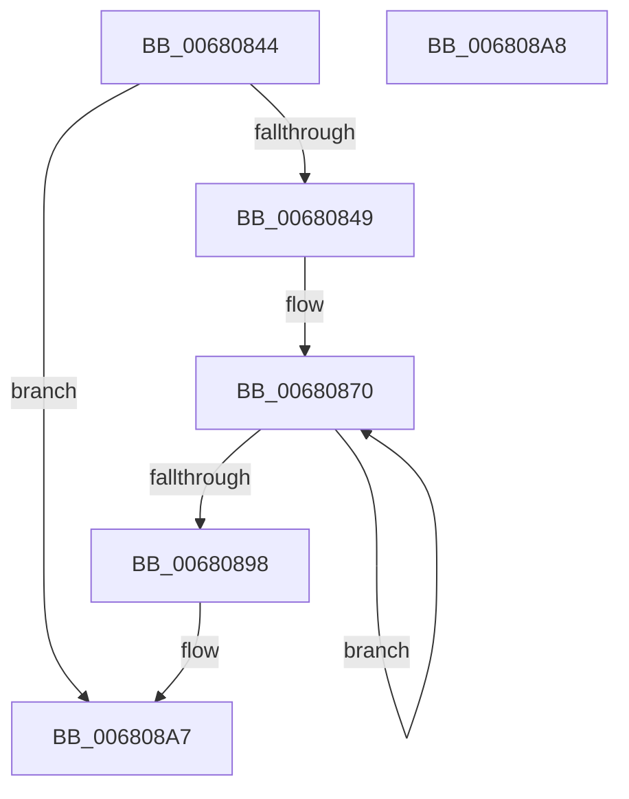

# MiDecrementProtoShareCounts

- RVA: `0x00680844`–`0x006808A9` (길이 `101` bytes)
- VA: `0x0000000140680844`
- 실행 섹션: `.text`
- PDB 이름 있음: `예`; PDB Function 태그: `아니요`
- unwind 정보 RVA: `0x000ADC24`
- 디코드: `29`개 명령, `101/101` bytes 표시
- 미해석 바이트: `0` (있으면 어셈블리에 `.byte`로 보존)

> 이 문서는 커널 이미지의 기계어와 PDB 기호를 분석해 생성했습니다. 4번과 5번은 함수 원형과 자료형을 바이너리 사용 방식에서 추정한 C 해석이며 원본 소스 복구 결과는 아닙니다.

## 1. Dependencies

- 직접 호출 지점: **3**; 고유 호출 대상: **3**
- 직접 호출자로 확인된 함수: **1**
- RIP 상대 이미지 참조: **0**

### Outgoing calls
- `0x00680873` → [MiLockPageInline](../31/MiLockPageInline_function_0031A340.md) (function, `0x0031A340`)
- `0x0068087F` → [MiDecrementShareCountEx](../33/MiDecrementShareCountEx_function_00333F70.md) (function, `0x00333F70`)
- `0x00680889` → [MiUnlockPage](../31/MiUnlockPage_function_0031A3E0.md) (function, `0x0031A3E0`)

### Direct callers
- [MiCreateFileOnlyPfns](../../page/80/MiCreateFileOnlyPfns_function_00800DB4.md) at `0x00800F21`

### Static image references
- 디코드된 RIP-relative 메모리 참조가 없습니다.

## 2. Other-region calls and transfers

- 다른 실행 섹션으로 향하는 call: **0**
- 별도 외부 분기/꼬리 이동을 확인하지 못했습니다.

## 3. Assembly (complete function range)

```asm
00680844  48 85 D2                        test rdx, rdx
00680847  74 5E                           je 0x1406808a7
00680849  48 89 5C 24 08                  mov qword ptr [rsp + 8], rbx
0068084E  48 89 74 24 10                  mov qword ptr [rsp + 0x10], rsi
00680853  57                              push rdi
00680854  48 83 EC 20                     sub rsp, 0x20
00680858  48 8D 3C 49                     lea rdi, [rcx + rcx*2]
0068085C  48 8B F2                        mov rsi, rdx
0068085F  48 C1 E7 04                     shl rdi, 4
00680863  48 B8 00 00 00 00 00 DE FF FF   movabs rax, 0xffffde0000000000
0068086D  48 03 F8                        add rdi, rax
00680870  48 8B CF                        mov rcx, rdi
00680873  E8 C8 9A C9 FF                  call 0x14031a340
00680878  33 D2                           xor edx, edx
0068087A  48 8B CF                        mov rcx, rdi
0068087D  8A D8                           mov bl, al
0068087F  E8 EC 36 CB FF                  call 0x140333f70
00680884  8A D3                           mov dl, bl
00680886  48 8B CF                        mov rcx, rdi
00680889  E8 52 9B C9 FF                  call 0x14031a3e0
0068088E  48 83 C7 30                     add rdi, 0x30
00680892  48 83 EE 01                     sub rsi, 1
00680896  75 D8                           jne 0x140680870
00680898  48 8B 5C 24 30                  mov rbx, qword ptr [rsp + 0x30]
0068089D  48 8B 74 24 38                  mov rsi, qword ptr [rsp + 0x38]
006808A2  48 83 C4 20                     add rsp, 0x20
006808A6  5F                              pop rdi
006808A7  C3                              ret
006808A8  CC                              int3
```

## 4. C-style interpretation (structured pseudocode)

```c
__int64 __fastcall MiDecrementProtoShareCounts(__int64 a1, __int64 a2)
{
    __int64 result;
    __int64 v_rdi;
    __int64 v_rsi;
    __int64 v_rsp;
    unsigned __int64 v_stack_p10;
    unsigned __int64 v_stack_p8;

    if (a2 == 0) goto loc_006808A7;
    v_stack_p8 = v_rbx;
    v_stack_p10 = v_rsi;
    v_rsp = (v_rsp) - (32);
    v_rdi = (a1 + a1 * 2) << (4);
    v_rdi = (v_rdi) + (result);
loc_00680870:
    result = MiLockPageInline(v_rdi, a2, a3, a4);
    a2 = 0;
    result = MiDecrementShareCountEx(v_rdi, a2, a3, a4);
    result = MiUnlockPage(v_rdi, (unsigned __int8)((unsigned __int8)(result)), a3, a4);
    v_rdi = (v_rdi) + (48);
    v_rsi = (a2) - (1);
    if (condition_is_not_equal) goto loc_00680870;
    v_rsp = (v_rsp) + (32);
loc_006808A7:
    return result;
}
```

## 5. (Beta) C Style

```c
int64_t MiDecrementProtoShareCounts(void *Arg1, int64_t Arg2)
{
    uint8_t *arg1 = (uint8_t *)Arg1;

    int64_t result;
    int64_t local_rdi;
    int64_t local_rsi;
    int64_t local_rsp;
    uint64_t v_stack_p10;
    uint64_t v_stack_p8;

    if (Arg2 == 0) goto loc_006808A7;
    v_stack_p8 = local_rbx;
    v_stack_p10 = local_rsi;
    local_rsp = (local_rsp) - (32);
    local_rdi = (Arg1 + Arg1 * 2) << (4);
    local_rdi = (local_rdi) + (result);
loc_00680870:
    result = MiLockPageInline(local_rdi, Arg2, a3, a4);
    Arg2 = 0;
    result = MiDecrementShareCountEx(local_rdi, Arg2, a3, a4);
    result = MiUnlockPage(local_rdi, (uint8_t)((uint8_t)(result)), a3, a4);
    local_rdi = (local_rdi) + (48);
    local_rsi = (Arg2) - (1);
    if (condition_is_not_equal) goto loc_00680870;
    local_rsp = (local_rsp) + (32);
loc_006808A7:
    return result;
}
```

### 관측된 메모리 오프셋

구조체 형식이 확인되지 않은 접근은 인자 기준의 오프셋으로만 기록했습니다.

| 기준 인자 | 오프셋 표현 | 폭 (bit) | 접근 |
|---|---:|---:|---|
| `Arg1` | `+ 0x0 + rcx*2` | `64` | `R` |

## 6. Execution-region graph

[열기: 2D/3D 그래프와 함수 탐색 컨트롤 패널](../../../control-panel.html?section=text&rva=0x00680844&view=graph)

- 2D 그래프는 위에서 아래로 흐르고, 3D 그래프는 빈 공간을 드래그해 회전합니다. Shift+드래그는 이동, 휠은 확대·축소, 함수 노드 선택은 대상 보고서 이동입니다.

### Static fallback


