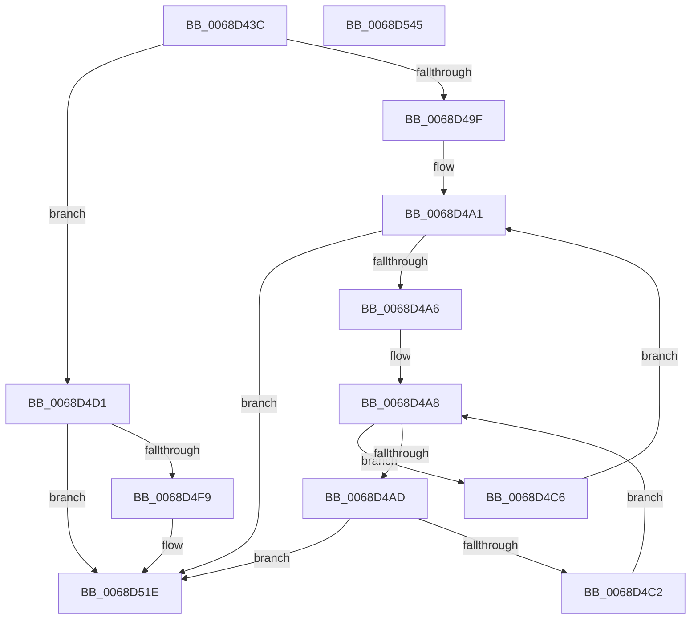

# MiDefragmentAllSlabAllocators

- RVA: `0x0068D43C`–`0x0068D546` (길이 `266` bytes)
- VA: `0x000000014068D43C`
- 실행 섹션: `.text`
- PDB 이름 있음: `예`; PDB Function 태그: `아니요`
- unwind 정보 RVA: `0x000D8ED4`
- 디코드: `81`개 명령, `266/266` bytes 표시
- 미해석 바이트: `0` (있으면 어셈블리에 `.byte`로 보존)

> 이 문서는 커널 이미지의 기계어와 PDB 기호를 분석해 생성했습니다. 4번과 5번은 함수 원형과 자료형을 바이너리 사용 방식에서 추정한 C 해석이며 원본 소스 복구 결과는 아닙니다.

## 1. Dependencies

- 직접 호출 지점: **5**; 고유 호출 대상: **4**
- 직접 호출자로 확인된 함수: **1**
- RIP 상대 이미지 참조: **3**

### Outgoing calls
- `0x0068D46E` → [MiDeletePendingSlabIdentities](MiDeletePendingSlabIdentities_function_0068DA3C.md) (function, `0x0068DA3C`)
- `0x0068D4B9` → [MiDefragmentAllSlabsHelper](MiDefragmentAllSlabsHelper_function_0068D550.md) (function, `0x0068D550`)
- `0x0068D4EA` → [MiEnumerateSlabAllocatorsEx](../47/MiEnumerateSlabAllocatorsEx_function_004746F8.md) (function, `0x004746F8`)
- `0x0068D519` → [MiEnumerateSlabAllocatorsEx](../47/MiEnumerateSlabAllocatorsEx_function_004746F8.md) (function, `0x004746F8`)
- `0x0068D531` → [_security_check_cookie](../6A/_security_check_cookie_function_006AC640.md) (function, `0x006AC640`)

### Direct callers
- [MmManagePartitionCreateLargePages](../../page/80/MmManagePartitionCreateLargePages_function_0080E000.md) at `0x0080E0CB`

### Static image references
- `0x0068D44E` → RVA `0x00E0A740` (`.data`; read)
- `0x0068D477` → RVA `0x000135E8` (`.rdata`; read)
- `0x0068D4E3` → RVA `0x0068D550` (`MiDefragmentAllSlabsHelper`; read)

## 2. Other-region calls and transfers

- 다른 실행 섹션으로 향하는 call: **0**
- 별도 외부 분기/꼬리 이동을 확인하지 못했습니다.

## 3. Assembly (complete function range)

```asm
0068D43C  40 55                           push rbp
0068D43E  53                              push rbx
0068D43F  56                              push rsi
0068D440  57                              push rdi
0068D441  41 55                           push r13
0068D443  41 56                           push r14
0068D445  41 57                           push r15
0068D447  48 8B EC                        mov rbp, rsp
0068D44A  48 83 EC 60                     sub rsp, 0x60
0068D44E  48 8B 05 EB D2 77 00            mov rax, qword ptr [rip + 0x77d2eb]
0068D455  48 33 C4                        xor rax, rsp
0068D458  48 89 45 F0                     mov qword ptr [rbp - 0x10], rax
0068D45C  8B DA                           mov ebx, edx
0068D45E  41 8B F8                        mov edi, r8d
0068D461  33 C0                           xor eax, eax
0068D463  33 D2                           xor edx, edx
0068D465  89 45 D4                        mov dword ptr [rbp - 0x2c], eax
0068D468  49 8B F1                        mov rsi, r9
0068D46B  4C 8B F1                        mov r14, rcx
0068D46E  E8 C9 05 00 00                  call 0x14068da3c
0068D473  83 65 D4 00                     and dword ptr [rbp - 0x2c], 0
0068D477  4C 8D 2D 6A 61 98 FF            lea r13, [rip - 0x679e96]
0068D47E  41 8B 4C BD 00                  mov ecx, dword ptr [r13 + rdi*4]
0068D483  44 8B FF                        mov r15d, edi
0068D486  48 83 65 E0 00                  and qword ptr [rbp - 0x20], 0
0068D48B  48 83 65 E8 00                  and qword ptr [rbp - 0x18], 0
0068D490  48 D3 E6                        shl rsi, cl
0068D493  89 7D D0                        mov dword ptr [rbp - 0x30], edi
0068D496  48 89 75 D8                     mov qword ptr [rbp - 0x28], rsi
0068D49A  83 FB FF                        cmp ebx, -1
0068D49D  75 32                           jne 0x14068d4d1
0068D49F  33 FF                           xor edi, edi
0068D4A1  83 FF 02                        cmp edi, 2
0068D4A4  73 78                           jae 0x14068d51e
0068D4A6  33 DB                           xor ebx, ebx
0068D4A8  83 FB 09                        cmp ebx, 9
0068D4AB  7D 19                           jge 0x14068d4c6
0068D4AD  4C 8D 45 D0                     lea r8, [rbp - 0x30]
0068D4B1  89 5D EC                        mov dword ptr [rbp - 0x14], ebx
0068D4B4  33 D2                           xor edx, edx
0068D4B6  49 8B CE                        mov rcx, r14
0068D4B9  E8 92 00 00 00                  call 0x14068d550
0068D4BE  85 C0                           test eax, eax
0068D4C0  75 5C                           jne 0x14068d51e
0068D4C2  FF C3                           inc ebx
0068D4C4  EB E2                           jmp 0x14068d4a8
0068D4C6  C7 45 E8 01 00 00 00            mov dword ptr [rbp - 0x18], 1
0068D4CD  FF C7                           inc edi
0068D4CF  EB D0                           jmp 0x14068d4a1
0068D4D1  44 8B CB                        mov r9d, ebx
0068D4D4  C7 44 24 20 09 00 00 00         mov dword ptr [rsp + 0x20], 9
0068D4DC  4C 8D 45 D0                     lea r8, [rbp - 0x30]
0068D4E0  49 8B CE                        mov rcx, r14
0068D4E3  48 8D 15 66 00 00 00            lea rdx, [rip + 0x66]
0068D4EA  E8 09 72 DE FF                  call 0x1404746f8
0068D4EF  48 8B 45 D8                     mov rax, qword ptr [rbp - 0x28]
0068D4F3  48 39 45 E0                     cmp qword ptr [rbp - 0x20], rax
0068D4F7  73 25                           jae 0x14068d51e
0068D4F9  44 8B CB                        mov r9d, ebx
0068D4FC  C7 45 E8 01 00 00 00            mov dword ptr [rbp - 0x18], 1
0068D503  4C 8D 45 D0                     lea r8, [rbp - 0x30]
0068D507  C7 44 24 20 09 00 00 00         mov dword ptr [rsp + 0x20], 9
0068D50F  48 8D 15 3A 00 00 00            lea rdx, [rip + 0x3a]
0068D516  49 8B CE                        mov rcx, r14
0068D519  E8 DA 71 DE FF                  call 0x1404746f8
0068D51E  48 8B 45 E0                     mov rax, qword ptr [rbp - 0x20]
0068D522  43 8B 4C BD 00                  mov ecx, dword ptr [r13 + r15*4]
0068D527  48 D3 E8                        shr rax, cl
0068D52A  48 8B 4D F0                     mov rcx, qword ptr [rbp - 0x10]
0068D52E  48 33 CC                        xor rcx, rsp
0068D531  E8 0A F1 01 00                  call 0x1406ac640
0068D536  48 83 C4 60                     add rsp, 0x60
0068D53A  41 5F                           pop r15
0068D53C  41 5E                           pop r14
0068D53E  41 5D                           pop r13
0068D540  5F                              pop rdi
0068D541  5E                              pop rsi
0068D542  5B                              pop rbx
0068D543  5D                              pop rbp
0068D544  C3                              ret
0068D545  CC                              int3
```

## 4. C-style interpretation (structured pseudocode)

```c
__int64 __fastcall MiDefragmentAllSlabAllocators(__int64 a1, int a2, int a3, __int64 a4)
{
    __int64 result;
    __int64 v_rbx;
    __int64 v_rdi;
    __int64 v_rsi;
    __int64 v_rsp;
    unsigned __int64 v_stack_m48;
    unsigned int v_stack_m4C;
    unsigned __int64 v_stack_m50;
    unsigned __int64 v_stack_m58;
    unsigned __int64 v_stack_m60;
    unsigned int v_stack_m64;
    unsigned int v_stack_m68;
    unsigned int v_stack_m78;

    v_rsp = (v_rsp) - (96);
    result = (*(unsigned __int64 *)(v_rip + 7852779)) ^ (v_rsp);
    v_stack_m48 = result;
    result = 0;
    a2 = 0;
    v_stack_m64 = 0;
    result = MiDeletePendingSlabIdentities(a1, a2, a3, a4);
    v_rsi = (a4) << ((unsigned __int8)((unsigned int)(*(unsigned int *)(v_rip - 6790806 + (unsigned int)(a3) * 4))));
    v_stack_m68 = (unsigned int)((unsigned int)(a3));
    v_stack_m60 = v_rsi;
    if (((unsigned int)((unsigned int)(a2))) != -1) goto loc_0068D4D1;
    v_rdi = 0;
loc_0068D4A1:
    if (0 >= 2) goto loc_0068D51E;
    v_rbx = 0;
loc_0068D4A8:
    if (0 >= 9) goto loc_0068D4C6;
    v_stack_m4C = 0;
    a2 = 0;
    result = MiDefragmentAllSlabsHelper(a1, a2, v_stack_m68, a4);
    if ((unsigned int)(result) != 0) goto loc_0068D51E;
    v_rbx = (unsigned int)((v_rbx) + 1);
    goto loc_0068D4A8;
loc_0068D4C6:
    v_stack_m50 = 1;
    v_rdi = (unsigned int)((v_rdi) + 1);
    goto loc_0068D4A1;
loc_0068D4D1:
    v_stack_m78 = 9;
    result = MiEnumerateSlabAllocatorsEx(a1, v_rip + 102, v_stack_m68, (unsigned int)((unsigned int)(v_rbx)));
    result = v_stack_m60;
    if (v_stack_m58 < v_stack_m60) {
        a4 = (unsigned int)(v_rbx);
        v_stack_m50 = 1;
        a3 = v_stack_m68;
        v_stack_m78 = 9;
        a2 = v_rip + 58;
        a1 = a1;
        result = MiEnumerateSlabAllocatorsEx(a1, a2, a3, a4);
    }
    result = (v_stack_m58) >> ((unsigned __int8)((unsigned int)(*(unsigned int *)(v_rip - 6790806 + (unsigned int)((unsigned int)((unsigned int)(a3))) * 4))));
    a1 = (v_stack_m48) ^ (v_rsp);
    result = _security_check_cookie(a1, a2, a3, a4);
    v_rsp = (v_rsp) + (96);
    return result;
}
```

## 5. (Beta) C Style

```c
int64_t MiDefragmentAllSlabAllocators(int64_t Arg1, int32_t Arg2, int32_t Arg3, int64_t Arg4)
{
    int64_t result;
    int64_t local_rbx;
    int64_t local_rdi;
    int64_t local_rsi;
    int64_t local_rsp;
    uint64_t v_stack_m48;
    uint32_t v_stack_m4C;
    uint64_t v_stack_m50;
    uint64_t v_stack_m58;
    uint64_t v_stack_m60;
    uint32_t v_stack_m64;
    uint32_t v_stack_m68;
    uint32_t v_stack_m78;

    local_rsp = (local_rsp) - (96);
    result = (*(uint64_t *)(v_rip + 0x77D2EB)) ^ (local_rsp);
    v_stack_m48 = result;
    result = 0;
    Arg2 = 0;
    v_stack_m64 = 0;
    result = MiDeletePendingSlabIdentities(Arg1, Arg2, Arg3, Arg4);
    local_rsi = (Arg4) << ((uint8_t)((uint32_t)(*(uint32_t *)(v_rip - 0x679E96 + (uint32_t)(Arg3) * 4))));
    v_stack_m68 = (uint32_t)((uint32_t)(Arg3));
    v_stack_m60 = local_rsi;
    if (((uint32_t)((uint32_t)(Arg2))) != -1) goto loc_0068D4D1;
    local_rdi = 0;
loc_0068D4A1:
    if (0 >= 2) goto loc_0068D51E;
    local_rbx = 0;
loc_0068D4A8:
    if (0 >= 9) goto loc_0068D4C6;
    v_stack_m4C = 0;
    Arg2 = 0;
    result = MiDefragmentAllSlabsHelper(Arg1, Arg2, v_stack_m68, Arg4);
    if ((uint32_t)(result) != 0) goto loc_0068D51E;
    local_rbx = (uint32_t)((local_rbx) + 1);
    goto loc_0068D4A8;
loc_0068D4C6:
    v_stack_m50 = 1;
    local_rdi = (uint32_t)((local_rdi) + 1);
    goto loc_0068D4A1;
loc_0068D4D1:
    v_stack_m78 = 9;
    result = MiEnumerateSlabAllocatorsEx(Arg1, v_rip + 102, v_stack_m68, (uint32_t)((uint32_t)(local_rbx)));
    result = v_stack_m60;
    if (v_stack_m58 < v_stack_m60) {
        Arg4 = (uint32_t)(local_rbx);
        v_stack_m50 = 1;
        Arg3 = v_stack_m68;
        v_stack_m78 = 9;
        Arg2 = v_rip + 58;
        Arg1 = Arg1;
        result = MiEnumerateSlabAllocatorsEx(Arg1, Arg2, Arg3, Arg4);
    }
    result = (v_stack_m58) >> ((uint8_t)((uint32_t)(*(uint32_t *)(v_rip - 0x679E96 + (uint32_t)((uint32_t)((uint32_t)(Arg3))) * 4))));
    Arg1 = (v_stack_m48) ^ (local_rsp);
    result = _security_check_cookie(Arg1, Arg2, Arg3, Arg4);
    local_rsp = (local_rsp) + (96);
    return result;
}
```

## 6. Execution-region graph

[열기: 2D/3D 그래프와 함수 탐색 컨트롤 패널](../../../control-panel.html?section=text&rva=0x0068D43C&view=graph)

- 2D 그래프는 위에서 아래로 흐르고, 3D 그래프는 빈 공간을 드래그해 회전합니다. Shift+드래그는 이동, 휠은 확대·축소, 함수 노드 선택은 대상 보고서 이동입니다.

### Static fallback


